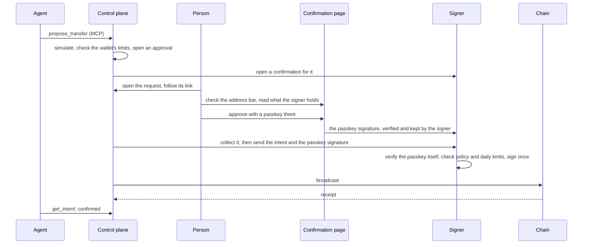

# os

Self-hosted workspaces where AI agents can hold and spend money without being trusted with it.

An agent proposes a payment. A person reads it on the signer's own confirmation page and approves
it there with a passkey. A separate signer service, the only component that can reach the wallet
keys, checks that passkey approval itself, checks the wallet's limits, and signs exactly one
transaction. For routine payments, people can instead approve once, in advance, a mandate: one
agent may pay listed recipients from one wallet up to stated amounts until a stated time, and the
signer enforces it. Everything runs on your own machines: Postgres, a control plane, the signer, a
keyless confirmation service and a reverse proxy in one Compose file, or the signer and its
confirmation page on a host of their own. No hosted service is needed.

<p align="center">
  
</p>

A payment request in the control plane, on a phone, from the UI's development fixture. It does
not ask for a passkey: it links to the signer's confirmation page and names the host to check in
the address bar.

## Why it is built this way

- **The approval is enforced where the key is.** The signer verifies the approver's passkey
  signature over a digest of the exact operation. The web application cannot mint an approval,
  and neither can someone who can write to its database.
- **The approval is made on a page the control plane cannot change.** The signer's confirmation
  page has its own origin, and the signer builds what it shows from its own records. The signer
  accepts a passkey approval only when the browser made it there: at that origin, top-level, as a
  `webauthn.get`.
- **Approving in advance is bounded by the signer.** A mandate names one agent, one wallet, the
  recipients, caps per payment, per window and in total, a number of payments and an end time.
  People approve it once, on the confirmation page; the signer then signs each payment that fits
  with no person asked, counts it itself, and sends everything else to the inbox. Anyone who
  approves can revoke it with one click.
- **What people and agents type about an operation is ciphertext at rest.** Workflow state is
  encrypted through our own storage backend for the Workflow SDK (the upstream Postgres backend
  stores it in plaintext), and the application's own content columns are sealed per workspace.
- **Bring your own agent.** An agent is any program that speaks MCP: Claude Code, Codex, a
  script. It gets eight tools. None of them signs, approves or administers.

## How one payment happens



## Run it

You need Docker with Compose v2.

```bash
git clone https://github.com/askgina/os.git && cd os
docker compose --profile dev up --build
```

The `dev` profile adds a local test chain, so there is something to send transactions to.

1. Get a setup token: `docker compose exec server node apps/server/src/cli.ts setup-token`.
2. Open <http://localhost:8080>, enter the token and create your passkey.
3. Create a workspace and add an agent. The agent gets its own wallet, and its token is shown once.
4. Set the wallet's limits and approve them with your passkey. A wallet with no limits signs nothing.
5. Give the wallet some test coins. The agent's page shows its wallet's full address; copy it, then:

   ```bash
   docker compose --profile dev exec anvil cast rpc anvil_setBalance <wallet address> 0xde0b6b3a7640000
   ```

6. Let the example agent propose a payment:

   ```bash
   docker compose --profile dev run --rm \
     -e AGENT_TOKEN=<the agent's token> \
     -e TRANSFER_TO=0x00000000000000000000000000000000000a11ce \
     scripted-agent
   ```

7. The proposal appears in the approval inbox. Open it and follow "Review and approve on the
   signer's page". The signer's confirmation page opens on <http://localhost:8081>: check that
   your address bar shows that address, read the payment as the signer holds it, and approve it
   there with your passkey. Back in the approval inbox, watch the agent report `confirmed`.

Passkeys work on `http://localhost` and on HTTPS. To serve a real host name with certificates,
see [`deploy/README.md`](deploy/README.md); the confirmation page then needs its own origin,
`APPROVE_ORIGIN`, on a subdomain or another port.

## Connect your own agent

Any MCP client that supports Streamable HTTP with a bearer token works:

```json
{
  "mcpServers": {
    "os": {
      "url": "http://localhost:8080/mcp",
      "headers": { "Authorization": "Bearer <the agent's token>" }
    }
  }
}
```

The tools are `whoami`, `get_balances`, `propose_transfer`, `propose_contract_call`,
`propose_order`, `get_intent`, `list_intents` and `cancel_intent`. `whoami` lists the agent's
live mandates with what is left of them, and the venue markets its wallet may trade. A propose
tool answers with `authorizedBy`: `"mandate"` when a mandate covers the proposal (it is signed
and sent with no person asked, and has no `approvalUrl`), or
`"person"` when someone must approve it at `approvalUrl`. `propose_transfer` takes an optional
`mandateId` to use exactly that mandate, or be refused with the reason. `get_intent` shows every
attempt of a sent payment and why it is not mined yet; no tool lets an agent speed one up or
cancel it. `propose_order` proposes a limit order on Hyperliquid's testnet (see below); a person
always approves it, and `cancel_intent` also cancels the agent's own order at the venue.
[`examples/scripted-agent`](examples/scripted-agent)
is the smallest complete agent. [`examples/eve-agent`](examples/eve-agent) is a real agent
runtime (vercel/eve, no Vercel service) that keeps its conversations encrypted in its own
database. Bots of the private Busy fork `askgina/busy` connect the same way, one agent token per
bot; their payments are not yet proven end to end (see the threat model).

## Approve in advance with a mandate

An owner asks for a mandate for one agent's wallet: the recipients, the caps per payment, per
window (for example an hour or a day) and in total, how many payments, the fee per payment, the
end time (seven days at most by default) and a purpose. Approvers approve it on the signer's
confirmation page at the workspace's admin threshold; the page shows the most that can leave the
wallet. From then on each payment of that agent that fits is signed with no passkey; anything
else waits in the inbox. Every payment counts, also one the network never includes.

Any owner or approver revokes a mandate with one click, without a passkey. It also ends when a
passkey that granted it is removed, when its agent is disabled, at its end time, after a restore
of the signer, and when the operator revokes it on the signer host
(`node src/admin.ts revoke-mandate`, see [`deploy/README.md`](deploy/README.md#mandates)).

## Be told when a request waits

Set `NOTIFY_WEBHOOK_URL` in `.env` and the server posts to it whenever a request waits for people
and whenever a mandate pays: identifiers, the kind of request, its expiry and a link to its page,
signed with a secret `init` creates, and retried until your receiver accepts it. Never an amount,
a recipient or a memo, and the link is no capability: opening it needs a passkey sign-in, and
approving still happens on the confirmation page.
[`examples/ntfy-sidecar`](examples/ntfy-sidecar) turns it into a phone notification through
[ntfy](https://ntfy.sh); other channels are built the same way, so the control plane holds no chat
or push provider's credential. The format and how to verify it are in
[`deploy/README.md`](deploy/README.md#notifications).

To notify people's own phones and browsers directly, serve the stack over HTTPS and set
`WEB_PUSH_ENABLED=1`; each person then turns notifications on per device, and the messages are
encrypted for the device and never show an amount or a recipient
([`deploy/README.md`](deploy/README.md#web-push)).

## When a payment is stuck

A sent payment that the chain does not mine keeps its nonce, and the wallet's later payments wait
behind it. The server signs it again with a higher fee by itself (after `REPRICE_AFTER_SECONDS`,
three minutes by default), and an owner or approver can press "Speed up" at once, without a
passkey. Only the two fee fields change, inside the fee ceiling people approved: never the
recipient, the amount or the nonce, so at most one of its attempts can be mined. People can also
cancel it: a request they approve with passkeys on the confirmation page, after which the signer
signs a transfer of nothing from the wallet to itself at the same nonce. A cancel is an attempt:
if the chain mines the payment first, the payment stands. Either way the payment counts toward
the wallet's daily limit. The settings and what they cannot do are in
[`deploy/README.md`](deploy/README.md#stuck-transactions).

## Trade on Hyperliquid's testnet

With `VENUES_FILE` set, an agent can propose a limit order on a Hyperliquid perpetual market,
and a withdrawal of USDC from the wallet's Hyperliquid account to the wallet's own address. A
person approves each on the confirmation page, which shows the market, side, size, limit price,
notional, time in force, reduce-only and the submit window; no mandate covers an order. The
signer encodes and signs the order itself, once per approval, inside the wallet's markets and
notional caps, and the server posts it to the venue and follows it. The agent, or any owner or
approver, can cancel that order with no passkey, also while the workspace is paused.

Limits: testnet only. The signer signs nothing for mainnet, and the server does not start with a
mainnet venue configured; turning mainnet on is the owner's open decision. The notional caps limit new
orders, not losses: what can be lost is the account's value at the venue. The signer never sees
the venue, so fills, positions and the account's value are the venue's report. The encoder's
signatures match the venue SDK's own vectors; everything else is unit-tested, with the
real-stack gate pending, and nothing has run against the real testnet
([`deploy/README.md`](deploy/README.md#venue-orders-hyperliquid-testnet)).

## Retire a wallet or delete a workspace

An owner can retire a wallet, or delete a paused workspace with all its wallets. People approve
it on the confirmation page with passkeys at the workspace's admin threshold; the page lists the
wallets and the time the signer destroys their keys, seven days later at the least by default
(`SIGNER_MIN_DESTROY_DELAY_SECONDS`). From that approval the wallets sign nothing and their
mandates end. Until the destroy time any member can cancel a deletion, and an owner or approver
a retirement; the keys stay. Then the signer destroys the keys, and for a deleted workspace the
server shreds its data keys, so nothing it stored can be read with the live keyring, and former
members no longer see it. The signer cannot see balances: empty the wallets first with a sweep.
Backups taken before a deletion still hold everything until you destroy them; the deploy guide
says how long to keep them and to rotate the keyring after each deletion
([`deploy/README.md`](deploy/README.md#retiring-wallets-and-deleting-workspaces)).
Its ten release gates run on the full stack and passed in CI (run 43729783071, amd64 and arm64).

## Export, copy or leave

An owner can download a workspace's template (its configuration, with no key, token or
history) and its record (its whole history, readable, after a fresh passkey sign-in), and check
the record offline with `node apps/server/src/lifecycle/verify-record.ts <file>`. A workspace
can be copied, or made from a template file. The copy gets new keys, new agent tokens shown once,
invite links instead of members, and an admin threshold of 1; its limits wait for its approvers
to approve them, and no mandate is copied. A person can erase themselves: their passkeys are
first removed through requests people approve, then their name, passkeys, sessions and
notification settings are deleted. Their user id stays, so the audit logs still verify. Release
gates run all of these on the full stack
([`deploy/README.md`](deploy/README.md#exporting-and-cloning-a-workspace)).

## What this protects, and what it does not

| If this is compromised       | The attacker can                                                                                                                                                                                                                                       | The attacker cannot                                                                                                                                                                                                                   |
| ---------------------------- | ------------------------------------------------------------------------------------------------------------------------------------------------------------------------------------------------------------------------------------------------------ | ------------------------------------------------------------------------------------------------------------------------------------------------------------------------------------------------------------------------------------- |
| An agent or its token        | Propose operations; spend inside its live mandates; cancel its own venue orders                                                                                                                                                                        | Approve, sign, change limits, reach the signer; pay outside a mandate's list or caps; speed up or cancel a payment                                                                                                                    |
| The control plane's database | Read names, ids, statuses, addresses, limits                                                                                                                                                                                                           | Read sealed content; forge an approval                                                                                                                                                                                                |
| The control plane itself     | Ask the signer; show a person a misleading card; have the signer sign transfers that fit a live mandate; raise a sent payment's network fee up to the ceiling people approved; ask for a deletion and show false balances beside it; cancel a deletion | Get an approval the signer accepts; change the confirmation page; exceed limits or a mandate; reuse an approval; change a stuck payment's recipient, amount or nonce; destroy a key without passkeys or before its time; export a key |
| The confirmation service     | Show a person a misleading page                                                                                                                                                                                                                        | Sign or read a key; reach a signer route but its four; approve unaided                                                                                                                                                                |
| The signer's machine         | Everything for the wallets on it                                                                                                                                                                                                                       |                                                                                                                                                                                                                                       |

Two limits are worth knowing before you rely on this:

- A passkey proves that a person approved a digest. It does not prove they read the details.
  The confirmation page shows what the signer holds, on an origin the control plane does not
  serve, so a compromised control plane can no longer get an approval for an operation the
  person did not see there. A compromised confirmation service, or the proxy in front of it,
  could still show one operation and collect an approval for another. For a payment the signer's
  limits bound that damage; for a change of limits or approvers they do not. A new approver
  must prove on the confirmation page that they hold the passkey being added before anyone can
  approve, but whoever holds a key a compromised control plane swapped in can pass that step
  too. Only comparing the key's fingerprint with the new person, over a call or in person,
  catches that. Add a second approver and raise the admin threshold to 2.
- A live mandate is spent with no person asked. A stolen agent token, or a compromised control
  plane, can make the signer pay the mandate's recipients up to its remaining caps, choosing
  when. Grant mandates with short lives and tight caps, and revoke them when they are not needed.
- An approved venue order can lose more than its notional cap. What bounds the loss is the
  account's value at the venue, which the signer cannot see; a compromised control plane can
  also report false fills and balances.
- Deleting a workspace destroys keys whatever their wallets hold. The balances the web app shows
  come from the control plane and are partial; the signer sees none. A deletion people were
  misled into loses funds, and a compromised control plane can delay any deletion by cancelling
  it.
- Running every service on one machine gives no protection against that machine. The deploy
  guide puts the signer and its confirmation page on a host of their own; that layout is tested
  in CI with both halves on one machine, not yet on two hosts with different administrators.

The full list is in [`docs/threat-model.md`](docs/threat-model.md).

## Status

This is a first release (v0.1) and has not been audited. Use test funds.

Scope: EVM chains; native transfers, ERC-20 transfers and allowlisted contract calls; one
approval for one transaction, or a mandate for a bounded series of one agent's transfers; a
stuck transaction repriced under its approval or cancelled with passkeys, tested against a local
chain only; retiring a wallet and deleting a workspace, with keys destroyed after a delay, tested
on the full stack; exporting, copying and importing a workspace and erasing a person, tested on
the full stack; key-encryption keys in a keyring file or in OpenBao Transit, the OpenBao provider
with unit tests only; limit orders on Hyperliquid perpetual markets and withdrawals to the
wallet's own address, on Hyperliquid's testnet only, each approved with passkeys, the encoder
proven against the venue SDK's signed vectors, the rest unit-tested with the real-stack gate
pending, and never run against the real testnet.

Beyond one machine ([`deploy/README.md`](deploy/README.md#running-the-signer-on-its-own-host)):

- The signer and its confirmation page on their own host, over mutual TLS: every release gate
  passes in CI across two Compose projects (`stack (split)`, run 43735023880).
- Several server replicas on one Postgres: unit-tested in CI; the two-replica gate on the real
  stack is written and has not run.
- Kubernetes manifests (`deploy/k8s/`): written; their CI job has not run.
- HA Postgres: not built.

Not in this release: mandates for contract calls or orders, other chains and venues, Hyperliquid
mainnet, a bundled agent runtime, cloud KMS key management. The
[map of open questions](https://github.com/askgina/os/issues/1) lists what is planned and why.

## Documentation

- [`docs/architecture.md`](docs/architecture.md): the components and what each may reach.
- [`docs/approval-protocol.md`](docs/approval-protocol.md): the exact formats, digests and checks.
- [`docs/threat-model.md`](docs/threat-model.md): every attacker position and the known limits.
- [`deploy/README.md`](deploy/README.md): services, networks, volumes, the confirmation page's
  origin, backups, key rotation and key providers, retiring wallets and deleting workspaces,
  exporting and cloning, erasing a person.
- [`CONTRIBUTING.md`](CONTRIBUTING.md) and [`SECURITY.md`](SECURITY.md).
- [`THIRD_PARTY.md`](THIRD_PARTY.md): dependencies whose licence is not MIT or Apache-2.0.

## Development

```bash
bun install
bun run services:up     # Postgres and a local chain for the tests
bun run check && bun run typecheck && bun run test
bun run services:down
```

Bun 1.4.4 and Node 26 are required. The repository layout is described in
[`CONTRIBUTING.md`](CONTRIBUTING.md).

## Licence

[MIT](LICENSE)
