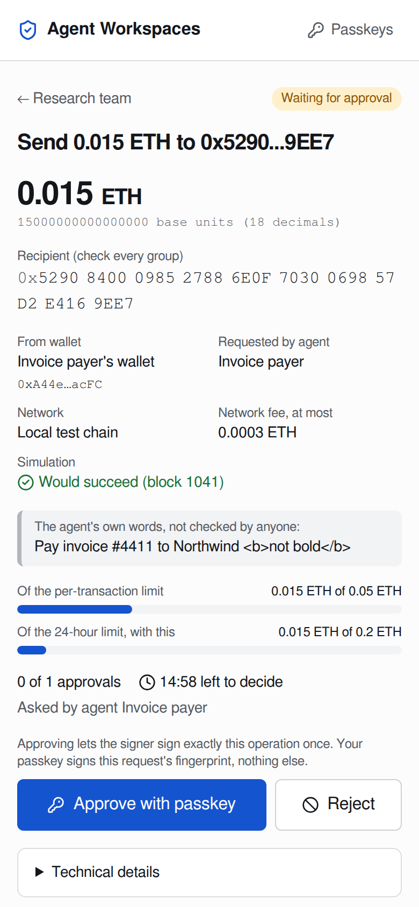
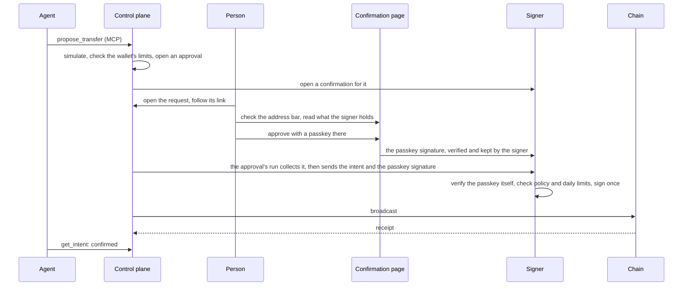

# os

Self-hosted workspaces where AI agents can propose payments and trades from wallets they cannot
spend from alone.

An agent proposes an operation over MCP (Model Context Protocol). A person reads it on a
confirmation page that the signer's side serves, and approves it there with a passkey. A separate
signer service, the only component that holds the wallet keys, checks that passkey approval and
the wallet's limits itself, then signs exactly what was approved, once. The control plane that
people and agents talk to is treated as something that could be compromised: it can ask the
signer, but it cannot make the signer sign anything people did not approve.

- **Who it is for:** people who run their own servers and want an AI agent to pay or trade under
  limits, with a person approving each operation, or approving a bounded series of payments in
  advance.
- **What it is not:** a hosted service, an AI agent or agent runtime (you bring any MCP client), or
  audited software.
- **Status:** first release (v0.1), not audited. Use test funds. EVM chains, and limit orders on
  Hyperliquid perpetual markets. [Status](#status) lists what is proven in CI, what was proven
  once by hand, and what is unproven.

<p align="center">
  
</p>

A payment request in the control plane's web app, on a phone, from the UI's development fixture.
It does not ask for a passkey: it links to the signer's confirmation page and names the host to
check in the address bar.

## The parts

| Part                 | Directory                   | What it does                                                                                                         | Holds wallet keys |
| -------------------- | --------------------------- | -------------------------------------------------------------------------------------------------------------------- | ----------------- |
| Control plane        | `apps/server`, `apps/web`   | People, workspaces, agents, approvals, the MCP gateway for agents, durable runs, and the web app people use.         | No                |
| Signer               | `apps/signer`               | Holds the wallet keys, each wallet's policy, the approvers' passkeys and the mandates. Verifies approvals and signs. | Yes               |
| Confirmation service | `apps/approve`              | Serves the confirmation page on its own origin (`APPROVE_ORIGIN`) and relays its requests to the signer.             | No                |
| Reverse proxy        | `deploy/Caddyfile*` (Caddy) | Publishes the web app, the confirmation page, and an MCP entry for agents.                                           | No                |
| Database             | Postgres                    | The control plane's state. Workflow state and the content people and agents type are stored encrypted.               | No                |

Everything runs on your own machines: in one Compose file, or with the signer and its
confirmation page on a host of their own. No hosted service is needed. The words used here
(workspace, wallet, intent, policy, mandate, envelope and others) are defined in
[`docs/architecture.md`](docs/architecture.md#words-used-on-this-page).

## Why it is built this way

- **The approval is enforced where the key is.** The signer verifies the approver's passkey
  signature over a digest of the exact operation. The web app cannot mint an approval, and
  neither can someone who can write to its database.
- **The approval is made on a page the control plane cannot change.** The signer's confirmation
  page has its own origin, and the signer builds what it shows from its own records. The signer
  accepts a passkey approval only when the browser made it there: at that origin, top-level, as a
  `webauthn.get`.
- **Approving in advance is bounded by the signer.** A mandate names one agent, one wallet, the
  recipients, caps per payment, per window and in total, a number of payments and an end time.
  People approve it once, on the confirmation page. The signer then signs each payment that fits
  with no person asked, counts it itself, and sends everything else to the inbox. Anyone who
  approves can revoke it with one click.
- **What people and agents type about an operation is ciphertext at rest.** The control plane
  runs its multi-step work on the Workflow SDK (the `workflow` package). Its state is encrypted
  through our own storage backend for that SDK, `packages/world` (the upstream Postgres backend
  stores it in plaintext). The application's own content columns are sealed per workspace.
- **Bring your own agent.** An agent is any program that speaks MCP: Claude Code, Codex, a
  script. Its tools read, propose, and cancel its own requests. None of them signs, approves or
  administers.

## How one payment happens



The approval's run asks the signer for the decision by itself, so the person does not need to
come back to the control plane after approving.

## Run it

You need Docker with Compose v2, and a browser that can create passkeys.

```bash
git clone https://github.com/askgina/os.git && cd os
docker compose --profile dev up --build
```

The first start builds the server, signer and confirmation-service images. The `dev` profile adds
a local test chain (Anvil, chain id `eip155:31337`), so there is something to send transactions
to. Settings have working defaults; [`.env.example`](.env.example) lists them.

1. In a second terminal, get a setup token:

   ```bash
   docker compose exec server node apps/server/src/cli.ts setup-token
   ```

   It prints one JSON line with `setupToken`. Each run replaces the token, and the server never
   writes it to its log.

2. Open <http://localhost:8080>, enter the token and create your passkey. You are the first owner.
3. Create a workspace and add an agent. The agent gets its own wallet. Copy the agent's token:
   it is shown once.
4. Set the wallet's limits. The request links to the signer's confirmation page on
   <http://localhost:8081>; approve the limits there with your passkey. A wallet with no approved
   limits signs nothing.
5. Give the wallet some test coins. The agent's page shows its wallet's full address. Copy it,
   then send it 1 test ETH:

   ```bash
   docker compose --profile dev exec anvil cast rpc anvil_setBalance <wallet address> 0xde0b6b3a7640000
   ```

6. Let the example agent propose a payment of 0.001 test ETH (`AMOUNT`, `CHAIN_ID` and `MEMO`
   change it):

   ```bash
   docker compose run --rm \
     -e AGENT_TOKEN=<the agent's token> \
     -e TRANSFER_TO=0x00000000000000000000000000000000000a11ce \
     scripted-agent
   ```

7. The proposal appears in the approval inbox. Open it and follow "Review and approve on the
   signer's page". The confirmation page opens on <http://localhost:8081>: check that your address
   bar shows that address, read the payment as the signer holds it, and approve it there with your
   passkey. The agent's terminal then prints `status: confirmed` and the transaction.

A person ran these steps by hand. CI runs the same journey on every push against freshly built
images, with a virtual passkey (`e2e/test/browser.spec.ts`), and runs the example agent through
`docker compose run` (`e2e/test/release-gates.spec.ts`).

Passkeys work on `http://localhost` and on HTTPS. To serve a real host name with certificates,
see [`deploy/README.md`](deploy/README.md); the confirmation page then needs its own origin,
`APPROVE_ORIGIN`, on a subdomain or another port. To stop the stack, and to know what
`docker compose down -v` deletes (every wallet key with it), read the same guide first.

## Connect your own agent

Any MCP client that supports Streamable HTTP with a bearer token works:

```json
{
  "mcpServers": {
    "os": {
      "url": "http://localhost:8080/mcp",
      "headers": { "Authorization": "Bearer <the agent's token>" }
    }
  }
}
```

### Or pair it, with no token to copy

An agent that runs next to a person can ask to be connected instead:

1. It sends `POST /agent-pairing` with `{"clientName": "…"}` and gets a short code, a link
   (`/pair/<id>`), a poll secret and an expiry ten minutes away.
2. It shows the person the code and opens the link. Signed in, the person checks that the two
   codes match, picks a workspace they own and allows it.
3. It polls `POST /agent-pairing/poll` with the id and the poll secret. The first answer after
   the person allows it carries the token and the MCP address, once; later polls answer `claimed`.

Allowing always creates a new agent with its own new wallet, which has no limits and can sign
nothing until an owner sets them. No token is stored: the agent's token is minted when its poll
collects it. Agent containers on the `agents` network cannot start a pairing: their gateway
forwards `/mcp` only. CI covers this in the server tests
([`apps/server/test/directory/pairing.test.ts`](apps/server/test/directory/pairing.test.ts)), in
a release gate through the public proxy
([`e2e/test/release-gates.spec.ts`](e2e/test/release-gates.spec.ts)) and, for the page, in the
web journey against the fixture server
([`apps/web/test/journey.e2e.ts`](apps/web/test/journey.e2e.ts)).

The tools are `whoami`, `get_balances`, `propose_transfer`, `propose_contract_call`,
`propose_order`, `get_intent`, `list_intents` and `cancel_intent` (the list in code is
`MCP_TOOL_NAMES` in [`apps/server/src/mcp/gateway.ts`](apps/server/src/mcp/gateway.ts)).

- `whoami` lists the agent's live mandates, with what is left of them, and the venue markets its
  wallet may trade.
- A propose tool answers with `authorizedBy`: `"mandate"` when a mandate covers the proposal (it
  is signed and sent with no person asked, and has no `approvalUrl`), or `"person"` when someone
  must approve it at `approvalUrl`.
- `propose_transfer` takes an optional `mandateId` to use exactly that mandate, or be refused with
  the reason. With a Hyperliquid network as `chainId`, it proposes a withdrawal of USDC from the
  wallet's venue account to the wallet's own address.
- `get_intent` shows every attempt of a sent payment and why it is not mined yet. No tool lets an
  agent speed a payment up or cancel it.
- `propose_order` proposes a limit order on Hyperliquid (see below). A person always approves it,
  and `cancel_intent` also cancels the agent's own order at the venue.

Examples:

- [`examples/scripted-agent`](examples/scripted-agent) is the smallest complete agent, with no
  model in it.
- [`examples/eve-agent`](examples/eve-agent) runs an agent framework,
  [eve](https://github.com/vercel/eve), with no Vercel service, and keeps its conversations
  encrypted in its own database.
- `askgina/busy`, a separate repository (private for now) that runs a fork of
  [Busy](https://github.com/MatiSolina/busy), a host for AI chat bots, without Vercel services,
  connects its bots the same way, one agent token per bot. A payment that a bot's model chose
  settled once, by hand, on a local chain; it is not a CI gate.

## Approve in advance with a mandate

An owner asks for a mandate for one agent's wallet: the recipients; the caps per payment, per
window (for example an hour or a day) and in total; how many payments; the fee per payment; the
end time (seven days at most by default, `MANDATE_MAX_SECONDS`); and a purpose. Approvers approve
it on the confirmation page at the workspace's admin threshold, the number of approvers the
workspace requires for changes such as limits, approvers and mandates. The page shows the most
that can leave the wallet. From then on, each payment of that agent that fits is signed with no
passkey; anything else waits in the inbox. Every payment counts, also one the network never
includes.

Any owner or approver revokes a mandate with one click, without a passkey. A mandate also ends
when a passkey that granted it is removed, when its agent is disabled, at its end time, after a
restore of the signer, and when the operator revokes it on the signer host
(`node src/admin.ts revoke-mandate`; see [`deploy/README.md`](deploy/README.md#mandates)).

## Be told when a request waits

Set `NOTIFY_WEBHOOK_URL` in `.env`, and the server posts to it whenever a request waits for people
and whenever a mandate pays. Each post carries identifiers, the kind of request, its expiry and a
link to its page, and is signed with a secret that the `init` service creates. It never carries
an amount, a recipient or a memo. The link is not a capability: opening it needs a passkey
sign-in, and approving still happens on the confirmation page. A delivery is retried with growing
delays while the receiver is busy or failing, and given up after a fixed number of attempts.
[`examples/ntfy-sidecar`](examples/ntfy-sidecar) turns it into a phone notification through
[ntfy](https://ntfy.sh). Other channels are built the same way, so the control plane holds no
chat or push provider's credential. The format, the retries and how to verify a request are in
[`deploy/README.md`](deploy/README.md#notifications).

To notify people's own phones and browsers directly, serve the stack over HTTPS and set
`WEB_PUSH_ENABLED=1`. Each person then turns notifications on per device. The messages are
encrypted for the device and never show an amount or a recipient
([`deploy/README.md`](deploy/README.md#web-push)).

## When a payment is stuck

A sent payment that the chain does not mine keeps its nonce, and the wallet's later payments wait
behind it. The server signs it again with a higher fee by itself (after `REPRICE_AFTER_SECONDS`,
three minutes by default), and an owner or approver can press "Speed up" at once, without a
passkey. Only the two fee fields change, inside the fee ceiling people approved: never the
recipient, the amount or the nonce, so at most one of its attempts can be mined.

People can also cancel it: a request they approve with passkeys on the confirmation page, after
which the signer signs a transfer of nothing from the wallet to itself at the same nonce. A cancel
is an attempt: if the chain mines the payment first, the payment stands. Either way the payment
counts toward the wallet's daily limit. The settings and what they cannot do are in
[`deploy/README.md`](deploy/README.md#stuck-transactions).

## Trade on Hyperliquid

Hyperliquid's testnet and mainnet are both supported. A venue is on only when the operator lists
it in `VENUES_FILE` and people approve, with passkeys, wallet rules that name that network; there
is no other switch. The signer signs for the network the wallet's approved rules name, and refuses
an order for any other.

With that done, an agent can propose a limit order on a Hyperliquid perpetual market, and a
withdrawal of USDC from the wallet's Hyperliquid account to the wallet's own address. A person
approves each on the confirmation page, which shows the market, side, size, limit price,
notional, time in force, reduce-only and the submit window. No mandate covers an order. The
signer encodes and signs the order itself, once per approval, inside the wallet's markets and
notional caps, and the server posts it to the venue and follows it. The agent, or any owner or
approver, can cancel that order with no passkey, also while the workspace is paused.

Limits: on mainnet, orders and withdrawals move real funds. What bounds them is the same on both
networks: a passkey approval of every order on the confirmation page, the markets in the wallet's
rules, the per-order and per-day notional caps, and the submit window. The notional caps limit new
orders, not losses: what can be lost is the account's value at the venue. The signer never talks
to the venue, so fills, positions and the account's value are what the venue reports through the
control plane. See [`deploy/README.md`](deploy/README.md#venue-orders-hyperliquid) to set it up,
and [Status](#status) for what is proven.

## Retire a wallet or delete a workspace

An owner can retire a wallet, or delete a paused workspace with all its wallets. People approve
it on the confirmation page with passkeys at the workspace's admin threshold. The page lists the
wallets and the time the signer destroys their keys: by default seven days later at the earliest
(`SIGNER_MIN_DESTROY_DELAY_SECONDS`). From that approval the wallets sign nothing and their
mandates end. Until the destroy time, any member can cancel a deletion, and an owner or approver
can cancel a retirement; the keys stay.

Then the signer destroys the keys. For a deleted workspace the server also shreds its data keys,
so nothing it stored can be read with the live keyring, and former members no longer see it. The
signer cannot see balances: empty the wallets first with a sweep. Backups taken before a deletion
still hold everything until you destroy them; the deploy guide says how long to keep them and to
rotate the keyring after each deletion
([`deploy/README.md`](deploy/README.md#retiring-wallets-and-deleting-workspaces)).

## Export, copy or leave

An owner can download a workspace's template (its configuration, with no key, token or history)
and its record (its whole history, readable, after a fresh passkey sign-in). Anyone can check a
record offline from a checkout of this repository, after `bun install`, with
`node apps/server/src/lifecycle/verify-record.ts <file>`.

A workspace can be copied, or made from a template file. The copy gets new keys, new agent tokens
shown once, invite links instead of members, and an admin threshold of 1. Its limits wait for its
approvers to approve them, and no mandate is copied.

A person can erase themselves: their passkeys are first removed through requests people approve,
then their name, passkeys, sessions and notification settings are deleted. Their user id stays, so
the audit logs still verify. The operator can erase a person who cannot sign in
([`deploy/README.md`](deploy/README.md#erasing-a-person)).

## What this protects, and what it does not

| If this is compromised       | The attacker can                                                                                                                                                                                                                                       | The attacker cannot                                                                                                                                                                                                                   |
| ---------------------------- | ------------------------------------------------------------------------------------------------------------------------------------------------------------------------------------------------------------------------------------------------------ | ------------------------------------------------------------------------------------------------------------------------------------------------------------------------------------------------------------------------------------- |
| An agent or its token        | Propose operations; spend inside its live mandates; cancel its own venue orders                                                                                                                                                                        | Approve, sign, change limits, reach the signer; pay outside a mandate's list or caps; speed up or cancel a payment                                                                                                                    |
| The control plane's database | Read names, ids, statuses, addresses, limits                                                                                                                                                                                                           | Read sealed content; forge an approval                                                                                                                                                                                                |
| The control plane itself     | Ask the signer; show a person a misleading card; have the signer sign transfers that fit a live mandate; raise a sent payment's network fee up to the ceiling people approved; ask for a deletion and show false balances beside it; cancel a deletion | Get an approval the signer accepts; change the confirmation page; exceed limits or a mandate; reuse an approval; change a stuck payment's recipient, amount or nonce; destroy a key without passkeys or before its time; export a key |
| The confirmation service     | Show a person a misleading page                                                                                                                                                                                                                        | Sign or read a key; reach any signer route but the confirmation routes; approve unaided                                                                                                                                               |
| The signer's machine         | Everything for the wallets on it                                                                                                                                                                                                                       | Nothing on it is protected                                                                                                                                                                                                            |

Limits worth knowing before you rely on this:

- A passkey proves that a person approved a digest. It does not prove they read the details.
  The confirmation page shows what the signer holds, on an origin the control plane does not
  serve, so a compromised control plane cannot get an approval for an operation the person did
  not see there. A compromised confirmation service, or the proxy in front of it, could still
  show one operation and collect an approval for another. For a payment the signer's limits bound
  that damage; for a change of limits or approvers they do not.
- A new approver must prove on the confirmation page that they hold the passkey being added
  before anyone can approve the change. Whoever holds a key that a compromised control plane
  swapped in can pass that step too. Only comparing the key's fingerprint with the new person,
  over a call or in person, catches that. Add a second approver and raise the admin threshold
  to 2.
- A live mandate is spent with no person asked. A stolen agent token, or a compromised control
  plane, can make the signer pay the mandate's recipients up to its remaining caps, choosing
  when. Grant mandates with short lives and tight caps, and revoke them when they are not needed.
- An approved venue order can lose more than its notional cap. What bounds the loss is the
  account's value at the venue, which the signer cannot see. A compromised control plane can also
  report false fills and balances.
- Deleting a workspace destroys keys whatever their wallets hold. The balances the web app shows
  come from the control plane and are partial; the signer sees none. A deletion people were
  misled into loses funds, and a compromised control plane can delay any deletion by cancelling
  it.
- Running every service on one machine gives no protection against that machine. The deploy
  guide puts the signer and its confirmation page on a host of their own; CI tests that layout
  with both halves on one machine, not on two hosts with different administrators.

The full list is in [`docs/threat-model.md`](docs/threat-model.md).

## Status

This is a first release (v0.1). It has not been audited. Use test funds.

"CI" below means the `ci` workflow ([`.github/workflows/ci.yml`](.github/workflows/ci.yml)),
which runs every job on every push to `main` and on every pull request. Release gates are the
end-to-end tests in [`e2e/test/`](e2e/test) that run against the whole stack built from this
repository ([`e2e/README.md`](e2e/README.md)).

| Capability                                                              | Evidence                                                                                                                                                                                  |
| ----------------------------------------------------------------------- | ----------------------------------------------------------------------------------------------------------------------------------------------------------------------------------------- |
| Native-coin transfers on EVM chains, one passkey approval for each      | CI: release gates and the browser gate (`release-gates.spec.ts`, `browser.spec.ts`) in jobs `stack (amd64)` and `stack (arm64)`, against a local chain. By hand: a synced phone passkey.  |
| ERC-20 transfers and allowlisted contract calls                         | CI: server tests against a local chain (`apps/server/test/execution/engine.test.ts`) and signer unit tests. The release gates check that a contract call waits for an approval.           |
| The confirmation page over HTTPS                                        | CI: the browser gate in job `stack (tls)`, with Caddy's local certificate authority. Unproven: a certificate from a public authority.                                                     |
| Adding an approver, with proof of possession of the new passkey         | CI: `browser.spec.ts`, `release-gates.spec.ts`.                                                                                                                                           |
| Mandates for one agent's transfers                                      | CI: release gates and the browser gate.                                                                                                                                                   |
| Repricing or cancelling a stuck transaction                             | CI: release gates, against a local chain only.                                                                                                                                            |
| Webhook notifications                                                   | CI: unit tests (`apps/server/test/notify/`) and release gates.                                                                                                                            |
| Web Push notifications                                                  | CI: unit tests, and the service worker under the production Content-Security-Policy. By hand: a push on a real phone opened the approval.                                                 |
| Retiring a wallet, deleting a workspace, keys destroyed after a delay   | CI: `lifecycle.spec.ts` in jobs `stack (amd64)` and `stack (arm64)`.                                                                                                                      |
| Exporting, copying and importing a workspace; erasing a person          | CI: `lifecycle.spec.ts` in jobs `stack (amd64)` and `stack (arm64)`.                                                                                                                      |
| Hyperliquid limit orders and USDC withdrawals, testnet and mainnet      | CI: the encoder against the venue SDK's signed vectors (`apps/signer/test/`), release gates against a fake venue in both modes (`venue.spec.ts`). Unproven: the real testnet; real funds. |
| The signer and its confirmation page on their own host, over mutual TLS | CI: job `stack (split)` (`split.spec.ts`, then every release gate) with both halves on one machine. Unproven: two hosts with different administrators.                                    |
| Key-encryption keys in OpenBao Transit instead of a keyring file        | CI: job `stack (openbao)` (`openbao.spec.ts`, then every release gate), and the World's ciphertext test on both providers in job `test`.                                                  |
| Two server replicas on one Postgres                                     | CI: job `stack (replicas)` (`replicas.spec.ts`, then every release gate).                                                                                                                 |
| Kubernetes (Kustomize manifests in `deploy/k8s/`)                       | CI: job `k8s`, on a throwaway kind cluster (`kubernetes.spec.ts`). Unproven: any other cluster.                                                                                           |
| Highly available Postgres (CloudNativePG, three instances)              | CI: job `k8s-ha`, on kind; the primary is deleted during a payment (`kubernetes-ha.spec.ts`).                                                                                             |
| A hardware security key as the passkey                                  | Unproven.                                                                                                                                                                                 |

Not in this release: mandates for contract calls or orders, other chains and venues, a bundled
agent runtime, cloud KMS key management. Open design questions and what is planned are tracked
as GitHub issues in this repository, starting from
[issue 1](https://github.com/askgina/os/issues/1); the plans themselves are in
[`specs/`](specs/README.md).

## Where to read next

- [`docs/architecture.md`](docs/architecture.md): the components, what each may reach, and the
  words used everywhere.
- [`docs/approval-protocol.md`](docs/approval-protocol.md): the exact formats, digests and checks.
- [`docs/threat-model.md`](docs/threat-model.md): every attacker position and the known limits.
- [`deploy/README.md`](deploy/README.md): running it for real: HTTPS, the confirmation page's
  origin, backups, key rotation and key providers, the signer on its own host, replicas,
  Kubernetes, notifications, retiring wallets and deleting workspaces, exporting, erasing a
  person.
- Each app, package and example has its own README: [`apps/server`](apps/server/README.md),
  [`apps/web`](apps/web/README.md), [`apps/signer`](apps/signer/README.md),
  [`apps/approve`](apps/approve/README.md), [`packages/protocol`](packages/protocol/README.md),
  [`packages/api`](packages/api/README.md), [`packages/keys`](packages/keys/README.md),
  [`packages/world`](packages/world/README.md), [`packages/testkit`](packages/testkit/README.md),
  [`e2e`](e2e/README.md), and the three under [`examples/`](examples).
- [`specs/README.md`](specs/README.md): the plans and research behind each feature.
- [`CONTRIBUTING.md`](CONTRIBUTING.md) and [`SECURITY.md`](SECURITY.md).
- [`THIRD_PARTY.md`](THIRD_PARTY.md): dependencies whose licence is not MIT or Apache-2.0.

## Development

You need Bun 1.4.4 and Node.js 26.

```bash
bun install
bun run check          # Biome: formatting and lint, Markdown included
bun run lint:slop      # Oxlint with the anti-slop rules
bun run typecheck      # TypeScript in every workspace
```

Run one test file at a time locally; CI builds the images and runs the whole suite.
[`CONTRIBUTING.md`](CONTRIBUTING.md) says how, and describes the repository layout.

## Licence

[MIT](LICENSE)
