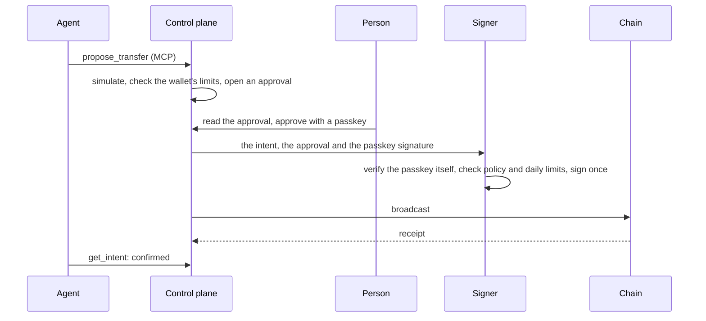

# os

Self-hosted workspaces where AI agents can hold and spend money without being trusted with it.

An agent proposes a payment. A person approves it with a passkey. A separate signer service,
the only component that can reach the wallet keys, checks that passkey approval itself, checks the
wallet's limits, and signs exactly one transaction. Everything runs on your own machine: Postgres,
a control plane, the signer and a reverse proxy in one Compose file. No hosted service is needed.

<p align="center">
  
</p>

The approval page, on a phone, from the UI's development fixture.

## Why it is built this way

- **The approval is enforced where the key is.** The signer verifies the approver's passkey
  signature over a digest of the exact operation. The web application cannot mint an approval,
  and neither can someone who can write to its database.
- **What people and agents type about an operation is ciphertext at rest.** Workflow state is
  encrypted through our own storage backend for the Workflow SDK (the upstream Postgres backend
  stores it in plaintext), and the application's own content columns are sealed per workspace.
- **Bring your own agent.** An agent is any program that speaks MCP: Claude Code, Codex, a
  script. It gets seven tools. None of them signs, approves or administers.

## How one payment happens



## Run it

You need Docker with Compose v2.

```bash
git clone https://github.com/askgina/os.git && cd os
docker compose --profile dev up --build
```

The `dev` profile adds a local test chain, so there is something to send transactions to.

1. Find the setup token: `docker compose logs server | grep "setup token" | tail -1`.
2. Open <http://localhost:8080>, enter the token and create your passkey.
3. Create a workspace and add an agent. The agent gets its own wallet, and its token is shown once.
4. Set the wallet's limits and approve them with your passkey. A wallet with no limits signs nothing.
5. Give the wallet some test coins. Copy the wallet's address from its page, then:

   ```bash
   docker compose --profile dev exec anvil cast rpc anvil_setBalance <wallet address> 0xde0b6b3a7640000
   ```

6. Let the example agent propose a payment:

   ```bash
   docker compose --profile dev run --rm \
     -e AGENT_TOKEN=<the agent's token> \
     -e TRANSFER_TO=0x00000000000000000000000000000000000a11ce \
     scripted-agent
   ```

7. The proposal appears in the approval inbox. Approve it with your passkey and watch the agent
   report `confirmed`.

Passkeys work on `http://localhost` and on HTTPS. To serve a real host name with certificates,
see [`deploy/README.md`](deploy/README.md).

## Connect your own agent

Any MCP client that supports Streamable HTTP with a bearer token works:

```json
{
  "mcpServers": {
    "os": {
      "url": "http://localhost:8080/mcp",
      "headers": { "Authorization": "Bearer <the agent's token>" }
    }
  }
}
```

The tools are `whoami`, `get_balances`, `propose_transfer`, `propose_contract_call`,
`get_intent`, `list_intents` and `cancel_intent`. [`examples/scripted-agent`](examples/scripted-agent)
is the smallest complete agent.

## What this protects, and what it does not

| If this is compromised       | The attacker can                                | The attacker cannot                                                        |
| ---------------------------- | ----------------------------------------------- | -------------------------------------------------------------------------- |
| An agent or its token        | Propose operations                              | Approve, sign, change limits, reach the signer                             |
| The control plane's database | Read names, ids, statuses, addresses, limits    | Read sealed content; forge an approval                                     |
| The control plane itself     | Ask the signer; show a person a misleading card | Produce a passkey signature; exceed the signer's limits; reuse an approval |
| The signer's machine         | Everything for the wallets on it                |                                                                            |

Two limits are worth knowing before you rely on this:

- A passkey proves that a person approved a digest. It does not prove they saw the right details.
  A compromised control plane could show one operation and submit another. The signer's limits
  bound the damage.
- Running every service on one machine gives no protection against that machine.

The full list is in [`docs/threat-model.md`](docs/threat-model.md).

## Status

This is a first release (v0.1) and has not been audited. Use test funds.

Scope: EVM chains; native transfers, ERC-20 transfers and allowlisted contract calls; one
approval for one transaction. Not in this release: approvals that cover more than one action,
other chains, a bundled agent runtime, cloud key management, push notifications. The
[map of open questions](https://github.com/askgina/os/issues/1) lists what is planned and why.

## Documentation

- [`docs/architecture.md`](docs/architecture.md): the components and what each may reach.
- [`docs/approval-protocol.md`](docs/approval-protocol.md): the exact formats, digests and checks.
- [`docs/threat-model.md`](docs/threat-model.md): every attacker position and the known limits.
- [`deploy/README.md`](deploy/README.md): services, networks, volumes, backups, key rotation.
- [`CONTRIBUTING.md`](CONTRIBUTING.md) and [`SECURITY.md`](SECURITY.md).
- [`THIRD_PARTY.md`](THIRD_PARTY.md): dependencies whose licence is not MIT or Apache-2.0.

## Development

```bash
bun install
bun run services:up     # Postgres and a local chain for the tests
bun run check && bun run typecheck && bun run test
bun run services:down
```

Bun 1.4.4 and Node 26 are required. The repository layout is described in
[`CONTRIBUTING.md`](CONTRIBUTING.md).

## Licence

[MIT](LICENSE)
