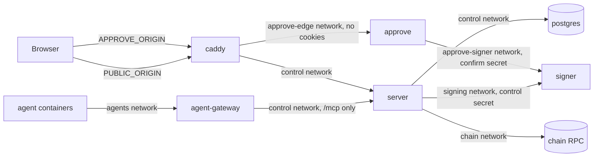

# Running the stack

From a fresh clone:

    cp .env.example .env              # optional; the defaults run on http://localhost:8080
    docker compose --profile dev up -d --build

`--profile dev` adds a local chain (`anvil`). Without it, list real chains
in `deploy/chains.json` first.

For a public host name with HTTPS, set `OS_HOSTNAME` and `PUBLIC_HOST` in `.env` to the name and run
`docker compose -f compose.yaml -f compose.tls.yaml up -d --build`. Ports 80 and 443 must be
reachable so Caddy can obtain certificates. Changing the host name later invalidates every passkey.

Every layout also names the origin of the signer's confirmation page, `APPROVE_ORIGIN`. It is the
only place people approve with their passkeys (`specs/trusted-display.md`): a person opens a
request in the control plane, follows its link there, checks the address bar, reads the request
as the signer holds it, and approves. The signer accepts an approval only when the browser made
it at `APPROVE_ORIGIN`, top-level, as a `webauthn.get`; the control plane has no approval prompt
of its own. The `approve` service serves the page, and Caddy publishes it as a second site. It
must not be `PUBLIC_ORIGIN`; the server and the signer refuse to start when it is, and the
signer also refuses when its host is not `OS_HOSTNAME` or a name under it. Pick one of two
layouts:

- A subdomain, for example `APPROVE_ORIGIN=https://approve.os.example.com`. Give the name its own
  DNS record pointing at this machine; with the TLS overlay Caddy obtains its certificate and
  serves it on port 443. Prefer this layout where you can: browsers keep cookies apart by host
  but not by port.
- Another port on `OS_HOSTNAME`, for example `APPROVE_ORIGIN=https://os.example.com:8443`, with
  `APPROVE_TLS_PORT=8443` so the TLS overlay publishes that port. Use it where a subdomain is not
  possible: machine names under `*.ts.net` have none, and neither has `localhost`.

Either way passkeys keep working: the confirmation page asks for them under the same RP ID,
`OS_HOSTNAME`. Without the TLS overlay `APPROVE_ORIGIN` defaults to `http://localhost:8081` and
Caddy publishes it on `127.0.0.1:${APPROVE_HTTP_PORT:-8081}`, which fits only
`OS_HOSTNAME=localhost`. The TLS overlay requires `APPROVE_ORIGIN`.

You can move from one layout to the other later. Nobody enrolls a passkey again, because the RP
ID stays `OS_HOSTNAME`. Move only while no request waits for approval: an approval made on the
old origin and not yet acted on is refused afterwards, and its request must be proposed again.

If something else already terminates HTTPS in front of this machine (Tailscale Serve, a tunnel,
a load balancer), keep the plain `compose.yaml` and tell the stack the address people will use.
For `https://box.example.ts.net:8444` forwarded to port 18080 on this machine, `.env` is:

    PUBLIC_ORIGIN=https://box.example.ts.net:8444
    OS_HOSTNAME=box.example.ts.net
    PUBLIC_HOST=box.example.ts.net:8444
    HTTP_PORT=18080
    APPROVE_ORIGIN=https://box.example.ts.net:8445
    APPROVE_HTTP_PORT=18081

The proxy must pass the `Host` header through unchanged. With Tailscale:
`tailscale serve --bg --https=8444 http://127.0.0.1:18080` and
`tailscale serve --bg --https=8445 http://127.0.0.1:18081`.

## Services

| Service          | Purpose                                                                                                                                                                                           |
| ---------------- | ------------------------------------------------------------------------------------------------------------------------------------------------------------------------------------------------- |
| `init`           | Runs once at start; creates any missing secret in the secret volumes and never changes an existing one.                                                                                           |
| `postgres`       | Control-plane data and the encrypted Workflow history.                                                                                                                                            |
| `signer`         | Holds the wallets; verifies passkey approvals itself and signs at most once per approval. No outside access.                                                                                      |
| `approve`        | The confirmation page at `APPROVE_ORIGIN`, where every approval is made. Holds no key; relays a view, an assertion and a new approver's possession step to the signer's four confirmation routes. |
| `server`         | UI, API, MCP gateway and the Workflow runtime.                                                                                                                                                    |
| `caddy`          | The only public entry point, with two sites: the UI and the confirmation page. Refuses `/.well-known/workflow/*` as a second lock.                                                                |
| `agent-gateway`  | The only thing agent containers can reach. Forwards `/mcp` and nothing else.                                                                                                                      |
| `anvil`          | `dev` profile: a local chain (id 31337).                                                                                                                                                          |
| `scripted-agent` | An example agent, not started by `up`. `docker compose --profile dev run --rm -e AGENT_TOKEN=… -e TRANSFER_TO=0x… scripted-agent`.                                                                |

## Networks

| Network          | Members                                    | Why                                                                         |
| ---------------- | ------------------------------------------ | --------------------------------------------------------------------------- |
| `edge`           | caddy                                      | Where the published ports live.                                             |
| `control`        | caddy, agent-gateway, server, postgres     | Proxies to the server; the server to Postgres.                              |
| `signing`        | server, signer (internal)                  | The server's path to the signer. No internet.                               |
| `approve-edge`   | caddy, approve (internal)                  | The only path to the `approve` service. No internet.                        |
| `approve-signer` | approve, signer (internal)                 | The `approve` service's path to the signer, and its only one. No internet.  |
| `chain`          | server, anvil                              | RPC access for reading chains and broadcasting.                             |
| `agents`         | agent-gateway, agent containers (internal) | Agents reach `http://agent-gateway/mcp` and nothing else, not the internet. |

Only the server and the `approve` service reach the signer, each on its own network, and each
with its own request secret. The `approve` service's secret opens the signer's four confirmation
routes and no other; the server's opens every route except those four.

The `approve` service reads one secret, `confirm-request-secret`, from the `approve-secrets`
volume, mounted read-only. It holds no wallet key, no keyring and no database password, and it
sets no cookie. A compromise of it, or of Caddy in front of it, lets an attacker show people a
false confirmation page and relay their approvals over other operations; it cannot sign or read
a key (`docs/threat-model.md`).

## Volumes

| Volume            | Holds                                                                                                                                                                                                                       | Read by  |
| ----------------- | --------------------------------------------------------------------------------------------------------------------------------------------------------------------------------------------------------------------------- | -------- |
| `postgres-data`   | The database.                                                                                                                                                                                                               | postgres |
| `signer-data`     | The wallet vault and the signer's SQLite (used approvals, policies, mandates and their counts, audit, restore fence).                                                                                                       | signer   |
| `server-secrets`  | `keyring.json` (key-encryption keys), `signer-request-secret`, a copy of `postgres-password`, `notify-webhook-secret` (signs the notification webhook), `vapid-key.pem` (identifies the server to browsers' push services). | server   |
| `signer-secrets`  | `signer-request-secret`, `confirm-request-secret`, `token-key`, `vault-passphrase`.                                                                                                                                         | signer   |
| `approve-secrets` | A copy of `confirm-request-secret`, which `init` writes again whenever it differs.                                                                                                                                          | approve  |
| `db-secrets`      | `postgres-password`.                                                                                                                                                                                                        | postgres |

## Backups and restoring

Back up `postgres-data`, `server-secrets`, `signer-data`, `signer-secrets` and `db-secrets`
together, from the same moment, with the stack stopped (`docker compose stop`). `approve-secrets`
needs no backup: `init` copies it from `signer-secrets` on every start.

- The database without the keyring is unreadable, and the keyring without the database is useless.
- `signer-data` is the wallets. Restoring an older copy forgets which approvals were used after
  it was made, so never restore it on its own, and always fence it (below).
- Without `vault-passphrase` new wallets cannot be created; without `token-key` existing wallets
  cannot sign.

One archive per volume, for example:

    docker run --rm -v os_signer-data:/v:ro -v "$PWD":/b alpine tar czf /b/signer-data.tgz -C /v .

Keep the archives encrypted; together they contain every key.

To restore, every time, in this order:

1. Restore into empty volumes: on a machine with no stack yet, or after removing the old
   stack's volumes. Create each volume from its archive
   (`docker run --rm -v os_signer-data:/v -v "$PWD":/b alpine tar xzf /b/signer-data.tgz -C /v`).
2.  Fence the signer before it serves anything:

        docker compose run --rm signer node src/admin.ts fence

    It prints one line, `{"ok":true,"action":"fence-set-by-operator","fenceAt":…}`.
3. Start the stack as usual. `init` leaves existing secrets alone. Keep the same `PUBLIC_ORIGIN`:
   passkeys are bound to its host name.
4. Grant again every mandate people still want. The fence ended all of them (below).

Why every restore is fenced: a backup may be older than the last payment, and nothing in it says
so. A restore puts the signer's record of used approvals back to the moment of the backup, so an
approval paid after the backup would look unused, and approving it again would pay a second
time. After the fence, the signer refuses every approval issued before the fence with
`envelope_fenced`, whatever the control plane asks. The control plane still shows approvals
that were waiting when the backup was taken, but none can be approved: the confirmation page
shows them as closed (`superseded`) and refuses an approval (`confirmation_closed`), or the
request shows no link at all. Reject them, and the agent proposes again. The same happens to a
proposal made in the first 30 seconds after the fence (the clock skew the signer allows).
Approvals that were already used stay used. A chain is not part of a backup.

The fence also ends every mandate that was still live, with reason `operator`, in the same
signer transaction. A restored signer has forgotten the payments it counted under a mandate
after the backup, so its counts would let more leave the wallet than people approved. Nothing
brings an ended mandate back: people grant a new one. The control plane shows each ended mandate
with reason `operator`, and with no usage when the restored signer never held it (the backup is
older than the grant). The release gate "the operator's restore fence ends every live mandate"
runs the `fence` command against a running stack and checks this; no gate restores a backup
that holds a live mandate.

The signer also fences itself when it opens a database file that is not the file it last opened:
one extracted from an archive, copied, or moved to another host. It logs `restore fence set`
with `reason: new_database_file`. It cannot notice a restore that rolls the same file back in
place, for example a disk or filesystem snapshot, so the `fence` step stays part of every
restore. The fence is kept in `signer-data` and survives restarts; each fence is recorded in
every workspace's signer decision log.

The fence is a time on the signer host's clock, and mandates start, end and count their
windows by the same clock: keep it synchronized (see "Mandates").

The fence also stops the reprice of every transaction signed before it; a cancel of one is still
signed (see "Stuck transactions").

## Rotating the keyring

The keyring holds the key-encryption keys that wrap every data key in the database. Rotating
re-wraps the data keys; it does not re-encrypt the data.

    docker compose run --rm init node /init/rotate-keyring.mjs add      # new key, made active
    docker compose restart server                                        # the server reads it at start
    docker compose exec server node packages/keys/src/cli.ts rewrap      # expect "failedCount":0
    docker compose run --rm init node /init/rotate-keyring.mjs prune --confirm-rewrapped
    docker compose restart server

Do not prune if rewrap reported failures: a data key still wrapped under a removed key can never
be read again. Back up `server-secrets` before and after.

## Adding an approver

A person becomes an approver of a workspace when they join it as an approver or owner, or when
their role changes from viewer; an approver who registers another passkey adds that passkey.
Each opens one approver change per passkey. The signer applies it only after the person being
added has proven that the passkey is theirs, and only with the workspace's admin threshold of
approvals:

1. The person being added opens the request's link to the confirmation page, on the device that
   holds the new passkey, and presses "This passkey is mine". The page shows them the key's
   fingerprint, four groups of four characters.
2. They read the fingerprint to the people who approve, over a call or in person, not through
   this site or a message it sent.
3. Each approver opens the same request on the confirmation page and approves only if the
   fingerprint they heard matches its "Key fingerprint" line. Until step 1 is done the page
   keeps the approve button disabled, and the signer refuses an approval with
   `possession_unproven`.

Skip the comparison and the step proves only that someone holds the key: a compromised control
plane could have put in a key it holds (`docs/threat-model.md`, "Limits"). The operator's
`enroll-approver` command below has no such step, because the operator types the key.

## Mandates

A mandate lets one agent pay from one wallet, to the addresses it lists, within its caps (per
payment, per rolling window, in total, number of payments, fee per payment) until its end time,
with no passkey per payment. The wallet's policy still applies to every payment, and a mandate
never covers a contract call. What it protects and what it does not is in
`docs/threat-model.md`, "Mandates".

- **Granting.** An owner asks for one for an agent's wallet (`POST
  /api/v1/workspaces/:workspaceId/wallets/:walletId/mandates`). It is approved like every other
  request, on the confirmation page, at the workspace's admin threshold. The server refuses a
  draft the wallet's policy or the longest life would refuse; the signer checks again and its
  answer decides.
- **Using.** An agent proposes as usual. When a live mandate of that agent covers the payment,
  the answer says `authorizedBy: "mandate"` with its `mandateId`, and the payment is signed and
  sent with no person asked. Anything a mandate does not cover goes to the inbox. An agent may
  name a mandate (`mandateId` on `propose_transfer`); one that does not cover the payment is
  refused with its reason, for example `mandate_over_window_cap`. The signer counts every
  payment it signs under a mandate, also one the network never includes, and gives nothing
  back.
- **Revoking.** Any owner or approver revokes a mandate with one click and no passkey
  (`POST /api/v1/workspaces/:workspaceId/mandates/:mandateId/revoke`). It ends for good; a new
  grant replaces it. The signer also ends mandates on its own: when a passkey that granted one
  stops approving, when the agent is disabled (the control plane asks it to), when the restore
  fence moves, and on the operator's command below.

The operator's commands, on the signer host:

    docker compose exec signer node src/admin.ts list-mandates --workspace <workspace id>
    docker compose exec signer node src/admin.ts revoke-mandate --mandate <mandate id>
    docker compose exec signer node src/admin.ts revoke-mandate --all --workspace <workspace id>

`list-mandates` prints identifiers, status, times and use counts, never a purpose or a
recipient. `revoke-mandate` ends one mandate, or every live mandate of a workspace, with reason
`operator`, and prints the ids it ended. It does not depend on the control plane: use it when
the control plane may be compromised, because a person's revocation goes through it.

Two settings in `.env`, both optional:

| Setting                               | Meaning                                                                                                                                                                                                  |
| ------------------------------------- | -------------------------------------------------------------------------------------------------------------------------------------------------------------------------------------------------------- |
| `MANDATE_MAX_SECONDS`                 | The longest life of a mandate: 3600 to 2592000 seconds, default 604800 (seven days). Compose gives it to the signer (`SIGNER_MAX_MANDATE_SECONDS`, which decides) and to the server, so they stay equal. |
| `SIGNER_MAX_LIVE_MANDATES_PER_WALLET` | How many live mandates one wallet may hold: 1 to 64, default 16.                                                                                                                                         |

**The signer host must keep its clock synchronized** (NTP, `chrony` or `systemd-timesyncd`). The
signer decides by its own clock when a mandate starts and ends and which payments fall in its
window, and the restore fence is a time on the same clock. A clock that runs behind keeps an
ended mandate signing; one that runs ahead lets payments leave the window early. Nothing in the
stack checks the clock.

## Stuck transactions

A payment the signer signed and the server sent may not be mined: the base fee rose above its
fee cap, its tip is too low, or a node dropped it. It keeps its account nonce, so every later
transaction of that wallet on that chain waits behind it. The approval page shows it with every
attempt, and agents see the same through `get_intent` (`attempts`, `stuckReason`); an agent has
no tool that speeds up or cancels.

- **Repriced by itself.** While `REPRICE_AUTO=1`, the server asks the signer for the same
  transaction with both fees higher once the newest attempt is `REPRICE_AFTER_SECONDS` old, and
  offers it to the chain. Only the two fee fields change; the signer rebuilds every attempt from
  its own record of the first signature, so the nonce, gas, recipient, amount and data stay
  those people approved, and since every attempt has the one nonce, at most one is ever mined.
  It needs no passkey and stays inside `min(intent.maxFeeWei, policy fees.maxPerTxWei)`, the
  fee ceiling people approved, capped by the wallet's current policy. It stops at that ceiling,
  `SIGNER_REPRICE_WINDOW_SECONDS` after the first signature, or after `SIGNER_MAX_TX_ATTEMPTS`
  signatures; the page then says why (`stuckReason`). A payment waiting behind an earlier unmined
  nonce is not repriced: a higher fee would not help it.
- **Speed up.** An owner or approver can ask for the next attempt now, with no passkey
  (`POST /api/v1/intents/:intentId/speed-up`). Within 15 seconds of the newest attempt the click
  adds none and shows the payment as it is.
- **Cancel.** An owner or approver asks to cancel a sent, unmined payment
  (`POST /api/v1/intents/:intentId/cancel-transaction`; a sweep's transaction:
  `POST /api/v1/approvals/:approvalId/cancel-transaction`). That opens a `cancel-transaction`
  request, approved like any other on the confirmation page, at the wallet policy's threshold.
  The signer then signs a transfer of nothing from the wallet to itself at the same nonce, with a
  fee of at most the policy's `fees.maxPerTxWei`. Once a cancel exists every later attempt is a
  cancel. It works while the workspace is paused. A sweep can be cancelled, not repriced.
- **A cancel is an attempt, not a guarantee.** Whichever the chain mines first wins: the cancel
  (the payment ends `voided`, `transaction_cancelled`) or the payment (`confirmed` or `reverted`,
  `cancel_too_late`). The payment still counts toward the wallet's 24-hour cap either way: the
  signer counted it when it first signed it and gives nothing back. A cancel costs a network fee.
- **Paused.** Pausing a workspace stops every reprice, automatic or not; cancels still go through.

Five settings in `.env`, all optional; Compose passes them on:

| Setting                         | Read by | Meaning                                                                                                                                                   |
| ------------------------------- | ------- | --------------------------------------------------------------------------------------------------------------------------------------------------------- |
| `REPRICE_AUTO`                  | server  | `1` (default) raises the fee of a stuck transaction without asking; `0` leaves it to an approver's "Speed up".                                            |
| `REPRICE_AFTER_SECONDS`         | server  | How long the newest attempt stays unmined before the next: 15 to 86400 seconds, default 180.                                                              |
| `REPRICE_BUMP_PERCENT`          | server  | How much both fees rise at least, each time: 10 to 100 percent, default 12.                                                                               |
| `SIGNER_REPRICE_WINDOW_SECONDS` | signer  | How long after the first signature the signer reprices with no person: 0 to 604800 seconds, default 86400. `0` refuses every reprice; cancels still work. |
| `SIGNER_MAX_TX_ATTEMPTS`        | signer  | The most signatures of one approval, the first included: 2 to 64, default 16. When it is reached, nothing more is signed, not even a cancel.              |

To stop repricing while keeping the record, set `REPRICE_AUTO=0` and
`SIGNER_REPRICE_WINDOW_SECONDS=0`. The server keeps following every attempt already signed,
because any of them may still be mined.

**Replacement rules differ by client.** A node replaces a pooled transaction only when the new
one pays enough more. go-ethereum and reth want both fees at least 10% higher, which the default
bump of 12 clears; Anvil takes any higher fee cap; Besu, Nethermind, L2 sequencers and private
relays have rules of their own. A node that refuses a replacement keeps the earlier attempt,
which stays valid and may still be mined. If your chain's nodes want more, raise
`REPRICE_BUMP_PERCENT`. The signer requires only that both fees are strictly higher than the
latest attempt's.

**Reorgs and confirmation depth.** Which attempt was mined, the payment or its cancel, is decided
only at the chain's `confirmations` in `deploy/chains.json`. Until then a reorg can swap one for
another, so the nonce stays held and nothing is reported final. On chains with deep reorgs raise
`confirmations`.

**What a compromised control plane can do with this.** It chooses when and how far fees rise,
within the ceiling people approved, the window and the attempt limit: it can burn every
payment's network fee up to that ceiling. It cannot change a recipient, an amount, a nonce, the
gas or the data, cannot get a second nonce for an approved payment, and cannot cancel without
passkeys on the confirmation page (`docs/threat-model.md`, "Stuck transactions").

**After a restore.** The fence (see "Backups and restoring") also ends repricing of every
transaction signed before it: the signer refuses with `envelope_fenced`, and the payment shows
`reprice_refused`. A restored signer may have forgotten attempts signed after its backup, a
cancel among them, and a reprice built from what it remembers could turn that cancel back into
the payment. Such a transaction can still be cancelled: the cancel request is new, so the fence
does not refuse it. The chain is not part of a backup; whatever attempt was mined meanwhile is
found again by its hash.

## When no approver is left

Who may approve for a workspace is recorded in the signer, and normally changes only with a
passkey approval from an existing approver. If none is left (every approving passkey was lost),
the person registers a new passkey in the UI, where it waits as "pending", and the operator
enrolls it on the signer's host. The members page shows the command with its values filled in:

    docker compose exec signer node src/admin.ts enroll-approver \
      --workspace <workspace id> --user <user id> \
      --credential-id <credential id> --public-key <public key>

Whoever can run this command decides who approves. That is deliberate: access to the signer's
host is the root of trust in this design. The enrollment is written to the signer's decision log.

There is no way yet to sign in again after losing every passkey of an account. Register a second
passkey on another device while you can.

## Upgrading

    git pull
    docker compose --profile dev up -d --build

Database migrations run when the server starts. Take a backup first. The Workflow SDK and its
Postgres backend must stay on the same release line; this repository pins both.

The signer migrates its own SQLite when it starts (`PRAGMA user_version`). The first start of a
signer with the restore fence on a v0.1 database fences it once, because nothing tells it the
file was not restored: approvals waiting at that moment must be proposed again. A signer refuses
to start on a database written by a newer signer (`schema_too_new`). Do not go back to a v0.1
signer image after upgrading: it does not know the fence and would ignore it.

The signer's schema is now version 6: version 6 adds the table `signature_attempts`, one row per
reprice or cancel the signer signed. The migration only creates it; a transaction signed before
the upgrade can be repriced and cancelled like a new one. A signer image from before it refuses
to start on the migrated file with `schema_too_new`, so a rollback of the signer means fixing
forward. The control plane's migration `0007_transaction_attempts` adds `transaction_attempts`
and the columns that track them; do not run an older control plane against a database that holds
attempts: it follows only each first signature's hash.

Version 5 added the tables `mandates`, `mandate_grantors` and `mandate_uses`. The migration
only creates them, and nothing changes for a workspace until someone grants a mandate. A signer
image from before it refuses to start on the migrated file with `schema_too_new`, so a rollback
of the signer means fixing forward. The same holds for the control plane: its migration
`0004_mandates` adds the `mandates` table and lets an approval be a mandate use; do not run an
older control plane against a database that holds mandate uses.

Version 4 added the table `possession_challenges` for a new approver's possession step. The
migration only creates that table. A signer image from before it refuses to start on the
migrated file with `schema_too_new`, so after that upgrade a rollback of the signer means fixing
forward, not going back to the older image. An approver change that
was waiting at the upgrade needs the possession step before anyone can approve it. One that had
all its approvals but was not yet applied is refused by the signer with `possession_unproven`
when the control plane applies it, ends `failed`, and must be proposed again.

Upgrading from a release in which the control plane's own page could approve (it had the
signer setting `WEBAUTHN_ORIGINS`): the signer now accepts approvals made on the confirmation
page only. A request approved on the control plane's page before the upgrade and not yet signed
or applied ends `failed` with `assertion_invalid`, and must be proposed again. A request that
waits without approvals simply gains its link to the confirmation page. Set `APPROVE_ORIGIN`
first if your layout needs another value than the default. `WEBAUTHN_ORIGINS` is no longer
read anywhere.

## Notifications

People see waiting requests in the approval inbox. To tell them elsewhere, set
`NOTIFY_WEBHOOK_URL` in `.env` to an address of yours: the server then sends it a signed `POST`
whenever a request waits for people and whenever a mandate pays, and tries again until your
receiver accepts it. The receiver turns it into whatever reaches people: a chat message, a pager,
a phone notification. [`examples/ntfy-sidecar`](../examples/ntfy-sidecar) is a complete receiver
that publishes to an [ntfy](https://ntfy.sh) topic; other channels are built the same way, so the
control plane never holds a chat service's or a push provider's credential. Web Push to people's
own browsers is a separate setting, off unless `WEB_PUSH_ENABLED=1` (see "Web Push" below).

This replaces the webhook of v0.1, which sent `{"event","approvalId","workspaceId","kind"}` once,
unsigned. A receiver built for that one must verify the signature and dedupe, as below.

### What the server sends

| `event`             | When                                                                                                                               | Body keys                                                                            |
| ------------------- | ---------------------------------------------------------------------------------------------------------------------------------- | ------------------------------------------------------------------------------------ |
| `approval.opened`   | A request people decide on opens: a payment, a policy or approver change, the admin threshold, a resume, a sweep, a mandate grant. | `approvalId`, `deliveryId`, `event`, `expiresAt`, `kind`, `link`, `v`, `workspaceId` |
| `approval.reminder` | Not sent to the webhook today: reminders go only to Web Push devices (see "Reminders" below). The format keeps the event.          | The same                                                                             |
| `mandate.used`      | A payment a mandate covers goes to the signer with no person asked.                                                                | `approvalId`, `deliveryId`, `event`, `link`, `mandateId`, `v`, `workspaceId`         |

One request, as it arrives:

    POST /your/path HTTP/1.1
    content-type: application/json
    x-os-delivery: ndl_01kb2…
    x-os-timestamp: 1794000000
    x-os-signature: v1=5c0f…(64 hex digits)

    {"approvalId":"apr_01kb2…","deliveryId":"ndl_01kb2…","event":"approval.opened","expiresAt":1794003600,"kind":"approve-intent","link":"https://os.example.com/w/wsp_01ka9…/approvals/apr_01kb2…","v":1,"workspaceId":"wsp_01ka9…"}

- The body is canonical JSON: keys sorted, no white space. `v` is the format's version, 1.
  `expiresAt` is Unix seconds. `kind` is the request's kind, for example `approve-intent` or
  `grant-mandate`.
- `link` is the request's page on `PUBLIC_ORIGIN`, or for `mandate.used` the mandate's page, which
  lists its payments. It carries no token: opening it needs a passkey sign-in, and approving still
  happens only on the signer's confirmation page. The `approvalId` of `mandate.used` names the
  payment's own record, which no list of approvals shows.
- The body never holds an amount, a recipient, calldata, a memo, a policy, a mandate's caps or
  purpose, a name, or anything else a person or an agent typed: identifiers, a kind, a time and a
  link only. Treat it as metadata of the workspace's activity all the same.
- `x-os-delivery` is the delivery's id, the same on every attempt. `x-os-timestamp` is the Unix
  second the attempt was sent. `x-os-signature` is `v1=` and the hex HMAC-SHA-256, under the
  secret below, of the timestamp, a dot and the body.

### Verifying a request

A receiver accepts a request only when all of these hold, in this order:

1. `x-os-timestamp` is within 300 seconds of its own clock. Keep the clock synchronized.
2. The HMAC-SHA-256 of `<x-os-timestamp>.<body>`, over the exact bytes received and before any
   JSON parsing, equals the hex after `v1=` in `x-os-signature`, compared in constant time.
3. The body parses, `v` is 1, and `deliveryId` equals `x-os-delivery`: the header is not signed,
   the body is.
4. A `deliveryId` it has acted on before is answered 2xx again and not acted on twice. Deliveries
   arrive at least once, and may arrive more than once.

In Node, step 2 is:

    const expected = createHmac("sha256", secret).update(`${timestamp}.`).update(rawBody).digest();
    const given = Buffer.from(signature.slice("v1=".length), "hex");
    const valid = given.length === expected.length && timingSafeEqual(given, expected);

Answer 2xx once it has the delivery, and quickly: an attempt that takes over five seconds counts
as failed.

### The secret

`init` creates `notify-webhook-secret` in the `server-secrets` volume on first start: 32 random
bytes, base64url. The key is the file's text, trimmed; the server refuses to start with
`NOTIFY_WEBHOOK_URL` set and a secret shorter than 32 characters. Copy it to the receiver, and
keep it as you keep the receiver's own credentials:

    docker compose exec server cat /run/secrets/server/notify-webhook-secret

The secret is a file, not a database row, so a copy of the database cannot sign a delivery. To
replace it, remove the file, run `init` again, restart the server, then give the receiver the new
one. A delivery the old receiver refuses in between is not retried.

    docker run --rm -v os_server-secrets:/s alpine rm /s/notify-webhook-secret
    docker compose up -d init && docker compose restart server

### Retries

- Each delivery is a row written in the same database transaction as the request or the payment,
  so a request never exists without its notification, and a crash loses none. The server sends
  due rows every three seconds.
- 2xx: delivered. 408, 429, any 5xx, no answer, or no answer within five seconds: tried again
  after 10, 20, 40, 80, 160, 320, then 600 seconds, or after the receiver's `Retry-After` (seconds
  or a date) when that is at most an hour away and, for a request, before it expires. After the
  eighth failed attempt the delivery is given up.
- Any other status, a redirect included, gives it up at once. Redirects are not followed.
- An `approval.*` delivery whose request was decided or has expired by the time it is due is not
  sent; `mandate.used` always is. With `NOTIFY_WEBHOOK_URL` removed, waiting deliveries are dropped.
- A sender that stops in the middle leaves its delivery to be sent again a minute later: one more
  reason to dedupe.
- The receiver's answer body is never read. The server logs `notification delivered`,
  `notification retry`, `notification dropped` and `notification failed` with the delivery's and
  the request's ids and a short code such as `http_503`.

### Web Push

With `WEB_PUSH_ENABLED=1`, people who can approve may turn on notifications on their own devices,
and the server then sends each of those devices a notification when a request waits for that
person, through the push service of the device's browser. It is off unless you set it, because
those push services are third parties (below). It is opt-in per person and per device: a device
gets nothing until its person turns notifications on there.

To turn it on:

1. Serve the control plane over HTTPS, with `compose.tls.yaml` or a proxy in front (see the top
   of this page). Browsers offer Web Push only to pages over HTTPS or on `http://localhost`.
2. In `.env`, set `WEB_PUSH_ENABLED=1`. Set `WEB_PUSH_SUBJECT` too when `PUBLIC_ORIGIN` is not
   `https:`. `PUBLIC_ORIGIN` must be at most 128 characters, because every message carries a link
   on it and must fit in 511 bytes. The server refuses to start when a rule in this step is not met.
3. Start the stack as usual. `init` creates `vapid-key.pem` in the `server-secrets` volume
   whenever it is missing, and Compose already passes its path to the server.
4. Each person turns on notifications on each device in the web app. On an iPhone or iPad, Web
   Push works only for a web app added to the Home Screen: open the site in Safari, tap Share, then
   Add to Home Screen, and turn notifications on in the app opened from there.

| Setting                   | Meaning                                                                                                                                                                                                                               |
| ------------------------- | ------------------------------------------------------------------------------------------------------------------------------------------------------------------------------------------------------------------------------------- |
| `WEB_PUSH_ENABLED`        | `1` turns Web Push on. Empty or `0`: off.                                                                                                                                                                                             |
| `WEB_PUSH_VAPID_KEY_FILE` | The PEM file with the server's P-256 VAPID private key. Compose sets it to `/run/secrets/server/vapid-key.pem`. Required with `WEB_PUSH_ENABLED=1`; any other kind of key stops the server at start.                                  |
| `WEB_PUSH_SUBJECT`        | How a push service can reach you: a `mailto:` or `https:` URI, sent with every message. Defaults to `PUBLIC_ORIGIN` when that is `https:`; required otherwise.                                                                        |
| `WEB_PUSH_ENDPOINT_HOSTS` | Comma-separated lowercase host names. A device's push endpoint must be `https:`, carry no user name or password, and have one of these hosts or a host under one. Setting it replaces the built-in list below; empty keeps that list. |

The server checks a device's endpoint against that list when a person turns notifications on,
and again before every message, and never contacts an endpoint that fails it (`endpoint_refused`).
A member chooses the endpoint, so this check is what keeps the server from posting to an
internal address on a member's behalf: list only push services.

#### Who learns what

The browser picks its push service; the server sends to whichever one the device's endpoint
names. The built-in list:

| Push service                                 | Endpoint host                       | Used by                                 |
| -------------------------------------------- | ----------------------------------- | --------------------------------------- |
| Google Firebase Cloud Messaging              | `fcm.googleapis.com`                | Chrome and most Chromium-based browsers |
| Mozilla's push service                       | `updates.push.services.mozilla.com` | Firefox                                 |
| Apple Push Notification service              | `push.apple.com`                    | Safari on macOS, iOS and iPadOS         |
| Microsoft Windows Push Notification Services | `notify.windows.com`                | Microsoft Edge                          |

For every message, the push service learns: which device it is for, when it was sent, the
server's address, the `WEB_PUSH_SUBJECT` (or `PUBLIC_ORIGIN`), urgency `high`, how long to keep
it for an offline device (until the request expires, at least 60 seconds), and a `Topic` that is
a hash and names no request. The body is encrypted for the device (RFC 8291) and padded to 512
bytes, so the push service cannot read it or tell one message from another by its length. It sees
when and how often a device is notified, never what about. The device then shows the text, on
its lock screen too.

#### What a notification says

Each workspace has a content level. Only an owner changes it, without a passkey; each change is
recorded in the workspace's audit log as `workspace.notification_detail_set`.

| Level             | Title                                              | Body                                                                                 |
| ----------------- | -------------------------------------------------- | ------------------------------------------------------------------------------------ |
| `count` (default) | `Approval waiting`                                 | `1 request needs your passkey`, or `N requests need your passkey` (to `99+`)         |
| `summary`         | The kind of request, for example `Payment waiting` | `<requester> in <workspace>`: the agent's or person's name, and the workspace's name |

`summary` cuts each line to 60 characters and removes control and bidirectional characters. No
level ever holds an amount, a recipient, an address or a memo: the message is built from a
structure that has no field for them
([`apps/server/src/notify/content.ts`](../apps/server/src/notify/content.ts)). The app's badge
shows how many requests wait for the person's passkey. A notification has no action buttons.
Tapping it opens the request's page on `PUBLIC_ORIGIN`; the link carries no token and never
creates a session, so a signed-out person signs in with their passkey first, and approving still
happens only on the signer's confirmation page.

#### Who gets one

One notification per device of each owner or approver whose passkey the signer accepts in the
request's workspace, unless that person turned Web Push off for that workspace. The devices are
those turned on when the request opens; a device turned on later hears only about later
requests. Just before sending, the server checks again and drops the notification, logging
`notification dropped` with a code, when Web Push was turned off (`channel_off`), the device was
removed or moved to another person (`unsubscribed`), the person can no longer approve or turned
Web Push off for the workspace (`not_recipient`), they already approved (`already_approved`), or
the request was decided or expired (`approval_ended`).

Sending follows the webhook's retry rules above, with these differences: a push service's 404 or
410 means the device's subscription is gone, so the server deletes it and drops the notification
(`gone`); the person turns notifications on again to get more. Log lines name the target `push`,
never the device's endpoint.

#### Reminders

A request that lives 30 minutes or more gets one reminder per device, a quarter of its lifetime
before it expires and at least ten minutes before: a one-hour request reminds 15 minutes before
its expiry, a 24-hour request six hours before. A request that lives less than 30 minutes gets
none. The reminder's title starts with `Expiring soon: ` and it replaces the first notification on
the device. Each person can turn reminders off per workspace (`reminders_off`). Reminders go only
to Web Push devices, never to the webhook, and are dropped like any notification once the
request is decided or expired.

#### Quiet hours

Each person may set quiet hours: a start and an end time in their time zone, which may cross
midnight. A push notification due inside them is held (`notification held`) and sent when they
end, or dropped (`quiet_hours`) when the request expires before they end. Quiet hours do not
apply to the webhook: it is sent at once, and your receiver decides what to do at night.

#### The VAPID key

`vapid-key.pem` identifies this server to the push services, and every device's subscription is
bound to it. It is a file in the `server-secrets` volume, not a database row, so a copy of the
database cannot send a push message. Back it up with that volume (see "Backups and restoring").

Never replace it. `init` writes a new key only when the file is missing, and with a new key every
existing subscription stops working: deliveries to them fail, and every person must turn
notifications on again on every device.

#### Removing a service worker

To receive push, the web app installs a service worker, `/sw.js`, which stays on each device and
which the browser checks for updates. If a bad `/sw.js` was ever served, serving a good one again
replaces it on each device when the browser next checks. To remove the worker instead, serve a
no-op worker at `/sw.js`, or send the header `Clear-Site-Data: "storage"` on the site's responses
for a while: it removes the site's stored data, its service worker included, from browsers that
receive it. Deleting the file is not enough: the server answers any missing path with the app's
page, not a worker.

## The setup token

Until the first owner exists, every start of the server prints a one-time setup token and retires
the previous one. Use the newest: `docker compose logs server | grep "setup token" | tail -1`.

## Stopping and removing

- Stop: `docker compose --profile dev stop`.
- Remove containers and networks, keep data: `docker compose --profile dev down`.
- Remove everything including all data and keys (irreversible): `docker compose --profile dev down -v`.
