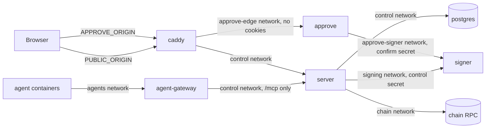

# Running the stack

From a fresh clone:

    cp .env.example .env              # optional; the defaults run on http://localhost:8080
    docker compose --profile dev up -d --build

`--profile dev` adds a local chain (`anvil`). Without it, list real chains
in `deploy/chains.json` first.

For a public host name with HTTPS, set `OS_HOSTNAME` and `PUBLIC_HOST` in `.env` to the name and run
`docker compose -f compose.yaml -f compose.tls.yaml up -d --build`. Ports 80 and 443 must be
reachable so Caddy can obtain certificates. Changing the host name later invalidates every passkey.

Every layout also names the origin of the signer's confirmation page, `APPROVE_ORIGIN`. It is the
only place people approve with their passkeys (`specs/trusted-display.md`): a person opens a
request in the control plane, follows its link there, checks the address bar, reads the request
as the signer holds it, and approves. The signer accepts an approval only when the browser made
it at `APPROVE_ORIGIN`, top-level, as a `webauthn.get`; the control plane has no approval prompt
of its own. The `approve` service serves the page, and Caddy publishes it as a second site. It
must not be `PUBLIC_ORIGIN`; the server and the signer refuse to start when it is, and the
signer also refuses when its host is not `OS_HOSTNAME` or a name under it. Pick one of two
layouts:

- A subdomain, for example `APPROVE_ORIGIN=https://approve.os.example.com`. Give the name its own
  DNS record pointing at this machine; with the TLS overlay Caddy obtains its certificate and
  serves it on port 443. Prefer this layout where you can: browsers keep cookies apart by host
  but not by port.
- Another port on `OS_HOSTNAME`, for example `APPROVE_ORIGIN=https://os.example.com:8443`, with
  `APPROVE_TLS_PORT=8443` so the TLS overlay publishes that port. Use it where a subdomain is not
  possible: machine names under `*.ts.net` have none, and neither has `localhost`.

Either way passkeys keep working: the confirmation page asks for them under the same RP ID,
`OS_HOSTNAME`. Without the TLS overlay `APPROVE_ORIGIN` defaults to `http://localhost:8081` and
Caddy publishes it on `127.0.0.1:${APPROVE_HTTP_PORT:-8081}`, which fits only
`OS_HOSTNAME=localhost`. The TLS overlay requires `APPROVE_ORIGIN`.

You can move from one layout to the other later. Nobody enrolls a passkey again, because the RP
ID stays `OS_HOSTNAME`. Move only while no request waits for approval: an approval made on the
old origin and not yet acted on is refused afterwards, and its request must be proposed again.

If something else already terminates HTTPS in front of this machine (Tailscale Serve, a tunnel,
a load balancer), keep the plain `compose.yaml` and tell the stack the address people will use.
For `https://box.example.ts.net:8444` forwarded to port 18080 on this machine, `.env` is:

    PUBLIC_ORIGIN=https://box.example.ts.net:8444
    OS_HOSTNAME=box.example.ts.net
    PUBLIC_HOST=box.example.ts.net:8444
    HTTP_PORT=18080
    APPROVE_ORIGIN=https://box.example.ts.net:8445
    APPROVE_HTTP_PORT=18081

The proxy must pass the `Host` header through unchanged. With Tailscale:
`tailscale serve --bg --https=8444 http://127.0.0.1:18080` and
`tailscale serve --bg --https=8445 http://127.0.0.1:18081`.

## Services

| Service          | Purpose                                                                                                                                                        |
| ---------------- | -------------------------------------------------------------------------------------------------------------------------------------------------------------- |
| `init`           | Runs once at start; creates any missing secret in the secret volumes and never changes an existing one.                                                        |
| `postgres`       | Control-plane data and the encrypted Workflow history.                                                                                                         |
| `signer`         | Holds the wallets; verifies passkey approvals itself and signs at most once per approval. No outside access.                                                   |
| `approve`        | The confirmation page at `APPROVE_ORIGIN`, where every approval is made. Holds no key; relays a view and an assertion to the signer's two confirmation routes. |
| `server`         | UI, API, MCP gateway and the Workflow runtime.                                                                                                                 |
| `caddy`          | The only public entry point, with two sites: the UI and the confirmation page. Refuses `/.well-known/workflow/*` as a second lock.                             |
| `agent-gateway`  | The only thing agent containers can reach. Forwards `/mcp` and nothing else.                                                                                   |
| `anvil`          | `dev` profile: a local chain (id 31337).                                                                                                                       |
| `scripted-agent` | An example agent, not started by `up`. `docker compose --profile dev run --rm -e AGENT_TOKEN=… -e TRANSFER_TO=0x… scripted-agent`.                             |

## Networks

| Network          | Members                                    | Why                                                                         |
| ---------------- | ------------------------------------------ | --------------------------------------------------------------------------- |
| `edge`           | caddy                                      | Where the published ports live.                                             |
| `control`        | caddy, agent-gateway, server, postgres     | Proxies to the server; the server to Postgres.                              |
| `signing`        | server, signer (internal)                  | The server's path to the signer. No internet.                               |
| `approve-edge`   | caddy, approve (internal)                  | The only path to the `approve` service. No internet.                        |
| `approve-signer` | approve, signer (internal)                 | The `approve` service's path to the signer, and its only one. No internet.  |
| `chain`          | server, anvil                              | RPC access for reading chains and broadcasting.                             |
| `agents`         | agent-gateway, agent containers (internal) | Agents reach `http://agent-gateway/mcp` and nothing else, not the internet. |

Only the server and the `approve` service reach the signer, each on its own network, and each
with its own request secret. The `approve` service's secret opens the signer's two confirmation
routes and no other; the server's opens every route except those two.

The `approve` service reads one secret, `confirm-request-secret`, from the `approve-secrets`
volume, mounted read-only. It holds no wallet key, no keyring and no database password, and it
sets no cookie. A compromise of it, or of Caddy in front of it, lets an attacker show people a
false confirmation page and relay their approvals over other operations; it cannot sign or read
a key (`docs/threat-model.md`).

## Volumes

| Volume            | Holds                                                                                         | Read by  |
| ----------------- | --------------------------------------------------------------------------------------------- | -------- |
| `postgres-data`   | The database.                                                                                 | postgres |
| `signer-data`     | The wallet vault and the signer's SQLite (used approvals, policies, audit, restore fence).    | signer   |
| `server-secrets`  | `keyring.json` (key-encryption keys), `signer-request-secret`, a copy of `postgres-password`. | server   |
| `signer-secrets`  | `signer-request-secret`, `confirm-request-secret`, `token-key`, `vault-passphrase`.           | signer   |
| `approve-secrets` | A copy of `confirm-request-secret`, which `init` writes again whenever it differs.            | approve  |
| `db-secrets`      | `postgres-password`.                                                                          | postgres |

## Backups and restoring

Back up `postgres-data`, `server-secrets`, `signer-data`, `signer-secrets` and `db-secrets`
together, from the same moment, with the stack stopped (`docker compose stop`). `approve-secrets`
needs no backup: `init` copies it from `signer-secrets` on every start.

- The database without the keyring is unreadable, and the keyring without the database is useless.
- `signer-data` is the wallets. Restoring an older copy forgets which approvals were used after
  it was made, so never restore it on its own, and always fence it (below).
- Without `vault-passphrase` new wallets cannot be created; without `token-key` existing wallets
  cannot sign.

One archive per volume, for example:

    docker run --rm -v os_signer-data:/v:ro -v "$PWD":/b alpine tar czf /b/signer-data.tgz -C /v .

Keep the archives encrypted; together they contain every key.

To restore, every time, in this order:

1. Restore into empty volumes: on a machine with no stack yet, or after removing the old
   stack's volumes. Create each volume from its archive
   (`docker run --rm -v os_signer-data:/v -v "$PWD":/b alpine tar xzf /b/signer-data.tgz -C /v`).
2.  Fence the signer before it serves anything:

        docker compose run --rm signer node src/admin.ts fence

    It prints one line, `{"ok":true,"action":"fence-set-by-operator","fenceAt":…}`.
3. Start the stack as usual. `init` leaves existing secrets alone. Keep the same `PUBLIC_ORIGIN`:
   passkeys are bound to its host name.

Why every restore is fenced: a backup may be older than the last payment, and nothing in it says
so. A restore puts the signer's record of used approvals back to the moment of the backup, so an
approval paid after the backup would look unused, and approving it again would pay a second
time. After the fence, the signer refuses every approval issued before the fence with
`envelope_fenced`, whatever the control plane asks. The control plane still shows approvals
that were waiting when the backup was taken, but none can be approved: the confirmation page
shows them as closed (`superseded`) and refuses an approval (`confirmation_closed`), or the
request shows no link at all. Reject them, and the agent proposes again. The same happens to a
proposal made in the first 30 seconds after the fence (the clock skew the signer allows).
Approvals that were already used stay used. A chain is not part of a backup.

The signer also fences itself when it opens a database file that is not the file it last opened:
one extracted from an archive, copied, or moved to another host. It logs `restore fence set`
with `reason: new_database_file`. It cannot notice a restore that rolls the same file back in
place, for example a disk or filesystem snapshot, so the `fence` step stays part of every
restore. The fence is kept in `signer-data` and survives restarts; each fence is recorded in
every workspace's signer decision log.

## Rotating the keyring

The keyring holds the key-encryption keys that wrap every data key in the database. Rotating
re-wraps the data keys; it does not re-encrypt the data.

    docker compose run --rm init node /init/rotate-keyring.mjs add      # new key, made active
    docker compose restart server                                        # the server reads it at start
    docker compose exec server node packages/keys/src/cli.ts rewrap      # expect "failedCount":0
    docker compose run --rm init node /init/rotate-keyring.mjs prune --confirm-rewrapped
    docker compose restart server

Do not prune if rewrap reported failures: a data key still wrapped under a removed key can never
be read again. Back up `server-secrets` before and after.

## When no approver is left

Who may approve for a workspace is recorded in the signer, and normally changes only with a
passkey approval from an existing approver. If none is left (every approving passkey was lost),
the person registers a new passkey in the UI, where it waits as "pending", and the operator
enrolls it on the signer's host. The members page shows the command with its values filled in:

    docker compose exec signer node src/admin.ts enroll-approver \
      --workspace <workspace id> --user <user id> \
      --credential-id <credential id> --public-key <public key>

Whoever can run this command decides who approves. That is deliberate: access to the signer's
host is the root of trust in this design. The enrollment is written to the signer's decision log.

There is no way yet to sign in again after losing every passkey of an account. Register a second
passkey on another device while you can.

## Upgrading

    git pull
    docker compose --profile dev up -d --build

Database migrations run when the server starts. Take a backup first. The Workflow SDK and its
Postgres backend must stay on the same release line; this repository pins both.

The signer migrates its own SQLite when it starts (`PRAGMA user_version`). The first start of a
signer with the restore fence on a v0.1 database fences it once, because nothing tells it the
file was not restored: approvals waiting at that moment must be proposed again. A signer refuses
to start on a database written by a newer signer (`schema_too_new`). Do not go back to a v0.1
signer image after upgrading: it does not know the fence and would ignore it.

Upgrading from a release in which the control plane's own page could approve (it had the
signer setting `WEBAUTHN_ORIGINS`): the signer now accepts approvals made on the confirmation
page only. A request approved on the control plane's page before the upgrade and not yet signed
or applied ends `failed` with `assertion_invalid`, and must be proposed again. A request that
waits without approvals simply gains its link to the confirmation page. Set `APPROVE_ORIGIN`
first if your layout needs another value than the default. `WEBAUTHN_ORIGINS` is no longer
read anywhere.

## The approval webhook

Set `NOTIFY_WEBHOOK_URL` in `.env` to be told when an approval is waiting. The server sends one
`POST` with a JSON body of identifiers only: `{"event":"approval.opened","approvalId":…,"workspaceId":…,"kind":…}`.
It never contains an amount, a recipient or a memo.

Know its limits before you build on it. The request is sent once, with a five-second timeout, and
is not retried. It is not signed, so the receiver cannot tell it came from this server. It is lost
if the server stops between recording the approval and sending it, and approvals that the
recovery sweeper starts are not announced. Treat it as a hint and read the inbox for the truth.

## The setup token

Until the first owner exists, every start of the server prints a one-time setup token and retires
the previous one. Use the newest: `docker compose logs server | grep "setup token" | tail -1`.

## Stopping and removing

- Stop: `docker compose --profile dev stop`.
- Remove containers and networks, keep data: `docker compose --profile dev down`.
- Remove everything including all data and keys (irreversible): `docker compose --profile dev down -v`.
