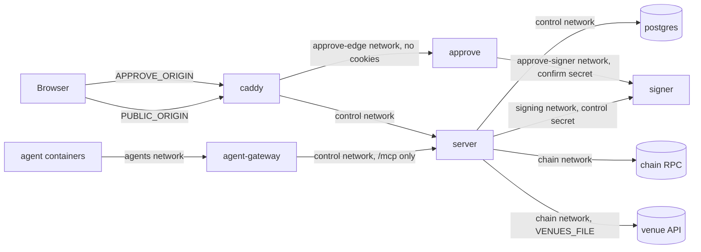

# Running the stack

This is the operator's guide: how to run the stack, keep it running and change it. It is for
whoever administers the machines. It does not explain the design; read
[`docs/architecture.md`](../docs/architecture.md) for that and
[`docs/threat-model.md`](../docs/threat-model.md) for what each part protects. Words such as
workspace, approver, intent, policy and mandate mean what the table "Words used on this page" in
`docs/architecture.md` says.

Read it in this order:

1. "Starting", "Services", "Networks" and "Volumes": start the stack and learn its parts.
2. "Backups and restoring", "Rotating the keyring" and "Choosing the key provider", before you
   hold real funds.
3. "The setup token" to create the first owner, then "Notifications" if people should hear about
   waiting requests anywhere but the web app.
4. The rest when you need it: approvers, mandates, stuck transactions, venues, retiring and
   deleting, exporting, erasing a person, upgrading, the signer on its own host, more than one
   server replica, Kubernetes.

CI (`.github/workflows/ci.yml`) runs on every push to `main` and every pull request. Its
`stack` jobs run the release gates, the end-to-end tests in `e2e/test/` that `./e2e/run.sh` runs
against the whole Compose stack; the split layout, several server replicas, OpenBao and
Kubernetes each have CI jobs of their own. Paragraphs marked "What is proven" say which CI job
and test file prove what, and what has never been tried.

## Starting

You need Docker with Compose v2. From a fresh clone:

    cp .env.example .env              # optional; the defaults run on http://localhost:8080
    docker compose --profile dev up -d --build

`--profile dev` adds a local chain (`anvil`). Without it, list real chains
in `deploy/chains.json` first.

For a public host name with HTTPS, set `OS_HOSTNAME` to the name and `APPROVE_ORIGIN` (below) in
`.env`, and run `docker compose -f compose.yaml -f compose.tls.yaml up -d --build`. The overlay
sets `PUBLIC_ORIGIN` to `https://` and `OS_HOSTNAME`, and refuses to start without either
setting. Ports 80 and 443 must be reachable so Caddy can obtain certificates. Changing the host
name later invalidates every passkey.

Every layout also names the origin of the signer's confirmation page, `APPROVE_ORIGIN`. It is the
only place people approve with their passkeys (`specs/trusted-display.md`): a person opens a
request in the control plane, follows its link there, checks the address bar, reads the request
as the signer holds it, and approves. The signer accepts an approval only when the browser made
it at `APPROVE_ORIGIN`, top-level, as a `webauthn.get`; the control plane has no approval prompt
of its own. The `approve` service serves the page, and Caddy publishes it as a second site. It
must not be `PUBLIC_ORIGIN`; the server and the signer refuse to start when it is, and the
signer also refuses when its host is not `OS_HOSTNAME` or a name under it. Pick one of two
layouts:

- A subdomain, for example `APPROVE_ORIGIN=https://approve.os.example.com`. Give the name its own
  DNS record pointing at this machine; with the TLS overlay Caddy obtains its certificate and
  serves it on port 443. Prefer this layout where you can: browsers keep cookies apart by host
  but not by port.
- Another port on `OS_HOSTNAME`, for example `APPROVE_ORIGIN=https://os.example.com:8443`, with
  `APPROVE_TLS_PORT=8443` so the TLS overlay publishes that port. Use it where a subdomain is not
  possible: machine names under `*.ts.net` have none, and neither has `localhost`.

Either way passkeys keep working: the confirmation page asks for them under the same RP ID,
`OS_HOSTNAME`. Without the TLS overlay `APPROVE_ORIGIN` defaults to `http://localhost:8081` and
Caddy publishes it on `127.0.0.1:${APPROVE_HTTP_PORT:-8081}`, which fits only
`OS_HOSTNAME=localhost`. The TLS overlay requires `APPROVE_ORIGIN`.

You can move from one layout to the other later. Nobody enrolls a passkey again, because the RP
ID stays `OS_HOSTNAME`. Move only while no request waits for approval: an approval made on the
old origin and not yet acted on is refused afterwards, and its request must be proposed again.

If something else already terminates HTTPS in front of this machine (Tailscale Serve, a tunnel,
a load balancer), keep the plain `compose.yaml` and tell the stack the address people will use.
For `https://box.example.ts.net:8444` forwarded to port 18080 on this machine, `.env` is:

    PUBLIC_ORIGIN=https://box.example.ts.net:8444
    OS_HOSTNAME=box.example.ts.net
    PUBLIC_HOST=box.example.ts.net:8444
    HTTP_PORT=18080
    APPROVE_ORIGIN=https://box.example.ts.net:8445
    APPROVE_HTTP_PORT=18081

The proxy must pass the `Host` header through unchanged. With Tailscale:
`tailscale serve --bg --https=8444 http://127.0.0.1:18080` and
`tailscale serve --bg --https=8445 http://127.0.0.1:18081`.

## Services

| Service          | Purpose                                                                                                                                                                                           |
| ---------------- | ------------------------------------------------------------------------------------------------------------------------------------------------------------------------------------------------- |
| `init`           | Runs once at start; creates any missing secret in the secret volumes and never changes an existing one.                                                                                           |
| `postgres`       | Control-plane data and the encrypted Workflow history.                                                                                                                                            |
| `signer`         | Holds the wallets; verifies passkey approvals itself and signs at most once per approval. No outside access.                                                                                      |
| `approve`        | The confirmation page at `APPROVE_ORIGIN`, where every approval is made. Holds no key; relays a view, an assertion and a new approver's possession step to the signer's four confirmation routes. |
| `server`         | UI, API, MCP gateway and the Workflow runtime.                                                                                                                                                    |
| `caddy`          | The only public entry point, with two sites: the UI and the confirmation page. Refuses `/.well-known/workflow/*` as a second lock.                                                                |
| `agent-gateway`  | The only thing agent containers can reach. Forwards `/mcp` and nothing else.                                                                                                                      |
| `anvil`          | `dev` profile: a local chain (id 31337).                                                                                                                                                          |
| `scripted-agent` | `agent` profile: an example agent, not started by `up`. `docker compose run --rm -e AGENT_TOKEN=… -e TRANSFER_TO=0x… scripted-agent`.                                                             |

## Networks

| Network          | Members                                    | Why                                                                                        |
| ---------------- | ------------------------------------------ | ------------------------------------------------------------------------------------------ |
| `edge`           | caddy                                      | Where the published ports live.                                                            |
| `control`        | caddy, agent-gateway, server, postgres     | Proxies to the server; the server to Postgres.                                             |
| `signing`        | server, signer (internal)                  | The server's path to the signer. No internet.                                              |
| `approve-edge`   | caddy, approve (internal)                  | The only path to the `approve` service. No internet.                                       |
| `approve-signer` | approve, signer (internal)                 | The `approve` service's path to the signer, and its only one. No internet.                 |
| `chain`          | server, anvil                              | RPC access for reading chains and broadcasting; the venue's API when `VENUES_FILE` is set. |
| `agents`         | agent-gateway, agent containers (internal) | Agents reach `http://agent-gateway/mcp` and nothing else, not the internet.                |

Only the server and the `approve` service reach the signer, each on its own network, and each
with its own request secret. The `approve` service's secret opens the signer's four confirmation
routes and no other; the server's opens every route except those four.

The `approve` service reads one secret, `confirm-request-secret`, from the `approve-secrets`
volume, mounted read-only. It holds no wallet key, no keyring and no database password, and it
sets no cookie. A compromise of it, or of Caddy in front of it, lets an attacker show people a
false confirmation page and relay their approvals over other operations; it cannot sign or read
a key (`docs/threat-model.md`).

## Volumes

| Volume            | Holds                                                                                                                                                                                                                       | Read by  |
| ----------------- | --------------------------------------------------------------------------------------------------------------------------------------------------------------------------------------------------------------------------- | -------- |
| `postgres-data`   | The database.                                                                                                                                                                                                               | postgres |
| `signer-data`     | The wallet vault and the signer's SQLite (used approvals, policies, mandates and their counts, audit, restore fence).                                                                                                       | signer   |
| `server-secrets`  | `keyring.json` (key-encryption keys), `signer-request-secret`, a copy of `postgres-password`, `notify-webhook-secret` (signs the notification webhook), `vapid-key.pem` (identifies the server to browsers' push services). | server   |
| `signer-secrets`  | `signer-request-secret`, `confirm-request-secret`, `token-key`, `vault-passphrase`.                                                                                                                                         | signer   |
| `approve-secrets` | A copy of `confirm-request-secret`, which `init` writes again whenever it differs.                                                                                                                                          | approve  |
| `db-secrets`      | `postgres-password`.                                                                                                                                                                                                        | postgres |
| `caddy-data`      | With `compose.tls.yaml` only: Caddy's certificates and ACME account. Caddy obtains them again when the volume is lost.                                                                                                      | caddy    |

## Backups and restoring

Back up `postgres-data`, `server-secrets`, `signer-data`, `signer-secrets` and `db-secrets`
together, from the same moment, with the stack stopped (`docker compose stop`). `approve-secrets`
needs no backup: `init` copies it from `signer-secrets` on every start.

- The database without the keyring is unreadable, and the keyring without the database is useless.
  With `KEY_PROVIDER=openbao` the key-encryption keys are in OpenBao, not in `server-secrets`:
  a restore needs an OpenBao that still holds every key version the backup was wrapped under
  (see "Choosing the key provider").
- `signer-data` is the wallets. Restoring an older copy forgets which approvals were used after
  it was made, so never restore it on its own, and always fence it (below).
- Without `vault-passphrase` new wallets cannot be created; without `token-key` existing wallets
  cannot sign.

One archive per volume, for example:

    docker run --rm -v os_signer-data:/v:ro -v "$PWD":/b alpine tar czf /b/signer-data.tgz -C /v .

Keep the archives encrypted; together they contain every key.

To restore, every time, in this order:

1. Restore into empty volumes: on a machine with no stack yet, or after removing the old
   stack's volumes. Create each volume from its archive
   (`docker run --rm -v os_signer-data:/v -v "$PWD":/b alpine tar xzf /b/signer-data.tgz -C /v`).
2.  Fence the signer before it serves anything:

        docker compose run --rm signer node src/admin.ts fence

    It prints one line, `{"ok":true,"action":"fence-set-by-operator","fenceAt":…}`.
3. Start the stack as usual. `init` leaves existing secrets alone. Keep the same `PUBLIC_ORIGIN`:
   passkeys are bound to its host name.
4. Grant again every mandate people still want. The fence ended all of them (below).

Why every restore is fenced: a backup may be older than the last payment, and nothing in it says
so. A restore puts the signer's record of used approvals back to the moment of the backup, so an
approval paid after the backup would look unused, and approving it again would pay a second
time. After the fence, the signer refuses every approval issued before the fence with
`envelope_fenced`, whatever the control plane asks. The control plane still shows approvals
that were waiting when the backup was taken, but none can be approved: the confirmation page
shows them as closed (`superseded`) and refuses an approval (`confirmation_closed`), or the
request shows no link at all. Reject them, and the agent proposes again. The same happens to a
proposal made in the first 30 seconds after the fence (the clock skew the signer allows).
Approvals that were already used stay used. A chain is not part of a backup.

The fence also ends every mandate that was still live, with reason `operator`, in the same
signer transaction. A restored signer has forgotten the payments it counted under a mandate
after the backup, so its counts would let more leave the wallet than people approved. Nothing
brings an ended mandate back: people grant a new one. The control plane shows each ended mandate
with reason `operator`, and with no usage when the restored signer never held it (the backup is
older than the grant). The release gate "the operator's restore fence ends every live mandate"
(`e2e/test/release-gates.spec.ts`) runs the `fence` command against a running stack and checks
this; no gate restores a backup that holds a live mandate.

The signer also fences itself when it opens a database file that is not the file it last opened:
one extracted from an archive, copied, or moved to another host. It logs `restore fence set`
with `reason: new_database_file`. It cannot notice a restore that rolls the same file back in
place, for example a disk or filesystem snapshot, so the `fence` step stays part of every
restore. The fence is kept in `signer-data` and survives restarts; each fence is recorded in
every workspace's signer decision log.

The fence is a time on the signer host's clock, and mandates start, end and count their
windows by the same clock: keep it synchronized (see "Mandates").

The fence also stops the reprice of every transaction signed before it; a cancel of one is still
signed (see "Stuck transactions").

**Venue orders signed after the backup cannot be cancelled.** A restored signer has no
record of an order it signed after its backup, so it answers `not_found` to that order's cancel.
An immediate-or-cancel order is already done; a good-till-cancelled or add-liquidity-only order
may rest at the venue with no way for this system to cancel it. That is why the venue rules a
policy starts from allow immediate or cancel only. After a restore, compare each wallet's resting
orders on its wallet page, as the venue reports them, with the orders people approved since the
backup (see "Venue orders (Hyperliquid)").

**Deleted workspaces stay in backups.** A backup set taken before a deletion holds the deleted
workspace whole: `signer-data` holds its wallet keys, signed transactions, confirmations and
mandate texts, and `postgres-data` with the `server-secrets` of the same moment opens its sealed
data and workflow history. Deleted data leaves your backups only when every set taken before the
deletion is destroyed. So, after each deletion:

1. Rotate the keyring as in "Rotating the keyring" below, through `prune`, and note the date. The
   server logs `lifecycle.rotate_keyring` when a deletion is finished, as the reminder. From then
   on a database copy taken before the deletion cannot be opened with the live keyring; it still
   opens with the `server-secrets` archive saved beside it.
2. Keep backup sets for 30 days, then destroy them, `server-secrets` and `signer-data` archives
   included. That retention is how long a deleted workspace stays recoverable, and readable to
   whoever holds the archives. Choose another if you must, and write it down where the people who
   delete workspaces can read it.

Restoring a backup set brings back every workspace as it was at that moment, deleted ones
included, with their keys. Every restore is fenced as above, which also ends every live mandate.
A workspace that was waiting to be deleted at the backup comes back `deleting` with its countdown
still running: finishing a deletion needs no new approval, so the fence does not stop it. Cancel
the deletion if the restore was meant to undo it, or take the keys out first with `export-wallet`
(see "Retiring wallets and deleting workspaces").

## Rotating the keyring

The keyring holds the key-encryption keys that wrap every data key in the database. Rotating
re-wraps the data keys; it does not re-encrypt the data.

    docker compose run --rm init node /init/rotate-keyring.mjs add      # new key, made active
    docker compose restart server                                        # the server reads it at start
    docker compose exec server node packages/keys/src/cli.ts rewrap      # expect "failedCount":0
    docker compose run --rm init node /init/rotate-keyring.mjs prune --confirm-rewrapped
    docker compose restart server

Do not prune if rewrap reported failures: a data key still wrapped under a removed key can never
be read again. Back up `server-secrets` before and after.

These commands are for one server. With more than one replica, rotate in two phases (see "More
than one server replica").

Rotate after every finished deletion (see "Backups and restoring"): `prune` removes the key that
wrapped the deleted workspace's data keys from the live keyring, so older database copies no
longer open with it.

With `KEY_PROVIDER=openbao` there is no keyring to rotate: rotate the Transit key instead (see
"Choosing the key provider").

## Choosing the key provider

The server wraps its data keys under key-encryption keys from one of two providers
([`packages/keys/README.md`](../packages/keys/README.md#choosing-the-key-provider) has every
setting):

- `KEY_PROVIDER=file`, the default: the keyring file, `keyring.json` in `server-secrets`, which
  `init` creates. This is what `compose.yaml` runs.
- `KEY_PROVIDER=openbao`: an [OpenBao](https://openbao.org/) Transit key, set with
  `OPENBAO_ADDR`, `OPENBAO_AUTH` (`token`, `approle` or `kubernetes`) and its credential files,
  `OPENBAO_TRANSIT_MOUNT` and `OPENBAO_TRANSIT_KEY` (default `transit` and `os-kek`),
  `OPENBAO_CA_FILE` and `OPENBAO_TIMEOUT_MS` (default 2000 milliseconds). Use an `https:`
  address between hosts: the data keys travel to OpenBao and back. `compose.yaml` passes these
  variables from `.env`, except the two `kubernetes` ones (`OPENBAO_KUBERNETES_ROLE`,
  `OPENBAO_KUBERNETES_JWT_FILE`); on Compose use `approle` or `token`. Put the credential files
  in the `server-secrets` volume and name them in `.env`.

Give the server's OpenBao identity the policy in [`openbao/policy.hcl`](openbao/policy.hcl):
encrypt, decrypt and read on the one Transit key, nothing else. Replace `transit` and `os-kek`
in it when your mount or key name differs.

To move from the keyring file to OpenBao, set `KEY_PROVIDER=openbao` and the `OPENBAO_*`
variables and keep `KEYRING_FILE`, so both are in use; restart the server; run
`docker compose exec server node packages/keys/src/cli.ts rewrap` until it reports
`"failedCount":0`; then remove `KEYRING_FILE` and restart. To rotate the Transit key (default
names): `bao write -f transit/keys/os-kek/rotate`, wait five minutes (or restart the server), run
`rewrap`, then raise the key's `min_decryption_version`; copies wrapped under older versions,
backups included, no longer open. Do this after every finished deletion, as you would rotate the
keyring.

**When OpenBao is down, the server fails closed.** Every operation that needs a key fails with
`KeyProviderUnavailableError` until OpenBao answers again, apart from keys already cached (up to
`DATA_KEY_CACHE_SECONDS`, one minute by default): proposing and opening sealed content fail.
Nothing falls back to the keyring file or to plaintext. Shredding does not need OpenBao. The
server logs `keys.provider_unavailable` and `keys.provider_refresh_failed`. Whoever holds the
server's OpenBao token, or controls OpenBao, unwraps every data key it is given: with a database
copy, that reads everything.

**What is proven.** In CI job `test`, the provider's unit tests run against a stand-in for the
Transit API and against a development-mode OpenBao from `deploy/compose.test.yaml`
(`packages/keys/test/`). CI job `stack (openbao)` runs the whole stack with its keys in OpenBao
Transit, signed in by AppRole: first its own gates (`e2e/test/openbao.spec.ts`: the AppRole can
use the one key and nothing else; a payment completes; every data key is wrapped by Transit and
nothing an agent typed is in the database in the clear; with OpenBao paused for 20 seconds new
work fails closed and a payment approved meanwhile completes once it is back; a key rotation, a
rewrap and a raised minimum version keep every earlier payment readable), then every release
gate. The move from the keyring file to OpenBao has unit tests in CI job `test`
(`packages/keys/test/composite.test.ts`) and no gate on a running stack. The `kubernetes` sign-in
is unproven against a real OpenBao.

## Adding an approver

A person becomes an approver of a workspace when they join it as an approver or owner, or when
their role changes from viewer; an approver who registers another passkey adds that passkey.
Each opens one approver change per passkey. The signer applies it only after the person being
added has proven that the passkey is theirs, and only with the workspace's admin threshold of
approvals:

1. The person being added opens the request's link to the confirmation page, on the device that
   holds the new passkey, and presses "This passkey is mine". The page shows them the key's
   fingerprint, four groups of four characters.
2. They read the fingerprint to the people who approve, over a call or in person, not through
   this site or a message it sent.
3. Each approver opens the same request on the confirmation page and approves only if the
   fingerprint they heard matches its "Key fingerprint" line. Until step 1 is done the page
   keeps the approve button disabled, and the signer refuses an approval with
   `possession_unproven`.

Skip the comparison and the step proves only that someone holds the key: a compromised control
plane could have put in a key it holds (`docs/threat-model.md`, "Limits"). The operator's
`enroll-approver` command below has no such step, because the operator types the key.

## Mandates

A mandate lets one agent pay from one wallet, to the addresses it lists, within its caps (per
payment, per rolling window, in total, number of payments, fee per payment) until its end time,
with no passkey per payment. The wallet's policy still applies to every payment, and a mandate
never covers a contract call. What it protects and what it does not is in
`docs/threat-model.md`, "Mandates".

- **Granting.** An owner asks for one for an agent's wallet (`POST
  /api/v1/workspaces/:workspaceId/wallets/:walletId/mandates`). It is approved like every other
  request, on the confirmation page, at the workspace's admin threshold. The server refuses a
  draft the wallet's policy or the longest life would refuse; the signer checks again and its
  answer decides.
- **Using.** An agent proposes as usual. When a live mandate of that agent covers the payment,
  the answer says `authorizedBy: "mandate"` with its `mandateId`, and the payment is signed and
  sent with no person asked. Anything a mandate does not cover goes to the inbox. An agent may
  name a mandate (`mandateId` on `propose_transfer`); one that does not cover the payment is
  refused with its reason, for example `mandate_over_window_cap`. The signer counts every
  payment it signs under a mandate, also one the network never includes, and gives nothing
  back.
- **Revoking.** Any owner or approver revokes a mandate with one click and no passkey
  (`POST /api/v1/workspaces/:workspaceId/mandates/:mandateId/revoke`). It ends for good; a new
  grant replaces it. The signer also ends mandates on its own: when a passkey that granted one
  stops approving, when the agent is disabled (the control plane asks it to), when the restore
  fence moves, and on the operator's command below.

The operator's commands, on the signer host:

    docker compose exec signer node src/admin.ts list-mandates --workspace <workspace id>
    docker compose exec signer node src/admin.ts revoke-mandate --mandate <mandate id>
    docker compose exec signer node src/admin.ts revoke-mandate --all --workspace <workspace id>

`list-mandates` prints identifiers, status, times and use counts, never a purpose or a
recipient. `revoke-mandate` ends one mandate, or every live mandate of a workspace, with reason
`operator`, and prints the ids it ended. It does not depend on the control plane: use it when
the control plane may be compromised, because a person's revocation goes through it.

Two settings in `.env`, both optional:

| Setting                               | Meaning                                                                                                                                                                                                                                          |
| ------------------------------------- | ------------------------------------------------------------------------------------------------------------------------------------------------------------------------------------------------------------------------------------------------ |
| `MANDATE_MAX_SECONDS`                 | The longest life of a mandate: 3600 to 2592000 seconds, default 604800 (seven days). Compose gives it to the signer (`SIGNER_MAX_MANDATE_SECONDS`, which decides) and to the server, so they stay equal. On split hosts set it the same on both. |
| `SIGNER_MAX_LIVE_MANDATES_PER_WALLET` | How many live mandates one wallet may hold: 1 to 64, default 16.                                                                                                                                                                                 |

**The signer host must keep its clock synchronized** (NTP, `chrony` or `systemd-timesyncd`). The
signer decides by its own clock when a mandate starts and ends and which payments fall in its
window, and the restore fence is a time on the same clock. A clock that runs behind keeps an
ended mandate signing; one that runs ahead lets payments leave the window early. Nothing in the
stack checks the clock.

## Stuck transactions

A payment the signer signed and the server sent may not be mined: the base fee rose above its
fee cap, its tip is too low, or a node dropped it. It keeps its account nonce, so every later
transaction of that wallet on that chain waits behind it. The approval page shows it with every
attempt, and agents see the same through `get_intent` (`attempts`, `stuckReason`); an agent has
no tool that speeds up or cancels.

- **Repriced by itself.** While `REPRICE_AUTO=1`, the server asks the signer for the same
  transaction with both fees higher once the newest attempt is `REPRICE_AFTER_SECONDS` old, and
  offers it to the chain. Only the two fee fields change; the signer rebuilds every attempt from
  its own record of the first signature, so the nonce, gas, recipient, amount and data stay
  those people approved, and since every attempt has the one nonce, at most one is ever mined.
  It needs no passkey and stays inside `min(intent.maxFeeWei, policy fees.maxPerTxWei)`, the
  fee ceiling people approved, capped by the wallet's current policy. It stops at that ceiling,
  `SIGNER_REPRICE_WINDOW_SECONDS` after the first signature, after `SIGNER_MAX_TX_ATTEMPTS`
  signatures, while the workspace is paused, once the mandate that covered the payment is
  revoked, and after a restore fence; the page then says why (`stuckReason`). A payment waiting
  behind an earlier unmined nonce is not repriced: a higher fee would not help it.
- **Speed up.** An owner or approver can ask for the next attempt now, with no passkey
  (`POST /api/v1/intents/:intentId/speed-up`). Within 15 seconds of the newest attempt the click
  adds none and shows the payment as it is.
- **Cancel.** An owner or approver asks to cancel a sent, unmined payment
  (`POST /api/v1/intents/:intentId/cancel-transaction`; a sweep's transaction:
  `POST /api/v1/approvals/:approvalId/cancel-transaction`). That opens a `cancel-transaction`
  request, approved like any other on the confirmation page, at the wallet policy's threshold.
  The signer then signs a transfer of nothing from the wallet to itself at the same nonce, with a
  fee of at most the policy's `fees.maxPerTxWei`. Once a cancel exists every later attempt is a
  cancel. It works while the workspace is paused. A sweep can be cancelled, not repriced.
- **A cancel is an attempt, not a guarantee.** Whichever the chain mines first wins: the cancel
  (the payment ends `voided`, `transaction_cancelled`) or the payment (`confirmed` or `reverted`,
  `cancel_too_late`). The payment still counts toward the wallet's 24-hour cap either way: the
  signer counted it when it first signed it and gives nothing back. A cancel costs a network fee.
- **Paused.** Pausing a workspace stops every reprice, automatic or not. A cancel's first
  signature still goes through, but the cancel is not repriced until the workspace resumes.

Five settings in `.env`, all optional; Compose passes them on:

| Setting                         | Read by | Meaning                                                                                                                                                   |
| ------------------------------- | ------- | --------------------------------------------------------------------------------------------------------------------------------------------------------- |
| `REPRICE_AUTO`                  | server  | `1` (default) raises the fee of a stuck transaction without asking; `0` leaves it to an approver's "Speed up".                                            |
| `REPRICE_AFTER_SECONDS`         | server  | How long the newest attempt stays unmined before the next: 15 to 86400 seconds, default 180.                                                              |
| `REPRICE_BUMP_PERCENT`          | server  | How much both fees rise at least, each time: 10 to 100 percent, default 12.                                                                               |
| `SIGNER_REPRICE_WINDOW_SECONDS` | signer  | How long after the first signature the signer reprices with no person: 0 to 604800 seconds, default 86400. `0` refuses every reprice; cancels still work. |
| `SIGNER_MAX_TX_ATTEMPTS`        | signer  | The most signatures of one approval, the first included: 2 to 64, default 16. When it is reached, nothing more is signed, not even a cancel.              |

To stop repricing while keeping the record, set `REPRICE_AUTO=0` and
`SIGNER_REPRICE_WINDOW_SECONDS=0`. The server keeps following every attempt already signed,
because any of them may still be mined.

**Replacement rules differ by client.** A node replaces a pooled transaction only when the new
one pays enough more. go-ethereum and reth want both fees at least 10% higher, which the default
bump of 12 clears; Anvil takes any higher fee cap; Besu, Nethermind, L2 sequencers and private
relays have rules of their own. A node that refuses a replacement keeps the earlier attempt,
which stays valid and may still be mined. If your chain's nodes want more, raise
`REPRICE_BUMP_PERCENT`. The signer requires only that both fees are strictly higher than the
latest attempt's.

**Reorgs and confirmation depth.** Which attempt was mined, the payment or its cancel, is decided
only at the chain's `confirmations` in `deploy/chains.json`. Until then a reorg can swap one for
another, so the nonce stays held and nothing is reported final. On chains with deep reorgs raise
`confirmations`.

**What a compromised control plane can do with this.** It chooses when and how far fees rise,
within the ceiling people approved, the window and the attempt limit: it can burn every
payment's network fee up to that ceiling. It cannot change a recipient, an amount, a nonce, the
gas or the data, cannot get a second nonce for an approved payment, and cannot cancel without
passkeys on the confirmation page (`docs/threat-model.md`, "Stuck transactions").

**After a restore.** The fence (see "Backups and restoring") also ends repricing of every
transaction signed before it: the signer refuses with `envelope_fenced`, and the payment shows
`reprice_refused`. A restored signer may have forgotten attempts signed after its backup, a
cancel among them, and a reprice built from what it remembers could turn that cancel back into
the payment. Such a transaction can still be cancelled: the cancel request is new, so the fence
does not refuse it. The chain is not part of a backup; whatever attempt was mined meanwhile is
found again by its hash.

## Venue orders (Hyperliquid)

An agent can propose a limit order on a Hyperliquid perpetual market with `propose_order`, and a
withdrawal of USDC from the wallet's Hyperliquid account to the wallet's own address with
`propose_transfer` on the venue's network (`hyperliquid:testnet` or `hyperliquid:mainnet`). A
person approves each one on the confirmation page; the signer builds and signs the request, and
the server posts it to the venue and follows it (`docs/architecture.md`, "A venue order, end to
end"; `specs/non-evm-operations.md`).

Status: **testnet and mainnet supported, off by default.** A venue is on only when you list it
in `VENUES_FILE` and people approve, with passkeys, wallet rules that name that network; there
is no other switch. Using a venue is the choice of whoever runs the workspace. On mainnet, orders
and withdrawals move real funds.

**What is proven.** In CI job `test`, unit tests check that the encoder's signatures match the
venue SDK's own signed vectors, and cover the signer's venue routes and the server's half. In
the `stack (amd64)` and `stack (arm64)` jobs, the release gates in `e2e/test/venue.spec.ts` run
orders, cancels and withdrawals on the whole stack against a fake Hyperliquid, in testnet mode
and in mainnet mode. Unproven: nothing has run against the real Hyperliquid testnet, and no
real mainnet order with real funds has ever been placed with this software.

| Setting       | Service | Meaning                                                                                                                                                                                                                    |
| ------------- | ------- | -------------------------------------------------------------------------------------------------------------------------------------------------------------------------------------------------------------------------- |
| `VENUES_FILE` | server  | The path, inside the server's container, of a JSON array of `{ "network", "apiUrl" }`, at most one entry per network. Empty or unset (default): no venue, and every venue proposal is refused with `venue_not_configured`. |

The signer needs no setting: a wallet's policy carries its venue rules (markets with their asset
index and per-order cap, a daily cap, the allowed time in force, a submit window of 5 to 300
seconds, whether withdrawals are allowed) and the network they apply to. The signer signs for
whichever network the approved policy names.

To turn it on, write the file, for example `deploy/venues.json`. For mainnet:

    [{ "network": "hyperliquid:mainnet", "apiUrl": "https://api.hyperliquid.xyz" }]

For the testnet:

    [{ "network": "hyperliquid:testnet", "apiUrl": "https://api.hyperliquid-testnet.xyz" }]

Or both, at most one entry per network:

    [
      { "network": "hyperliquid:testnet", "apiUrl": "https://api.hyperliquid-testnet.xyz" },
      { "network": "hyperliquid:mainnet", "apiUrl": "https://api.hyperliquid.xyz" }
    ]

Then mount it into the server with an override, and start the stack with it
(`docker compose -f compose.yaml -f compose.venues.yaml up -d`):

    # compose.venues.yaml
    services:
      server:
        environment:
          VENUES_FILE: /etc/os/venues.json
        volumes:
          - ./deploy/venues.json:/etc/os/venues.json:ro

The split layout's control host inherits the setting from `compose.yaml`; the Kubernetes
manifests do not set it. The server reaches the venue over the `chain` network, which has
internet access. Then an owner adds venue rules to the wallet's policy in the web app, choosing
the network when both are configured, and people approve the new policy on the confirmation
page like any policy change. The web app offers the networks in `VENUES_FILE` (and the network of
rules already in force, so the editor shows what the policy says), and the server refuses a
policy draft that names any other (`venue_not_configured`). The rules a new policy starts from
name the first configured network (testnet before mainnet) and allow immediate or cancel only,
a 60-second submit window and no withdrawals; the owner fills in the markets and caps.

**What bounds an order.** The same on both networks: a passkey approval of every order on the
signer's confirmation page, the markets in the wallet's rules, the per-order and per-day
notional caps, and the submit window. The caps limit new orders, not losses: what can be lost is
the account's value at the venue. Give a mainnet wallet's rules few markets and small caps.

**The boot check.** The server does not start when an entry pairs one of Hyperliquid's own hosts
with the other network: `api.hyperliquid.xyz` must name `hyperliquid:mainnet`, and
`api.hyperliquid-testnet.xyz` must name `hyperliquid:testnet`. It logs `failed to start` with
`reason: "VENUES_FILE: api.hyperliquid.xyz is Hyperliquid's mainnet API; its entry must name
hyperliquid:mainnet"` (or the testnet twin) and exits. Any other host, such as a proxy or a fake
venue, is accepted with either network. A file that is not such an array (`VENUES_FILE: expected
a JSON array of { network, apiUrl }`), that has more than two entries, or that names a network
twice, stops it too.

**Funding the account.** This system builds no deposit. The account is funded from outside it,
by a transfer from another funded account on the same network, or by an ordinary EVM payment to
the venue's bridge that people approve. Hyperliquid's testnet faucet pays only addresses that
deposited on mainnet. Neither way has been tried with this software.

**What you see in the server's logs.** One JSON line per event, with the approval id (and, for
most, the network), never the request or its fields:

| `event`         | `message`                                                  | Fields                                                                                                                                              |
| --------------- | ---------------------------------------------------------- | --------------------------------------------------------------------------------------------------------------------------------------------------- |
| `venue.post`    | `venue request posted`                                     | `outcome`: `resting`, `filled`, `accepted` (a withdrawal, or an order read back next) or `refused` (the venue's text is in the intent, not the log) |
| `venue.post`    | `venue request not answered` (warn)                        | `outcome: "unreachable"`: tried again after 5 seconds; a request the venue never had ends `expired` once its submit window passes                   |
| `venue.status`  | `venue order read`, `venue withdrawal read`                | `status`: the venue's own word for the order, `accepted` for a withdrawal, or `unknown` when the venue has no record of it                          |
| `venue.status`  | `venue reconcile failed` (error)                           | `error`: the error's name. Orders older than an hour are read every 5 minutes                                                                       |
| `venue.cancel`  | `venue cancel posted`                                      | `outcome`: `accepted` or `refused`; the order's status is read right after                                                                          |
| `venue.account` | `venue account not read`, `venue account not shown` (warn) | `network`: the wallet page could not read the account at the venue, or could not show what it answered                                              |

The signer's decision log records `sign-venue` for each order or withdrawal it signed or refused
and `cancel-venue-order` for each cancel. A cancel needs no passkey and is allowed while the
workspace is paused: approving an order includes cancelling it.

**Clocks.** The signer's clock sets each request's nonce and its `expiresAfter`. A signer clock
behind the venue's by more than the submit window makes every order arrive expired; keep NTP on
the signer host.

**Upgrading.** Upgrade the signer before the server. A server ahead of its signer gets 404 from
the signer's venue routes, and the order's approval fails.

**Removing a venue.** Take its entry out of `VENUES_FILE` and restart the server. A request
signed and not yet posted ends `expired` once its submit window has passed; an order already
resting at the venue stays there, and this system can no longer read or cancel it.

## Retiring wallets and deleting workspaces

An owner can retire one wallet, or delete a paused workspace with every wallet in it. Both end
with the signer destroying keys, so people approve them on the confirmation page at the
workspace's admin threshold, like a policy change. The page lists the wallets and addresses the
signer holds and the time it destroys the keys. From that approval the wallets sign nothing and
their mandates end. Until the destroy time any member can cancel a deletion, and an owner or
approver a retirement, with no passkey: the keys stay. A cancelled retirement leaves the wallet
`held`, signing nothing until people approve a new policy for it; a cancelled deletion puts each
wallet back as it was and leaves the workspace paused until people approve resuming it. Ended
mandates stay ended.

Once the destroy time has passed by the signer's clock, the server's sweeper (once a minute)
finishes it. It waits while any transaction of the wallet or workspace could still be mined:
one signed, sent or stuck, or one given up on whose nonce no later transaction has used. People
clear a stuck one with its cancel, which still works while the workspace is being deleted (see
"Stuck transactions"). Then the signer deletes each key from the vault and empties the signed
transactions it kept. For a workspace it also deletes its confirmations and blanks its mandate
texts, and the server shreds the workspace's data key and the key of every workflow run of it,
and leaves a tombstone: names cleared, members removed. Former members then get `not_found`.

**The signer cannot see balances.** It destroys keys whatever the wallets still hold. The list
the web app shows before a deletion is the server's reading of the native coin of each chain in
`deploy/chains.json` and of the assets each wallet's policy lists: partial, and only as honest as
the control plane. Empty the wallets first with a sweep. A token nothing lists is lost with the
key.

Two settings in `.env`, both optional; Compose passes them to the signer:

| Setting                            | Meaning                                                                                                                                                                                                          |
| ---------------------------------- | ---------------------------------------------------------------------------------------------------------------------------------------------------------------------------------------------------------------- |
| `SIGNER_MIN_DESTROY_DELAY_SECONDS` | The shortest time between a request being opened and its keys being destroyed: 0 to 7776000 seconds, default 604800 (seven days). The server reads it from the signer and refuses an earlier time before asking. |
| `SIGNER_MAX_DESTROY_DELAY_SECONDS` | The longest: 1 to 31536000 seconds, at least the minimum, default 7776000 (90 days).                                                                                                                             |

The signer refuses a request outside these bounds (`destroy_delay_out_of_range`). Changing them
does not move a destroy time already approved. A minimum of 0 suits only a test stack.

Two webhook events and push notices announce a scheduled destruction: `lifecycle.scheduled` when
people approved it and `lifecycle.due_soon` 24 hours before the keys go (see "What the server
sends"). The server logs `lifecycle.finalize_skipped` with the reason (`unmined_transactions`,
`unfinished_runs`, `destroy_not_due`, `not_scheduled`) while it waits, `lifecycle.finalize_failed`
on an error, and `lifecycle.finalized` when done; every step is safe to repeat, so the next round
finishes what a crash interrupted. The signer's decision log records `retire-wallet`,
`delete-workspace`, `cancel-retire-wallet`, `cancel-delete-workspace` and `destroy-wallet`.

**Taking a key out.** No route exports a wallet key. On the signer host, before its destroy time:

    docker compose exec signer node src/admin.ts export-wallet \
      --workspace <workspace id> --wallet <wallet id> --out /tmp/<wallet id>.txt
    docker compose exec -T signer cat /tmp/<wallet id>.txt > <wallet id>.txt
    docker compose exec signer rm /tmp/<wallet id>.txt

It writes the wallet's mnemonic to a new file readable by its user only, refuses a path that
exists (`out_exists`) and a destroyed wallet (`wallet_retired`), and prints one line with the
address, never the secret. `/tmp` in the signer's container is in memory; never write the file
under `/data`, which is the backed-up `signer-data` volume. The export is recorded as
`export-wallet-by-operator` in the workspace's decision log. Whoever holds the file holds the
wallet: move its funds and destroy the file.

**Shredding by hand.** The sweeper shreds a deleted workspace's keys itself. To shred every data
key of one tenant by hand, for example the run keys of a workspace:

    docker compose exec server node packages/keys/src/cli.ts shred-tenant run <workspace id>

It prints `{"event":"keys.shred_tenant",…,"shredded":<n>}` and exits 0, also when nothing was
left to shred. Data under those keys can never be read again, and a workflow run still going
retries forever, so shred only after its runs have finished. Every server replica drops a
shredded key from its cache at once, because it listens for shreds; a process that does not
listen, such as a World started from `@askgina/os-world/target`, keeps a cached key for up to
one minute.

**What a compromised control plane can do with this.** Ask for a retirement or deletion people
did not want, describe it falsely in its own pages, or show false balances; cancel any of them,
or never finish one, which only delays it. It cannot destroy a key without passkeys at the admin
threshold over the exact wallet set, before the destroy time, or with a delay outside the
signer's bounds (`docs/threat-model.md`, "Retiring a wallet and deleting a workspace").

**What is proven.** The release gates in `e2e/test/lifecycle.spec.ts` run this on the whole
stack in CI jobs `stack (amd64)` and `stack (arm64)`: retiring and cancelling, `export-wallet`,
destroying a key at its time, a deletion and its cancel, the webhook announcement, the wait for
a transaction that could still be mined, what a deleted workspace leaves, and a pre-deletion
database copy after a keyring rotation. The 30-day backup retention in "Backups and restoring"
is a choice, not something a gate checks.

## Exporting and cloning a workspace

An owner can download two files from a workspace in the web app:

- **The template**: its configuration, with no key, address, token, mandate or history. Members
  appear as user ids with their roles.
- **The record**: its whole history, opened from the sealed columns, as JSON Lines. It needs a
  passkey sign-in in the last five minutes, and the export is written to the audit log first.
  Whoever holds the file reads everything in it: store it encrypted. It is not part of the
  backups above.

Check a record offline, in a checkout of this repository after `bun install`:

    node apps/server/src/lifecycle/verify-record.ts <record file>

It prints `{"ok":true,"brokenAt":null}` and exits 0 when every hash, chain and count verifies, 2
when one does not (`brokenAt` is the first line that fails), and 1 when the file cannot be read
or the command is used wrongly. A record that verifies is consistent, not proof that the control
plane was honest: keep the `auditHead` and `signerDecisionHead` from the first line of each
export and compare them with the next.

An owner can clone a workspace, and anyone signed in can import a template file. The copy carries
no authority: new wallets with new keys and addresses, new agent tokens shown once, the person
cloning as its only owner and approver, an admin threshold of 1 until changed, invite links for
the members this installation knows, and one policy change per wallet that applies only when the
new workspace's approvers approve it. No mandate, approval or history is copied. A template
naming a chain that `deploy/chains.json` does not list is refused before anything is created.

Exporting, cloning and importing have release gates on the whole stack
(`e2e/test/lifecycle.spec.ts`, CI jobs `stack (amd64)` and `stack (arm64)`).

## Erasing a person

A person erases themselves in the web app, with a passkey sign-in in the last five minutes. It
takes two steps. The first opens a request to remove each of their passkeys from each
workspace where it approves; people approve those on the confirmation page at the admin
threshold, which also ends the mandates those passkeys granted. When none is left, asking again
erases: their name (shown as "Erased person" from then on), passkeys, sessions, push
subscriptions, notification settings and quiet hours, memberships and unsent notifications.
Their user id stays in the audit logs, approvals, the signer's records and exported records, so
every chain still verifies.

It is refused, with nothing changed, for the only owner of a workspace (`last_owner`), when
fewer people would be left to approve than a workspace needs (`last_approver`), and while a
workspace where they approve is being deleted (`workspace_deleting`). These names are the
error's `detail`; its `code` is `conflict`.

For someone who cannot sign in, on the server host:

    docker compose exec server node apps/server/src/identity/erase-cli.ts --user <user id>

Its result is the last JSON line it prints (an erasure logs a line before it). Exit 0,
`{"ok":true,"userId":…,"alreadyErased":…}`: erased, now or before. Exit 3,
`{"ok":false,"code":"still_approving","workspaces":[…]}`: their passkeys still approve in the
listed workspaces, and the command cannot open the requests that remove them; an owner of each
removes the person there (or makes them a viewer), people approve it, then run the command
again. Exit 2, `{"ok":false,"code":…,"detail":…,"message":…}`: refused, with a `detail` above,
`try_again`, or the code `not_found` for an unknown user. Exit 1: usage.

Backups taken before an erasure keep the person's name and everything else until they are
destroyed. The user id stays everywhere, so the audit logs still verify.

Erasing has release gates on the whole stack, by the person and by the operator
(`e2e/test/lifecycle.spec.ts`, CI jobs `stack (amd64)` and `stack (arm64)`).

## When no approver is left

Who may approve for a workspace is recorded in the signer, and normally changes only with a
passkey approval from an existing approver. If none is left (every approving passkey was lost),
the person registers a new passkey in the UI, where it waits as "pending", and the operator
enrolls it on the signer's host. The members page shows the command with its values filled in:

    docker compose exec signer node src/admin.ts enroll-approver \
      --workspace <workspace id> --user <user id> \
      --credential-id=<credential id> --public-key=<public key>

Whoever can run this command decides who approves. That is deliberate: access to the signer's
host is the root of trust in this design. The enrollment is written to the signer's decision log.

There is no way yet to sign in again after losing every passkey of an account. Register a second
passkey on another device while you can.

## Upgrading

    git pull
    docker compose --profile dev up -d --build

Use the same `-f` files and profiles you started the stack with. Take a backup first (see
"Backups and restoring"). The signer and `approve` must be upgraded no later than the server: a
server ahead of its signer may ask for something the signer does not know, and that request
fails and must be proposed again. On one machine `up` handles this, because the server waits for
a healthy signer; on split hosts, upgrade the signer host first (see "Operating it"). With more
than one server replica, stop every replica first (see "More than one server replica").

The server migrates the database when it starts (`apps/server/src/db/migrations/`). The Workflow
SDK and its Postgres backend must stay on the same release line; this repository pins both. Do
not run an older server against a database a newer one has migrated: it does not know the newer
tables and columns, for example later attempts of a repriced transaction or mandate uses.

The signer migrates its own SQLite when it starts (`apps/signer/src/db.ts`, `PRAGMA
user_version`) and turns on SQLite's `secure_delete`. A signer refuses to start on a database
written by a newer signer (`schema_too_new`). So an upgrade that migrates the signer's database
cannot be undone by starting the older image. Either fix forward, or restore the `signer-data`
backup taken before the upgrade: that is a restore, fenced as in "Backups and restoring", and it
forgets every retirement and deletion since, bringing back the keys of any finished one.

## Running the signer on its own host

`compose.yaml` runs every trust domain on one machine, where root on that machine controls the
wallets (`docs/threat-model.md`, "Running on more than one machine"). `deploy/split/` puts the
signer, the confirmation page and that page's edge on a host of their own, administered apart
from the control plane's host. The hosts share one connection, the server's to the signer's
port 8787. It is mutual TLS 1.3 in which each side accepts exactly the other's certificate, with
no certificate authority, and every request inside it still carries its request signature.

|                        | Signer host                                                                                             | Control host                                                                                                                                                                          |
| ---------------------- | ------------------------------------------------------------------------------------------------------- | ------------------------------------------------------------------------------------------------------------------------------------------------------------------------------------- |
| Compose file, project  | `deploy/split/signer.compose.yaml`, `os-signer`                                                         | `deploy/split/control.compose.yaml`, `os-control`                                                                                                                                     |
| Services               | `init`, `signer`, `approve`, `caddy` (the `APPROVE_ORIGIN` site only, `deploy/split/Caddyfile.approve`) | `init`, `postgres`, `server`, `caddy` (the `PUBLIC_ORIGIN` site only, `deploy/split/Caddyfile.control`), `agent-gateway`, `anvil` (profile `dev`), `scripted-agent` (profile `agent`) |
| Volumes                | `signer-data`, `signer-secrets`, `approve-secrets`, `caddy-data`                                        | `postgres-data`, `server-secrets`, `db-secrets`, `caddy-data`                                                                                                                         |
| Import directory       | `SIGNER_HOST_FILES`: `signer.crt`, `signer.key`, `control.crt`, `approve.crt`, `approve.key`            | `CONTROL_HOST_FILES`: `signer-request-secret`, `control.crt`, `control.key`, `signer.crt`                                                                                             |
| Reachable from outside | 80 and 443 for the confirmation page; 8787 on `SIGNER_BIND_ADDRESS`, for the control host               | 80 and 443 for `PUBLIC_ORIGIN`                                                                                                                                                        |

**The control host never holds** the vault and the signer's SQLite (`signer-data`), `token-key`,
`vault-passphrase`, `confirm-request-secret`, `signer.key` or `approve.key`. It holds a copy of
`signer-request-secret`, which reaches the signer's control routes only. `init --domain=control`
makes none of those, and never makes a request secret of its own.

### Setting it up

1. **Names.** `APPROVE_ORIGIN` is on the signer host: a name under `OS_HOSTNAME` with its own
   public DNS record pointing at that host, for example `https://approve.os.example.com`.
   `PUBLIC_ORIGIN` stays on the control host. The signer also needs a private name,
   `SIGNER_HOSTNAME` (for example `signer.os.internal`), that resolves to the signer host's
   private address from the containers on the control host: a record in the DNS they use, or
   Docker's `extra_hosts` on the `server` service in a second Compose file. The certificate
   names DNS names only, no IP address, so the server must reach the signer by that name; an
   address fails the TLS name check.
2.  **Certificates,** on the signer host, into a new directory:

        deploy/split/make-peer-certs.sh signer.os.internal /root/os-peer

    It writes `signer`, `control` and `approve`, each a `.crt` and a `.key`: P-256, valid two
    years (730 days), mode `0400`, never overwriting a file, and prints each certificate's SHA-256
    fingerprint. `signer.crt` names the host name given and `signer`, the name `approve` uses on
    the signer host.
3.  **The signer host.** Set `OS_HOSTNAME`, `PUBLIC_ORIGIN` (the control host's origin),
    `APPROVE_ORIGIN`, `SIGNER_BIND_ADDRESS` (the private address the control host reaches) and
    `SIGNER_HOST_FILES` (the directory from step 2) in `deploy/split/.env` or the environment,
    then:

        docker compose -f deploy/split/signer.compose.yaml up -d --build
        sudo nft -f deploy/split/nftables-signer.conf

    `init` runs `init.mjs --domain=signer`: it makes the request secret, the confirm secret (and
    the `approve` service's copy), `token-key` and `vault-passphrase`, and installs the
    certificates from `/import`, mounted read-only, into this host's volumes. The signer
    publishes 8787 on `SIGNER_BIND_ADDRESS` only. The nftables rules drop every new connection
    from the bridge `os-signer0` (network `signer-wire`, the signer's only network with a route
    out) to anywhere off it or to the host itself, and let the answers to the control host
    through. `approve` is on internal networks only, so the edge is the one container on this
    host that opens connections out, to the ACME server for its certificate. The rules are an
    example: fit them to your host's firewall, and load them at boot (for example from
    `/etc/nftables.conf`).
4.  **Copy to the control host** `control.crt`, `control.key` and `signer.crt` from step 2, and
    the request secret:

        docker compose -f deploy/split/signer.compose.yaml exec signer cat /run/secrets/signer/signer-request-secret

    Then delete `control.key` from the signer host: each key belongs on one host.
5.  **The control host.** Put those four files in a directory, `CONTROL_HOST_FILES`. Set
    `OS_HOSTNAME`, `PUBLIC_ORIGIN` and `APPROVE_ORIGIN` to the same values as on the signer host,
    `SIGNER_HOSTNAME`, and any setting of `compose.yaml`'s server, then:

        docker compose -f deploy/split/control.compose.yaml up -d --build

    `init --domain=control` makes the keyring, `notify-webhook-secret`, `vapid-key.pem` and the
    Postgres password, installs the three certificate files, and takes `signer-request-secret`
    from `/import`; it refuses to start without it. The server calls
    `https://${SIGNER_HOSTNAME}:8787` and accepts only the certificate in `signer.crt`.

The settings the two Compose files set:

| Setting                                                                                     | Read by | Meaning                                                                                                                                                                                                                                                                                                |
| ------------------------------------------------------------------------------------------- | ------- | ------------------------------------------------------------------------------------------------------------------------------------------------------------------------------------------------------------------------------------------------------------------------------------------------------ |
| `SIGNER_TLS_CERT_FILE`, `SIGNER_TLS_KEY_FILE`                                               | signer  | Its certificate and key.                                                                                                                                                                                                                                                                               |
| `SIGNER_TLS_CONTROL_CERT_FILE`, `SIGNER_TLS_APPROVE_CERT_FILE`                              | signer  | The two client certificates it accepts. The control plane's reaches control routes only, the `approve` service's its four confirmation routes only; another signed route is refused `unauthenticated` before the request signature is checked (`GET /healthz` answers either). All four files or none. |
| `SIGNER_HEALTH_PORT`                                                                        | signer  | With TLS, a plain listener on `127.0.0.1` that answers `GET /healthz` and nothing else, for the container's health check (default 8789).                                                                                                                                                               |
| `SIGNER_HOST`                                                                               | signer  | The address it listens on (default `0.0.0.0` inside its container; Compose publishes the port on `SIGNER_BIND_ADDRESS` only).                                                                                                                                                                          |
| `SIGNER_URL`, `SIGNER_TLS_CERT_FILE`, `SIGNER_TLS_KEY_FILE`, `SIGNER_TLS_PEER_CERT_FILE`    | server  | An `https:` `SIGNER_URL` needs all three files and an `http:` one takes none; the server refuses to start otherwise.                                                                                                                                                                                   |
| `SIGNER_ADMIN_COMMAND`                                                                      | server  | The prefix of the signer's admin commands that the members page shows owners (default `docker compose exec signer node src/admin.ts`; the control host's file sets the split form). Words of letters, digits and `_./:-`, single spaces; checked at start.                                             |
| `SIGNER_URL`, `APPROVE_TLS_CERT_FILE`, `APPROVE_TLS_KEY_FILE`, `APPROVE_TLS_PEER_CERT_FILE` | approve | The same rule as the server's, with `SIGNER_URL=https://signer:8787`.                                                                                                                                                                                                                                  |

### Operating it

Every `docker compose exec signer …` or `docker compose run --rm signer …` in this guide runs on
the signer host as `docker compose -f deploy/split/signer.compose.yaml …`, and every server
command on the control host with `-f deploy/split/control.compose.yaml`. Back up each host's
volumes from the same moment, both stacks stopped; the volume names carry the project, for
example `os-signer_signer-data`. Keep the import directories with the backups of their host.

**Certificates.** At every start the signer logs `tls_expiry` with the days left on its own
certificate and on both client certificates, and refuses to start, `tls_certificate_expired`,
when one has expired. Neither the server nor `approve` checks: once a certificate expires, every
handshake fails and nothing is signed or approved. Before the two years end, make a new set into
a new directory with `make-peer-certs.sh`, put the files in both import directories, and on the
signer host, then the control host:

    docker compose -f deploy/split/signer.compose.yaml up -d init && docker compose -f deploy/split/signer.compose.yaml restart signer approve
    docker compose -f deploy/split/control.compose.yaml up -d init && docker compose -f deploy/split/control.compose.yaml restart server

`init` writes a file again whenever `/import` holds a different one. Requests made between the
two restarts are refused.

**Upgrading.** Upgrade the signer host first, then the control host, in one window: on each,
`git pull` and `docker compose -f deploy/split/<host>.compose.yaml up -d --build` (see
"Upgrading"). A newer control plane may ask an older signer for something it does not know; the
signer refuses it, and the request fails closed and must be proposed again.

**Moving the signer** to another host, from one machine to a split, or back, is a new database
file, so the signer fences itself on the new host and logs `restore fence set` with
`reason: new_database_file`. Every approval waiting at the move is refused, and every live
mandate ends with reason `operator`. Nothing keeps them: the signer cannot tell a move from a
copy, and a copy that skipped the fence could pay an approval twice. So:

1. Wait until no request waits for approval, and tell people their mandates will end.
2. Stop both stacks. Archive `signer-data` and `signer-secrets` as in "Backups and restoring".
3. On the new host, restore them into empty volumes of its project, run `fence`
   (`docker compose -f deploy/split/signer.compose.yaml run --rm signer node src/admin.ts fence`),
   then start the signer host and the control host.
4. Keep the name of `APPROVE_ORIGIN` and point it at the new host: the RP ID stays
   `OS_HOSTNAME`, so nobody enrolls a passkey again. People grant again the mandates they want.
5. Destroy the old host's copy of the volumes.

**What is proven.** CI job `stack (split)` runs the two projects on one runner, joined only by a
network that carries the mutual TLS. It runs the split gates in `e2e/test/split.spec.ts` (the
control project holds no signer secret, no confirm secret and no vault, and runs no signer or
confirmation page; a client without the control certificate gets no handshake; the signer
cannot reach the internet under the example nftables rules), then every release gate in
`e2e/test/release-gates.spec.ts`. The lifecycle, venue and browser gates do not run split.
Unproven: two real hosts with different administrators, and moving a signer between hosts.

## More than one server replica

The server can run as several replicas on one Postgres. Everything that decides between them is
in the database: the limits on agent requests and on failed agent authentications (token
buckets in `os.rate_limits`, counted by the database's clock), the setup token, the
workflow-bundle lock, the notification outbox's leases, nonce reservations, and the once-a-minute
finishing of retirements and deletions. A shred in any replica reaches every replica's key cache
at once. `os.rate_limits` is `UNLOGGED`: a database crash or failover empties it, which only
resets the limits.

On Compose, add a `compose.override.yaml` and start as usual:

    services:
      server:
        deploy:
          replicas: 2

Both edges find every replica through Docker's DNS (`dynamic a server 3000`, refreshed every
second) and send a request that cannot reach its replica to another for up to 10 seconds. Every
replica reads the same `server-secrets` volume, so all of them use one `notify-webhook-secret` and
one `vapid-key.pem`; a replica with another VAPID key would break every push subscription. The
split control host's edge (`deploy/split/Caddyfile.control`) finds replicas the same way, but
no gate runs replicas on a split layout.

| Setting                       | Default | Meaning                                                                                                                                                                                                                                                                                                                       |
| ----------------------------- | ------- | ----------------------------------------------------------------------------------------------------------------------------------------------------------------------------------------------------------------------------------------------------------------------------------------------------------------------------- |
| `DATA_KEY_CACHE_SECONDS`      | 60      | How long a replica keeps an unwrapped data key, 0 to 600. A replica caches only while it listens for shreds, and forgets its cache when that connection drops.                                                                                                                                                                |
| `FORWARDED_HOPS`              | 1       | How many proxies append to `X-Forwarded-For` before the server, 1 to 5: a failed agent authentication is charged to the entry this many from the end. 1 behind the bundled Caddy; 2 with a load balancer in front of it. Too high lets a client pick the address it is charged to; too low charges every client to one proxy. |
| `WORKFLOW_WORKER_CONCURRENCY` | 10      | Workflow steps one replica runs at once, 1 to 200. `compose.yaml` does not pass it.                                                                                                                                                                                                                                           |

**Upgrading: stop every replica first.** A workflow run is not pinned to the code that started
it, so two versions of the workflow bundle on one database would replay the same run with
different code. A replica refuses to start while one on another bundle runs (it logs
`workflow.bundle_mismatch`), and a running one that finds another bundle stops and exits:

    git pull
    docker compose stop server
    docker compose --profile dev up -d --build

**Rotating the keyring in two phases.** A replica restarted after `add` would wrap new data keys
under a key the others have not read yet, and they would fail every read of those keys. So the
new key goes in inactive first:

    docker compose run --rm init node /init/rotate-keyring.mjs add --inactive   # prints "added":"k2"
    docker compose restart server                                                 # every replica reads k2
    docker compose run --rm init node /init/rotate-keyring.mjs activate k2
    docker compose restart server                                                 # every replica wraps under k2
    docker compose exec server node packages/keys/src/cli.ts rewrap               # expect "failedCount":0
    docker compose run --rm init node /init/rotate-keyring.mjs prune --confirm-rewrapped
    docker compose restart server

**Database connections.** Each replica's pool holds up to `WORKFLOW_WORKER_CONCURRENCY + 14`
connections, 24 by default: one per workflow worker, one listening for shreds, one holding the
bundle lock, and the rest for requests. The World opens up to three listening connections of
its own beside the pool, so a replica needs about 27 by default. The operator's commands add one
or two while they run. Postgres needs `max_connections` of at least replicas × 27 plus that
headroom; `compose.yaml` keeps Postgres's default of 100.

**Readiness.** `GET /readyz` answers 200 `{"ok":true}` once this replica's database answers and
its World delivers runs, and 503 otherwise; `/healthz` answers whenever the process is up.
Compose's health check and the Kubernetes readiness probe use `/readyz`. It does not ask the key
provider: during an OpenBao outage every replica stays ready, and what needs a key fails.

**What is proven.** In CI job `test`, unit tests cover two gateways sharing limits on one
database, one setup token from boots at once, the bundle lock and shred eviction. CI job
`stack (replicas)` starts the stack with two server replicas (`e2e/compose.replicas.yaml`) and
runs the replica gates in `e2e/test/replicas.spec.ts`: both replicas boot before setup and log
no token, and of two `setup-token` commands at once one token claims the installation; both
replicas and the edge answer `/readyz`; the replica that started signing a payment is killed and
the other finishes it with exactly one transaction; each notification reaches the webhook once
while both replicas sweep; one agent's requests are counted once across both replicas. Then it
runs every release gate on a fresh two-replica stack. The two-phase keyring rotation above has
no gate.

## Kubernetes

[`deploy/k8s/`](k8s/) holds Kustomize manifests for the control plane: `base` (the server, its
edge, the agent gateway, the namespaces `os` and `os-agents`, and NetworkPolicies), components
(`signer-external`, `signer-in-cluster`, `postgres-single`, `postgres-cnpg`, `dev-chain`,
`notifications-egress`), and these overlays:

- `overlays/production-example`: the control plane in the cluster, Postgres from
  `postgres-cnpg` (below), and the signer with its confirmation page on their own host as above,
  joined by mutual TLS (`signer-external`). Copy it and replace every example value; its
  `kustomization.yaml` lists them. In production the signer and `approve` run outside the
  cluster: Secrets are not encrypted in etcd by default, cluster administration reaches every
  node, and a confirmation page in the cluster would give its administrators the page.
- `overlays/kind`: everything in one kind cluster, for CI and evaluation only, with its Secrets
  made by `deploy/k8s/make-secrets.sh`.
- `overlays/kind-ha`: the kind stack with `postgres-cnpg`, for the HA gate below.

The server's Deployment runs two replicas with `strategy: Recreate` (the bundle rule above), uses
`/readyz` as its readiness probe; get the setup token with
`kubectl exec -n os deploy/server -- node apps/server/src/cli.ts setup-token`. A NetworkPolicy
does nothing on a network plugin that does not enforce it, and kind's plugin fails open when its
controller cannot start, so run [`k8s/isolation-probe.yaml`](k8s/isolation-probe.yaml) after
every install, upgrade or change of network plugin; its header has the commands. With
`notifications-egress` the server may open TCP 443 to any address. No manifest sets
`VENUES_FILE`: to use a venue on Kubernetes, add it to the `os-server` ConfigMap and mount the
file yourself.

Postgres in the production example is the component `postgres-cnpg`: a CloudNativePG cluster
`os-db` of three instances with quorum commit to one standby and `dataDurability: required`, so
a commit returns only once a second instance holds it and a lost primary loses no acknowledged
commit. Install the CloudNativePG v1.30.1 operator first (`kubectl apply --server-side -f` its
release manifest; `e2e/run-k8s.sh` pins the manifest by SHA-256 and the operator image by
digest), and replace the component's two documentation addresses with your Kubernetes API's
(its `network-policies.yaml` gives the commands), since the instances talk to the API. The
server connects to the Service `os-db-rw`, which follows the primary, with the password from the
Secret `os-db-app` the operator creates. While two of the three instances are down, writes wait
until one comes back instead of committing on the primary alone. Size
`max_connections` (200) as `cluster.yaml` explains: about 27 connections per server replica.

**What is proven.** CI job `k8s` checks that the manifests' copies of `deploy/` files match
their sources (`deploy/k8s/test/files.test.ts`), renders every overlay with `kubectl kustomize`
and validates it with `kubeconform` against Kubernetes 1.37, then runs `./e2e/run-k8s.sh` on a
kind cluster with `overlays/kind`. Its gate, `e2e/test/kubernetes.spec.ts`, checks: two server
replicas are ready; the isolation probe passes, and fails once a namespace's default-deny policy
is deleted; the signer reaches nothing and the confirmation service reaches only the signer; the
edge refuses the Workflow delivery routes; the installation is claimed with a setup token from
the operator's command, never the log; an agent's payment approved on the confirmation page
lands once. CI job `k8s-ha` runs `./e2e/run-k8s.sh --ha` with `overlays/kind-ha`; its gate,
`e2e/test/kubernetes-ha.spec.ts`, checks the three instances with quorum commit and
`max_connections` 200, that only the server and the instances reach Postgres, that a payment
lands once when the primary is deleted while it is being signed, that both replicas are ready
again afterwards with every listening connection back, that a shred on one replica reaches the
other, and that with both standbys gone a write waits and lands once one returns.

Not proven on Kubernetes: the release gates in `e2e/test/release-gates.spec.ts` do not run
there; `overlays/production-example`, with the signer on a separate host, is rendered and
validated but never started by a gate; no gate runs on a cluster other than kind.

## Notifications

People see waiting requests in the approval inbox. To tell them elsewhere, set
`NOTIFY_WEBHOOK_URL` in `.env` to an `http:` or `https:` address of yours: the server then sends
it a signed `POST` whenever a request waits for people, whenever a mandate pays, and when keys
are scheduled for destruction, and tries again until your receiver accepts it. The receiver
turns it into whatever reaches people: a chat message, a pager, a phone notification.
[`examples/ntfy-sidecar`](../examples/ntfy-sidecar) is a complete receiver
that publishes to an [ntfy](https://ntfy.sh) topic; other channels are built the same way, so the
control plane never holds a chat service's or a push provider's credential. Web Push to people's
own browsers is a separate setting, off unless `WEB_PUSH_ENABLED=1` (see "Web Push" below).

### What the server sends

| `event`               | When                                                                                                                                | Body keys                                                                                                                 |
| --------------------- | ----------------------------------------------------------------------------------------------------------------------------------- | ------------------------------------------------------------------------------------------------------------------------- |
| `approval.opened`     | Any request people decide on opens: a payment, a policy or approver change, a mandate grant, a cancel, a retirement or a deletion.  | `approvalId`, `deliveryId`, `event`, `expiresAt`, `kind`, `link`, `v`, `workspaceId`                                      |
| `approval.reminder`   | Not sent to the webhook today: reminders go only to Web Push devices (see "Reminders" below). The format keeps the event.           | The same                                                                                                                  |
| `mandate.used`        | A payment a mandate covers goes to the signer with no person asked.                                                                 | `approvalId`, `deliveryId`, `event`, `link`, `mandateId`, `v`, `workspaceId`                                              |
| `lifecycle.scheduled` | People approved retiring a wallet or deleting the workspace; the signer destroys the keys at `destroyAfter` unless someone cancels. | `approvalId`, `deliveryId`, `destroyAfter`, `event`, `kind`, `link`, `v`, `walletId` (null for a deletion), `workspaceId` |
| `lifecycle.due_soon`  | 24 hours before `destroyAfter`, when that is later than the approval. Dropped if the destruction was cancelled meanwhile.           | The same                                                                                                                  |

One request, as it arrives:

    POST /your/path HTTP/1.1
    content-type: application/json
    x-os-delivery: ndl_01kb2…
    x-os-timestamp: 1794000000
    x-os-signature: v1=5c0f…(64 hex digits)

    {"approvalId":"apr_01kb2…","deliveryId":"ndl_01kb2…","event":"approval.opened","expiresAt":1794003600,"kind":"approve-intent","link":"https://os.example.com/w/wsp_01ka9…/approvals/apr_01kb2…","v":1,"workspaceId":"wsp_01ka9…"}

- The body is canonical JSON: keys sorted, no white space. `v` is the format's version, 1.
  `expiresAt` is Unix seconds. `kind` is the request's kind, for example `approve-intent` or
  `grant-mandate`.
- `link` is the request's page on `PUBLIC_ORIGIN`, or for `mandate.used` the mandate's page, which
  lists its payments. It carries no token: opening it needs a passkey sign-in, and approving still
  happens only on the signer's confirmation page. The `approvalId` of `mandate.used` names the
  payment's own record, which no list of approvals shows.
- The body never holds an amount, a recipient, calldata, a memo, a policy, a mandate's caps or
  purpose, a name, or anything else a person or an agent typed: identifiers, a kind, a time and a
  link only. Treat it as metadata of the workspace's activity all the same.
- `x-os-delivery` is the delivery's id, the same on every attempt. `x-os-timestamp` is the Unix
  second the attempt was sent. `x-os-signature` is `v1=` and the hex HMAC-SHA-256, under the
  secret below, of the timestamp, a dot and the body.

### Verifying a request

A receiver accepts a request only when all of these hold, in this order:

1. `x-os-timestamp` is within 300 seconds of its own clock. Keep the clock synchronized.
2. The HMAC-SHA-256 of `<x-os-timestamp>.<body>`, over the exact bytes received and before any
   JSON parsing, equals the hex after `v1=` in `x-os-signature`, compared in constant time.
3. The body parses, `v` is 1, and `deliveryId` equals `x-os-delivery`: the header is not signed,
   the body is.
4. A `deliveryId` it has acted on before is answered 2xx again and not acted on twice. Deliveries
   arrive at least once, and may arrive more than once.

In Node, step 2 is:

    const expected = createHmac("sha256", secret).update(`${timestamp}.`).update(rawBody).digest();
    const given = Buffer.from(signature.slice("v1=".length), "hex");
    const valid = given.length === expected.length && timingSafeEqual(given, expected);

Answer 2xx once it has the delivery, and quickly: an attempt that takes over five seconds counts
as failed.

### The secret

`init` creates `notify-webhook-secret` in the `server-secrets` volume on first start: 32 random
bytes, base64url. The key is the file's text, trimmed; the server refuses to start with
`NOTIFY_WEBHOOK_URL` set and a secret shorter than 32 characters. Copy it to the receiver, and
keep it as you keep the receiver's own credentials:

    docker compose exec server cat /run/secrets/server/notify-webhook-secret

The secret is a file, not a database row, so a copy of the database cannot sign a delivery. To
replace it, remove the file, run `init` again, restart the server, then give the receiver the new
one. A delivery the old receiver refuses in between is not retried.

    docker run --rm -v os_server-secrets:/s alpine rm /s/notify-webhook-secret
    docker compose up -d init && docker compose restart server

### Retries

- Each delivery is a row written in the same database transaction as the request or the payment,
  so a request never exists without its notification, and a crash loses none. The server sends
  due rows every three seconds.
- 2xx: delivered. 408, 429, any 5xx, no answer, or no answer within five seconds: tried again
  after 10, 20, 40, 80, 160, 320, then 600 seconds, or after the receiver's `Retry-After` (seconds
  or a date) when that is at most an hour away and, for a request, before it expires (for a
  `lifecycle.*` notice, before the destroy time). After the eighth failed attempt the delivery is
  given up.
- Any other status, a redirect included, gives it up at once. Redirects are not followed.
- An `approval.*` delivery whose request was decided or has expired by the time it is due is not
  sent, and neither is a `lifecycle.*` notice whose destruction was cancelled, done or is past
  (`lifecycle_ended`); `mandate.used` always is. With `NOTIFY_WEBHOOK_URL` removed, waiting
  deliveries are dropped.
- A sender that stops in the middle leaves its delivery to be sent again a minute later: one more
  reason to dedupe.
- The receiver's answer body is never read. The server logs `notification delivered`,
  `notification retry`, `notification dropped` and `notification failed` with the delivery's and
  the request's ids and a short code such as `http_503`.

### Web Push

With `WEB_PUSH_ENABLED=1`, people who can approve may turn on notifications on their own devices,
and the server then sends each of those devices a notification when a request waits for that
person, and when keys of one of their workspaces are scheduled for destruction (see "Retiring
wallets and deleting workspaces"), through the push service of the device's browser. It is off
unless you set it, because those push services are third parties (below). It is opt-in per
person and per device: a device gets nothing until its person turns notifications on there.

To turn it on:

1. Serve the control plane over HTTPS, with `compose.tls.yaml` or a proxy in front (see the top
   of this page). Browsers offer Web Push only to pages over HTTPS or on `http://localhost`.
2. In `.env`, set `WEB_PUSH_ENABLED=1`. Set `WEB_PUSH_SUBJECT` too when `PUBLIC_ORIGIN` is not
   `https:`. `PUBLIC_ORIGIN` must be at most 128 characters, because every message carries a link
   on it and must fit in 511 bytes. The server refuses to start when a rule in this step is not met.
3. Start the stack as usual. `init` creates `vapid-key.pem` in the `server-secrets` volume
   whenever it is missing, and Compose already passes its path to the server.
4. Each person turns on notifications on each device in the web app. On an iPhone or iPad, Web
   Push works only for a web app added to the Home Screen: open the site in Safari, tap Share, then
   Add to Home Screen, and turn notifications on in the app opened from there.

| Setting                   | Meaning                                                                                                                                                                                                                               |
| ------------------------- | ------------------------------------------------------------------------------------------------------------------------------------------------------------------------------------------------------------------------------------- |
| `WEB_PUSH_ENABLED`        | `1` turns Web Push on. Empty or `0`: off. Any other value stops the server at start.                                                                                                                                                  |
| `WEB_PUSH_VAPID_KEY_FILE` | The PEM file with the server's P-256 VAPID private key. Compose sets it to `/run/secrets/server/vapid-key.pem`. Required with `WEB_PUSH_ENABLED=1`; any other kind of key stops the server at start.                                  |
| `WEB_PUSH_SUBJECT`        | How a push service can reach you: a `mailto:` or `https:` URI, sent with every message. Defaults to `PUBLIC_ORIGIN` when that is `https:`; required otherwise.                                                                        |
| `WEB_PUSH_ENDPOINT_HOSTS` | Comma-separated lowercase host names. A device's push endpoint must be `https:`, carry no user name or password, and have one of these hosts or a host under one. Setting it replaces the built-in list below; empty keeps that list. |

The server checks a device's endpoint against that list when a person turns notifications on,
and again before every message, and never contacts an endpoint that fails it (`endpoint_refused`).
A member chooses the endpoint, so this check is what keeps the server from posting to an
internal address on a member's behalf: list only push services.

#### Who learns what

The browser picks its push service; the server sends to whichever one the device's endpoint
names. The built-in list:

| Push service                                 | Endpoint host                       | Used by                                 |
| -------------------------------------------- | ----------------------------------- | --------------------------------------- |
| Google Firebase Cloud Messaging              | `fcm.googleapis.com`                | Chrome and most Chromium-based browsers |
| Mozilla's push service                       | `updates.push.services.mozilla.com` | Firefox                                 |
| Apple Push Notification service              | `push.apple.com`                    | Safari on macOS, iOS and iPadOS         |
| Microsoft Windows Push Notification Services | `notify.windows.com`                | Microsoft Edge                          |

For every message, the push service learns: which device it is for, when it was sent, the
server's address, the `WEB_PUSH_SUBJECT` (or `PUBLIC_ORIGIN`), urgency `high`, how long to keep
it for an offline device (until the request expires, at least 60 seconds), and a `Topic` that is
a hash and names no request. The body is encrypted for the device (RFC 8291) and padded to 512
bytes, so the push service cannot read it or tell one message from another by its length. It sees
when and how often a device is notified, never what about. The device then shows the text, on
its lock screen too.

#### What a notification says

Each workspace has a content level. Only an owner changes it, without a passkey; each change is
recorded in the workspace's audit log as `workspace.notification_detail_set`.

| Level             | Title                                              | Body                                                                                 |
| ----------------- | -------------------------------------------------- | ------------------------------------------------------------------------------------ |
| `count` (default) | `Approval waiting`                                 | `1 request needs your passkey`, or `N requests need your passkey` (to `99+`)         |
| `summary`         | The kind of request, for example `Payment waiting` | `<requester> in <workspace>`: the agent's or person's name, and the workspace's name |

A scheduled destruction has its own text. At `count`: `Keys scheduled for destruction`, `Open to
review or cancel`. At `summary`: `Wallet retirement scheduled` or `Workspace deletion scheduled`,
and `Keys destroyed <date and time> UTC in <workspace>`. The notice 24 hours before starts with
`In 24 hours: ` and replaces the first.

`summary` cuts each line to 60 characters and removes control and bidirectional characters. No
level ever holds an amount, a recipient, an address or a memo: the message is built from a
structure that has no field for them
([`apps/server/src/notify/content.ts`](../apps/server/src/notify/content.ts)). The app's badge
shows how many requests wait for the person's passkey. A notification has no action buttons.
Tapping it opens the request's page on `PUBLIC_ORIGIN`; the link carries no token and never
creates a session, so a signed-out person signs in with their passkey first, and approving still
happens only on the signer's confirmation page.

#### Who gets one

One notification per device of each owner or approver whose passkey the signer accepts in the
request's workspace, unless that person turned Web Push off for that workspace. The devices are
those turned on when the request opens; a device turned on later hears only about later
requests. Just before sending, the server checks again and drops the notification, logging
`notification dropped` with a code, when Web Push was turned off (`channel_off`), the device was
removed or moved to another person (`unsubscribed`), the person can no longer approve or turned
Web Push off for the workspace (`not_recipient`), they already approved (`already_approved`), or
the request was decided or expired (`approval_ended`).

Sending follows the webhook's retry rules above, with these differences: a push service's 404 or
410 means the device's subscription is gone, so the server deletes it and drops the notification
(`gone`); the person turns notifications on again to get more. Log lines name the target `push`,
never the device's endpoint.

#### Reminders

A request that lives 30 minutes or more gets one reminder per device, a quarter of its lifetime
before it expires and at least ten minutes before: a one-hour request reminds 15 minutes before
its expiry, a 24-hour request six hours before. A request that lives less than 30 minutes gets
none. The reminder's title starts with `Expiring soon: ` and it replaces the first notification on
the device. Each person can turn reminders off per workspace (`reminders_off`). Reminders go only
to Web Push devices, never to the webhook, and are dropped like any notification once the
request is decided or expired. Turning reminders off also drops the `In 24 hours: ` notice of a
scheduled destruction on that person's devices; the webhook still gets `lifecycle.due_soon`.

#### Quiet hours

Each person may set quiet hours: a start and an end time in their time zone, which may cross
midnight. A push notification due inside them is held (`notification held`) and sent when they
end, or dropped (`quiet_hours`) when the request expires before they end. Quiet hours do not
apply to the webhook: it is sent at once, and your receiver decides what to do at night.

#### The VAPID key

`vapid-key.pem` identifies this server to the push services, and every device's subscription is
bound to it. It is a file in the `server-secrets` volume, not a database row, so a copy of the
database cannot send a push message. Back it up with that volume (see "Backups and restoring").

Never replace it. `init` writes a new key only when the file is missing, and with a new key every
existing subscription stops working: deliveries to them fail, and every person must turn
notifications on again on every device.

#### Removing a service worker

To receive push, the web app installs a service worker, `/sw.js`, which stays on each device and
which the browser checks for updates. If a bad `/sw.js` was ever served, serving a good one again
replaces it on each device when the browser next checks. To remove the worker instead, serve a
no-op worker at `/sw.js`, or send the header `Clear-Site-Data: "storage"` on the site's responses
for a while: it removes the site's stored data, its service worker included, from browsers that
receive it. Deleting the file is not enough: the server answers any missing path with the app's
page, not a worker.

## The setup token

Until the first owner exists, the server needs a one-time setup token. No boot mints one and no
log line carries one, because logs are shipped, kept and read by more people than may create the
first owner. A boot before setup logs only an event `setup.token_pending` whose message names the
command. The operator gets the token from that command, run in a server container:

    docker compose exec server node apps/server/src/cli.ts setup-token

It prints `{"ok":true,"setupToken":"…"}` to the terminal, stores only the token's hash, and every
earlier token stops working; run it again whenever someone else may have seen the token. Once the
first owner exists it prints `{"ok":false,"code":"setup_done"}` and exits 3. On Kubernetes:
`kubectl exec -n os deploy/server -- node apps/server/src/cli.ts setup-token`.

## Stopping and removing

- Stop: `docker compose --profile dev stop`.
- Remove containers and networks, keep data: `docker compose --profile dev down`.
- Remove everything including all data and keys (irreversible): `docker compose --profile dev down -v`.
