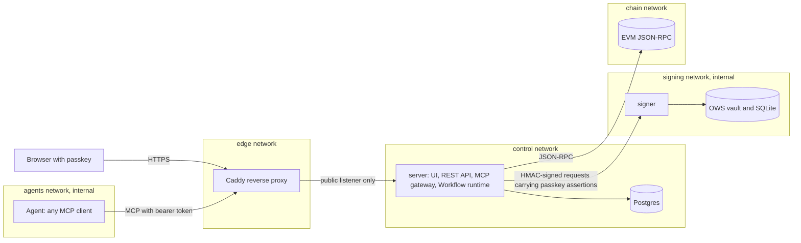
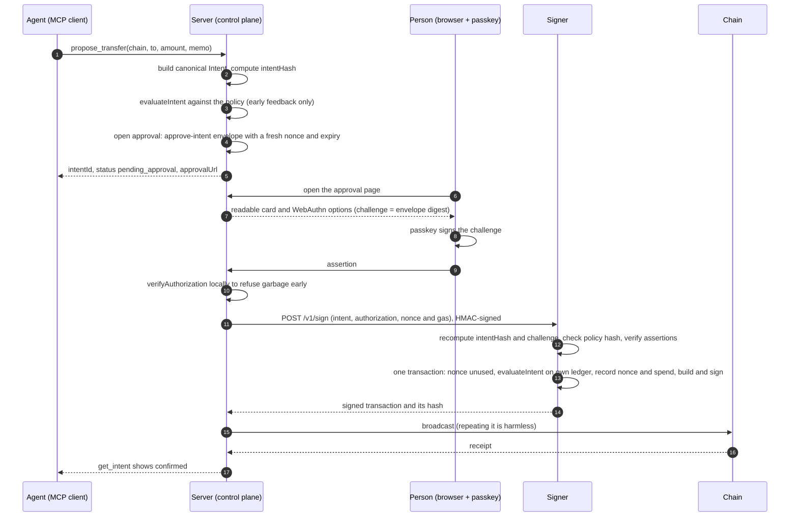

# Architecture

This project lets AI agents propose payments from wallets they cannot spend from on their own.
A person approves each payment with a passkey. A separate signer service checks that passkey
approval itself, checks the wallet's rules, and signs exactly one transaction.

Everything runs on hardware you control. No hosted service is required.

This page describes the design that the v0.1 plan
([`specs/agent-workspaces-v0.1.md`](../specs/agent-workspaces-v0.1.md)) and the shared contract
files fix. Two companion documents go deeper:

- [`approval-protocol.md`](./approval-protocol.md): the exact data formats, digests and checks.
- [`threat-model.md`](./threat-model.md): what each attacker can and cannot do, and the known limits.

## Words used on this page

Each term below has one meaning everywhere in this repository. The definitions follow the plan's
"Terms" list.

| Term           | Meaning                                                                                                                                                   |
| -------------- | --------------------------------------------------------------------------------------------------------------------------------------------------------- |
| Workspace      | The unit people share. It has members, agents and wallets.                                                                                                |
| Member         | A person in a workspace with one role: `owner`, `approver` or `viewer`.                                                                                   |
| Approver       | A member whose passkey the signer accepts for that workspace.                                                                                             |
| Agent          | A program you bring that talks to the system over MCP (Model Context Protocol). It has a token and one wallet of its own.                                 |
| Wallet         | An EVM address whose private key lives only in the signer. Kind `agent` or `treasury`.                                                                    |
| Intent         | One operation an agent proposes, such as "send 0.25 ETH to 0x1111…". It never changes after it is made. Its hash identifies it.                           |
| Policy         | The rules for one wallet: chains, which agents may propose, caps, allowed recipients and contracts, fee ceiling, how many approvals. The signer holds it. |
| Envelope       | A small statement of one thing a person authorizes, such as "sign this intent under this policy". Its digest is what the passkey signs.                   |
| Authorization  | An envelope together with the passkey signatures (WebAuthn "assertions") over it.                                                                         |
| Signer         | The isolated service that holds the wallet keys and decides whether to sign.                                                                              |
| Control plane  | The server that people and agents talk to. It can ask the signer. It cannot make the signer sign.                                                         |
| World          | The Workflow SDK's name for its storage and job-queue backend.                                                                                            |
| KEK / data key | A key-encryption key kept in a keyring file outside the database, and a per-run or per-workspace key that the KEK wraps inside the database.              |

The schemas for intent, policy and envelope are in
[`packages/protocol/src/intent.ts`](../packages/protocol/src/intent.ts),
[`packages/protocol/src/policy.ts`](../packages/protocol/src/policy.ts) and
[`packages/protocol/src/envelopes.ts`](../packages/protocol/src/envelopes.ts).

## Components and what each may reach

The diagram is the network layout the plan fixes. The rules it encodes:

- **Agent.** It reaches only Caddy. It cannot resolve the server, Postgres or the signer by name.
  On MCP it has seven tools, and none of them signs, approves or administers (plan, "MCP tools").
- **Caddy.** The only entry point. It forwards to the server's public listener.
- **Server (control plane).** A Hono server on Node. It serves the UI, the REST API under
  `/api/v1` ([`packages/api/src/routes.ts`](../packages/api/src/routes.ts)), the MCP gateway at
  `/mcp`, and runs the Workflow SDK runtime. The Workflow SDK's delivery routes have no
  authentication upstream, so they are mounted only on a second listener bound to loopback
  inside the server's container, never on the public one.
- **Postgres.** Holds the control plane's tables (schema `os`), the Workflow runtime's tables
  (schemas `workflow` and `graphile_worker`) and the wrapped data keys (schema `os_keys`).
- **Signer.** Reachable only from the server, on an internal network with no outbound route.
  It holds the wallet keys in an OWS (Open Wallet Standard) vault and its own records in SQLite.
  Its HTTP contract is [`packages/protocol/src/signer/api.ts`](../packages/protocol/src/signer/api.ts).
  It has no route that signs messages, typed data or raw hashes.
- **Chain.** The server talks to EVM nodes over JSON-RPC to read balances, simulate, estimate
  fees, broadcast and watch receipts. The signer never talks to a chain.

## One payment, end to end

The signer's checks, in order, are in
[the approval protocol](./approval-protocol.md#the-signing-rule).

## Where state lives

| State                                                                                                                                                                | Where                                                                                                        | Who can change it                                                                                              |
| -------------------------------------------------------------------------------------------------------------------------------------------------------------------- | ------------------------------------------------------------------------------------------------------------ | -------------------------------------------------------------------------------------------------------------- |
| Wallet private keys                                                                                                                                                  | OWS vault in the signer's data volume                                                                        | Only the signer                                                                                                |
| Authoritative wallet policy, approver registry, admin threshold, paused flag                                                                                         | Signer's SQLite                                                                                              | Only the signer, on passkey authorization (pausing and revoking need none, because they only remove authority) |
| Used envelope nonces, spend ledger, signed transactions, hash-chained decision log                                                                                   | Signer's SQLite                                                                                              | Only the signer                                                                                                |
| People, passkeys for sign-in, sessions, workspaces, memberships, agents, wallets (addresses and a mirror of the policy), approvals, intents, transactions, audit log | Postgres, schema `os` ([`apps/server/src/db/schema.ts`](../apps/server/src/db/schema.ts))                    | The server                                                                                                     |
| Workflow runs, steps, events, hooks, streams                                                                                                                         | Postgres, schemas `workflow` and `graphile_worker`                                                           | The Workflow runtime                                                                                           |
| Wrapped data keys and shred tombstones                                                                                                                               | Postgres, schema `os_keys` ([`packages/keys/src/data-key-store.ts`](../packages/keys/src/data-key-store.ts)) | The server                                                                                                     |
| Key-encryption keys                                                                                                                                                  | Keyring JSON file outside Postgres ([`packages/keys/src/keyring.ts`](../packages/keys/src/keyring.ts))       | The operator                                                                                                   |
| Shared request-signing secret                                                                                                                                        | A file read by both server and signer                                                                        | The operator                                                                                                   |

Some rows in Postgres mirror the signer's state for display (the policy on `wallets`, the paused
flag on `workspaces`, the `approver_credentials` table). The schema's comments say so. The
signer's copy is the one that counts.

### What is encrypted at rest

Two mechanisms, both rooted in the keyring file:

1. **Workflow payloads.** The upstream Postgres World stores payloads in plaintext. Our World
   ([`packages/world/src/index.ts`](../packages/world/src/index.ts)) adds the one method the
   Workflow SDK asks for, `getEncryptionKeyForRun()`. The SDK then encrypts inputs, outputs, hook
   payloads, stream chunks and step errors with AES-256-GCM under a key that exists once per run.
2. **Application columns.** The server seals the intent, its presentation, approval details,
   signed transactions and audit details into `bytea` columns under a per-workspace data key
   ([`packages/keys/src/seal.ts`](../packages/keys/src/seal.ts),
   [`apps/server/src/db/sealed.ts`](../apps/server/src/db/sealed.ts)).

Names, identifiers, statuses, hashes, addresses and policies stay readable on purpose. The full
table is in [the threat model](./threat-model.md#what-is-encrypted-at-rest).

## Why each boundary exists

- **The signer is a separate service.** The server talks to the internet, to browsers and to
  agents. If it could sign, a bug in any of that would be a bug in custody. The signer has one
  small API and no outbound network.
- **The signer checks passkeys itself.** If the signer trusted an "approved" flag from the
  server, anyone who controlled the server or wrote to its database could approve. The signer
  recomputes the WebAuthn challenge from the envelope and checks the assertion against its own
  approver registry ([`packages/protocol/src/webauthn/verify-authorization.ts`](../packages/protocol/src/webauthn/verify-authorization.ts)).
- **The signer, not OWS, enforces policy.** OWS's policy checks only a chain id the caller
  passes, and signs the bytes it is handed. So the signer builds each transaction from the
  approved intent and decides with `evaluateIntent`
  ([`packages/protocol/src/evaluate.ts`](../packages/protocol/src/evaluate.ts)). See
  [`specs/research/ows-node-sdk-in-an-isolated-signer.md`](../specs/research/ows-node-sdk-in-an-isolated-signer.md).
- **Policy lives in the signer.** A policy the server could edit alone would make the caps
  decorative. A new policy needs passkey approval of its hash.
- **One wallet per agent, each with its own mnemonic.** An OWS key file holds a whole mnemonic,
  so accounts derived from one seed would share one blast radius.
- **Keys live outside the database.** A copy of the database without the keyring file cannot
  be read. A keyring without the database is useless.
- **Workflow delivery routes stay on loopback.** Upstream they are unauthenticated. Anyone who
  could call them could forge workflow events.
- **Agents have their own network.** An agent may run untrusted code or follow injected
  instructions. It should be able to reach the MCP gateway and nothing else.

The decisions behind these boundaries, with the reasons, are recorded on the
[Wayfinder map](https://github.com/askgina/os/issues/1) (tickets #7 to #15) and in the plan's
Decision Log.
