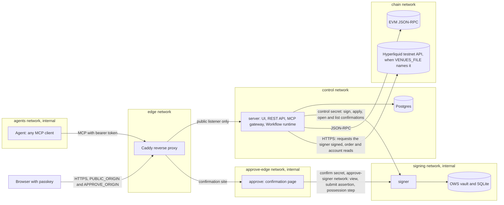
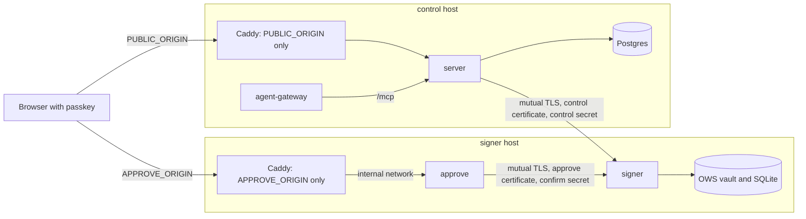
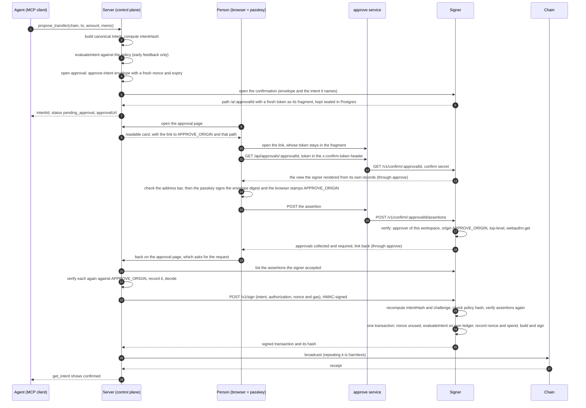
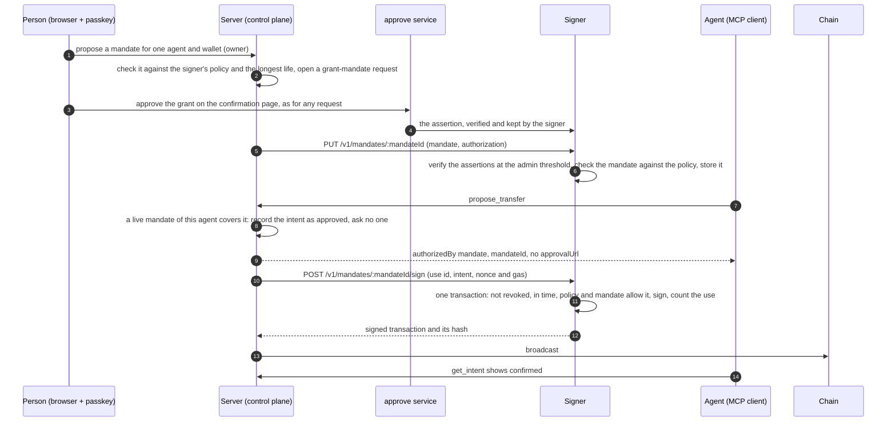
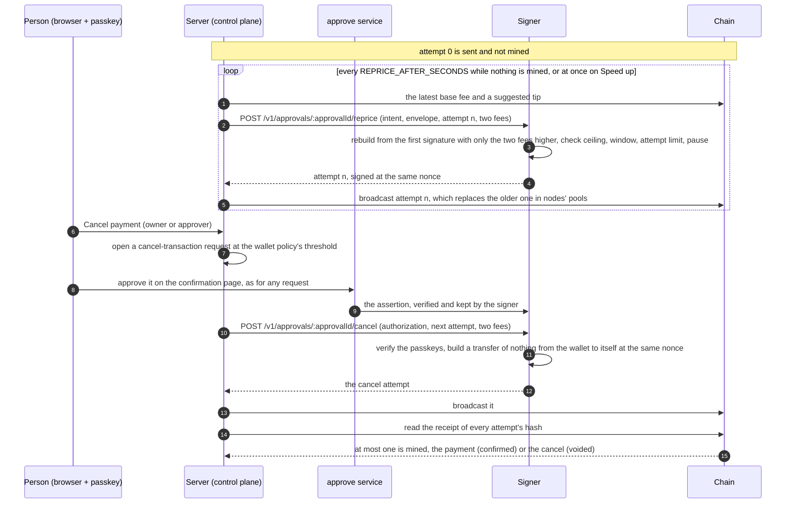
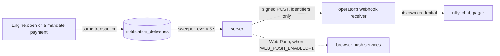
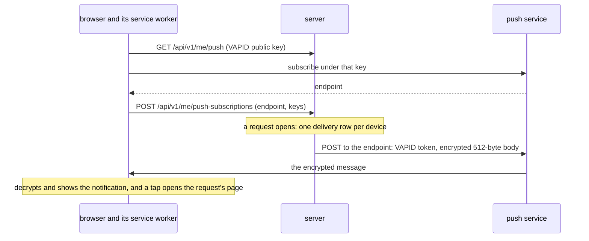
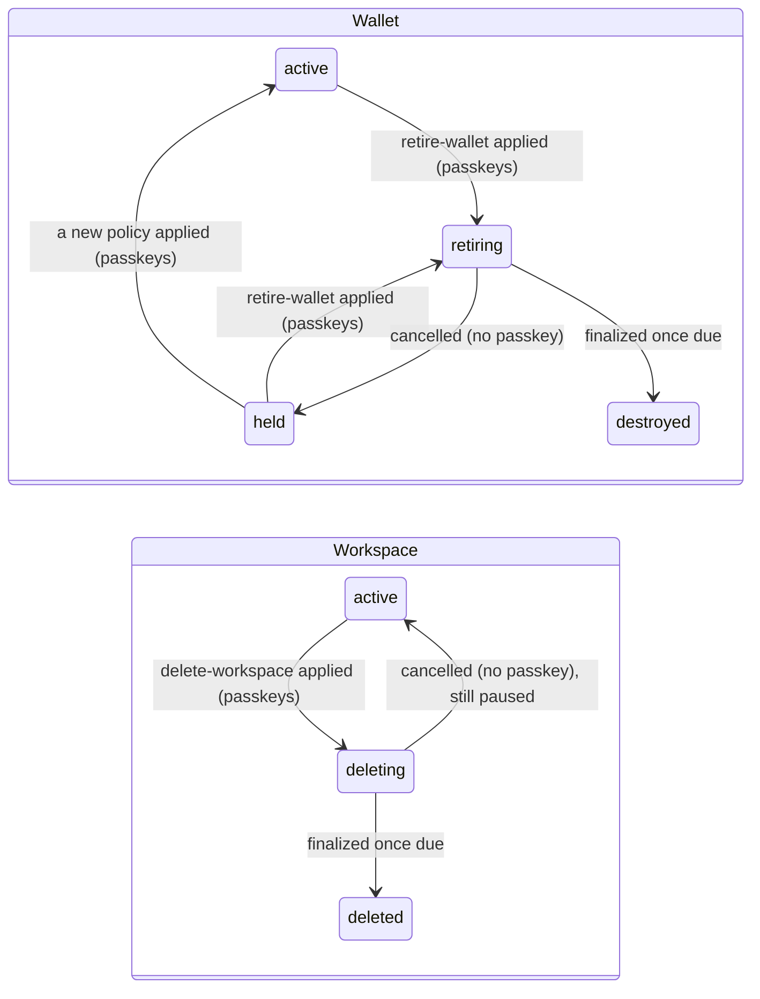
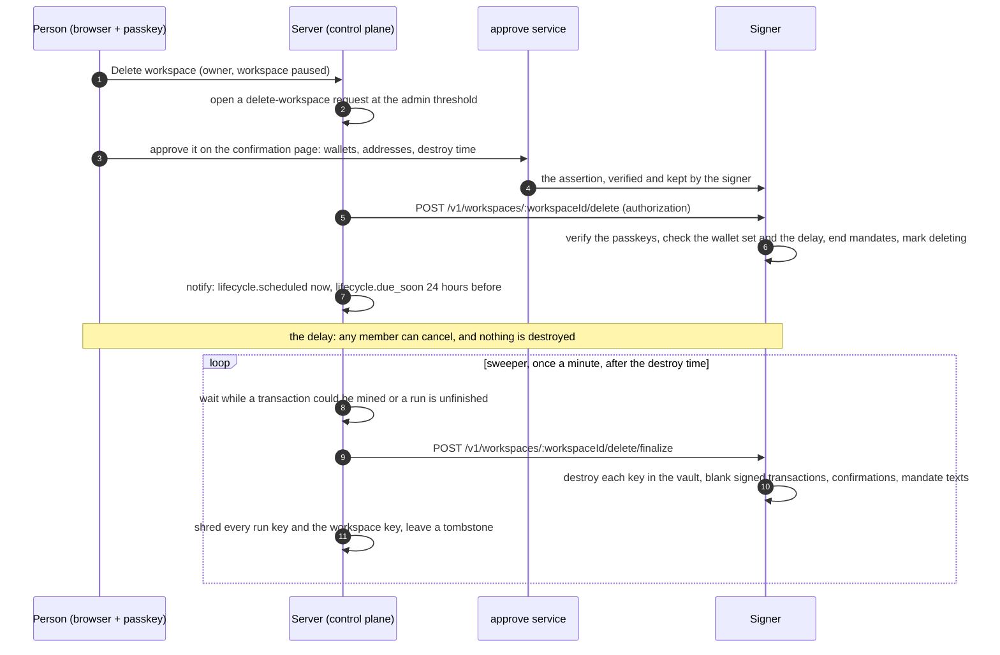

# Architecture

This project lets AI agents propose payments from wallets they cannot spend from on their own.
A person approves each payment with a passkey, on the signer's confirmation page. A separate
signer service checks that passkey approval itself, checks the wallet's rules, and signs exactly
one transaction. An agent can also propose a limit order on a Hyperliquid perpetual market, on
Hyperliquid's testnet only: the signer builds and signs it after the same passkey approval, and
the control plane posts it to the venue (see "A venue order, end to end").

Everything runs on hardware you control. No hosted service is required.

This page describes the design that the v0.1 plan
([`specs/agent-workspaces-v0.1.md`](../specs/agent-workspaces-v0.1.md)) and the shared contract
files fix. Two companion documents go deeper:

- [`approval-protocol.md`](./approval-protocol.md): the exact data formats, digests and checks.
- [`threat-model.md`](./threat-model.md): what each attacker can and cannot do, and the known limits.

## Words used on this page

Each term below has one meaning everywhere in this repository. The definitions follow the plan's
"Terms" list.

| Term           | Meaning                                                                                                                                                                   |
| -------------- | ------------------------------------------------------------------------------------------------------------------------------------------------------------------------- |
| Workspace      | The unit people share. It has members, agents and wallets.                                                                                                                |
| Member         | A person in a workspace with one role: `owner`, `approver` or `viewer`.                                                                                                   |
| Approver       | A member whose passkey the signer accepts for that workspace.                                                                                                             |
| Agent          | A program you bring that talks to the system over MCP (Model Context Protocol). It has a token and one wallet of its own.                                                 |
| Wallet         | An EVM address whose private key lives only in the signer. Kind `agent` or `treasury`. The same address is the wallet's Hyperliquid account.                              |
| Intent         | One operation an agent proposes, such as "send 0.25 ETH to 0x1111…" or "buy 0.01 BTC perpetual at 65,000 USD". It never changes after it is made. Its hash identifies it. |
| Venue          | An exchange the signer signs actions for but never talks to. One exists: Hyperliquid's testnet (`hyperliquid:testnet`). The control plane posts what the signer signed.   |
| Policy         | The rules for one wallet: chains, which agents may propose, caps, allowed recipients and contracts, fee ceiling, how many approvals. The signer holds it.                 |
| Envelope       | A small statement of one thing a person authorizes, such as "sign this intent under this policy". Its digest is what the passkey signs.                                   |
| Authorization  | An envelope together with the passkey signatures (WebAuthn "assertions") over it.                                                                                         |
| Mandate        | An approval given once, in advance, for one agent's transfers from one wallet to listed recipients, within caps, until an end time. The signer holds it.                  |
| Signer         | The isolated service that holds the wallet keys and decides whether to sign.                                                                                              |
| Control plane  | The server that people and agents talk to. It can ask the signer. It cannot make the signer sign.                                                                         |
| World          | The Workflow SDK's name for its storage and job-queue backend.                                                                                                            |
| KEK / data key | A key-encryption key kept outside the database (a keyring file, or an OpenBao Transit key), and a per-run or per-workspace key that the KEK wraps inside it.              |

The schemas for intent, policy and envelope are in
[`packages/protocol/src/intent.ts`](../packages/protocol/src/intent.ts),
[`packages/protocol/src/policy.ts`](../packages/protocol/src/policy.ts) and
[`packages/protocol/src/envelopes.ts`](../packages/protocol/src/envelopes.ts).

## Components and what each may reach



The diagram is the one-machine layout of `compose.yaml`; the two-host layout is in "Two trust
domains on two hosts" below. The rules it encodes:

- **Agent.** It reaches only Caddy. It cannot resolve the server, Postgres or the signer by name.
  On MCP it has eight tools, and none of them signs, approves or administers (plan, "MCP tools";
  `MCP_TOOL_NAMES` in [`gateway.ts`](../apps/server/src/mcp/gateway.ts)). `propose_order` is the
  eighth; `cancel_intent` also cancels an order of the agent's that rests at the venue.
- **Caddy.** The only entry point, with two sites. `PUBLIC_ORIGIN` goes to the server's public
  listener; `APPROVE_ORIGIN` goes to the `approve` service. It drops the `Cookie` header on the
  way to `approve`.
- **`approve` service.** The signer's confirmation page on its own origin
  ([`apps/approve`](../apps/approve)). It holds no key. It serves one hand-written page and
  relays four routes to the signer, each with the token from the link: the view of one
  approval, one passkey assertion, and for an approver change the possession challenge and the
  answer to it. Its secret reaches those four signer routes and no other. Only Caddy reaches it,
  on the internal `approve-edge` network, and it reaches only the signer, on the internal
  `approve-signer` network.
- **Server (control plane).** A Hono server on Node. It serves the UI, the REST API under
  `/api/v1` ([`packages/api/src/routes.ts`](../packages/api/src/routes.ts)), the MCP gateway at
  `/mcp`, and runs the Workflow SDK runtime. It lists and explains approval requests and links
  to the confirmation page, but has no route that takes a passkey approval: it collects the
  approvals the signer accepted there. The Workflow SDK's delivery routes have no
  authentication upstream, so they are mounted only on a second listener bound to loopback
  inside the server's container, never on the public one.
- **Postgres.** Holds the control plane's tables (schema `os`), the Workflow runtime's tables
  (schemas `workflow` and `graphile_worker`) and the wrapped data keys (schema `os_keys`).
- **Signer.** Reachable only from the server and the `approve` service, each on its own internal
  network with no outbound route, and each with its own request secret.
  It holds the wallet keys in an OWS (Open Wallet Standard) vault and its own records in SQLite.
  Its HTTP contract is [`packages/protocol/src/signer/api.ts`](../packages/protocol/src/signer/api.ts).
  It has no route that signs messages, typed data or raw hashes. Its venue route signs typed data
  it built itself from an approved intent; no route takes typed data from the caller.
- **Chain.** The server talks to EVM nodes over JSON-RPC to read balances, simulate, estimate
  fees, broadcast and watch receipts. The signer never talks to a chain.
- **Venue.** With `VENUES_FILE` set, the server posts the signer's signed requests to the venue's
  `/exchange` and reads its `/info`: market metadata, an order's status by its client order id,
  the account's value, positions and resting orders
  ([`apps/server/src/execution/venues/hyperliquid.ts`](../apps/server/src/execution/venues/hyperliquid.ts)).
  The signer never talks to the venue either. A wallet's key is one OWS mnemonic, which also
  derives addresses on other chain families; the signer builds nothing for them and cannot spend
  from them.

A bot of the private Busy fork (`askgina/busy`, name not final) is an agent like any other: it
holds its own agent token, which the fork's Hub stores sealed and its runner hands to the bot as a
secret file, and it reaches the gateway over the `os_agents` network. The fork adds no approval
path; approvals stay on the signer's confirmation page, and the fork does not receive the
webhook. Its runner holds a Docker socket and must not share the signer's host. Only a stub
gateway has been used in its gates so far; no Busy bot payment is proven end to end. See "A
compromised host of bots" in the [threat model](threat-model.md).

## Two trust domains on two hosts

The stack has two trust domains. The signer's holds the wallet keys and decides; the control
plane's holds everything else and asks. On one machine they share root. The split deployment
([`deploy/split/`](../deploy/split/),
[`deploy/README.md`](../deploy/README.md#running-the-signer-on-its-own-host)) gives each its own
host:



- **What crosses between the hosts:** one connection, from the server to the signer's port 8787,
  published only on the signer host's private address. It is TLS 1.3 in which each side accepts
  exactly one certificate of the other, made by `deploy/split/make-peer-certs.sh`; there is no
  certificate authority. The signer maps the client certificate to a scope (control or confirm)
  before it checks the request signature, which every request still carries.
- **What stays on the signer host:** the vault, the signer's SQLite, `token-key`,
  `vault-passphrase`, the confirm secret, the confirmation page and its edge (plan decision D7:
  a confirmation page on the control host would give that host the display again).
  `init --domain=signer` makes these secrets; only the request secret and the control plane's
  certificate and key are copied to the control host.
- **What stays on the control host:** Postgres, the keyring (or the OpenBao credentials), the
  webhook secret and the VAPID key. `init --domain=control` makes the keyring and the two
  secrets, and takes the request secret from the operator's copy.
- **Outbound:** the signer opens no connection; `deploy/split/nftables-signer.conf` is an example
  of host rules that enforce it. The `approve` service has internal networks only. The signer
  host's edge is the one container there that reaches out, to an ACME server.

On Kubernetes ([`deploy/k8s/`](../deploy/k8s/)) the control plane runs in the cluster and, in
production, the signer host stays outside it, joined by the same mutual TLS (plan decision D4).
The `kind` overlay puts the signer in the cluster, for CI and evaluation only. The manifests have
not run in CI yet.

### More than one server replica

The server keeps nothing between requests that another replica would need: every replica
connects to the same Postgres and the same signer, and anything that must happen once is decided
in the database.

| What                                             | How replicas agree                                                                                |
| ------------------------------------------------ | ------------------------------------------------------------------------------------------------- |
| An agent's request limit, failed authentications | Token buckets in `os.rate_limits` (UNLOGGED), one row per bucket, counted by the database's clock |
| The finishing of retirements and deletions       | One bucket in `os.rate_limits`: once a minute across all replicas                                 |
| The setup token                                  | Never minted at boot; `cli.ts setup-token` replaces it under an advisory lock                     |
| Account nonces, reprices and cancels             | Advisory transaction locks per wallet and chain, and per approval                                 |
| Notifications                                    | Outbox rows claimed with `FOR UPDATE SKIP LOCKED` and leased for 60 seconds                       |
| Workflow steps                                   | The World's queue in Postgres; each replica runs `WORKFLOW_WORKER_CONCURRENCY` workers            |
| Which workflow bundle runs                       | A shared advisory lock per bundle (class `18680`): a replica on another bundle refuses to start   |
| A shredded data key                              | `NOTIFY os_keys_shred`; every replica listens and drops the key from its cache                    |

Each replica answers `GET /readyz` with 200 once its database answers and its World delivers
runs. On Compose the edges find replicas by DNS and send a request that cannot reach its replica
to another; on Kubernetes a Service does. Upgrades stop every replica first, because a workflow
run is not pinned to the bundle that started it. The two-replica gate on the real stack is
written and has not run; the unit tests with two gateways on one database passed in CI.

## One payment, end to end

A person opens the request in the control plane and follows its link to the signer's
confirmation page, on its own origin, `APPROVE_ORIGIN`. There they check the address bar, read
the view the signer built from its own records, and approve with a passkey. The control plane
then collects the approvals from the signer and asks it to sign. The signer accepts an approval
only when the browser made it at `APPROVE_ORIGIN`, top-level and not in a frame, as a
`webauthn.get`; an approval made on any page the control plane serves is refused.



Every other kind of request (a policy change, an approver change, the admin threshold, resuming
a workspace, a sweep) is approved the same way, on the same page; the control plane then asks
the signer to apply it instead of signing. The signer's checks, in order, are in
[the approval protocol](./approval-protocol.md#the-signing-rule). The design of the
confirmation page is in [`specs/trusted-display.md`](../specs/trusted-display.md).

An approver change has one step first. The person being added opens the request's link on the
device that holds the new passkey and presses "This passkey is mine". The page asks that passkey
to sign a challenge the signer issued, and the signer checks the answer against the key in the
request. Only then can anyone approve. The page shows the person being added the key's
fingerprint; they read it to the approvers over a call or in person, and the approvers compare
it with the fingerprint their page shows. The signer applies the change only when that proof is
recorded for that exact request
([the approval protocol, section 10](./approval-protocol.md#the-confirmation-routes)).

## A venue order, end to end

A venue order takes the payment's path up to the approval, and then differs in two places: the
signer encodes a venue action instead of an EVM transaction, and the control plane posts it to
the venue instead of broadcasting it to a chain
([`specs/non-evm-operations.md`](../specs/non-evm-operations.md)).

| Step            | EVM payment                                              | Venue order                                                                                                                                                 |
| --------------- | -------------------------------------------------------- | ----------------------------------------------------------------------------------------------------------------------------------------------------------- |
| Proposed with   | `propose_transfer`, `propose_contract_call`              | `propose_order`; a withdrawal is `propose_transfer` on `hyperliquid:testnet`                                                                                |
| Checked before  | The policy, a simulation                                 | The policy's venue rules, and the venue's metadata: the coin still at the policy's index and listed (`market_metadata_mismatch`), the tick (`invalid_tick`) |
| Covered by      | One approval, or a mandate                               | One approval only: no mandate covers an order or a withdrawal (D7)                                                                                          |
| Approved on     | The signer's confirmation page                           | The same page, showing market, index, side, size, limit price, notional, time in force, reduce-only, the submit window, and that caps are not loss caps     |
| Signer route    | `POST /v1/sign`                                          | `POST /v1/venue/sign`                                                                                                                                       |
| Who encodes     | The signer builds the transaction                        | The signer builds the action (msgpack and EIP-712, its own encoder), with a nonce from its venue ledger and an `expiresAfter` inside the submit window      |
| Who sends       | The server broadcasts the raw transaction                | The server posts the signer's request body to `/exchange`, byte for byte                                                                                    |
| Followed by     | Receipts by transaction hash                             | The order's status by its client order id, every 5 to 60 seconds for an hour, then every 5 minutes                                                          |
| Stopped with    | A reprice or a cancel, the cancel approved with passkeys | `cancel_intent` or "Cancel order": the signer signs `cancelByCloid` with no passkey, also while paused (D4)                                                 |
| Loss bounded by | The policy's caps                                        | The account's value at the venue; the caps bound new orders only                                                                                            |

```mermaid
sequenceDiagram
  autonumber
  participant Ag as Agent (MCP client)
  participant S as Server (control plane)
  participant H as Venue (Hyperliquid testnet)
  participant P as Person (confirmation page + passkey)
  participant G as Signer
  Ag->>S: propose_order(network, coin, side, size, limitPrice, timeInForce, reduceOnly, memo)
  S->>S: evaluateIntent against the policy's venue rules (early feedback only)
  S->>H: POST /info meta: the coin at the policy's index, not delisted
  S->>S: open approval: approve-intent envelope, never a mandate
  S-->>Ag: intentId, status pending_approval, approvalUrl
  P->>G: approve on the confirmation page, as for a payment
  S->>G: POST /v1/venue/sign (intent, authorization), HMAC-signed
  G->>G: verify assertions, policy and caps on its own ledger; build the action; nonce and expiresAfter
  G->>G: sign once, check the vault's signature, record the request and the spend
  G-->>S: account, client order id, request body
  S->>S: store the body sealed in venue_orders.request
  S->>H: POST /exchange, the body byte for byte
  H-->>S: resting, filled or refused
  S->>H: POST /info orderStatus by client order id, until final
  Ag->>S: cancel_intent (or a person's "Cancel order")
  S->>G: POST /v1/venue/orders/:approvalId/cancel, no passkey
  G-->>S: signed cancelByCloid
  S->>H: POST /exchange
```

The signer signs only `hyperliquid:testnet`, a constant in its code, and the server stops at
boot when `VENUES_FILE` names mainnet: whether mainnet may ship is the owner's open question
(D2). Fills, positions and the account's value come from the venue through the control plane;
the signer sees none of them, and the web app labels them as reported, not verified. What each
party can do is in [the threat model](./threat-model.md#venue-orders); the exact signing and
cancel rules are in [the approval protocol, section 8](./approval-protocol.md#venue-orders).

## A payment under a mandate

People can approve a series of one agent's transfers in advance with a mandate
([`specs/approval-mandates.md`](../specs/approval-mandates.md)). An owner asks for it; approvers
approve the `grant-mandate` request on the confirmation page at the workspace's admin threshold,
as above, and the signer verifies their assertions and stores the mandate. From then on, when a
proposal fits a live mandate of its agent, the control plane opens no request: it records the
intent as approved and asks the signer to sign under the mandate. The signer checks the mandate
and the wallet's policy against its own counts, signs, and counts the payment in the same
database transaction. Anything the mandate does not cover goes to the inbox as before.



Any owner or approver revokes a mandate without a passkey, because that only removes authority.
The signer also ends mandates on its own: when a passkey that granted one is removed, when the
restore fence moves, and on the operator's command on the signer host. The exact checks are in
[the approval protocol, section 8](./approval-protocol.md#8-the-signing-rule); what a mandate
lets a compromised control plane or a stolen agent token do is in
[the threat model](./threat-model.md#mandates).

## A stuck payment: repriced or cancelled

A payment that is signed and sent may not be mined: the base fee rose above its fee cap, its tip
is too low, or a node dropped it. It keeps its account nonce, and the wallet's later transactions
on that chain wait behind it. Nothing new is approved to fix it: the signer signs further
**attempts** under the approval the payment already has, all at the first signature's nonce, so
at most one can be mined ([`specs/stuck-transaction-repricing.md`](../specs/stuck-transaction-repricing.md)).

A **reprice** is the same transaction with both fees higher. The server asks for one by itself
once the newest attempt is `REPRICE_AFTER_SECONDS` old, and an owner or approver can ask now with
"Speed up"; neither needs a passkey. The signer rebuilds the transaction from its own record of
the first signature and lets only `maxFeePerGas` and `maxPriorityFeePerGas` rise, within the fee
ceiling people approved (`intent.maxFeeWei`, and the policy's current cap if lower), within a
window after the first signature and a number of attempts, and never while the workspace is
paused.

A **cancel** is a new request, `cancel-transaction`, which people approve on the confirmation
page at the wallet policy's threshold like any other. The signer then signs a transfer of
nothing from the wallet to itself at the same nonce. From then on every attempt is a cancel.
It is an attempt, not a guarantee: whichever the chain mines first wins.



The server follows every attempt's hash until one is mined at the chain's confirmation depth.
Neither a reprice nor a cancel adds or gives back a spend: the signer counted the payment when it
first signed it. Agents see every attempt in `get_intent` and have no tool for either. What a
compromised control plane can do with this, at most burn fees up to each approval's ceiling, is
in [the threat model](./threat-model.md#stuck-transactions); the exact checks are in
[the approval protocol, section 8](./approval-protocol.md#reprices-and-cancels).

## Notifications

People see waiting requests in the approval inbox. The server can also tell them elsewhere, and
does so through an outbox ([`apps/server/src/notify/`](../apps/server/src/notify/)). The
transaction that opens a request, or records a payment under a mandate, also writes one row per
notification to `notification_deliveries`, so a request never exists without its notification and
a crash loses none. Every three seconds the sweeper claims the rows that are due, leases them for
a minute so two passes never send one twice, and sends each: at least once, retried with backoff
until it is delivered, its request is no longer waiting, or eight attempts failed.



The one channel built in besides Web Push is a webhook (`NOTIFY_WEBHOOK_URL`): a `POST` of
canonical JSON with identifiers, the request's kind, its expiry and a link to its page, signed
with HMAC-SHA-256 under `notify-webhook-secret`, a file in the server's secrets volume. Every other
channel is a sidecar of that webhook, a small service next to the stack that verifies the
signature and forwards with its own credential: [`examples/ntfy-sidecar`](../examples/ntfy-sidecar)
publishes fixed text to an ntfy topic. The format, the checks a receiver makes and the retry rules
are in [`deploy/README.md`](../deploy/README.md#notifications).

Web Push to people's own browsers is off unless the operator sets `WEB_PUSH_ENABLED=1`, and then
each person turns it on per device. The server identifies itself to browsers' push services with
a VAPID key (RFC 8292), a P-256 key in the file `vapid-key.pem` that `init` creates. A browser
subscribes under that key's public half, which the web app reads from `GET /api/v1/me/push`, and
the web app sends the subscription to `POST /api/v1/me/push-subscriptions`: an endpoint at the
browser's push service and the browser's own keys. The server keeps it only if the endpoint is
`https:` under a host of `WEB_PUSH_ENDPOINT_HOSTS`.



When a push row is due, the server checks that the person can still approve, has not approved,
wants it and is outside their quiet hours, then builds the message at the workspace's content
level ([`content.ts`](../apps/server/src/notify/content.ts)): a Declarative Web Push JSON with a
title, a body and a link to the request's page. It encrypts that JSON for the device with the
subscription's keys (RFC 8291, `aes128gcm`), padded to 512 bytes, and posts it to the endpoint
with a VAPID token valid for 12 hours, a `Topic` that is a hash of the request's id, and a time to
live that ends with the request
([`webpush/`](../apps/server/src/notify/webpush/)). The push service passes it to the device,
where the browser, or the web app's service worker `/sw.js`, shows it. A reminder reuses the
same `Topic` and the same notification tag, so it replaces the first one. A push service's 404 or
410 deletes the subscription. What each party learns is in
[the threat model](./threat-model.md#notifications).

No notification carries what a request is about, and none is an input to an approval: the
signer is not involved at any step.

## Retiring a wallet and deleting a workspace

People end a wallet by retiring it, and a workspace by deleting it with every wallet in it
([`specs/workspace-lifecycle.md`](../specs/workspace-lifecycle.md)). Both end with the signer
destroying keys, so both are approved like a signature: an owner asks, and people approve the
`retire-wallet` or `delete-workspace` request on the confirmation page at the workspace's admin
threshold. The envelope names the wallets with their addresses (for a deletion, exactly the
wallets whose keys the signer still holds) and the destroy time. To empty a wallet first, people
sweep it to an allowed address or the treasury.

The signer keeps each lifecycle in its SQLite (schema version 7). A workspace is `active`,
`deleting` or `deleted`; a wallet is `active`, `retiring`, `held` or `destroyed`:



- **Applying** (`POST /v1/wallets/:walletId/retire`, `POST /v1/workspaces/:workspaceId/delete`
  on the signer) needs the passkeys. From then on the wallet, or every wallet of the workspace,
  signs nothing, and every live mandate of it ends in the same transaction. A deletion also
  pauses the workspace and records each wallet's state before it (`active` or `held`); while it
  waits the signer opens and signs only a `cancel-transaction`, so a stuck transaction can be
  cleared first.
- **Cancelling** needs no passkey, because it only keeps keys. A cancelled retirement leaves the
  wallet `held`: it signs nothing until people approve a new policy for it. A cancelled deletion
  puts each wallet back to the state the deletion found and leaves the workspace paused until
  people approve `resume-workspace`. Mandates stay ended either way.
- **Finalizing** needs no passkey either: it does only what people approved, once the destroy
  time has passed by the signer's clock. The server's sweeper asks once a minute
  ([`apps/server/src/lifecycle/finalize.ts`](../apps/server/src/lifecycle/finalize.ts)), and only
  when no transaction of the subject can still be mined and no workflow run of it is unfinished.



Who enforces what:

| Rule                                                                                                                           | Enforced by                                                                                                                                            |
| ------------------------------------------------------------------------------------------------------------------------------ | ------------------------------------------------------------------------------------------------------------------------------------------------------ |
| Passkeys at the admin threshold over the exact wallet set and destroy time                                                     | The signer, against its own approver registry and records (`wallet_set_mismatch`)                                                                      |
| The delay lies between `SIGNER_MIN_DESTROY_DELAY_SECONDS` and `SIGNER_MAX_DESTROY_DELAY_SECONDS`                               | The signer (`destroy_delay_out_of_range`); the server checks it first for a clear error                                                                |
| No key is destroyed before the destroy time                                                                                    | The signer's clock (`destroy_not_due`)                                                                                                                 |
| A retiring or destroyed wallet, or a deleting or deleted workspace, signs nothing                                              | The signer (`wallet_retired`, `workspace_deleting`, `workspace_deleted`); the confirmation page shows such a request as closed                         |
| Mandates end when the request is applied                                                                                       | The signer, in the same transaction                                                                                                                    |
| A deletion is asked for only while the workspace is paused; who may ask (owner) and cancel (any member; approver for a wallet) | The server                                                                                                                                             |
| Finalize waits for transactions that could still be mined and for unfinished runs                                              | The server: a compromised control plane can skip this, but not destroy early                                                                           |
| Writes to a workspace that is not `active` are refused, except pause, cancel, revoking a mandate and the notification level    | The server (`conflict`, `workspace_deleting` or `workspace_deleted`); routes keyed by an approval or intent stay open, so a stuck one can be cancelled |
| Data keys are shredded and the tombstone left                                                                                  | The server, after the signer's finalize                                                                                                                |
| The balances shown before a deletion                                                                                           | Nobody: the server reads them for display, partially, and the signer cannot see them                                                                   |

Removing an agent is disabling it, which is already final: it ends the agent's mandates and,
now, its payments still waiting for people, which the server also revokes at the signer. The
only way a wallet key leaves the signer is the operator's `admin.ts export-wallet` on the signer
host; no route exports one. What each party can do with this is in
[the threat model](./threat-model.md#retiring-a-wallet-and-deleting-a-workspace); the exact
checks are in [the approval protocol, section 8](./approval-protocol.md).

## Exporting, cloning and erasing a person

None of these adds authority at the signer. What reaches it goes through the paths that create a
workspace and its wallets by hand, and through requests people approve on the confirmation page.

- **Template** (`GET /api/v1/workspaces/:workspaceId/export/template`, an owner): the
  workspace's configuration, with its members as user ids and its wallets as references
  (`w1`, `w2`, …) carrying kind, label, agent name and policy
  ([`apps/server/src/lifecycle/template.ts`](../apps/server/src/lifecycle/template.ts)).
- **Record** (`GET /api/v1/workspaces/:workspaceId/export/record`, an owner with a passkey
  sign-in at most 300 seconds old): JSON Lines, opened from the sealed columns, with the audit
  chain and the signer's decision chain; `verify-record.ts` checks it offline
  ([`export.ts`](../apps/server/src/lifecycle/export.ts),
  [`verify-record.ts`](../apps/server/src/lifecycle/verify-record.ts)).
- **Clone** (`POST /api/v1/workspaces/:workspaceId/clone`, an owner of the source) and
  **import** (`POST /api/v1/workspaces/import`, anyone signed in, with a template file): a new
  workspace through the same paths that create one by hand
  ([`clone.ts`](../apps/server/src/lifecycle/clone.ts)): new keys at the signer, new agent
  tokens shown once, invite links for members, and one `set-policy` request per wallet.
- **Erasing a person** (`POST /api/v1/me/erase`, the person with a recent passkey sign-in, or
  the operator's `apps/server/src/identity/erase-cli.ts --user <id>`): first `remove-approver`
  requests for the person's passkeys, then, once none approves anywhere, the person's rows
  ([`apps/server/src/identity/erase.ts`](../apps/server/src/identity/erase.ts)).

Who enforces what:

| Rule                                                                                                              | Enforced by                                                                                        |
| ----------------------------------------------------------------------------------------------------------------- | -------------------------------------------------------------------------------------------------- |
| A clone carries no key, mandate, approver, approval or history                                                    | The server, by building the copy through its creation paths; the signer creates new keys           |
| A clone's limits apply only once approved                                                                         | The signer: each policy is a `set-policy` request, approved with passkeys on the confirmation page |
| A clone starts with one approver and an admin threshold of 1                                                      | The signer, which registers the new workspace with the person cloning as its only approver         |
| The record needs a recent passkey sign-in                                                                         | The server (`sign_in_again`)                                                                       |
| A person stops approving only when people approve their `remove-approver` requests                                | The signer, at the admin threshold; the same request ends the mandates their passkey granted       |
| Erasing is refused while it would leave a workspace without an owner or enough approvers, or one is being deleted | The server (`last_owner`, `last_approver`, `workspace_deleting`)                                   |
| Erasing keeps the user id, so audit and decision chains still verify                                              | The server: it rewrites no sealed value and no chained field                                       |

Export, clone, import and erasing have unit tests; no release gate runs them on the real stack.
What each party can do with them is in
[the threat model](./threat-model.md#exporting-cloning-and-erasing-a-person).

## Where state lives

| State                                                                                                                                                                                                                                                 | Where                                                                                                                                                                                                           | Who can change it                                                                                              |
| ----------------------------------------------------------------------------------------------------------------------------------------------------------------------------------------------------------------------------------------------------- | --------------------------------------------------------------------------------------------------------------------------------------------------------------------------------------------------------------- | -------------------------------------------------------------------------------------------------------------- |
| Wallet private keys                                                                                                                                                                                                                                   | OWS vault in the signer's data volume                                                                                                                                                                           | Only the signer                                                                                                |
| Authoritative wallet policy, approver registry, admin threshold, paused flag                                                                                                                                                                          | Signer's SQLite                                                                                                                                                                                                 | Only the signer, on passkey authorization (pausing and revoking need none, because they only remove authority) |
| Used envelope nonces, spend ledger, signed transactions, hash-chained decision log                                                                                                                                                                    | Signer's SQLite                                                                                                                                                                                                 | Only the signer                                                                                                |
| Mandates, the people who granted each, and every use counted under them                                                                                                                                                                               | Signer's SQLite                                                                                                                                                                                                 | Only the signer, on passkey authorization of the grant (revoking needs none)                                   |
| Each workspace's and wallet's lifecycle (`active`, `deleting`, `deleted`; `active`, `retiring`, `held`, `destroyed`), destroy time, each wallet's state before a deletion                                                                             | Signer's SQLite                                                                                                                                                                                                 | Only the signer, on passkey authorization (cancelling and finalizing need none)                                |
| People (an erased person keeps a row: the id, the name "Erased person" and `erased_at`), passkeys for sign-in, sessions, workspaces, memberships, agents, wallets (addresses and a mirror of the policy), approvals, intents, transactions, audit log | Postgres, schema `os` ([`apps/server/src/db/schema.ts`](../apps/server/src/db/schema.ts))                                                                                                                       | The server                                                                                                     |
| Workflow runs, steps, events, hooks, streams                                                                                                                                                                                                          | Postgres, schemas `workflow` and `graphile_worker`                                                                                                                                                              | The Workflow runtime                                                                                           |
| Wrapped data keys and shred tombstones                                                                                                                                                                                                                | Postgres, schema `os_keys` ([`packages/keys/src/data-key-store.ts`](../packages/keys/src/data-key-store.ts))                                                                                                    | The server                                                                                                     |
| Key-encryption keys                                                                                                                                                                                                                                   | Keyring JSON file outside Postgres ([`packages/keys/src/keyring.ts`](../packages/keys/src/keyring.ts)), or an OpenBao Transit key with `KEY_PROVIDER=openbao` ([`transit.ts`](../packages/keys/src/transit.ts)) | The operator                                                                                                   |
| Shared request-signing secret                                                                                                                                                                                                                         | A file read by both server and signer; with the signer on its own host, made there and copied to the control host                                                                                               | The operator                                                                                                   |
| Mutual TLS certificates and keys between the hosts                                                                                                                                                                                                    | Files in each host's secret volumes, installed by `init` from the operator's import directory                                                                                                                   | The operator                                                                                                   |
| Each venue request the signer signed: its nonce at the venue, expiry, client order id and the exact body; every cancel it signed for an order; each wallet's last venue nonce per network; an order's notional in the spend ledger (`usd6`)           | Signer's SQLite, `venue_signatures`, `venue_cancels`, `venue_nonces`, `spends`                                                                                                                                  | Only the signer                                                                                                |
| What the venue answered about each signed request: status, venue order id, filled size, average price, the venue's refusal text, with the request body sealed                                                                                         | Postgres, `os.venue_orders`                                                                                                                                                                                     | The server                                                                                                     |
| The venues the server posts to                                                                                                                                                                                                                        | A JSON file named by `VENUES_FILE`; never a mainnet venue                                                                                                                                                       | The operator                                                                                                   |
| Rate-limit buckets shared by every server replica                                                                                                                                                                                                     | Postgres, `os.rate_limits` (UNLOGGED: a crash or failover empties it)                                                                                                                                           | The server                                                                                                     |
| Confirmation records, the hash of each link's token, assertions made on the confirmation page, possession challenges and proofs of new approver keys                                                                                                  | Signer's SQLite                                                                                                                                                                                                 | Only the signer                                                                                                |
| Confirmation request secret                                                                                                                                                                                                                           | A file read by the signer and, as a copy, by the `approve` service                                                                                                                                              | The operator                                                                                                   |
| Notifications waiting to be sent, and each one's outcome                                                                                                                                                                                              | Postgres, `os.notification_deliveries`                                                                                                                                                                          | The server                                                                                                     |
| Webhook signing secret                                                                                                                                                                                                                                | A file read by the server; the operator gives the receiver a copy                                                                                                                                               | The operator                                                                                                   |
| Push subscriptions (each device's endpoint, keys and label), each person's notification switches per workspace and quiet hours                                                                                                                        | Postgres, `os.push_subscriptions`, `os.notification_preferences`, `os.users.quiet_hours`                                                                                                                        | The server, at the person's request; it deletes a subscription its push service reports gone                   |
| Each workspace's notification content level (`count` or `summary`)                                                                                                                                                                                    | Postgres, `os.workspaces.notification_detail`                                                                                                                                                                   | The server, at an owner's request, recorded in the audit log                                                   |
| VAPID key (identifies the server to push services; every subscription is bound to it)                                                                                                                                                                 | A file read by the server, `vapid-key.pem` in its secrets volume                                                                                                                                                | The operator; `init` creates it when it is missing and never replaces it                                       |

Some rows in Postgres mirror the signer's state for display (the policy on `wallets`, the paused
flag on `workspaces`, the `lifecycle` and `destroy_after` columns of both, the
`approver_credentials` table, the `mandates` table). The schema's comments say so. The signer's
copy is the one that counts.

What a deleted workspace leaves, in each store:

- **OWS vault:** nothing of its wallets. The signer deletes each wallet's file and every OWS API
  key file named after it.
- **Signer's SQLite:** the workspace as `deleted` and its wallets as `destroyed`, with empty
  sealed credentials, empty signed transactions and attempts, and empty venue requests and
  cancels; used nonces, approvals, spends, policies, mandate ids, hashes, grantors and uses, and
  the decision log. Its approvers, confirmations, assertions and possession challenges are
  deleted and its mandate texts blanked.
- **Postgres, schema `os`:** a tombstone: ids, statuses, times, hashes, addresses and the audit
  chain, whose sealed details no key opens any more. Names and labels are cleared, agents are
  disabled with their token hashes replaced, and memberships, invites, approver mirrors,
  assertions, rejections, nonce reservations and notification preferences are removed. Former
  members no longer see the workspace.
- **Postgres, schemas `workflow` and `os_keys`:** the workflow rows stay, encrypted under run keys
  that are now shredded tombstones, as is the workspace's data key.
- **Backups taken before the deletion:** all of it, readable with the keyring saved beside them,
  until the operator destroys them ([`deploy/README.md`](../deploy/README.md#backups-and-restoring)).

### What is encrypted at rest

Two mechanisms, both rooted in the key-encryption keys, which the key provider holds: the
keyring file (`KEY_PROVIDER=file`, the default) or an OpenBao Transit key
(`KEY_PROVIDER=openbao`). When the provider cannot be reached, every operation that needs a key
fails; nothing falls back to another provider or to plaintext
([`packages/keys`](../packages/keys/README.md#choosing-the-key-provider)).

1. **Workflow payloads.** The upstream Postgres World stores payloads in plaintext. Our World
   ([`packages/world/src/index.ts`](../packages/world/src/index.ts)) adds the one method the
   Workflow SDK asks for, `getEncryptionKeyForRun()`. The SDK then encrypts inputs, outputs, hook
   payloads, stream chunks and step errors with AES-256-GCM under a key that exists once per run.
2. **Application columns.** The server seals the intent, its presentation, approval details,
   the confirmation page's link with its token, mandates, signed transactions, signed venue
   requests and audit details into `bytea` columns under a per-workspace data key
   ([`packages/keys/src/seal.ts`](../packages/keys/src/seal.ts),
   [`apps/server/src/db/sealed.ts`](../apps/server/src/db/sealed.ts)).

Names, identifiers, statuses, hashes, addresses and policies stay readable on purpose. The full
table is in [the threat model](./threat-model.md#what-is-encrypted-at-rest).

## Why each boundary exists

- **The signer is a separate service.** The server talks to the internet, to browsers and to
  agents. If it could sign, a bug in any of that would be a bug in custody. The signer has one
  small API and no outbound network.
- **The confirmation page has its own origin and its own service.** A passkey signs a digest,
  not what the page showed, and the browser writes the page's origin into the assertion. A page
  the control plane serves can show one thing and get a signature for another. On an origin it
  does not serve, with a view the signer renders from its own records, it cannot, and the signer
  accepts no other origin. The `approve` service holds no key, so its compromise brings back the
  display gap and nothing more.
- **The signer checks passkeys itself.** If the signer trusted an "approved" flag from the
  server, anyone who controlled the server or wrote to its database could approve. The signer
  recomputes the WebAuthn challenge from the envelope and checks the assertion against its own
  approver registry ([`packages/protocol/src/webauthn/verify-authorization.ts`](../packages/protocol/src/webauthn/verify-authorization.ts)).
- **The signer, not OWS, enforces policy.** OWS's policy checks only a chain id the caller
  passes, and signs the bytes it is handed. So the signer builds each transaction from the
  approved intent and decides with `evaluateIntent`
  ([`packages/protocol/src/evaluate.ts`](../packages/protocol/src/evaluate.ts)). See
  [`specs/research/ows-node-sdk-in-an-isolated-signer.md`](../specs/research/ows-node-sdk-in-an-isolated-signer.md).
- **Policy lives in the signer.** A policy the server could edit alone would make the caps
  decorative. A new policy needs passkey approval of its hash.
- **One wallet per agent, each with its own mnemonic.** An OWS key file holds a whole mnemonic,
  so accounts derived from one seed would share one blast radius.
- **Keys live outside the database.** A copy of the database without the keyring file, or
  without OpenBao, cannot be read. A keyring without the database is useless. With OpenBao the
  key-encryption key never leaves it: OpenBao unwraps data keys for the server and keeps the key.
- **The signer builds what it signs at a venue, and never talks to the venue.** A venue action is
  typed data; a route that took typed data from the caller would sign anything. So the signer
  encodes the action from the approved intent with its own code and picks its nonce and expiry,
  and the control plane only posts the bytes. The cost is that the signer cannot see fills or
  balances, and that the meaning of an asset index is bound in the policy people approved, not
  read from the venue by the signer.
- **Workflow delivery routes stay on loopback.** Upstream they are unauthenticated. Anyone who
  could call them could forge workflow events.
- **Agents have their own network.** An agent may run untrusted code or follow injected
  instructions. It should be able to reach the MCP gateway and nothing else.
- **Notification channels are sidecars of one signed webhook.** A chat service's or a pager's
  token inside the control plane would be one more credential its compromise yields.
  A sidecar holds it instead, and the control plane sends only identifiers, signed, so a channel
  learns that something waits, not what.

The decisions behind these boundaries, with the reasons, are recorded on the
[Wayfinder map](https://github.com/askgina/os/issues/1) (tickets #7 to #15) and in the plan's
Decision Log.
