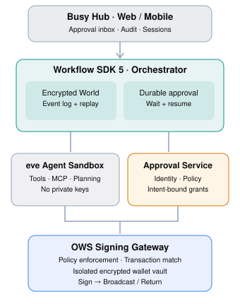
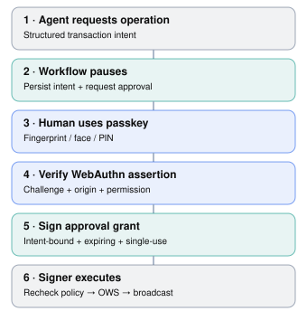

# ChatGPT share: Combine Encryption Approval UX

> Reference dump of a shared ChatGPT conversation. Not authoritative and not part of any docs navigation.
>
> - Source: https://chatgpt.com/share/6af8611d-cc34-83ed-bea7-121ff76f4230
> - Page title: Combine Encryption Approval UX
> - Conversation timestamp: 2026-11-14T12:55:11.578Z
> - Captured: 2026-11-14, from the rendered page in a headless browser
> - Turns: 8 (4 user, 4 assistant)
>
> Capture notes:
>
> - Converted from the rendered DOM to Markdown. Interactive widgets (approval cards, the "Create workspace" form, layered architecture boxes, checklists) are flattened to text; collapsed "Technical details" panels were not expanded.
> - Inline citation chips are kept as `^[Source+N · domain]`. The share page does not expose their target URLs, and the per-turn "View sources" lists were not captured. Explicit links in the text are preserved (`utm_source` stripped).
> - The inline SVG diagrams are saved next to this file.
> - The claims below are ChatGPT's. Several are wrong; read [the verification note](./chatgpt-combine-encryption-approval-ux-verification.md) before building on them.

## User

https://vercel.com/blog/workflow-sdk-5#encryption-on-self-hosted-worlds

with https://openwallet.sh/

https://busybot.dev/#architecture

how to combine all of these for encryption and approval UX

## Assistant

I'd combine these into a **durable, encrypted agent execution system with human approvals enforced at the wallet boundary**, rather than building another wallet-enabled chatbot.

The three projects fit together remarkably well, but each solves a different part of the problem.

### 1. How the three pieces fit

| Component | Responsibility | What I'd use |
| --- | --- | --- |
| Vercel Workflow SDK 5 | Durable execution and encrypted state | Encrypted event logs, retries, replay, suspended workflows |
| Open Wallet Standard (OWS) | Key custody and transaction authorization | Encrypted vault, signing isolation, scoped policies |
| Busy / eve | Agent runtime and approval experience | Per-agent sandboxes, approval inbox, chat, mobile UX |

The important distinction is that **encryption, approval and signing are three separate security boundaries**.

Vercel Workflow SDK 5 encrypts workflow and step payloads using AES-256-GCM, including on self-hosted Worlds with a custom key provider. OWS keeps wallet keys behind its own access and policy layer. Busy provides the agent-facing and user-facing infrastructure, including approval flows and isolation between bots. ^[Vercel+2 · vercel.com]

### 2. Proposed architecture



Proposed integration architecture, not a claim that the three projects already integrate natively.

The key architectural decision: **the workflow orchestrates approval, but the signer independently enforces it**. An agent must never be able to bypass approval simply by invoking a different MCP tool or replaying an earlier request.

### 3. The approval UX I'd build

The approval experience should be **transaction-aware, not tool-call-aware**.

A user shouldn't be asked to approve `ows_sign` with a JSON payload. They should see what the agent intends to accomplish, what it costs, and what authority they're granting.

**Agent approval** · `Demo · Pending`

Example approval card for a trading agent

### Swap 250 USDC → ETH

Treasury Agent requests permission to execute a swap on Base.

Maximum spend · **250 USDC**

Destination · **Allowlisted router**

Simulation · Passed (example)

Permission · **One transaction**

Expires · **In 5 minutes**

Technical details

Demo decision: Rejected

Interactive UX prototype only. No wallet is connected and no authorization is issued.

I'd support three approval levels:

- **Per-action:** approve a particular signed transaction intent, with exact parameters and expiry.
- **Session delegation:** allow specific operations under bounded limits, such as swaps up to $100 per transaction and $500 per day.
- **Autonomous policy:** permit routine operations within an explicit risk mandate, escalating only for exceptions.

For a trading agent, I'd add an approval for the *strategy mandate* rather than asking the user to approve every order. But withdrawals, wallet changes and policy expansions should require separate authorization.

### 4. Encryption design

There are three independent keys or key families.

| Key | Controls | Where it belongs |
| --- | --- | --- |
| Workflow run key | Decrypts workflow state and history | KMS-backed key provider |
| Wallet encryption key | Protects private signing keys | Isolated OWS signer |
| Approval identity key | Authenticates the human decision | Passkey/WebAuthn or hardware authenticator |

I would **not derive wallet keys from Workflow run keys**. They have different lifecycles and compromise boundaries.

For the self-hosted World, implement `getEncryptionKeyForRun()` backed by a KMS-controlled key hierarchy. Persist encrypted per-run data keys so replay returns the same 32 bytes, even across deployments and key rotations. Never put raw keys in the workflow event log.

The SDK already provides encrypted payload handling, cross-run sealed writes, and configurable payload retention. Its run attributes, however, remain plaintext, so use opaque IDs rather than wallet addresses, transaction descriptions or sensitive user identifiers. ^[Vercel · vercel.com]

One nuance: Workflow encryption is not full end-to-end encryption from the human's device to the wallet. Authorized workflow code still handles plaintext. Likewise, OWS encrypts keys at rest but its current specification describes in-process signing hardening, not a guaranteed hardware enclave. ^[OWS · docs.openwallet.sh]

### 5. The approval protocol

This is the critical missing integration layer I'd implement.

1. **Agent proposes an intent**

   Structured operation, chain, wallet, parameters, expected effects and limits. The agent cannot submit arbitrary signing bytes later.
2. **Gateway simulates and canonicalizes**

   Resolve the exact transaction, decode calldata, calculate an intent hash, and evaluate preliminary policies.
3. **Workflow suspends for approval**

   Create a durable approval request, notify Busy clients and wait for an authenticated response.
4. **Human approves the specific intent**

   Bind the grant to the transaction digest, wallet, chain, agent, policy version, nonce and expiry.
5. **Signer independently verifies**

   OWS gateway verifies the grant, rechecks policies and simulation freshness, then signs exactly the approved operation.
6. **Workflow records the outcome**

   Broadcast once, reconcile chain state, and record an auditable result. Retries check execution status before attempting another submission.

A minimal grant envelope might look like:

```typescript
type ApprovalGrant = {
  approvalId: string;
  workflowRunId: string;
  agentId: string;
  walletId: string;
  chainId: string;
  intentHash: string;
  policyVersion: string;
  expiresAt: string;
  nonce: string;
  approverId: string;
  authorizationProof: string;
};
```

The approval service signs or otherwise authenticates this envelope. The signer verifies it through a trusted channel, checks the exact transaction digest, and atomically consumes the nonce.

For operations where transaction bytes may change, such as gas repricing, define precisely which fields are allowed to vary. Anything outside that envelope requires reapproval.

### 6. What I'd reuse versus build

| Area | Decision |
| --- | --- |
| Busy hub, agent deployment, sandbox UX | Fork and extend |
| eve agent runtime and approval suspension | Reuse |
| Workflow SDK 5 encryption | Reuse natively |
| Self-hosted World key provider | Implement KMS adapter |
| OWS vault and policy interface | Reuse, audit and harden |
| Transaction simulation and decoding | Build chain-specific adapters |
| Approval inbox and notification delivery | Extend Busy |
| Signed approval grants and nonce consumption | Build |
| Cross-chain and trading-specific policies | Build |
| Signer isolation and recovery | Build operationally |

Busy's hub already centralizes application state and credentials, while individual bots run in separate Vercel projects with sandboxes. That makes it a natural starting point, but the public architecture doesn't establish that it already has transaction-bound cryptographic approvals. ^[busybot.dev+1]

### 7. Three important design choices

**First: do not host the production signing vault inside an agent sandbox.** A compromised browser, shell tool or prompt-injected agent should have no filesystem or network path to the raw keys. Use a separate signer service, ideally with HSM/KMS or enclave-backed signing where supported. OWS's local-first vault can serve as an initial implementation, but production isolation needs an explicit threat-model review.

**Second: make approvals durable but revocable.** A workflow can wait indefinitely, but approval requests should have short expiries. Revocation must be checked at signing time, not just when the workflow resumes. A rejected or expired request must never be converted into a valid signature by replaying workflow state.

**Third: keep authorization independent of the model.** The agent may explain why a transaction is useful. It must not decide whether the human approved it. Approval state, risk limits and signer permissions belong to deterministic services.

### 8. How I'd apply this to Gina MCP

Given Gina's execution-oriented architecture, I'd make the approval layer a reusable MCP authorization gateway rather than something specific to Busy.

**Any agent harness**

Busy · Codex · ChatGPT · Custom agents

**Gina MCP**

Structured trading intents and venue adapters

**Execution authorization gateway**

Workflow SDK · Policies · Approvals · Audit

**OWS signer**

On-chain signatures

**Venue adapter**

Perps and off-chain orders

For Hyperliquid, Polymarket and other execution venues, the authorization layer would need venue-specific semantics. Not every trade maps to a conventional on-chain transaction, so an OWS wallet policy alone cannot enforce all trading risk limits.

The more general abstraction is:

`Intent → Simulation → Policy → Approval → Execution → Reconciliation`

OWS is one execution adapter within that system.

#### Recommended implementation order

1. **Week 1:** Fork Busy, integrate Workflow SDK 5 encryption, and establish the approval state machine with no signing capability.
2. **Week 2:** Implement approval grants, replay protection, passkey authentication and an isolated OWS signing gateway on a testnet.
3. **Week 3:** Add simulation, policy enforcement, expiry, revocation and failure/retry tests.
4. **Week 4:** Add Gina venue adapters, strategy-level delegation, approval inbox improvements and security testing.

Those are engineering estimates, not verified implementation timelines.

My strongest recommendation is to treat **the approval grant as the central primitive**, not the encrypted wallet or the workflow itself. That gives you a portable authorization system that works across agent harnesses, wallets and trading venues.

The resulting architecture would let an agent run autonomously within a bounded mandate, while keeping signing authority outside the agent and preserving a durable, inspectable record of why every action was permitted.

Relevant implementation references: [Workflow SDK](https://workflow-sdk.dev/) · [OWS specification](https://docs.openwallet.sh/) · [Busy repository](https://github.com/MatiSolina/busy).

## User

ok but if I wanted a self hostable stack that is going to be opensource

## Assistant

Then I'd change the architecture quite substantially.

**I'd build a self-hostable, open-source agent execution platform, using Workflow SDK, OpenWallet and Busy as components—not make any of them the platform itself.**

The goal should be that someone can clone a repository, run `docker compose up`, connect an agent, create a wallet, and get encrypted durable execution with a polished approval experience.

No Vercel account, proprietary KMS, hosted database, or third-party approval service should be required.

### 1. The architecture I'd ship

**Web / PWA / CLI**

Chat · Approval inbox · Policies · Audit · Wallet management

**Control Plane**

Agent gateway

MCP · HTTP · Events

Workflow engine

Durable execution

Approval service

Wait · Resume · Revoke

Policy engine

Scopes · Limits · Risk

**Agent Plane**

Busy/eve sandboxes, tools and MCP servers

**Signing Plane**

OWS · Isolated vault · Signing policies

**Self-hosted infrastructure**

PostgreSQL · Object storage · Local encryption keys / KMS

The most important architectural choice is separating the **control plane, agent plane and signing plane**. They can all run on one machine for development, but must remain logically isolated.

### 2. Opinionated technology choices

I'd keep the first release deliberately small: **TypeScript, PostgreSQL, Docker Compose and a Next.js UI**.

| Layer | Choice | Why |
| --- | --- | --- |
| UI | Next.js + shadcn/ui | Portable, good approval UX |
| Authentication | Better Auth + WebAuthn | Self-hosted user identity and passkeys |
| Durable execution | Workflow SDK 5 | Existing replay, encryption and hooks |
| World backend | Postgres World | Self-hosted reference implementation |
| Agent runtime | eve / Busy adapters | Avoid reinventing agent execution |
| Wallet | OWS | Standardized local encrypted vault |
| Authorization | Custom policy and grant service | Enforce approvals outside the agent |
| Database | PostgreSQL | One durable state dependency |
| Encryption | Node crypto + envelope encryption | No mandatory cloud KMS |
| Deployment | Docker Compose first | Single-server installation |
| Observability | OpenTelemetry | Vendor-neutral instrumentation |

Workflow SDK already supports self-hosted Worlds, and Vercel maintains a Postgres reference implementation. Its v5 encryption can use a custom `getEncryptionKeyForRun()` provider, so a hosted Vercel deployment isn't necessary. ^[Vercel+1 · vercel.com]

OWS also fits the self-hosting requirement: its specification covers encrypted local wallets, scoped agent access and policy-gated signing. The specification is MIT-licensed, although I'd verify the licenses of the exact implementation packages before incorporating them. ^[OWS+1 · docs.openwallet.sh]

### 3. What I'd actually open-source

I'd create one monorepo, with separate packages that other developers can adopt independently.

**agent-control-plane/**

```text
apps/
  web/                 # Dashboard + approval inbox
  server/              # API + Workflow runtime
  signer/              # Isolated OWS service
  worker/              # Agent sandbox supervisor

packages/
  core/                # Intent and execution types
  workflow/            # Encrypted Postgres World
  approvals/           # HITL + signed grants
  policy/              # Deterministic rule engine
  wallet-ows/          # OWS adapter
  agent-eve/           # Busy/eve integration
  mcp/                 # Generic MCP gateway
  ui/                  # Reusable approval components
  sdk/                 # Client SDK

deploy/
  compose.yaml
  compose.production.yaml
  kubernetes/
```

I'd make the entire core **MIT or Apache-2.0 licensed**, subject to compatibility with upstream dependencies.

No artificial open-core split. Encryption, policy enforcement, multi-user approvals and audit logging should all be available in the community edition.

### 4. Approval should be a portable protocol

The main differentiator wouldn't be the dashboard. It would be an authorization protocol that any agent framework can use.

For example:

```typescript
const result = await approvals.request({
  agent: "treasury-agent",
  action: "wallet.transfer",
  intent: {
    chain: "eip155:8453",
    asset: "USDC",
    amount: "250",
    recipient: "0x..."
  },
  policy: "treasury-default",
  expiresIn: "5m"
});
```

That request becomes a durable workflow suspension, a human-readable approval card, and eventually a cryptographically authenticated grant that the signer verifies.

For the UX, I'd expose the same approval in the web dashboard, PWA and optionally via chat adapters. Vercel's Chat SDK/Workflow integration demonstrates the suspension-and-resume pattern, but I'd put a server-side authentication and authorization boundary in front of any resume hook rather than trusting a callback URL alone. ^[Vercel Knowledge Base · vercel.com]

### 5. Self-hosting profiles

**Local developer**

Docker Compose, PostgreSQL, local encryption master key, OWS vault, web dashboard. Everything on one machine.

Target: one command to start

---

**Personal VPS / homelab**

Persistent volumes, TLS, passkeys, encrypted backups and separately sandboxed agents. Signer isolated from agent containers.

---

**Production / multi-tenant**

Separate services, external key management, tenant isolation, HA PostgreSQL, dedicated workers, centralized audit and key rotation.

The local profile is for development and low-risk usage; running every component on one host does not give you strong protection against a host compromise.

### 6. What I'd change from Busy

I would **not fork all of Busy as the foundation immediately**.

I'd extract or integrate the agent-session and sandbox portions, and make them replaceable. Busy can be the first supported harness, but shouldn't dictate the platform's authorization model.

That gives you room to support OpenCode, Codex, Pi, custom MCP agents and other runtimes without forcing everyone to adopt Busy.

Likewise, OWS should be a signer adapter, not a dependency baked into the core workflow types.

### 7. Build order

**MVP milestones** · 0 of 5 complete

- [ ] 1. Foundation — Compose, Postgres World, encryption, auth and audit
- [ ] 2. Approval protocol — Durable requests, grants, passkeys, revocation and UI
- [ ] 3. Wallet integration — OWS signer, transaction matching, policies and replay protection
- [ ] 4. Agent integration — Busy/eve, MCP gateway and sandbox isolation
- [ ] 5. Public release — Examples, threat model, CI, deployment docs and security tests

The first public demo I'd aim for is a self-hosted agent that requests a wallet transaction, suspends, displays an approval card, verifies a passkey-backed decision, signs through isolated OWS, and resumes after execution.

The release gate should include crash recovery, duplicate-submit prevention, expired approvals, signer compromise tests and backup/restore validation.

---

### My recommendation

**Build a general-purpose, self-hostable authorization and execution layer for AI agents—not another agent framework.**

That is a cleaner open-source proposition:

> Bring your own agent. Bring your own wallet. Run everything on your own infrastructure. Every consequential action is durable, encrypted, policy-controlled and auditable.

I'd start with Workflow SDK + Postgres World + OWS, then integrate Busy/eve once the authorization boundary is working.

One architectural question materially changes the design: **do you want this to be local-first, where the user's own device holds the wallet keys, or server-first, where a self-hosted server holds encrypted wallets and signs on behalf of users?**

The former favors a desktop companion signer and device-side approvals. The latter favors a remotely accessible signing service with stronger isolation and operational key management.

## User

ows has a mcp, probs thinking wallet + agent bound creation 
as if it were a workspace

## Assistant

Yes — **I'd make the workspace the fundamental unit of isolation, with an agent and its wallet created together as a single lifecycle.**

That is a much cleaner abstraction than having users separately create agents, connect wallets, configure MCP servers and manage approval policies.

Think of it as a self-hosted agent workspace: every workspace gets its own identity, wallet, execution environment, memory, permissions and durable workflows.

### 1. Workspace as the primitive

**Workspace: Treasury** · Isolated agent environment · Owner-controlled · `Active`

**Treasury Agent** · Agent identity

---

**Agent Wallet** · OWS managed

---

**MCP Capabilities** · Scoped tools

---

**Approval Policies** · Owner enforced

---

**Durable Workflows** · Encrypted state

Independent signing boundary and encryption domain

I'd default to **one primary agent identity and one dedicated wallet per workspace**, but model the relationship so you can later support multiple agents and wallets without changing the security architecture.

The workspace owns the resources. The agent receives scoped capabilities. The wallet is never owned by the model process.

### 2. OWS MCP becomes the workspace wallet interface

OWS already exposes wallet operations through MCP, REST, SDK and CLI. Its documented model includes scoped API tokens, wallet IDs and policy IDs, so there's no reason to create a second wallet API. ^[Open Wallet Standard+1 · openwallet.sh]

I'd have the workspace provision OWS automatically:

```text
createWorkspace("treasury")
  ├─ Create workspace identity
  ├─ Create OWS wallet
  ├─ Create scoped OWS API token
  ├─ Attach workspace policies
  ├─ Provision agent sandbox
  ├─ Mount OWS MCP connection
  └─ Start encrypted workflow runtime
```

The workspace control plane would invoke OWS's administrative interface to create the wallet and scoped credentials. The agent receives only the delegated MCP connection, never wallet-creation or key-export privileges.

This is an important distinction: **OWS is the wallet authority; your workspace service is the lifecycle authority.**

### 3. The creation UX

Here's the flow I'd want in the open-source dashboard.

### Create workspace

Local-first agent + wallet provisioning

`Preview`

Workspace name

[Treasury Agent]

Agent runtime

- ( ) Busy / eve

- ( ) OpenCode

- ( ) Custom MCP agent

This is a local configuration prototype; it does not provision real resources.

### 4. The workspace data model

I'd use these core relationships:

```typescript
interface Workspace {
  id: string;
  ownerId: string;
  name: string;

  agent: {
    runtime: "eve" | "opencode" | "custom";
    instanceId: string;
    sandboxId: string;
  };

  wallet: {
    provider: "ows";
    walletId: string;
    accessGrantId: string;
  } | null;

  security: {
    encryptionDomainId: string;
    policySetId: string;
    approvalGroupId: string;
  };

  status: "provisioning" | "active" | "paused";
}
```

OWS's own wallet descriptors and access tokens remain inside the OWS subsystem. Your database stores references, not plaintext keys or raw API tokens.

I would also use a separate workspace identity for authentication and permissions, rather than treating a blockchain wallet address as the sole identity of an agent.

### 5. Lifecycle is where this gets interesting

I'd make workspace operations first-class durable workflows.

| Operation | Behaviour |
| --- | --- |
| Create | Provision agent, wallet, MCP access and policies |
| Start | Launch agent sandbox and attach scoped capabilities |
| Pause | Stop new actions, suspend workflows and disable signing |
| Resume | Revalidate policies and restart execution |
| Clone | Copy configuration, create fresh wallet and credentials |
| Export | Export configuration and encrypted backup separately |
| Delete | Revoke credentials, stop agent, handle remaining assets, then delete |

**Cloning should never silently clone the original wallet's private key.** A cloned workspace gets a new wallet unless the owner explicitly authorizes restoring an existing wallet.

Provisioning should also be idempotent. If wallet creation succeeds but sandbox creation fails, the workflow should resume from the failed step rather than accidentally generating a second wallet.

### 6. The security boundary

**Agent sandbox**

OWS MCP client

Scoped credential

Workspace tools

No raw wallet keys

**Trusted services**

Approval authority

OWS access layer

Policy enforcement

Encrypted vault

Authenticated, policy-enforced boundary

One thing I'd be strict about: an OWS MCP credential should be treated as a capability, not as evidence that a human approved a particular transaction.

For sensitive operations, the trusted signer must enforce the approval grant even if the agent calls `ows_sign` directly. Also, any generic message-signing operation needs restrictions; otherwise an agent might sign an authorization that has financial consequences outside the normal transaction path.

For genuinely isolated workspaces, separate credentials, storage namespaces and sandbox processes are essential. Per-workspace encryption keys add another boundary, but they don't protect against compromise of a shared host that can access every key.

### 7. My preferred repository shape

```text
workspace/
├── apps/
│   ├── web/                 # Workspace dashboard
│   ├── control-plane/       # Lifecycle + authorization
│   └── signer/              # Isolated OWS host
├── packages/
│   ├── workspace-core/      # Resource definitions
│   ├── workspace-workflows/ # Durable lifecycle
│   ├── workspace-crypto/    # Encryption domains
│   ├── workspace-approvals/ # Human approval protocol
│   ├── workspace-ows/       # OWS MCP integration
│   ├── runtime-eve/         # Busy/eve adapter
│   └── runtime-mcp/         # Generic agent adapter
├── examples/
│   ├── personal-assistant/
│   └── treasury-agent/
└── deploy/
    └── compose.yaml
```

The **workspace is the product**, Workflow SDK is its lifecycle engine, Busy/eve is an agent runtime, and OWS MCP is the wallet capability.

I'd make a workspace manifest declarative and portable so people can version-control their agent configuration, recreate it on another machine, and choose whether to restore its wallet separately.

The most compelling first demo would be:

**Create workspace → automatically create agent + OWS wallet → fund wallet → ask agent to perform a task → receive approval → execute → inspect encrypted workflow history.**

One question I'd settle before implementation: should **a workspace be equivalent to one agent**, or should it be a container for multiple agents, each with its own OWS wallet, sharing a workspace treasury and approval policies?

I'd lean toward the second as the underlying model, while making the default creation flow one agent + one wallet. That preserves the simple UX without boxing the architecture into a one-to-one relationship.

## User

sure second 

also how would passkey approval work 
+
reconfirm technicals deep research from this session

## Assistant

_Deep research turn (ChatGPT reported "Worked for 3m 7s")._

### Self-hosted agent workspaces: architecture and passkey approval

**Architecture decision: one workspace contains multiple agents, each with its own OWS wallet, plus an optional shared treasury controlled by workspace-level policies.**

After checking the current documentation and repositories, I'd keep the overall direction, but make several important technical corrections.

### 1. Research findings: what actually exists

**Workflow SDK 5 — suitable for self-hosting**

Released 12 November 2026. It supports encrypted workflow payloads and self-hosted Worlds. The official `@workflow/world-postgres` implementation uses PostgreSQL and Graphile Worker. Encryption requires a compatible per-run key provider. ^[Vercel+2 · vercel.com]

---

**OWS — suitable wallet foundation, but needs hardening**

The current reference repository supports local encrypted wallets, native SDK/CLI operations and policy-constrained agent API keys. Policies are attached to credentials, not directly to wallets. ^[GitHub+1 · github.com]

---

**OWS MCP — don't assume the published runtime is complete**

The website advertises MCP, but the current core specification calls access transports optional, and the reference README emphasizes SDK and CLI. A previously reported issue specifically identified a missing `ows serve --mcp` command. We'll need to validate the installed package or provide an MCP adapter. ^[GitHub+2 · github.com]

---

**Busy — open source, but not independently self-hostable end to end today**

The hub can run locally, but actual bots currently depend on Vercel projects, Sandbox, Drive and associated services. Busy is Apache-2.0 licensed. I'd reuse its interaction patterns and possibly its frontend, but replace its infrastructure-dependent provisioning. ^[GitHub+1 · github.com]

One major security finding: OWS currently documents **in-process signing**, not a fully isolated signer. More importantly, an OWS agent token is used to derive a key that decrypts its own encrypted wallet-secret copy. That means the token and matching key file together are sensitive signing material, even if normal OWS calls enforce policies. An isolated signing service is therefore essential for our design. ^[GitHub+1 · github.com]

### 2. Final workspace model

**Workspace: Trading Operations**

Members · Passkeys · Shared policies · Encrypted workflows

**Research Agent**

Dedicated OWS wallet

Read-only + small spend policy

**Execution Agent**

Dedicated OWS wallet

Trading-specific mandate

Request scoped treasury operations

**Workspace Treasury**

Separately scoped OWS wallet · Shared budgets

Approval grants + policy-enforced signing

Workspace approval and audit authority

I'd represent the ownership structure as:

`Workspace → Agents → Wallet assignments → Capabilities`

An agent can have one default wallet and additional explicitly delegated wallet assignments. Each assignment has its own permission scope. Agents do not automatically inherit access to the shared treasury.

For a first release, this offers a useful default: create a workspace, create an agent, automatically provision its wallet, and add more agents without sharing private keys.

### 3. How passkey approval actually works

The cleanest approach is to use passkeys as **human authorization credentials**, completely separate from the agent's OWS wallet.



#### Step A: Register the human's passkey

During workspace onboarding:

1. The owner creates or joins a workspace.
2. The browser calls WebAuthn `navigator.credentials.create()`.
3. The user's device creates an authentication key pair.
4. Your self-hosted auth service stores the public key, credential ID, user association and credential metadata.
5. The private passkey remains with the user's authenticator or passkey provider.

Use Better Auth with its passkey plugin for account authentication. It uses SimpleWebAuthn underneath. ^[Better Auth+1 · better-auth.com]

Crucially, this does **not** create the OWS wallet or decrypt its private key. Those remain separate operations.

#### Step B: Bind an approval to an exact intent

The agent proposes a transaction. Your server canonicalizes its details, then calculates an intent digest.

```typescript
type SigningIntent = {
  workspaceId: string;
  agentId: string;
  walletId: string;
  chainId: string;

  operation: "transfer" | "swap" | "trade";
  payloadHash: string;

  policyVersion: string;
  nonce: string;
  expiresAt: string;
};

// Hash a versioned, canonical encoding.
// Never hash ordinary unordered JSON as-is.
const intentHash = sha256(
  canonicalEncode(intent)
);
```

For financial transactions, `payloadHash` should commit to the complete executable operation, including the destination, calldata or equivalent venue-specific payload, amount, asset, and any allowed gas or slippage bounds.

It must also commit to the expected signing domain, so an approval cannot be reused across chains or wallets.

#### Step C: User approves with biometric/PIN

The server creates a fresh random WebAuthn challenge and stores its association with `approvalId`, `intentHash`, the authorized approver and an expiry.

The web client uses `navigator.credentials.get()` to ask the authenticator to sign that challenge.

```typescript
import {
  generateAuthenticationOptions,
  verifyAuthenticationResponse,
} from "@simplewebauthn/server";

const options =
  await generateAuthenticationOptions({
    rpID: "agents.example.com",
    allowCredentials: approverCredentials,
    userVerification: "required",
  });

// Store options.challenge with approvalId,
// intentHash, approverId and expiry.

// After receiving the browser assertion:
const result =
  await verifyAuthenticationResponse({
    response: assertion,
    expectedChallenge: saved.challenge,
    expectedOrigin:
      "https://agents.example.com",
    expectedRPID: "agents.example.com",
    credential: savedCredential,
    requireUserVerification: true,
  });
```

The browser call between these two server-side operations is provided by `@simplewebauthn/browser`. This is an illustrative implementation excerpt; it omits challenge persistence, error handling and database transactions.

Verification confirms the credential signature, expected challenge, relying-party identity, origin and required user verification. Then the service must check the member's workspace permissions and atomically consume the challenge. ^[SimpleWebAuthn+1 · simplewebauthn.dev]

#### An important WebAuthn limitation

**A passkey approval does not inherently prove the user saw the transaction details.**

Normal WebAuthn authenticators sign challenges and show a generic authentication prompt. They don't provide a trusted display of arbitrary blockchain transaction details.

The W3C's Secure Payment Confirmation work addresses that distinction for supported payment flows, but you cannot assume it provides secure transaction confirmation for general agent or crypto-wallet operations. ^[GitHub+1 · github.com]

For our open-source stack, the application must generate the human-readable preview from exactly the intent the signer later verifies. For high-value transfers, I'd optionally support an external hardware wallet that independently displays and signs transaction details.

### 4. Approval UX: what the owner sees

The useful UX isn't a generic WebAuthn popup. It's a proper approval inbox, with WebAuthn invoked only after the owner reviews an action.

**Treasury approval** · `Example request`

Workspace: Trading Operations

### Approve 250 USDC transfer

Execution Agent is requesting funds from the workspace treasury on Base.

Requesting agent · Execution Agent

Amount · **250 USDC**

Approval scope · This action only

Authorization · Passkey required

Expiring grant · 5 minutes

UX prototype only. It does not invoke WebAuthn or grant signing authority.

The passkey check is **step-up authorization**. A user's normal session gets them into the dashboard, but a fresh passkey assertion is required for actions above the relevant policy threshold.

For teams, the approval service can accumulate independently verified assertions. For example, a treasury withdrawal might require two authorized members, while ordinary low-value agent expenses need one.

### 5. How this connects to Workflow SDK 5

I would specifically use `createHook()` and `resumeHook()`.

Vercel documents both as the server-controlled pattern for human-in-the-loop workflows. I would avoid exposing `createWebhook()` URLs as approval authority because whoever obtains the generated callback URL may be able to resume it. ^[GitHub+1 · github.com]

```typescript
import { createHook } from "workflow";

export async function executeIntent(
  approvalId: string
) {
  "use workflow";

  const hook = createHook<{
    approvalId: string;
  }>({
    token: `approval:${approvalId}`,
  });

  await hook;

  // Runs in a trusted "use step" function.
  // Reload approval from the database.
  // Never trust the hook payload as authorization.
  return await executeApprovedIntent(
    approvalId
  );
}
```

Your approval API performs all WebAuthn and permission checks, makes a conditional database state transition, then calls `resumeHook()`.

The resumed workflow **reloads the authoritative approval record**. A hook merely wakes the workflow; it does not itself constitute permission.

This also handles useful failure scenarios: expired requests, multiple approvers, duplicate mobile submissions and a process restart halfway through an approval.

### 6. OWS integration: the most important design correction

After inspecting OWS's actual policy implementation, I'd make the following architecture non-negotiable:

**Agent sandbox**

Workspace MCP tools · Capability identity only

**MCP authorization gateway**

Intents · Durable approvals · Budgets

**Trusted signer**

Verify approval grant + policy + exact operation

**OWS SDK + encrypted vault**

OWS API token never accessible to agent

OWS's documented API-key model creates an encrypted copy of the wallet secret under a key derived from the API token. Policies are checked before the normal signing operation, but a party with both the token and the encrypted key file can potentially decrypt the wallet secret outside the normal policy path. ^[GitHub · github.com]

Therefore:

- The agent never receives a raw `ows_key_...` credential or access to the OWS vault directory.
- The signer service owns the OWS integration and must verify an intent-bound authorization before signing.
- The MCP interface exposed to agents should offer scoped intents, not unrestricted `ows_sign`, arbitrary `signMessage`, wallet export or administrative operations.
- Policies for cumulative spending, smart-contract effects and unusual signatures need additional trusted enforcement. OWS explicitly documents several spending controls as requiring executable policies rather than built-in declarative rules. ^[GitHub · github.com]

An authenticated, single-use grant might contain:

```typescript
type AuthorizationGrant = {
  approvalId: string;
  workspaceId: string;
  agentId: string;
  walletId: string;

  intentHash: string;
  policyVersion: string;

  approverIds: string[];
  issuedAt: string;
  expiresAt: string;
  nonce: string;
};

// Signed by the authorization service.
// The isolated signer verifies it and
// atomically consumes its nonce.
```

The signing gateway may verify an authorization-service signature over this grant, or directly verify retained WebAuthn assertions against registered approver keys. The latter reduces dependence on a separate grant-signing key, at the cost of more implementation complexity.

Neither approach eliminates the need to trust the signer host itself.

### 7. Data and encryption model

The research also changes how I'd describe encryption. There isn't one universal encryption domain supplied automatically by these three projects.

| Data | Protection | Authority |
| --- | --- | --- |
| User credentials | WebAuthn public-key credentials | Auth service |
| Workflow inputs and outputs | Per-run AES-256-GCM | Workflow key provider |
| Workspace files and memory | Workspace-scoped envelope encryption | Workspace key service |
| OWS wallet secrets | OWS encrypted keystore | Isolated signer |
| Approval decisions | WebAuthn assertion + authenticated grant | Approval service |
| Audit records | Append-only, integrity-protected events | Control plane |

Workflow SDK 5 encrypts inputs, outputs, hooks and streams **when the World supports encryption**. Metadata such as workflow names, step names, identifiers and timestamps remains plaintext. ^[workflow-sdk.dev]

For PostgreSQL self-hosting, I'd start from `@workflow/world-postgres` and implement or wrap the World key provider. I would explicitly test that the configured World encrypts stored payloads, because simply selecting a PostgreSQL backend does not itself prove encryption is enabled.

My key hierarchy would use:

`Host root key → workspace data encryption key → wrapped per-run keys`

The host root key is stored outside PostgreSQL. Per-run keys must remain available throughout replay and recovery, including after upgrades. In production an external KMS or OpenBao can be an optional backend, not a mandatory service.

Passkeys should **not** automatically serve as your workflow or OWS vault encryption keys. That would make unattended agents, recovery, synced credentials and key rotation significantly more complicated.

### 8. Self-hosting and open-source feasibility audit

This is how I'd rate the components for the proposed project.

| Capability | Reuse or build? | Assessment |
| --- | --- | --- |
| Workflow event persistence | Reuse | Mature starting point |
| Encrypted workflow payloads | Reuse + configure | Provider implementation required |
| WebAuthn registration/login | Reuse | Better Auth / SimpleWebAuthn |
| Per-action passkey approval | Build | Challenge-to-intent binding |
| OWS encrypted wallet | Reuse | MIT licensed |
| OWS MCP transport | Build/verify | Not confirmed in current core implementation |
| Isolated signing gateway | Build | Security-critical |
| Multi-agent workspaces | Build | Core product model |
| Shared treasury policies | Build | Requires atomic budget accounting |
| Busy-style agent UX | Adapt | Apache-2.0 code available |
| Busy cloud-free execution | Replace | Current infrastructure is Vercel-oriented |

The shared treasury introduces a concurrency problem that wallet policies alone do not solve. If two agents simultaneously request $80 against a $100 budget, they must not both receive authorization.

I'd implement budget reservations in PostgreSQL with atomic accounting, followed by settlement or release once transaction outcomes are reconciled. Approvals must not be used as a substitute for that reservation system.

### 9. The implementation I'd choose

**agent-workspaces/**

```text
apps/
  web/                # Next.js workspace UI
  api/                # Control plane + auth
  worker/             # Workflow execution
  signer/             # Isolated OWS runtime

packages/
  workspace/          # Workspace + agent lifecycle
  identity/           # Members + passkeys
  approvals/          # WebAuthn + signed grants
  policy/             # Deterministic policy engine
  workflows/          # Postgres World integration
  crypto/             # Key provider + encryption
  wallet-ows/         # OWS SDK bridge
  mcp-gateway/        # Agent-facing MCP capabilities
  runtime/            # Pluggable sandbox interface
  ui/                 # Approval / audit components

deploy/
  compose.yaml
  compose.prod.yaml
  kubernetes/
```

I'd make the public integration surface minimal:

```typescript
const workspace = await platform.workspaces.create({
  name: "Trading Operations",
});

const agent = await workspace.agents.create({
  name: "Executor",
  runtime: "eve",
  wallet: {
    provider: "ows",
    create: true,
  },
  authorization: {
    default: "require_approval",
  },
});
```

This is the **API I would build**, not an existing API from OWS, Busy or Workflow SDK.

Behind it, wallet creation and credential provisioning would be privileged lifecycle operations running in the signing environment. The owner would establish a vault recovery and administrative-unlock mechanism during setup. Unattended signing could then use a narrowly scoped OWS credential held only by the trusted signer.

For an entirely local stack, I'd use Docker Compose with PostgreSQL, a workflow worker, the control plane, an agent-container runtime and the isolated signer. The operator can supply their own model endpoint. No Vercel services need to be part of the default deployment.

#### Self-hosted passkey considerations

Passkeys are scoped to a relying-party domain. Localhost is supported for development, but production installations should use HTTPS with a stable hostname. Changing the hostname or relying-party ID can require passkey re-enrolment. ^[MDN+1 · developer.mozilla.org]

I'd also require operators to configure account recovery, support multiple registered passkeys and offer hardware security keys for treasury owners. Synced passkeys make everyday approvals convenient, while device-bound credentials can be used where stronger device control is required.

### 10. Release gates I'd insist on

The first public release needs security tests in addition to ordinary end-to-end tests:

- Compromised agent cannot reach an OWS secret, token, vault file or privileged signing interface.
- Altering amount, recipient, calldata, chain, wallet or policy version after approval invalidates the grant.
- Duplicate approvals, concurrent agents and workflow retries cannot cause double execution.
- Arbitrary message-signing and EIP-712 operations cannot bypass the authorization gateway.
- Revoked members, expired grants and changed approval requirements fail closed.
- Restoring backups preserves encrypted workflow replay without reusing invalid approvals.
- A lost passkey does not imply losing wallet funds; wallet recovery and approval-identity recovery are independent.

For chain execution, I'd use operation IDs, a persistent broadcast ledger and reconciliation before retrying. Exactly-once on-chain side effects cannot be assumed from workflow durability alone.

---

### Recommended v1 scope

I'd build a focused public demo around four experiences:

**Create a workspace**

Add agents, automatically create dedicated OWS wallets, and optionally create a workspace treasury.

**Approve with a passkey**

Every high-impact action produces an understandable, time-limited approval request.

**Resume safely**

The encrypted workflow resumes and the independent signer enforces the authorized operation.

**Run it anywhere**

Docker Compose with no hosted services required. The same manifests can later target Kubernetes.

The broader insight from reviewing these projects is that **the missing open-source primitive isn't another wallet, workflow engine or agent runtime. It's a portable workspace authority that joins them together securely.**

OWS owns key operations. Workflow SDK owns execution state. The agent runtime owns tools and computation. Your new platform owns identity, delegation, approvals and the boundaries between those systems.

That separation is what makes the whole stack genuinely reusable.

Primary technical references

[Workflow SDK 5 — encrypted self-hosted Worlds](https://vercel.com/blog/workflow-sdk-5#encryption-on-self-hosted-worlds)

[Workflow SDK source and self-hosted implementations](https://github.com/vercel/workflow)

[OWS source and specifications](https://github.com/open-wallet-standard/core)

[OWS policy engine and API-key cryptography](https://github.com/open-wallet-standard/core/blob/main/docs/03-policy-engine.md)

[OWS key isolation and threat model](https://github.com/open-wallet-standard/core/blob/main/docs/05-key-isolation.md)

[Busy architecture and infrastructure dependencies](https://github.com/MatiSolina/busy/blob/main/docs/architecture.md)

[SimpleWebAuthn server implementation](https://simplewebauthn.dev/docs/packages/server)

[W3C Secure Payment Confirmation — transaction display guarantees](https://www.w3.org/TR/secure-payment-confirmation/)
