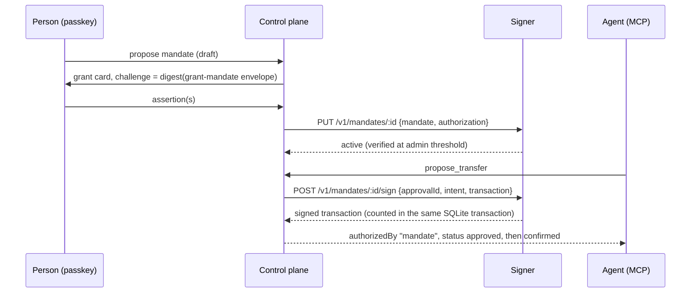

# Approve in advance: signer-enforced mandates for one agent's transfers

- Branch: none yet
- Status: Draft
- Owner(s): Eric Juta
- Created: 2026-11-14
- Last Updated: 2026-11-14
- Links: [Ticket #19](https://github.com/askgina/os/issues/19) | [Research report](./research/approval-mandates.md) | [Map #18](https://github.com/askgina/os/issues/18) | [v0.1 ExecPlan](./agent-workspaces-v0.1.md)

This ExecPlan is a living document. Keep `Progress`, `Surprises & Discoveries`,
`Decision Log`, and `Outcomes & Retrospective` current as research,
implementation, validation, and review proceed.
When the next milestone is clear, continue to it and update the spec instead of
asking for generic next steps.

## Purpose / Big Picture

Today every payment an agent proposes waits for a person's passkey. That is right for a rare
payment and tiring for a routine one. After this change an approver can approve once, in
advance, a bounded series of payments for one agent. For example: "Invoice payer may pay these
three suppliers up to 100 USDC at a time, at most 500 USDC in any 24 hours and 1,000 USDC in
total, at most 20 payments, until Friday 18:00". From then on every proposal of that agent that
fits is signed and sent without asking anyone. Everything that does not fit goes to the inbox as
it does now.

The grant is called a **mandate**. People approve it with their passkeys, over a digest of the
whole mandate, through a new envelope kind `grant-mandate`. The signer verifies those passkey
assertions itself, stores the mandate, counts every use in its own database in the same
transaction as the signature, and refuses anything outside the mandate or the wallet's policy.
The control plane cannot widen, extend, refund or revive a mandate. Any owner or approver can
stop a mandate from the wallet page with one click and no passkey, because stopping only removes
authority.

How to see it working: in CI's stack job, the example agent makes two payments under a mandate
with no passkey after the grant, its third payment (which would break the 24-hour cap) waits in
the inbox, and after a revocation the next payment waits in the inbox too.

Non-goals, each recorded under Risks or on the map:

- Contract calls and trades under a mandate. The signer cannot measure what calldata moves, so a
  "per trade" cap on a raw call would be unenforceable. Trading mandates wait for typed
  operations the signer encodes itself ([ticket 21](https://github.com/askgina/os/issues/21)),
  pending owner decision D3.
- Agents asking for a mandate over MCP (owner decision D4). People create mandates in the web UI.
- Approving a fixed list of exact intents with one passkey ("batch approval", owner decision D7).
- On-chain enforcement (ERC-7715 with ERC-7710, ERC-7579 session modules, EIP-7702 delegation).
  See the research report, finding F10.
- Pausing and resuming a single mandate. A mandate is revoked for good; a new grant replaces it.
- A trusted display for the grant card ([ticket 20](https://github.com/askgina/os/issues/20)),
  push notifications per use ([ticket 24](https://github.com/askgina/os/issues/24)), repricing a
  stuck mandated transaction ([ticket 22](https://github.com/askgina/os/issues/22)), and counters
  shared across several signer machines ([ticket 25](https://github.com/askgina/os/issues/25)).

Success means:

- `apps/signer/test/mandates.test.ts` proves, against the signer itself, every scope dimension,
  every counter, replay, concurrency, revocation, pause, removal of a granting approver, and that
  no contract call is ever signed under a mandate.
- The new stack release gates in `e2e/test/release-gates.spec.ts` pass in CI on amd64, arm64 and
  TLS, and the existing gates still pass, including "an agent can propose and read, and nothing
  else" (exactly seven MCP tools) and the ciphertext-at-rest scan, which now also plants a marker
  in a mandate's purpose.
- A person can grant, watch and revoke a mandate in the browser (UI journey in
  `apps/web/test/journey.e2e.ts`, phone and desktop, light and dark).
- Out of scope stays out: no new MCP tool, no contract calls under mandates, no on-chain code.

## Progress

- [x] (2026-11-14 21:36Z) Research: current behavior, prior art and options read from source and documentation; report written ([research/approval-mandates.md](./research/approval-mandates.md)). Nothing built or run.
- [x] (2026-11-14 21:36Z) Implementation approach and validation plan drafted (this file).
- [x] (2026-11-15) Owner decisions D1 to D7 taken: Eric chose the recommended option of each (Decision Log). Build started.
- [ ] Milestone 1: protocol structures, evaluator, signer contract, normative document.
- [ ] Milestone 2: the signer grants, counts, signs under and revokes mandates.
- [ ] Milestone 3: the control plane routes proposals through mandates; API and MCP report it.
- [ ] Milestone 4: the web UI grants, shows and revokes mandates.
- [ ] Milestone 5: stack release gates, threat model and documentation.
- [ ] Final outcome and residual risks recorded here and on ticket 19.

## Surprises & Discoveries

- Observation: v0.1 has no auto-approve limits. A policy's approval threshold is at least 1, and
  the signer signs only under an `approve-intent` authorization. The caps are ceilings on approved
  transactions, not an allowance.
  Evidence: `packages/protocol/src/policy.ts:76`; `apps/signer/src/signer.ts:719, 740-745`.
- Observation: "at most once" is keyed on the approval id in both services: signer tables,
  control-plane `transactions`, nonce reservations and the one workflow run per approval. The
  workflow already executes a row that is `approved` when its run starts.
  Evidence: `apps/signer/src/db.ts:60-87`; `apps/server/src/db/schema.ts:398-405`;
  `apps/server/src/execution/intents.ts:648-698`; `apps/server/workflows/approval.ts:45-62`.
  Consequence: each use of a mandate is its own approval id on a row created already approved,
  and reuses the whole execution path.
- Observation: the signer has no schema version or migration step; it only runs
  `CREATE TABLE IF NOT EXISTS`.
  Evidence: `apps/signer/src/db.ts:9-109`. Consequence: mandate state goes in new tables.
- Observation: a contract call that sends no native coin passes every cap.
  Evidence: `packages/protocol/src/evaluate.ts:63-66`. Consequence: no contract calls under a
  mandate in this plan.
- Observation: disabling an agent is a control-plane change; the signer does not know agent
  status.
  Evidence: `apps/server/src/directory/routes.ts:700-720`. Consequence: disabling an agent
  revokes its mandates at the signer.
- Observation: Secure Payment Confirmation defines no mandate or recurring construct, only one
  confirmed payment total.
  Evidence: [SPC CRD 2026-10-13](https://www.w3.org/TR/secure-payment-confirmation/); research
  report F10.

## Decision Log

Decisions this plan takes (delegated to the planning agent; each can be reopened on ticket 19):

- Decision: build signer-enforced mandates (Option B of the report), not an auto-approve tier in
  the policy, not a session key, not a grant the control plane enforces.
  Rationale: it is the only option that keeps "the signer decides whether a person approved" and
  fits keys held by the signer, while being time-boxed, per agent, counted and revocable without
  a passkey. Report, "Options compared".
  Date/Author: 2026-11-14 / planning agent
- Decision: one mandate names exactly one wallet and one agent.
  Rationale: the worst case is then one number per asset that a person can read; a stolen token
  of another agent cannot use it.
  Date/Author: 2026-11-14 / planning agent
- Decision: a mandate is checked together with the wallet's live policy at every use, and is not
  bound to a policy hash. Mandated spending counts against the policy's 24-hour cap.
  Rationale: the mandate's own fields are what the person approved; the policy stays the outer
  limit. Lowering the policy narrows every mandate at once; raising it widens none. Binding to a
  policy hash would end every mandate at each policy edit for no added safety.
  Date/Author: 2026-11-14 / planning agent
- Decision: each use is its own approval id. The control plane creates an `approvals` row of kind
  `mandate-use`, already `approved`, with no envelope; the signer records the use under that id
  and the intent id, both unique.
  Rationale: research F4; the whole execution path, its crash recovery and its gates are reused.
  Date/Author: 2026-11-14 / planning agent
- Decision: counters live only in the signer and are never refunded, not even for a transaction
  that was never mined.
  Rationale: only the control plane could report that a transaction failed, and it is not
  trusted. Same rule as the daily cap (`docs/threat-model.md:241`).
  Date/Author: 2026-11-14 / planning agent
- Decision: revoking a mandate needs only the request signature; there is no resume.
  Rationale: removing authority needs no passkey (as pause and revoke-approval today); a resume
  would add authority and need a grant anyway.
  Date/Author: 2026-11-14 / planning agent
- Decision: removing an approver credential that took part in a grant revokes that mandate, in
  the same signer transaction; a mandate also stops working while its distinct grantors are fewer
  than the current grant threshold.
  Rationale: a standing grant must not outlive the authority of the people who gave it
  (research F6).
  Date/Author: 2026-11-14 / planning agent
- Decision: `Mandate` and `grant-mandate` are added under protocol version 1 with a new domain
  tag `askgina.os/v1/mandate`; existing digests and their pinned vectors do not change.
  Rationale: `docs/approval-protocol.md:419-427` forbids changing hashed shapes in place; adding a
  new structure and a new kind changes none (research F9). An old signer refuses the new kind.
  Date/Author: 2026-11-14 / planning agent
- Decision: the control plane picks the covering mandate for a proposal (earliest `notAfter`,
  then lowest id); an agent may name one with `mandateId`; when the named one does not cover, the
  proposal is refused with its reason and nothing is recorded; when none covers, it goes to the
  inbox.
  Rationale: agents need no new concept to benefit; a named mandate gives a deterministic answer.
  Date/Author: 2026-11-14 / planning agent
- Decision: no eighth MCP tool. `whoami`, the propose tools, `get_intent` and `list_intents`
  report mandates in their outputs.
  Rationale: research F8; the "exactly seven tools" gate stays as it is.
  Date/Author: 2026-11-14 / planning agent
- Decision: record `PRAGMA user_version = 2` in the signer database when the new tables exist.
  Rationale: the next change to an existing signer table then has a version to migrate from
  (research F7). Nothing reads it in this plan.
  Date/Author: 2026-11-14 / planning agent

- Decision: D1 to D7 below are taken as recommended: (D1) admin threshold; (D2) allowlist
  required; (D3) native and ERC-20 transfers only; (D4) people in the web UI only; (D5) 7 days;
  (D6) rolling 24 hours; (D7) no fixed-list approval in this plan.
  Rationale: owner's answers in one form.
  Date/Author: 2026-11-15 / Eric Juta
- Decision: a `grant-mandate` envelope is approved on the signer's confirmation page like every
  other kind, so the signer builds its view (`packages/protocol/src/confirmation.ts`). The signer
  tables are added as the next `PRAGMA user_version` after 4, not as version 2.
  Rationale: the trusted display (ticket 20) and signer schema versions 2 to 4 landed after this
  plan was drafted; where the plan's text and the code on main disagree, main is the truth.
  Date/Author: 2026-11-15 / lead agent

Pending owner decisions. The plan is written for the recommended option of each; the milestones
that depend on one say so with **[depends on Dn]**.

- Decision (pending owner, D1): who must approve a grant. Options: (a) the workspace's admin
  threshold; (b) the wallet policy's transaction threshold; (c) a new per-wallet policy field
  that enables mandates and sets their threshold (a new policy version).
  Recommended: (a). A standing grant adds authority like a policy change, the admin threshold is
  never below any wallet's threshold (`apps/signer/src/signer.ts:646`), and for a one-person
  workspace it is the same single tap. (c) changes a hashed structure.
- Decision (pending owner, D2): recipients. Options: (a) a non-empty allowlist is required;
  (b) "any recipient" allowed with a warning; (c) allowlist required only above an amount.
  Recommended: (a). It is the one field that stops a stolen agent token or a compromised control
  plane from paying itself under a mandate.
- Decision (pending owner, D3): what a mandate may cover first. Options: (a) native and ERC-20
  transfers only; (b) also contract calls to allowlisted targets, counting only native value;
  (c) wait and ship together with typed swap operations from ticket 21.
  Recommended: (a). (b) is unbounded in whatever the call moves (research F5).
- Decision (pending owner, D4): who may propose a mandate. Options: (a) people in the web UI only;
  (b) agents too, through an eighth MCP tool `propose_mandate` that opens a grant request.
  Recommended: (a) for this plan; (b) can follow without protocol change.
- Decision (pending owner, D5): the longest lifetime the signer accepts by default
  (`SIGNER_MAX_MANDATE_SECONDS`). Options: 1 day; 7 days; 30 days.
  Recommended: 7 days. It covers "until Friday" and bounds the damage of one misleading card.
- Decision (pending owner, D6): what "per day" means. Options: (a) a rolling window, as the
  policy's 24-hour cap; (b) fixed periods counted from the mandate's start (as Coinbase Spend
  Permissions); (c) calendar days in a chosen time zone.
  Recommended: (a). It matches the policy and never allows twice the cap around a boundary.
- Decision (pending owner, D7): approving a fixed list of exact intents with one passkey.
  Options: (a) not in this plan, file a separate ticket; (b) add an `approve-intents` envelope to
  this plan.
  Recommended: (a). It solves "known in advance" batches, not "the agent decides later".

## Outcomes & Retrospective

- Outcome: research only. One passkey approval can cover a bounded series of transfers while the
  signer alone decides; the price is that a compromised control plane or a stolen agent token can
  spend a live mandate's remaining budget to its allowlisted recipients without a person.
  Evidence: [research/approval-mandates.md](./research/approval-mandates.md). Nothing built or run.
  Remaining: everything in Plan of Work, after the owner's decisions.

## Context and Orientation

Relevant repo rules:

- Read `AGENTS.md` and `specs/agents/issue-tracker.md` before changing files.
- TypeScript is strict ESM with erasable syntax only (no enums, parameter properties or
  namespaces); relative imports carry `.ts`. No `console.*`: one JSON log line per event with
  identifiers, codes and counts only.
- Errors that cross a workflow step, an HTTP response or a log line carry a stable code and a fixed
  message; they never quote what a person or an agent typed.
- Every dependency stays pinned exactly. This plan adds none.
- Any change to the shape of a hashed structure is a new protocol version
  (`docs/approval-protocol.md`, section 12).
- Local builds, whole test suites, coverage and the stack run in CI only (owner's rule, map #18).
  Locally: `bun run check`, `bun run typecheck`, and one test file at a time.

Terms:

- **Mandate**: a person-approved, signer-held grant that lets one agent move bounded amounts from
  one wallet to listed recipients during a time span, without a passkey per payment.
- **Grant**: the approval request, kind `grant-mandate`, whose envelope people sign.
- **Use**: one intent signed under a mandate. Each use has its own approval id (`apr_…`) and
  names one intent.
- **Grantor**: an approver whose passkey assertion is part of the grant.
- **Window**: the rolling span (`windowSeconds`) over which `maxPerWindow` is counted.
- **Worst case**: per asset, the most a mandate can let leave the wallet:
  `min(maxTotal, maxUses × maxPerAction)`, and never more than the policy's 24-hour cap per day of
  the mandate's life.

Current behavior:

- The policy (`packages/protocol/src/policy.ts`) has caps per transaction and per rolling 24 hours,
  a recipient rule, a contract-call rule, a fee ceiling and an approval threshold of 1 to 16.
- An agent proposes over MCP (`apps/server/src/mcp/gateway.ts`); `propose()` in
  `apps/server/src/execution/intents.ts:295` checks the signer's policy early and opens an
  `approve-intent` request through the approval engine
  (`apps/server/src/execution/approvals.ts:114`).
- People approve with passkeys over the envelope digest (`packages/protocol/src/envelopes.ts`);
  the workflow (`apps/server/workflows/approval.ts`) calls `executeIntent`
  (`apps/server/src/execution/intents.ts:708`), which reserves an account nonce and asks the
  signer to sign (`apps/signer/src/signer.ts:710-831`).
- The signer verifies the assertions itself, then, in one `BEGIN IMMEDIATE` transaction, consumes
  the envelope nonce, evaluates the policy against its `spends` ledger, signs, and records
  `approvals`, `signatures` and `spends`.

How the relevant pieces fit together after this change:

- Grant: an owner fills the mandate editor on the wallet page; the server validates the draft
  with the same pure checks the signer uses and opens a `grant-mandate` request; approvers sign
  its envelope; the workflow calls the signer's `grantMandate`, which verifies the assertions at
  the admin threshold and stores the mandate; the server stores a sealed mirror.
- Use: an agent proposes a transfer; `propose()` finds a covering mandate; the server inserts the
  intent as `approved` and an `approvals` row of kind `mandate-use`, starts its workflow, and the
  workflow calls the signer's `signUnderMandate`; broadcast and follow-up are unchanged.
- Revoke: a person, the agent's disabling, the removal of a grantor's passkey, or the operator's
  admin command ends the mandate at the signer; the mirror follows.

Assumptions:

- One signer process owns its SQLite file, as in v0.1. If ticket 25 spreads the signer over
  machines, mandate counters need the same serialization as the daily cap.
- The signer's clock is correct within seconds. It decides `notBefore` and `notAfter`.
- Owner decisions D1 to D7 are taken as recommended. If not, the milestones marked
  **[depends on Dn]** change as that decision says.

## Threat model after this change

The invariant is kept: the signer decides whether people approved, and signs only what they
approved. What people approve is now either one intent or one mandate, and in both cases the
signer verifies their passkey assertions itself and enforces the approved content.

| If this is compromised       | It can, after this change                                                                                                                                                                                                                                                                                                                                                                                                                                                                                         | It cannot                                                                                                                                                                                                                                                                                                                                                                                                                                                                     |
| ---------------------------- | ----------------------------------------------------------------------------------------------------------------------------------------------------------------------------------------------------------------------------------------------------------------------------------------------------------------------------------------------------------------------------------------------------------------------------------------------------------------------------------------------------------------- | ----------------------------------------------------------------------------------------------------------------------------------------------------------------------------------------------------------------------------------------------------------------------------------------------------------------------------------------------------------------------------------------------------------------------------------------------------------------------------- |
| The control plane process    | Everything it could before. In addition: have the signer sign, with no person, any transfer that fits a live mandate (listed recipient, under every cap, under the use count, inside the time span), choosing which and when, until the mandate's remaining worst case is spent; invent the agent's proposals under it; revoke any mandate (denial of service); show a misleading grant card and so obtain a mandate whose hashed content differs from the card, within the grant-time checks against the policy. | Produce a grant assertion; have the signer sign a contract call, a recipient not listed, an amount over any cap of the mandate or the policy, before `notBefore` or from `notAfter`, after revocation, past `maxUses` or `maxTotal`; use one intent id twice; widen, extend, refund or revive a mandate (its state and counters exist only in the signer); keep a mandate working after a grantor's passkey is removed or after the admin threshold rises above its grantors. |
| An agent's token             | Propose transfers that the signer signs with no person, inside that agent's live mandates.                                                                                                                                                                                                                                                                                                                                                                                                                        | Pay an address that is not listed (D2), exceed any cap, use another agent's mandate (the control plane binds the token to the agent; a compromised control plane is the row above).                                                                                                                                                                                                                                                                                           |
| The control plane's database | Read mandate ids, wallets, agents, status, times and hashes; corrupt the mirror.                                                                                                                                                                                                                                                                                                                                                                                                                                  | Read the sealed mandate (purpose and caps) without the keyring; change what the signer enforces.                                                                                                                                                                                                                                                                                                                                                                              |
| One approver's passkey       | Grant mandates when the admin threshold is 1, which is no more than it could approve one by one; the grant outlives the theft until revoked.                                                                                                                                                                                                                                                                                                                                                                      | Keep its grants alive after its credential is removed: removal revokes them.                                                                                                                                                                                                                                                                                                                                                                                                  |
| The signer host              | Everything, as before.                                                                                                                                                                                                                                                                                                                                                                                                                                                                                            | (nothing is protected against this)                                                                                                                                                                                                                                                                                                                                                                                                                                           |

Worst case of one misleading grant, per asset: at most `min(maxTotal, maxUses × maxPerAction)`,
and at most the policy's `maxPerDay` for each started day of the mandate's life, plus fees of at
most `maxUses × maxFeePerActionWei`. The grant-time checks keep every cap at or below the policy,
and D5 keeps the life at or below 7 days by default. In v0.1 one misleading card yields at most
one transaction under the policy's per-transaction cap; a misleading mandate card yields its
worst case. That makes the trusted display (ticket 20) weigh more, and it is the main residual
risk.

At rest: the control plane seals the mandate (including `purpose`) in `mandates.mandate` and in
the grant request's `approvals.detail`. The signer keeps the canonical mandate in plain text in
its SQLite, as it keeps policies; the signer volume is the funds' trust domain already.

## Plan of Work

Five milestones, each verifiable in CI on its own. Milestones 1 and 2 change only shared packages
and the signer; nothing a person sees changes until Milestone 3.

### Milestone 1: protocol structures, evaluator and signer contract

Scope: the hashed structures, the pure evaluation shared by signer and control plane, the
signer's HTTP contract and its typed client, and the normative document. First, because every
later milestone imports them and their digests must be pinned before anything stores them.

Files and interfaces:

- `packages/protocol/src/primitives.ts`: add `MandateId = prefixedId("mnd")` and `"mnd"` to
  `ID_PREFIXES`; move the `sortedSet` helper here from `policy.ts` and export it.
- `packages/protocol/src/canonical.ts`: add `DomainTag.mandate = "askgina.os/v1/mandate"` and
  `DomainTag.mandateUse = "askgina.os/v1/mandate-use"`.
- `packages/protocol/src/mandate.ts` (new): `MandateAssetLimit`, `Mandate`, `mandateHash`,
  `normalizeMandate`, `mandateWorstCase`, `mandateTimeState`, `checkMandateAgainstPolicy`,
  `MANDATE_DENY_CODES`, `MandateUsage`, `evaluateMandate`, `mandateUseDigest`.
- `packages/protocol/src/envelopes.ts`: add `GrantMandateEnvelope` to the `Envelope` union.
- `packages/protocol/src/index.ts`: export `mandate.ts`.
- `packages/protocol/src/signer/api.ts`: five routes, four request and response schemas, five
  error codes (see Interfaces).
- `packages/protocol/src/signer/client.ts`: `grantMandate`, `getMandate`, `listMandates`,
  `revokeMandate`, `signUnderMandate`.
- `docs/approval-protocol.md`: new section "Mandates" (structure, evaluation, grant-time checks),
  the `grant-mandate` row in section 5, a new section "Signing under a mandate" after section 8,
  and test vectors in section 11.
- `packages/protocol/test/mandate.test.ts` (new); `packages/protocol/test/digests.test.ts`,
  `schemas.test.ts`, `signer-client.test.ts` (extended); `packages/protocol/test/fixtures.ts`
  (a fixture mandate).

Work:

`Mandate` is a strict object (shape in Interfaces). Its refinement refuses: assets not sorted by
`chainId|asset` or duplicated; `maxPerAction > maxPerWindow` or `maxPerWindow > maxTotal`;
`notAfter <= notBefore`; a span over 2,592,000 seconds (30 days, the schema ceiling; the signer's
own ceiling is lower); the zero address as a recipient; an empty recipient list **[depends on
D2]**. There is no operation field: an asset `native` permits `evm.transfer`, a token address
permits `evm.erc20.transfer` of that token, and `evm.call` is never permitted **[depends on D3]**.

`evaluateMandate(mandate, intent, usage)` is pure, like `evaluateIntent`, and returns either
`{ allowed: true, spend }` or `{ allowed: false, code }`. Rules in order, first failure decides:

1. `intent.workspaceId` or `intent.walletId` differs: `mandate_wallet_mismatch`.
2. `intent.agentId` differs: `mandate_agent_mismatch`.
3. `intent.operation.type` is `evm.call`: `mandate_operation_not_allowed`.
4. No `MandateAssetLimit` for `(intent.chainId, asset)`: `mandate_asset_not_allowed`.
5. The recipient (`operation.to`) is not in `recipients`: `mandate_recipient_not_allowed`.
6. `intent.maxFeeWei > maxFeePerActionWei`: `mandate_over_fee_cap`.
7. `usage.uses + 1 > maxUses`: `mandate_uses_exhausted`.
8. `amount > maxPerAction`: `mandate_over_per_action_cap`.
9. `usage.inWindow(chainId, asset) + amount > maxPerWindow`: `mandate_over_window_cap`.
10. `usage.total(chainId, asset) + amount > maxTotal`: `mandate_over_total_cap`.
11. Otherwise allowed, with the spend `(chainId, asset, amount)`.

Time is checked by `mandateTimeState(mandate, now)`, returning `not_yet_valid` (now <
`notBefore`), `live`, or `expired` (now >= `notAfter`), so the signer can answer with its own
top-level codes, as `verifyAuthorization` does for envelope expiry.

`checkMandateAgainstPolicy(mandate, policy, { now, maxSeconds })` returns `null` or the first
reason the grant is impossible: the policy's wallet or workspace differ; the agent is not in
`requesters`; an asset's chain is not in `chains`; an asset has no policy `AssetLimit`;
`maxPerAction > maxPerTx`; `windowSeconds <= 86_400` and `maxPerWindow > maxPerDay`; a recipient
is outside a policy allowlist; `maxFeePerActionWei > fees.maxPerTxWei`; `notAfter <= now`;
`notAfter - max(now, notBefore) > maxSeconds`. Both the server (early, for a clear message) and
the signer (authoritative) call it.

`mandateUseDigest({ approvalId, mandateId, intentHash })` is the digest under
`DomainTag.mandateUse`. The signer stores it as the `envelope_digest` of a use's `approvals` row,
so a repeat is recognized and a use id can never be confused with an envelope.

Acceptance:

- CI job `check` (Biome and `tsc`) passes.
- CI job `test` passes, including `packages/protocol/test/mandate.test.ts` with: the fixture
  mandate accepted and each malformed field refused; `mandateHash` stable under
  `normalizeMandate` and different for a change of each field; one test per deny code on both
  sides of its boundary; `evm.call` refused even with value 0; `mandateWorstCase` for a total-bound
  and a uses-bound mandate; each `checkMandateAgainstPolicy` refusal.
- `packages/protocol/test/digests.test.ts` pins a mandate hash and a `grant-mandate` challenge,
  reproduced with `openssl dgst -sha256` as the existing vectors are, and its three existing
  vectors are unchanged.
- `packages/protocol/test/signer-client.test.ts` covers the five new client methods against a
  fake `fetch` (method, path, signature headers, parsing, error mapping).

### Milestone 2: the signer grants, counts, signs under and revokes mandates

Scope: `apps/signer`. All enforcement lives here; the control plane changes nothing yet.

Files and interfaces:

- `apps/signer/src/db.ts`: three new tables and their indexes; `PRAGMA user_version = 2`.
- `apps/signer/src/mandates.ts` (new): `createMandateOperations(internals)` returning
  `grantMandate`, `getMandate`, `listMandates`, `revokeMandate`, `signUnderMandate`,
  `revokeMandatesOfCredential`, `revokeMandateByOperator`.
- `apps/signer/src/signer.ts`: extract `signBuilt(wallet, intent, params)` (open the sealed
  credential, build with `buildTransaction`, sign with the vault, `isSignedBy`, hash) from
  `sign()` so both paths share it; pass `decide`, `authorizedChange`, `requireWorkspace`,
  `findWallet`, `currentPolicy`, `spentSince`, `findApproval`, `recordApproval` and `signBuilt` to
  `createMandateOperations`; call `revokeMandatesOfCredential` inside `removeApprover`'s `apply`.
- `apps/signer/src/index.ts`: dispatch the five routes.
- `apps/signer/src/config.ts`: `SIGNER_MAX_MANDATE_SECONDS` (3,600 to 2,592,000, default
  604,800 **[depends on D5]**), `SIGNER_MAX_LIVE_MANDATES_PER_WALLET` (1 to 64, default 16).
- `apps/signer/src/admin.ts`: commands `list-mandates --workspace <ws_…>` and
  `revoke-mandate --mandate <mnd_…>` or `revoke-mandate --all --workspace <ws_…>`.
- `apps/signer/test/mandates.test.ts` (new); `signing.test.ts`, `hardening.test.ts`,
  `admin.test.ts`, `ows.test.ts` (extended); `apps/signer/test/harness.ts` (grant helper).

Work:

New tables (STRICT, created with `IF NOT EXISTS`, so an existing v0.1 file gains them on start):

    CREATE TABLE IF NOT EXISTS mandates (
      mandate_id TEXT PRIMARY KEY,
      workspace_id TEXT NOT NULL REFERENCES workspaces(workspace_id),
      wallet_id TEXT NOT NULL REFERENCES wallets(wallet_id),
      agent_id TEXT NOT NULL,
      mandate_hash TEXT NOT NULL,
      mandate TEXT NOT NULL,              -- canonical JSON
      grant_approval_id TEXT NOT NULL UNIQUE,
      not_before INTEGER NOT NULL,
      not_after INTEGER NOT NULL,
      granted_at INTEGER NOT NULL,
      revoked_at INTEGER,
      revoked_reason TEXT CHECK (revoked_reason IN ('requested', 'grantor_removed', 'operator'))
    ) STRICT;
    CREATE INDEX IF NOT EXISTS mandates_by_wallet ON mandates (wallet_id, not_after);
    CREATE TABLE IF NOT EXISTS mandate_grantors (
      mandate_id TEXT NOT NULL REFERENCES mandates(mandate_id),
      user_id TEXT NOT NULL,
      credential_id TEXT NOT NULL,
      PRIMARY KEY (mandate_id, user_id)
    ) STRICT;
    CREATE INDEX IF NOT EXISTS mandate_grantors_by_credential ON mandate_grantors (credential_id);
    CREATE TABLE IF NOT EXISTS mandate_uses (
      approval_id TEXT PRIMARY KEY REFERENCES approvals(approval_id),
      mandate_id TEXT NOT NULL REFERENCES mandates(mandate_id),
      intent_id TEXT NOT NULL UNIQUE,
      intent_hash TEXT NOT NULL,
      at INTEGER NOT NULL
    ) STRICT;
    CREATE INDEX IF NOT EXISTS mandate_uses_by_mandate ON mandate_uses (mandate_id, at);

`grant_approval_id` has no foreign key, like `policies.approval_id`, because `authorizedChange`
applies a change before it records the approval row in the same transaction
(`apps/signer/src/signer.ts:381-393`).

`grantMandate(mandateId, { mandate, authorization })` uses `authorizedChange` with type
`grant-mandate`, action `grant-mandate`, and the admin threshold **[depends on D1]**. Its `check`
(run before verification and again inside the transaction) refuses with `envelope_mismatch` when
the path id, `envelope.mandateId`, `mandate.id`, the wallet, the agent or the workspace differ or
`envelope.mandateHash !== mandateHash(mandate)`; with `policy_missing` when the wallet has no
policy; with `mandate_invalid` (detail: the reason) when `checkMandateAgainstPolicy` refuses or
the wallet already has `SIGNER_MAX_LIVE_MANDATES_PER_WALLET` live mandates; with `conflict` when
the id exists under another grant. `apply` inserts the mandate and one grantor row per assertion.
A repeat of the same grant returns the state (as for policies).

`signUnderMandate(mandateId, { approvalId, intent, transaction })` runs entirely inside
`decide(…, "sign-under-mandate", …)` and one `transaction(db, …)`, with nothing awaited, in this
order; the first failure decides:

1. The mandate exists and its wallet and workspace exist (`not_found`).
2. `findApproval(approvalId)`: `revoked` gives `approval_revoked`; `signed` with
   `envelope_digest === mandateUseDigest(…)` returns the stored transaction; any other existing
   row gives `conflict`.
3. The workspace is not paused (`workspace_paused`).
4. The mandate is not revoked (`mandate_revoked`); `mandateTimeState` is `live`
   (`mandate_not_yet_valid`, `mandate_expired`).
5. The mandate's distinct grantors are at least the current admin threshold **[depends on D1]**
   (`mandate_denied`, detail `mandate_grant_below_threshold`).
6. `intent.id` has no `mandate_uses` row (`conflict`).
7. The wallet has a policy (`policy_missing`); `evaluateIntent(policy, intent, spent24h)` allows
   it (`policy_denied` with the rule as detail).
8. `evaluateMandate(mandate, intent, usage)` allows it (`mandate_denied` with the rule as detail).
   `usage` counts `mandate_uses` joined to `spends`: all uses; per asset, all time and since
   `now - windowSeconds`.
9. `gas × maxFeePerGas <= intent.maxFeeWei` and `maxPriorityFeePerGas <= maxFeePerGas`
   (`fee_cap_exceeded`).
10. `signBuilt`; then `recordApproval` with state `signed` and the use digest; insert
    `signatures`, `spends` and `mandate_uses`; `allow()`.

`revokeMandate(mandateId, { workspaceId })`: a mandate in another workspace is `not_found`;
revoking twice is a no-op; otherwise set `revoked_at` and reason `requested` and log
`revoke-mandate` with the grant's approval id. `revokeMandatesOfCredential(workspaceId,
credentialId)` revokes every live mandate with that grantor credential, reason `grantor_removed`,
one decision each; it runs inside `removeApprover`'s transaction. The admin CLI's
`revoke-mandate` uses reason `operator` and is logged like `enroll-approver-by-operator`.

`getMandate` and `listMandates` return `MandateState` with status computed at read time:
`revoked`; else `not_yet_valid` or `expired` by the clock; else `exhausted` when uses reached
`maxUses` or every asset reached `maxTotal`; else `active`.

Acceptance:

- CI job `test` passes, including `apps/signer/test/mandates.test.ts` with these tests:
  - a grant with admin-threshold assertions applies; fewer gives `insufficient_approvals`; a
    changed mandate gives `envelope_mismatch`; a reused envelope nonce gives `nonce_reused`; each
    `mandate_invalid` reason; an identical repeat returns the same state;
  - a transfer to a listed recipient is signed with no assertions and viem recovers the wallet's
    address; a repeat returns the identical transaction; another intent under the same use id
    gives `conflict`; the same intent under a new use id gives `conflict`;
  - one test per `mandate_denied` detail, including a contract call with value 0;
  - the window slides: with an injected clock, a use refused for the window cap fits after
    `windowSeconds`;
  - the policy still applies: its 24-hour cap refuses a use the mandate would allow, and mandated
    spending counts toward a later `approve-intent` under the same cap;
  - `mandate_not_yet_valid` before `notBefore`; `mandate_expired` at exactly `notAfter`;
  - a paused workspace refuses a use; a revoked mandate refuses; revoking twice is a no-op;
    revoking from another workspace is `not_found`;
  - removing a grantor's credential revokes the mandate in the same transaction and logs it;
  - raising the admin threshold above the grantors stops uses;
  - two concurrent use requests against a window cap that fits one produce exactly one signature;
  - `verify-log` passes after grants, uses, refusals and revocations.
- `apps/signer/test/signing.test.ts`: the five new routes refuse a missing or bad request
  signature; every path outside the contract still answers 404.
- `apps/signer/test/hardening.test.ts`: a SQLite file created with the v0.1 schema opens, gains
  the new tables and `user_version = 2`, keeps its signatures, and signs under a new mandate.
- `apps/signer/test/admin.test.ts`: `list-mandates` prints one JSON line; `revoke-mandate --all`
  revokes every live mandate of the workspace.
- `apps/signer/test/ows.test.ts`: with the real OWS vault, a use's signature recovers to the
  wallet's address.

### Milestone 3: the control plane routes proposals through mandates

Scope: `apps/server`, `packages/api`. After this milestone the API and MCP grant, use, report and
revoke mandates; the web UI does not show them yet.

Files and interfaces:

- `apps/server/src/db/schema.ts`:
  - new table `mandates`: `id` (`mnd_…`, primary key), `workspace_id`, `wallet_id`, `agent_id`,
    `mandate_hash`, `mandate` (bytea, sealed: the canonical `Mandate`), `not_before`,
    `not_after`, `grant_approval_id`, `status` (`active` or `ended`, a mirror), `ended_reason`
    (`revoked`, `grantor_removed`, `operator`, `expired`, `exhausted`, `agent_disabled`, or
    null), `created_at`, `updated_at`; index on (`workspace_id`, `wallet_id`, `status`) and on
    (`agent_id`, `status`);
  - `approvals`: `kind` also takes `mandate-use`; `envelope` becomes nullable; new nullable
    `mandate_id`; checks `(kind = 'mandate-use') = (envelope IS NULL)` and
    `(kind = 'mandate-use') = (mandate_id IS NOT NULL)`;
  - `intents`: new nullable `mandate_id`, index on (`mandate_id`, `created_at`).
- `apps/server/src/db/migrations/0002_mandates.sql` and its `meta/` snapshot: generated with
  `bun run db:generate` in `apps/server`, then the two checks added by hand (as `0001` added its
  backfill).
- `packages/api/src/dto.ts`: `MandateDraft`, `MandateSummary`, `MandateDetail`; `ApprovalKind`
  gains `grant-mandate`; `ApprovalSubject` gains a `grant-mandate` variant; `IntentSummary` gains
  `mandateId: MandateId.nullable()` (exactly one of `approvalId` and `mandateId` is set once an
  intent is recorded).
- `packages/api/src/routes.ts`: `proposeMandate`, `listMandates`, `getMandate`, `revokeMandate`.
- `apps/server/src/execution/mandates.ts` (new): `grantMandateKind()`, `mandateUseKind()`,
  `openMandateGrant`, `findCoveringMandate`, `revokeMandate`, `revokeAgentMandates`,
  `mandateSummary`, `registerMandateKinds`.
- `apps/server/src/approvals/kinds.ts`: handler kind type widened to
  `ApprovalKind | "mandate-use"`; `OpenApproval` unchanged.
- `apps/server/src/execution/approvals.ts`: `Engine.openUse({ workspaceId, mandateId,
  subjectId, detail, requestedBy, alongside })` inserts a row with status `approved`, threshold
  0, no envelope, `resume_state = 'needed'`, starts its run and posts the webhook event
  `mandate.used` (identifiers only); `list`, the inbox counts and `GET /api/v1/approvals/:id`
  exclude `mandate-use` rows (`not_found`).
- `apps/server/src/execution/intents.ts`: `propose()` asks `findCoveringMandate` after the early
  policy check; when one covers, inserts the intent with status `approved` and `mandate_id` and
  calls `openUse`; otherwise opens `approve-intent` as today. `executeIntent` takes the signing
  call as a parameter so `approve-intent` passes `signer.sign` and `mandate-use` passes
  `signer.signUnderMandate`; a refusal `mandate_denied` maps its detail to the intent's
  `failureCode`. `isPolicyCode` is replaced by a check against `POLICY_DENY_CODES` and
  `MANDATE_DENY_CODES` imported from `@askgina/os-protocol`. `registerIntentKind` registers the
  follow-up for both kinds.
- `apps/server/src/execution/routes.ts` and `index.ts`: mount the mandate routes and register the
  kinds.
- `apps/server/src/directory/routes.ts`: `disableAgent` calls `revokeAgentMandates` after the
  status change (logged on failure; the gateway already refuses a disabled agent,
  `apps/server/src/mcp/gateway.ts:429`).
- `apps/server/src/mcp/gateway.ts`: `whoami` adds `mandates`; `propose_transfer` takes an
  optional `mandateId`; both propose tools and `intentView` return `authorizedBy`, `mandateId`,
  and a nullable `approvalUrl` and `expiresAt`; `APPROVAL_NOTE` explains mandates.
- `apps/server/test/execution/mandates.test.ts` (new); `mcp.test.ts`, `workflow.test.ts`,
  `engine.test.ts`, `fixture.ts` (extended).

Work:

Who may do what, enforced with `requireMember`: an owner proposes a mandate (as with policy
changes); approvers approve it at the admin threshold **[depends on D1]**; an owner or approver
revokes; a viewer reads; a non-member gets `not_found`.

`openMandateGrant` mints `mnd_…`, sets `notBefore` to now, builds the `Mandate` from the draft,
normalizes it, runs `checkMandateAgainstPolicy` against the signer's current policy
(`signer.getWallet`) with `SIGNER_MAX_MANDATE_SECONDS` mirrored as the server setting
`MANDATE_MAX_SECONDS` (default 604,800; the signer's value decides), and opens the request with
envelope fields `{ mandateId, walletId, agentId, mandateHash }`, detail `{ mandate }` (sealed),
threshold the workspace's admin threshold, lifetime `ADMIN_APPROVAL_TTL_SECONDS`.

`grantMandateKind().execute` calls `signer.grantMandate`, inserts the mirror row with
`onConflictDoNothing`, and appends the audit event `mandate.granted`. Its `describe` returns the
subject the grant card needs: wallet, agent, the mandate, its worst case per asset in whole units
with symbols (from `chainAccess(ctx).token`), the policy's limits for the same assets, and the
mandate's current usage when it exists.

`findCoveringMandate(ctx, agent, wallet, intent, pinned?)` reads the agent's `active` mirror rows
for that wallet (or the pinned one), refreshes each from `signer.getMandate` (state and usage),
evaluates `mandateTimeState` and `evaluateMandate`, and returns the first that allows the intent,
ordered by `notAfter`, then `id`. A pinned mandate that does not allow it raises
`HttpError("policy_denied", …, <rule code>)` and nothing is recorded. A refreshed state that is no
longer `active` updates the mirror's status and reason.

Two proposals racing for the last budget both pass this early check; the signer signs one and
refuses the other with `mandate_over_window_cap` (or another counter code), and that intent ends
`denied`. The agent's next proposal then goes to the inbox. This is documented in `APPROVAL_NOTE`
and tested.

Acceptance:

- CI job `test` passes, including `apps/server/test/execution/mandates.test.ts`, against real
  Postgres, the local chain and the real signer in process, with the soft authenticator:
  - an owner opens a grant, an approver approves, and the mandate is `active` at the signer and in
    the mirror; a viewer cannot open or revoke one; a non-member gets `not_found`;
  - a covered proposal starts `approved`, ends `confirmed` on the chain, has `mandateId` set,
    `approvalId` null, and creates nothing in the inbox;
  - an uncovered proposal goes to the inbox; a pinned `mandateId` that does not cover is refused
    with its code and records nothing;
  - two concurrent covered proposals against a window cap that fits one: one `confirmed`, one
    `denied` with `mandate_over_window_cap`;
  - after revocation the next proposal goes to the inbox; disabling the agent revokes its
    mandates at the signer;
  - a sealed-content scan finds no marker planted in a mandate's `purpose` in any column.
- `apps/server/test/execution/workflow.test.ts`: killing the process between the use row and the
  signature still ends in exactly one transaction after restart.
- `apps/server/test/execution/mcp.test.ts`: the tool list is still exactly the seven names;
  `whoami` lists the agent's mandates with remaining budget; a covered `propose_transfer`
  returns `authorizedBy: "mandate"`, its `mandateId` and `approvalUrl: null`; `get_intent` and
  `list_intents` carry the same fields.

### Milestone 4: the web UI grants, shows and revokes mandates

Scope: `apps/web`. The grant card is the product of this plan, as the approval page was for v0.1.

Files and interfaces:

- `apps/web/src/components/mandate.tsx` (new): `MandateEditor`, `MandateSentence`,
  `MandateWorstCase`, `MandateUsage`, `MandateList`.
- `apps/web/src/routes/approval.tsx`: `MandateSubject` in `Subject`; the approve button reads
  "Approve in advance" for `grant-mandate`; `TechnicalDetails` shows the canonical mandate and its
  hash beside the envelope and challenge.
- `apps/web/src/routes/wallet.tsx`: a card "Approved in advance" with live and recently ended
  mandates, usage meters, time left, Revoke (confirmation dialog, no passkey), and "Approve in
  advance…" (owners) opening the editor.
- `apps/web/src/routes/agent.tsx`: the same list filtered to the agent.
- `apps/web/src/routes/mandate.tsx` (new) and `apps/web/src/router.tsx`: route
  `/w/$workspaceId/mandates/$mandateId` with the mandate and the intents that ran under it.
- Every place an intent is listed: a mandated intent shows "Approved in advance" and links to its
  mandate instead of an approval page.
- `apps/web/src/lib/codes.ts`: plain-language meanings for the new signer codes and every
  `MANDATE_DENY_CODES` entry.
- `apps/web/dev/fixture-server.ts`: fixture mandates, grant and revoke endpoints.
- `apps/web/test/journey.e2e.ts`: the mandate journey.

Work:

The grant card shows, without scrolling on a phone:

- One sentence, for example: "Let Invoice payer pay up to 100 USDC at a time to the 3 recipients
  below, at most 500 USDC in any 24 hours and 1,000 USDC in total, at most 20 payments, until Fri
  21 Nov 18:00 (your time)."
- The worst case, set apart: "At most 1,000 USDC can leave this wallet under this approval, plus
  network fees of at most 0.002 ETH per payment."
- Every recipient in full, grouped for checking, as the intent card shows a recipient.
- The agent, the wallet, the window, the end time in the viewer's time zone and how long that is
  from now, and the person's own purpose text marked as theirs.
- The wallet's own limits for the same assets and the sentence: "The wallet's limits still apply
  and count these payments."
- "Each payment is signed without asking you again. Anything outside these limits comes to your
  inbox as usual. Anyone who can approve can stop this at any time from the wallet page."

The editor offers end-time presets (end of today, end of Friday, in 7 days) and a custom date and
time in the viewer's time zone, converted to epoch seconds; a recipient list (one address per
line); per-asset caps in whole units; the number of payments; the fee per payment, defaulting to
the policy's fee ceiling. It computes and shows the worst case before submitting. Pure helpers
(whole units to base units, worst case, end-time presets) go in `apps/web/src/lib/` with unit
tests.

Acceptance:

- CI job `ui` passes, including a journey in `apps/web/test/journey.e2e.ts`, at 390x844 and
  1280x800, light and dark, under the production Content-Security-Policy, against the fixture:
  an owner opens the editor, sees the worst case, submits; the grant card shows the sentence,
  the worst case, every recipient and the end time; approving uses the virtual authenticator;
  the wallet page shows the mandate with its usage after a fixture use; Revoke asks for
  confirmation, not a passkey, and the mandate shows as ended.
- Unit tests for the new `apps/web/src/lib/` helpers pass in the same job.

### Milestone 5: stack release gates, threat model and documentation

Scope: `e2e`, `docs`, `README.md`. Proof against the running stack, and documents that say
exactly what is and is not protected.

Files and interfaces:

- `e2e/src/person.ts`: `grantMandate`, `revokeMandate` helpers using the real UI API and the soft
  authenticator; `e2e/src/agent.ts`: optional `mandateId` on proposals.
- `e2e/test/release-gates.spec.ts`: the gates below.
- `docs/threat-model.md`: the rows and worst case of "Threat model after this change"; a limit
  "A misleading grant card yields a whole mandate"; "Approvals wider than one action" removed
  from "Out of scope" for transfers, kept for contract calls.
- `docs/approval-protocol.md`: final text checked against the code.
- `docs/architecture.md` and `README.md`: one paragraph and one feature line each.
- `deploy/README.md`: the restore rule (revoke all mandates after restoring a signer volume) and
  the requirement that the signer host keeps its clock synchronized.

Work:

New gates in `e2e/test/release-gates.spec.ts`:

- "a mandate lets the example agent pay a listed recipient twice with no passkey, and its third
  payment, over the 24-hour cap, waits for a person";
- "a mandate never pays an unlisted recipient, even when the wallet's policy allows any";
- "a revoked mandate signs nothing, and the next proposal waits for a person";
- "removing the approver who granted a mandate ends it";
- "concurrent proposals under one mandate never exceed its window cap";
- "a crash after a mandated proposal and before the broadcast still ends in exactly one
  transaction";
- the existing "what an agent typed is in no column of the database in the clear" also plants a
  marker in a mandate's purpose;
- the existing "an agent can propose and read, and nothing else" still sees exactly seven tools.

Acceptance:

- CI jobs `stack (amd64)`, `stack (arm64)` and `stack (tls)` pass with the new gates and all
  existing gates.
- Every claim added to `docs/threat-model.md` names the test that backs it.

## Interfaces and Dependencies

Local interfaces (all in `@askgina/os-protocol` unless named otherwise):

- `MandateId`: `mnd_` and a lowercase ULID.
- `MandateAssetLimit`: `{ chainId: ChainId, asset: AssetRef, maxPerAction: PositiveAmount,
  maxPerWindow: PositiveAmount, maxTotal: PositiveAmount }`.
- `Mandate`:
  - Fields: `v: 1`, `id: MandateId`, `workspaceId`, `walletId`, `agentId`,
    `assets: MandateAssetLimit[]` (1 to 16, sorted by `chainId|asset`),
    `windowSeconds: integer 3600 to 604800`, `recipients: Address[]` (sorted set, 1 to 64),
    `maxUses: integer 1 to 10000`, `maxFeePerActionWei: PositiveAmount`,
    `notBefore: EpochSeconds`, `notAfter: EpochSeconds`, `purpose: Memo`.
  - `mandateHash(m)`: `digestHex("askgina.os/v1/mandate", Mandate.parse(m))`.
  - Failures: schema refusal (see Milestone 1).
- `GrantMandateEnvelope`: header (`v`, `approvalId`, `workspaceId`, `nonce`, `issuedAt`,
  `expiresAt`) plus `type: "grant-mandate"`, `mandateId`, `walletId`, `agentId`,
  `mandateHash: Digest`. Challenge: `envelopeChallenge(envelope)`, unchanged.
- `evaluateMandate(mandate, intent, usage: MandateUsage)`: `{ allowed: true, spend } |
  { allowed: false, code: MandateDenyCode }`. `MandateUsage` is `{ uses: number;
  total(chainId, asset): bigint; inWindow(chainId, asset): bigint }`.
- `MANDATE_DENY_CODES`: `mandate_wallet_mismatch`, `mandate_agent_mismatch`,
  `mandate_operation_not_allowed`, `mandate_asset_not_allowed`, `mandate_recipient_not_allowed`,
  `mandate_over_fee_cap`, `mandate_uses_exhausted`, `mandate_over_per_action_cap`,
  `mandate_over_window_cap`, `mandate_over_total_cap`, `mandate_grant_below_threshold` (signer
  only).
- `checkMandateAgainstPolicy(mandate, policy, { now, maxSeconds })`: `null` or a reason code.
- `mandateTimeState(mandate, now)`: `"not_yet_valid" | "live" | "expired"`.
- `mandateWorstCase(mandate)`: `{ chainId, asset, amount: bigint }[]`.
- `mandateUseDigest({ approvalId, mandateId, intentHash })`: hex digest under
  `askgina.os/v1/mandate-use`.

Signer HTTP contract (`packages/protocol/src/signer/api.ts`), every route request-signed:

| Route              | Method and path                       | Body                                                     | Result                         |
| ------------------ | ------------------------------------- | -------------------------------------------------------- | ------------------------------ |
| `grantMandate`     | `PUT /v1/mandates/:mandateId`         | `{ mandate: Mandate, authorization: Authorization }`     | `MandateState`                 |
| `getMandate`       | `GET /v1/mandates/:mandateId`         | none                                                     | `MandateState`                 |
| `listMandates`     | `GET /v1/wallets/:walletId/mandates`  | none                                                     | `{ mandates: MandateState[] }` |
| `revokeMandate`    | `POST /v1/mandates/:mandateId/revoke` | `{ workspaceId }`                                        | `MandateState`                 |
| `signUnderMandate` | `POST /v1/mandates/:mandateId/sign`   | `{ approvalId, intent, transaction: TransactionParams }` | `SignResponse`                 |

- `MandateState`: `{ mandate, mandateHash, status: "active" | "not_yet_valid" | "expired" |
  "exhausted" | "revoked", grantApprovalId, grantedAt, grantedBy: UserId[], revokedAt | null,
  revokedReason: "requested" | "grantor_removed" | "operator" | null, usage: { uses,
  assets: { chainId, asset, total: Amount, inWindow: Amount }[] } }`.
- New `SignerErrorCode` values, all HTTP 403: `mandate_revoked`, `mandate_expired`,
  `mandate_not_yet_valid`, `mandate_denied` (detail: a `MandateDenyCode`), `mandate_invalid`
  (detail: the grant-time reason). Not a version change (`docs/approval-protocol.md:426-427`).
- `GET /v1/approvals/:id` for a use id reports `signed` with the transaction hash, unchanged.

Control-plane API (`packages/api/src/routes.ts`), session-authenticated:

- `proposeMandate`: `POST /api/v1/workspaces/:workspaceId/wallets/:walletId/mandates`, body
  `MandateDraft` (`agentId`, `assets` in base units, `windowSeconds`, `recipients`, `maxUses`,
  `maxFeePerActionWei`, `notAfter`, `purpose`), owner only; result `ApprovalSummary`.
- `listMandates`: `GET /api/v1/workspaces/:workspaceId/mandates?walletId&agentId&status&cursor`;
  result a page of `MandateSummary`.
- `getMandate`: `GET /api/v1/workspaces/:workspaceId/mandates/:mandateId`; result
  `MandateDetail` (summary plus the intents that ran under it).
- `revokeMandate`: `POST /api/v1/workspaces/:workspaceId/mandates/:mandateId/revoke`, owner or
  approver; result `MandateSummary`.

MCP outputs (`apps/server/src/mcp/gateway.ts`), tool list unchanged:

- `whoami`: adds `mandates: { mandateId, walletId, purpose, recipients, windowSeconds, assets:
  { chainId, asset, maxPerAction, maxPerWindow, maxTotal, usedInWindow, usedTotal }[], usesLeft,
  notAfter }[]` for the agent's live mandates.
- `propose_transfer`: optional input `mandateId`. Both propose tools return `intentId`, `status`,
  `authorizedBy: "mandate" | "person"`, `mandateId` (or null), `approvalUrl` (null under a
  mandate), `expiresAt` (null under a mandate).
- `get_intent`, `list_intents`: add `authorizedBy` and `mandateId`.

Configuration:

| Service | Variable                              | Meaning                                                                    |
| ------- | ------------------------------------- | -------------------------------------------------------------------------- |
| signer  | `SIGNER_MAX_MANDATE_SECONDS`          | longest mandate life the signer grants; default 604800 **[depends on D5]** |
| signer  | `SIGNER_MAX_LIVE_MANDATES_PER_WALLET` | default 16                                                                 |
| server  | `MANDATE_MAX_SECONDS`                 | the server's early check; set equal to the signer's value                  |

External dependencies:

- None new. `@simplewebauthn/server` 14.1.0 and `@simplewebauthn/browser` 14.0.0 (challenge as
  bytes, unchanged), `zod` 4.6.7, `viem` 2.57.19, `drizzle-orm` 0.45.4 and `drizzle-kit` for the
  migration, `workflow` 5.5.0 (one run per approval, unchanged), Node 26 `node:sqlite`.
  - Version/source checked: repository lockfile and the v0.1 plan's pins.
  - Expected behavior: as used in v0.1; the use path adds no asynchronous call inside the signer.
  - Failure handling: as v0.1 (signer `internal` and `vault_error` retried by the workflow; every
    other refusal permanent).
- Standards consulted and not used: ERC-7715, ERC-7710, ERC-7579 Smart Sessions, EIP-7702,
  Coinbase Spend Permissions, Secure Payment Confirmation, AP2 v0.2 (research report F10).

## Concrete Steps

From the branch checkout's repository root:

    git switch -c feat/approval-mandates
    rg -n "approve-intent" packages apps --glob '!**/node_modules/**'    # every place a kind is listed
    bun run check
    bun run typecheck
    (cd packages/protocol && bunx vitest run test/mandate.test.ts)
    (cd apps/signer && bunx vitest run test/mandates.test.ts)
    (cd apps/server && bun run db:generate)                             # writes 0002_mandates.sql
    git push -u origin feat/approval-mandates                           # CI runs check, test, ui, stack

Whole suites, `bun run build:workflows`, the UI build and the stack run in CI only (owner's
rule). Each milestone is one or more commits on the branch; its acceptance is the CI run on its
last commit, recorded in Progress with the run link.

Expected evidence:

    ✓ apps/signer/test/mandates.test.ts > signs a transfer to a listed recipient with no assertions
    ✓ apps/signer/test/mandates.test.ts > two concurrent uses against a window cap that fits one produce one signature
    ✓ e2e/test/release-gates.spec.ts > a mandate lets the example agent pay a listed recipient twice with no passkey, and its third payment, over the 24-hour cap, waits for a person

## Validation and Acceptance

Automated validation:

- CI `check`: Biome and TypeScript, no errors.
- CI `test`: all package suites, with the new files `packages/protocol/test/mandate.test.ts`,
  `apps/signer/test/mandates.test.ts`, `apps/server/test/execution/mandates.test.ts` and the
  extensions listed per milestone.
- CI `ui`: the mandate journey in four viewports and the existing journeys.
- CI `stack (amd64)`, `stack (arm64)`, `stack (tls)`: the six new gates and every existing gate.

Manual or runtime validation (optional, owner's choice, as the v0.1 phone proof):

- Start: a staging stack as in `deploy/README.md`, HTTPS through Tailscale Serve or `compose.tls.yaml`.
- Exercise: grant a mandate on a phone with a synced passkey; run `examples/scripted-agent` twice
  with `TRANSFER_TO` set to a listed recipient.
- Observe: two confirmed transfers with no second passkey prompt; the wallet page's usage meter;
  Revoke, then a third run waits in the inbox.

Regression checks:

- Every v0.1 release gate passes unchanged, including "a proposal becomes one transaction after a
  passkey approval", "two approved proposals that together exceed the daily limit produce one
  transaction", "an agent can propose and read, and nothing else" and the restore gate (since the
  restore fence it refuses every approval issued before the restore).
- The three existing digest vectors in `packages/protocol/test/digests.test.ts` are unchanged.
- An agent without a mandate sees the same tool results as today, plus `authorizedBy: "person"`
  and `mandateId: null`.

## Idempotence and Recovery

- The signer's new tables are created with `IF NOT EXISTS` on every start; re-running is a no-op.
  `user_version` is set only after they exist.
- `0002_mandates.sql` runs once under the existing migration lock and journal.
- A repeated grant request (same approval id and envelope) returns the stored state; a repeated
  use request returns the stored transaction; a repeated revoke is a no-op. Workflow steps may
  therefore run twice, as every step already may.
- A crash between creating a use row and signing is recovered by the existing outbox sweeper and
  workflow restart; the signer's use id makes the signature single.
- Restore: restoring an older signer volume forgets uses made since that backup. Run
  `node apps/signer/src/admin.ts revoke-mandate --all --workspace <id>` for every workspace before
  starting the control plane, then grant again.
- Backout: revoke every mandate, wait until no intent with a `mandate_id` is in `approved`,
  `signed` or `broadcast`, then deploy the previous images. The previous signer ignores the new
  tables. The previous control plane is not run against a database that holds `mandate-use`
  rows: restore the pre-upgrade database backup instead, or stay on this version.

## Rollout and Operations

- Feature flags/config/env vars: no flag; nothing changes for a workspace until someone grants a
  mandate. New variables in Interfaces, with defaults that need no action.
- Migration/backfill steps: `0002_mandates.sql` on server start; signer tables on signer start. No
  backfill: no mandate exists before this version.
- Monitoring/alerts/logs: the signer's decision log records `grant-mandate`,
  `sign-under-mandate`, `revoke-mandate` and their refusals with codes; the server logs and
  audit events record `mandate.granted`, `mandate.revoked` and `intent.proposed` with the
  `mandateId`; the optional webhook receives `mandate.used` with identifiers only. A burst of
  `mandate_denied` with a counter code means an agent is hitting its budget.
- PR/branch workflow: branch `feat/approval-mandates`, one milestone at a time, pushed as it lands;
  CI green on each milestone's last commit before the next starts; no merge to `main` before the
  owner says go (map #18: nothing is built before that).

## Risks and Open Questions

- Risk: a compromised control plane shows one mandate and submits another, then spends its worst
  case with no person.
  Mitigation: grant-time checks keep every cap within the policy; recipients are an allowlist
  (D2); the life is at most 7 days by default (D5); the card shows the worst case. Residual until
  a trusted display exists (ticket 20).
- Risk: a stolen agent token spends a live mandate.
  Mitigation: the allowlist; disabling the agent stops the gateway at once and revokes its
  mandates at the signer.
- Risk: a restored signer volume forgets uses.
  Mitigation: the restore rule and the admin command; documented in `deploy/README.md`.
- Risk: a wrong signer clock extends or shortens a mandate.
  Mitigation: Milestone 5 adds to `deploy/README.md` that the signer host must run time
  synchronization (it does not say so today); the card shows the
  absolute end time.
- Risk: an agent is surprised when a racing proposal is refused after starting `approved`.
  Mitigation: `APPROVAL_NOTE` explains it; the result carries the counter code; tested.
- Risk: budget is spent by transactions that are never mined.
  Mitigation: none by design (no refunds); the card says counted payments include ones the
  network never accepts. Repricing under the same use is ticket 22's to define: a replacement
  signature for the same intent is refused today by the unique intent id.
- Risk: a nullable `envelope` on `approvals` leaks into code that assumes one.
  Mitigation: the check constraints; `mandate-use` rows are excluded from every API listing and
  page; typecheck forces each reader of `envelope` to handle null.
- Open question: owner decisions D1 to D7.
  Owner/next step: the owner, on ticket 19.
- Open question: whether trading mandates (typed swaps) are wanted soon enough to change D3.
  Owner/next step: the owner, with ticket 21.

## Artifacts and Notes

A fixture mandate, as canonical JSON (amounts in USDC base units, 6 decimals):

    {"agentId":"agt_01jd0000000000000000000002","assets":[{"asset":"0x833589fcd6edb6e08f4c7c32d4f71b54bda02913","chainId":"eip155:8453","maxPerAction":"100000000","maxPerWindow":"500000000","maxTotal":"1000000000"}],"id":"mnd_01jd0000000000000000000006","maxFeePerActionWei":"2000000000000000","maxUses":20,"notAfter":1700604000,"notBefore":1700000000,"purpose":"pay supplier invoices this week","recipients":["0x1111111111111111111111111111111111111111","0x2222222222222222222222222222222222222222","0x3333333333333333333333333333333333333333"],"v":1,"walletId":"wal_01jd0000000000000000000003","windowSeconds":86400,"workspaceId":"ws_01jd0000000000000000000001"}

Its worst case: `min(1000000000, 20 × 100000000) = 1000000000` base units, 1,000 USDC.

## Revision Notes

- 2026-11-14: First draft, written with the research report for ticket 19 before any owner
  decision. Nothing built.
