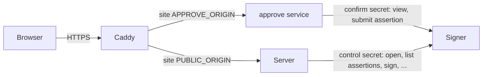

# Approve on a page the control plane cannot change: a trusted display for passkey approvals

- Branch: main
- Status: Ready for Review
- Owner(s): the repository owner
- Created: 2026-11-14
- Last Updated: 2026-11-15
- Links: [Issue askgina/os#20](https://github.com/askgina/os/issues/20) | [Map askgina/os#18](https://github.com/askgina/os/issues/18) | [Research report](./research/trusted-display.md) | [v0.1 ExecPlan](./agent-workspaces-v0.1.md)

This ExecPlan is a living document. Keep `Progress`, `Surprises & Discoveries`,
`Decision Log`, and `Outcomes & Retrospective` current as research,
implementation, validation, and review proceed.
When the next milestone is clear, continue to it and update the spec instead of
asking for generic next steps.

## Purpose / Big Picture

In v0.1 a person approves with a passkey on a page the control plane serves. The passkey signs a
digest the same page chose. A compromised control plane, or a script injected into its origin,
can show one operation and get a signature for another. The research report found that the
damage is not bounded by the wallet's caps: an `add-approver` or `set-policy` envelope can be
signed the same way, and every workspace starts with an admin threshold of 1, so one misled tap
can hand over a workspace for good (report, finding F3).

After this change a person approves on a **confirmation page** that lives on its own origin,
for example `https://approve.os.example.com` or `https://os.example.com:8443`. A small service
with no keys serves that page from the signer's trust domain. The page shows the operation as
the signer holds it: amount, recipient, token, chain, wallet, fee ceiling, policy context, the
policy diff for a policy change, the key fingerprint for a new approver. The passkey prompt runs
there. The signer accepts an approval only if the browser stamped that page's origin into the
assertion, which page script cannot fake. The control-plane UI still lists and explains
requests, but it can no longer collect an approval.

Passkeys keep working: the page uses the same RP ID, so nobody re-enrolls. Every browser with
WebAuthn works. The person can open the page on a second device.

Non-goals:

- Secure Payment Confirmation, hardware-wallet approvers and on-chain co-signing (report,
  findings F7 and F9; separate tickets if the owner wants them).
- Notifications sent by the signer or the confirmation service (ticket askgina/os#24).
- Changing how the first approvers of a workspace are trusted (trust on first use stays).
- Protection against a compromised user device, operating system or browser extension that can
  script the confirmation origin.
- Running the confirmation service on another host (ticket askgina/os#25 covers multi-machine).
- Rendering a QR code in the control-plane UI. The link is shown and can be copied.

Success means:

- A payment, a policy change and an approver change are each approved only on the confirmation
  page, and each is signed or applied by the signer (release gates in the CI `stack` jobs).
- A WebAuthn assertion over a pending envelope's digest that was made on the control plane's
  origin is refused by the signer with `assertion_invalid`, for an `approve-intent` and for an
  `add-approver` envelope (release gate).
- The confirmation page shows the recipient, amount and chain of a payment exactly as in the
  intent the signer holds (signer unit tests and the browser gate).
- An `add-approver` request cannot be approved until the new person has proven, on the
  confirmation page, that they hold the key in the request (milestone 4 gate).
- Out of scope boundary: a person who approves without reading is not protected.

## Progress

- [x] (2026-11-14 21:40Z) Research current behavior and relevant code paths
      (`specs/research/trusted-display.md`).
- [x] (2026-11-14 21:40Z) Define the implementation approach and validation plan (this file).
- [x] (2026-11-14) Owner decisions D1 to D7 in the Decision Log: the recommended option of each.
- [x] (2026-11-14 22:45Z) Milestone 1: signer confirmation records and views. Built: the pure
      view module (`packages/protocol/src/confirmation.ts`), the four routes and their schemas,
      `createConfirmClient`, the signer's tables (schema version 3), `apps/signer/src/confirmations.ts`,
      route scoping by secret, the five settings, `deploy/assets.json`, the signer's Compose
      environment and the confirm secret in `init`. Proven locally, one file at a time:
      `apps/signer/test/confirmations.test.ts` (13), `apps/signer/test/config.test.ts` (5),
      `packages/protocol/test/confirmation.test.ts` (38), `signer-client.test.ts` (18),
      `schemas.test.ts` (46), and the existing signer files `signing`, `governance`, `hardening`,
      `fence`, `sweep`, `admin`, `ows`; `tsc --noEmit` in `packages/protocol`, `apps/signer`,
      `apps/server`. Still to prove in CI: the whole `test` job, and the `stack` jobs, where the
      signer now starts only with the new settings and files (`compose.yaml`,
      `compose.tls.yaml` with `APPROVE_ORIGIN` from `e2e/run.sh`, `init` creating
      `confirm-request-secret`). No image was built locally.
- [x] (2026-11-14 23:45Z) Milestone 2: the `approve` service, its page, Compose and Caddy wiring,
      collection in the control plane. Built: the workspace `apps/approve` (app, config, log,
      main, Dockerfile, the page `public/index.html`, `approve.js`, `approve.css`,
      `favicon.svg`); the networks `approve-edge` and `approve-signer`, the service `approve`,
      the volume `approve-secrets`, Caddy's second site and `init`'s copy of the confirm secret;
      the server's `APPROVE_ORIGIN`, `confirmationSubject` for all seven kinds,
      `ensureConfirmation` and `collect` in the engine, the sealed column
      `approvals.confirmation` (migration `0003_confirmation_links`), `ApprovalDetail.confirmUrl`
      and the route `collectApproval`; the web approval page's link, host, "Copy link" and the
      existing 3-second refetch; `Person.confirm` and its parts in `e2e/src/person.ts`; the
      release gates "a payment approved on the confirmation page becomes one transaction" and
      "the confirmation service reaches the signer and nothing else", and the second policy
      change of the existing gate "limits change only with a passkey, ..." approved through
      `Person.confirm`; the browser gate "the
      confirmation page over HTTPS shows the payment and a passkey there approves it" (it runs
      over plain HTTP too, without "over HTTPS" in its name); `e2e/run.sh` ports and origins;
      README, `CONTRIBUTING.md`, `docs/architecture.md`, `docs/approval-protocol.md`,
      `docs/threat-model.md`, `deploy/README.md`. Proven locally, one file at a time:
      `apps/approve/test/app.test.ts` (7), `apps/server/test/execution/confirmation.test.ts`
      (9), `engine.test.ts` (14), `hardening.test.ts` (19), `sweep.test.ts` (4),
      `mcp.test.ts` (8), `apps/server/test/identity/identity.test.ts` (36),
      `apps/server/test/directory/directory.test.ts` (32),
      `apps/server/test/support/public-app.test.ts` (2), `packages/api/test/api.test.ts` (98),
      the `apps/web` journey on `phone-light`; `tsc --noEmit` in `apps/approve`,
      `apps/server`, `apps/web`, `packages/api`, `e2e`; `biome check .` without fixes;
      `bun install --frozen-lockfile --dry-run`; `docker compose config -q` for
      `compose.yaml`, with `e2e/compose.e2e.yaml`, and with `compose.tls.yaml` under the
      variables `e2e/run.sh` exports for `E2E_TLS=1`; the Mermaid blocks parse. No image was
      built and no stack was started locally. Still to prove in CI: `check` (every workspace's
      typecheck in one run); the whole `test` job; `ui` on all four projects; `stack (amd64)`
      and `stack (arm64)`, where the `approve` image is built for the first time and the two
      new release gates run; `stack (tls)`, where the browser gate approves on
      `https://localhost:8443` with the passkey enrolled on `https://localhost`, which also
      tests whether Chromium's virtual authenticator follows the tab across the origin change.
- [x] (2026-11-15 01:15Z) Milestone 3: cutover; the signer accepts approvals only from the
      confirmation origin; documents corrected. Green in CI with milestone 4 (see below).
  - [x] (2026-11-15 00:20Z) Code and tests, without `apps/web` and the prose documents (split
        to a second agent and a docs pass). Built: `verifyAuthorization` refuses an assertion
        made in a frame (`crossOrigin: true`, any `topOrigin`, unreadable client data) and
        passes `expectedType: "webauthn.get"`; the signer has no `WEBAUTHN_ORIGINS` and accepts
        approvals for signing and applying from `SIGNER_APPROVAL_ORIGIN` alone (`SignerOptions`
        and `SignerConfig` carry `rpId`, no `relyingParty`); `WEBAUTHN_ORIGINS` is gone from
        `compose.yaml` and `compose.tls.yaml`; `Engine.startCeremony`, `Engine.approve`, the
        routes `startApproval` and `approve`, `ApproveRequest` and `ApprovalDetail.challenge`
        are removed, and `Engine.#verify` checks against `APPROVE_ORIGIN` only; `t.approve`
        and the new `t.approveOnPage` and `t.approveAt` in the server's test support approve
        through the signer's confirm route and collect; `Person.approve` is removed, every
        release gate and both browser gates approve on the confirmation page; the negative
        release gate "an approval made on the control plane's page is refused" and browser gate
        "a script on the control plane's page cannot get an approval"; the guard step "The
        control plane has no approval prompt" in the CI `check` job. Proven locally, one file
        at a time: `packages/protocol/test/verify-authorization.test.ts` (28),
        `signer-client.test.ts` (18), `schemas.test.ts` (46), `confirmation.test.ts` (38),
        `soft-authenticator.test.ts` (5); `apps/signer/test/signing.test.ts` (31),
        `governance.test.ts` (15), `config.test.ts` (5), `confirmations.test.ts` (13),
        `hardening.test.ts` (8), `fence.test.ts` (10), `sweep.test.ts` (7), `admin.test.ts`
        (3), `ows.test.ts` (1); `packages/api/test/api.test.ts` (94);
        `apps/server/test/execution/confirmation.test.ts` (10), `engine.test.ts` (12),
        `hardening.test.ts` (19), `sweep.test.ts` (4), `mcp.test.ts` (8),
        `apps/server/test/identity/identity.test.ts` (36),
        `apps/server/test/directory/directory.test.ts` (32),
        `apps/server/test/support/public-app.test.ts` (2), `apps/approve/test/app.test.ts` (7);
        `tsc --noEmit` in `packages/protocol`, `packages/api`, `apps/signer`, `apps/server`,
        `apps/approve`, `e2e`, `examples/scripted-agent`; `docker compose config -q` for
        `compose.yaml`, with `e2e/compose.e2e.yaml`, and with `compose.tls.yaml`. Not run
        locally (CI only): `apps/server/test/execution/workflow.test.ts`, the release and
        browser gates, the guard step. Left for the other parts of this milestone: `apps/web`
        (the approval page and its dev fixture) and the documents, including
        `apps/signer/README.md`, which still names `WEBAUTHN_ORIGINS`.
  - [x] (2026-11-15) Documents. `README.md` (the opening, a new "Why" item, the sequence
        diagram with the confirmation page, step 7 of "Run it", the trust table, the first
        limit, and the screenshot's caption, marked as v0.1's page), `SECURITY.md` (the
        confirmation page in scope, the known limits), `docs/architecture.md` (the server's
        role, one sequence diagram for the whole flow in place of the two, "Why each boundary
        exists"), `docs/approval-protocol.md` (section 6: the frame check and type
        `webauthn.get` as checks, the origin rule; section 10: the submission rule and the only
        place an approval is made), `docs/threat-model.md` (trust boundaries 2 and 5, code
        execution in the control plane, the `approve` service and XSS on its page, a new
        position for lookalike hosts, "Limits" with the residual risks of this plan's threat
        model, "Out of scope" without the trusted display and with proof of possession),
        `deploy/README.md` (the rule, moving between layouts without new passkeys, a network
        diagram, the `approve` service's secret, the restore outcome `superseded`, upgrading
        from a release with `WEBAUTHN_ORIGINS`), `apps/signer/README.md` (the relying party,
        `WEBAUTHN_ORIGINS` removed from its settings and named as removed; also the default of
        `SIGNER_MAX_INTENT_TTL_SECONDS`, 86400 in `config.ts`, not 3600), the new
        `apps/approve/README.md`, the `APPROVE_ORIGIN` comment in `.env.example`, and a revision
        note with corrected statements in `specs/agent-workspaces-v0.1.md`. The "Until milestone
        3" and "Until the cutover" sentences are gone. Checked: `biome check` on the touched
        files; every Mermaid block in `README.md`, `docs/architecture.md`, `deploy/README.md`
        and this file parses with mermaid's parser (syntax only, not rendered). Not done:
        `docs/images/approval-phone.png` still shows v0.1's approval page with its passkey
        button; it needs a new screenshot from the journey.
- [x] (2026-11-15 00:45Z) Milestone 4: proof of possession and fingerprints for new approver
      keys, without `apps/web` and the prose documents. Built: the tag
      `askgina.os/v1/possession` (`DomainTag.possession`), `PossessionChallengeInput` and
      `possessionChallenge()` in `packages/protocol/src/confirmation.ts`, and `PasskeyRequest`,
      the shape of `ConfirmationView.webauthn` now named; `verifyPossession()` in
      `verify-authorization.ts`, which shares one assertion check with `verifyAuthorization`;
      the routes `getPossession` and `submitPossession` (confirm scope), `GetPossessionResponse`,
      `SubmitPossessionRequest`, `SubmitPossessionResponse` (`{ fingerprint }`) and the code
      `possession_unproven` (409), with `ConfirmClient.getPossession` and `submitPossession`;
      in the signer, schema version 4 (table `possession_challenges`), `getPossession` and
      `submitPossession` in `confirmations.ts`, `submitConfirmation` refusing an approval of an
      unproven `add-approver` with `possession_unproven`, and `addApprover` in `signer.ts`
      refusing with `possession_unproven` unless the confirmation of that exact envelope
      records the proof (`enroll-approver` on the signer host is unchanged); in `apps/approve`,
      the two relayed routes and the page's "This passkey is mine" step, with the fingerprint
      and the text to compare it over a call or in person, and the approve button disabled
      until the proof; `t.provePossession` in the server's test support and `t.approve` doing
      the step for every `add-approver`; `Person.readPossession`, `proveOnConfirmationPage` and
      `provePossession` in `e2e/src/person.ts`; the milestone 3 negative gate now has Grace
      prove first; the release gate "an approver change whose key the new person does not hold
      cannot be approved"; the tag in `docs/approval-protocol.md` section 2. New tests:
      `apps/signer/test/possession.test.ts` (the three the plan names and three more),
      "takes no approval until the person being added proved on the page that the passkey is
      theirs" in `apps/server/test/execution/confirmation.test.ts`, the pinned possession
      vector in `digests.test.ts`, three `verifyPossession` cases, a client case, the possession
      routes in `apps/approve/test/app.test.ts` and the page's `possessionOf`. Proven locally,
      one file at a time: `packages/protocol/test/digests.test.ts` (91), `schemas.test.ts` (46),
      `signer-client.test.ts` (19), `verify-authorization.test.ts` (31), `confirmation.test.ts`
      (38); `apps/signer/test/possession.test.ts` (6), `confirmations.test.ts` (13),
      `governance.test.ts` (15), `signing.test.ts` (31), `config.test.ts` (5),
      `hardening.test.ts` (8), `fence.test.ts` (10), `sweep.test.ts` (7), `admin.test.ts` (3),
      `ows.test.ts` (1); `apps/approve/test/app.test.ts` (9);
      `apps/server/test/execution/confirmation.test.ts` (11), `engine.test.ts` (12),
      `hardening.test.ts` (19), `sweep.test.ts` (4), `mcp.test.ts` (8),
      `apps/server/test/directory/directory.test.ts` (32),
      `apps/server/test/identity/identity.test.ts` (36),
      `apps/server/test/support/public-app.test.ts` (2); `tsc --noEmit` in `packages/protocol`,
      `packages/api`, `apps/signer`, `apps/approve`, `apps/server`, `apps/web`, `e2e`,
      `examples/scripted-agent`; `biome check` on the touched files; the guard step's `git grep`
      finds nothing. The existing digests and test vectors are unchanged. Still to prove in CI:
      the whole `test` job (with `apps/server/test/execution/workflow.test.ts`, whose fixture
      adds approvers through `t.approve`); `check`; the new release gate and the changed
      milestone 3 gate on `stack (amd64)` and `stack (arm64)`, which also run the signer's
      schema version 4 for the first time on a real volume; `stack (tls)`, whose browser gates
      load the reworked `approve.js` for payments. Not proven anywhere: no browser gate presses
      "This passkey is mine", so the page's possession step runs only in a manual check; the
      release gates drive its two routes through the `approve` service. No test reaches the
      step on a `complete` request (approvals collected before this milestone), because no route
      can collect them any more. Left for others: the two open items below.
  - [x] (2026-11-15) `apps/web` and a browser gate for the possession step. The approval page
        (`apps/web/src/routes/approval.tsx`) shows every reader of an `add-approver` request the
        key fingerprint, `keyFingerprint` of the envelope's `publicKey`. To the person being added
        (`subject.user` is the signed-in person) it shows the confirmation link even though they
        cannot decide (`ProvePasskey`): open it, press "This passkey is mine" with the new passkey,
        then read the fingerprint to an approver over a call or in person. To the approvers it
        says to compare that fingerprint with the new person before approving, and that the new
        person has to act first when the signer's page says the proof is missing
        (`CompareFingerprint`). `apps/web/src/lib/codes.ts` explains `possession_unproven`; the
        members page and the settings page say the new person proves first. `keyFingerprint`
        now decodes base64url with `atob` instead of Node's `Buffer`, so it runs in the browser
        (same output; the pinned vector holds, and a case with `-`, `_` and no padding is added).
        The dev fixture and its stand-in page (`apps/web/dev/`) have the step: the change waits
        for an answer from the new passkey to the step's own challenge, the page shows the
        fingerprint, and approving is refused with `possession_unproven` until then. The UI
        journey has a second person join as an approver, see the link on their approval page,
        prove on the stand-in page, while the owner sees the same fingerprint, finds approving
        disabled before the proof, approves after it, and the person can approve. The
        one-screen height rule now holds only on `phone-light` and `phone-dark`; `phone-wide-font`
        keeps the sideways check on every screen. The new browser gate in
        `e2e/test/browser.spec.ts` ("a new approver proves on the confirmation page that the
        passkey is theirs, then the owner approves") does the same against the real stack: a
        second person in their own browser context with their own virtual authenticator joins,
        opens the link from their approval page, presses "This passkey is mine" on the real
        page and sees the fingerprint; the owner sees the same fingerprint on the control plane
        and on the real page, finds "Approve with passkey" disabled before the proof, approves
        after it, and the members page shows two people who can approve. Proven locally: the
        journey on `phone-light`, `phone-dark`, `desktop-light`, `desktop-dark` and
        `phone-wide-font`; `apps/web` vitest files `operator` (5), `return-path` (36),
        `statuses` (21), `sweep` (3), one at a time; `packages/protocol/test/confirmation.test.ts`
        (39) and `digests.test.ts` (91); `tsc --noEmit` in `apps/web`, `e2e` and
        `packages/protocol`; `biome check` on the touched files. Still to prove in CI: the `ui`
        job on all five projects with CI's fonts, and the new browser gate on `stack (amd64)`,
        `stack (arm64)` and `stack (tls)`, which is the first run of the real page's "This
        passkey is mine" step in a browser. Not available to the page: the control plane's API
        does not say whether the proof is done (`ApprovalDetail` has no `possessionProven`; only
        the signer's `ConfirmationView` does), so the approval page says what to do either way.
  - [x] (2026-11-15) Documents for milestone 4. `docs/approval-protocol.md`: section 8 (the
        signer applies an `add-approver` only when the confirmation of that exact envelope
        records the proof, else `possession_unproven`; the operator's `enroll-approver` has no
        such step), section 10 (the confirm scope's four routes; six confirmation routes; "The
        possession step" with its rules and the swapped-key residual), section 11 (the
        possession vector from `digests.test.ts`, reproduced with OpenSSL), section 12 (a new
        tag for a new structure, no version change). `docs/threat-model.md`: trust boundary 6
        and the `approve` service's position (four routes), code execution in the control plane
        (what the step stops, the swapped key as not stopped, the new release gate), "Limits"
        (what the step closes, the swapped-key residual, how the fingerprint comparison works and
        when it fails, the admin threshold of 2 kept with its reason), the operator enrollment
        without the step, and proof of possession removed from "Out of scope".
        `docs/architecture.md` (the `approve` service relays four routes, the flowchart's
        edge label, the possession step after the sequence diagram, the state table).
        `README.md` (the trust table and the first limit), `SECURITY.md` (the possession step in
        scope, its secret's four routes, the known limit). `apps/approve/README.md` (the two
        relayed routes, "Adding an approver", four routes). `apps/signer/README.md` (the
        SQLite list with `possession_challenges` and schema version 4, four confirm routes, the
        two possession routes and the refusals, `confirmation.possession` in the logs,
        `possession_unproven` in the table). `deploy/README.md` (the `approve` service and its
        four routes, a new section "Adding an approver" with the fingerprint comparison, schema
        version 4 under "Upgrading" with `schema_too_new` and fixing forward). The `ui` job's
        comment in `ci.yml` names the wide-font phone project. A revision note in
        `specs/agent-workspaces-v0.1.md`. No document says a new approver's key is unproven
        until milestone 4. Checked: `biome check --write` on the touched files (it realigned
        four files' tables); the one Mermaid line changed (an edge label in
        `docs/architecture.md`) keeps the label syntax of the line it replaced, read, not
        parsed. Found while writing, from the code and not run: an `add-approver` request that
        was `complete` before the upgrade is applied when the control plane next collects it;
        the signer refuses it with `possession_unproven`, `directory/kinds.ts` turns that into
        an `ApprovalFailure`, and the request ends `failed`. So the step's `complete` window
        rarely helps; `deploy/README.md` says such a request must be proposed again.
- [x] (2026-11-15 01:15Z) Validation in CI: run
      [43661427736](https://github.com/askgina/os/actions/runs/43661427736) at `df9a904`, all six
      jobs green. `test`: 39 files. `stack (amd64)` and `stack (arm64)`: 20 release gates and 4
      browser gates each (the HTTPS one is skipped there). `stack (tls)`: 5 browser gates over
      HTTPS, including the possession step on the real confirmation page. `ui`: the journey on
      five projects. Earlier runs on the way: 43650081725 (milestone 1), 43655239594 and
      43656127986 (milestone 2, stack green, `ui` red on a phone overflow), 43660112114
      (milestones 3 and 4, `ui` red on the wide-font project's height rule).
- [ ] One manual run with a real phone and a real passkey on the confirmation page. Not done.
      Every passkey in the gates is Chromium's virtual authenticator or the test
      SoftAuthenticator.
- [x] (2026-11-15 01:15Z) Final outcome and residual risks are in Outcomes and in
      `docs/threat-model.md`.

## Surprises & Discoveries

- Observation: the signer's caps bound only payments. Admin envelopes are verified at the admin
  threshold, which defaults to 1, and `add-approver` enrolls whatever key the envelope carries.
  Evidence: `apps/signer/src/signer.ts:357-397`, `apps/signer/src/signer.ts:485-500`,
  `apps/server/src/directory/routes.ts:243`; report finding F3.
- Observation: sign-in prompts are approval opportunities too; they use the same RP ID, origin
  and browser helper.
  Evidence: `apps/server/src/identity/ceremonies.ts:152-165`, `apps/web/src/routes/auth.tsx:120`.
- Observation: `@simplewebauthn/server` 14.1.0 accepts `crossOrigin: true` when `topOrigin` is
  absent.
  Evidence: `verifyAuthenticationResponse.js:76-81` in the installed package.
- Observation: a subdomain of `localhost` likely cannot use RP ID `localhost`, and `*.ts.net`
  machine names have no subdomains. Development and Tailscale hosts use another port.
  Evidence: report findings F5.4 and F5.5 (both inferences, proven or disproven by milestone 2's
  gates).
- Observation: the check that refuses `crossOrigin: true` is what stops a framed assertion; the
  library alone accepts it.
  Evidence: with the check in `submitConfirmation` disabled, the test "an assertion made at
  another origin is refused with assertion_invalid" fails on its cross-origin case
  (2026-11-14, local run).
- Observation: an open confirmation can become one the signer will never act on. The restore
  fence (landed after this plan was drafted) refuses envelopes issued before it, and a payment
  or policy change names the policy it was proposed under. Neither fits the five states the
  plan listed.
  Evidence: `apps/signer/src/fence.ts`, `apps/signer/src/signer.ts` (`sign`, `setPolicy`).
- Observation: `deploy/chains.json` is the control plane's file and carries `rpcUrl`,
  `explorerUrl` and `confirmations` next to the labels, so the strict `ChainLabels` schema
  cannot read it as it is. Its RPC URL may hold an API key and is now also readable by the
  signer.
  Evidence: `apps/server/src/config.ts` (`ChainConfig`), `deploy/chains.json`.
- Observation: the signer migrates by `PRAGMA user_version` since the restore fence landed. An
  older signer refuses a database at a newer version (`schema_too_new`) instead of ignoring new
  tables, as this plan's "Idempotence and Recovery" assumed.
  Evidence: `apps/signer/src/db.ts` (`migrate`, `SchemaTooNewError`).
- Observation: the new signer settings are required, so the signer in Compose would not start
  without them before milestone 2. Its environment, the two mounted files and the confirm
  secret had to land with milestone 1.
  Evidence: `apps/signer/src/config.ts` (`loadConfig`), `compose.yaml`.
- Observation: the approval page refetches the request every 3 seconds while it waits. If every
  view opened the confirmation again, as milestone 1's step 5 allows, each refetch would issue a
  new token and end the link a person has open on the confirmation page or on another device.
  Evidence: `useApproval` in `apps/web/src/lib/api.ts` (`refetchInterval`),
  `openConfirmation` in `apps/signer/src/confirmations.ts`.
- Observation: cookies do not separate ports. On the port layout the browser sends the control
  plane's session cookie, even a host-only `__Host-` cookie, with every request to the
  confirmation page.
  Evidence: RFC 6265 section 8.5 ("cookies do not provide isolation by port"); the cookie is
  set in `apps/server/src/identity/sessions.ts` without a `Domain`.
- Observation: the signer serves a confirmation's view after the request closed, so the page can
  say why (`used`, `expired`, ...). A leaked link therefore shows the request after it closed,
  not "only while the envelope is valid" as this plan's risk list said.
  Evidence: `getConfirmation` in `apps/signer/src/confirmations.ts`; the browser gate's last
  step reads the closed page.
- Observation: computing the subject inside the transaction that holds the per-request advisory
  lock would take a second pool connection while other views of the same request wait on the
  lock with theirs. Under a burst of views that can exhaust the pool.
  Evidence: `ensureConfirmation` in `apps/server/src/execution/approvals.ts`; the server's pool
  is `workflowWorkerConcurrency + 12` (`apps/server/src/main.ts`).
- Observation: once the signer stopped accepting assertions from the control plane's origin,
  a request whose wallet policy changed, or that was issued before the restore fence, can no
  longer be approved by anyone: the confirmation page shows it `superseded` and refuses with
  `confirmation_closed`. Two tests had approved such requests and expected the signer to fail
  them at signing (`policy_changed`, `envelope_fenced`). The server test now approves on the
  page before the policy changes and collects after it; the restore gate now expects
  `superseded` and `confirmation_closed`, then rejects both requests.
  Evidence: `apps/server/test/execution/engine.test.ts` ("ends an intent failed with
  policy_changed ..."), `e2e/test/release-gates.spec.ts` (the restore gate), `stateOf` and
  `supersededBy` in `apps/signer/src/confirmations.ts`.
- Observation: with approvals counted only when collected, a rejection racing a collection can
  leave the collect call succeeding with status `rejected`; the old test expected exactly one
  of an approve and a reject call to fail. The lock in `#record` still decides once.
  Evidence: `apps/server/test/execution/engine.test.ts` ("lets only one of two concurrent
  decisions win ...").
- Observation: the Chromium virtual authenticator lives on the tab, and Playwright gives each
  test a new tab by default. The browser gates therefore share one tab, in order, so the
  passkey enrolled by the first is the one the confirmation page asks for.
  Evidence: `e2e/test/browser.spec.ts` (`beforeAll`). Whether the authenticator follows the tab
  across the origin change (and the browsing-context-group switch that COOP causes) is proven
  only by the `stack` jobs.
- Observation: the possession step proves that whoever answered holds the key, not that the key
  is the named person's. A WebAuthn signature does not cover the credential id, so whoever holds
  a key the control plane swapped in can answer under the named person's credential id and pass
  the step; the real person's passkey fails it. Only the fingerprint the people compare over
  another channel catches that swap, as D5's rationale says.
  Evidence: `apps/signer/test/possession.test.ts` ("a passkey other than the envelope's cannot
  prove possession", its last part).
- Observation: the person being added already gets the confirmation link from the API, because
  `confirmUrl` goes to every member who can read the request and a newcomer is a member. The
  web approval page shows the link only to people who can decide, so in the browser the person
  being added has no way to reach the step.
  Evidence: `getApproval` in `apps/server/src/execution/routes.ts` (`requireMember` with no
  role), `ensureConfirmation` in `apps/server/src/execution/approvals.ts`, the `canDecide`
  branch in `apps/web/src/routes/approval.tsx`; the server test "takes no approval until the
  person being added proved on the page that the passkey is theirs" reads the link as Dana.
- Observation: every signer migration is a no-op on a file that already has its tables, and
  the test "a v0.1 file is migrated ..." relies on it: it resets `user_version` to 0 on a file
  with every table. An `ALTER TABLE ... ADD COLUMN` would fail there with a duplicate column
  (`[INFERENCE]` from SQLite's rules; not run).
  Evidence: `apps/signer/src/db.ts` (`VERSION_1` to `VERSION_3`), `apps/signer/test/fence.test.ts`.

## Decision Log

The owner took the recommended option of D1 to D7 on 2026-11-14. Each entry keeps the options
and the research agent's rationale.

- Decision D1 (owner, 2026-11-14: A, a confirmation page on its own origin): which mechanism
  closes the gap.
  Options: A, a confirmation page on its own origin (recommended); B, Secure Payment
  Confirmation; D, hardware approvers over EIP-712; F, keep v0.1 and document.
  Rationale: A works in every browser with WebAuthn, covers all six envelope kinds and needs no
  re-enrollment. B is Chromium-only and covers only transfers with a 3-letter ticker. D needs a
  protocol change and hardware. Report, "Options compared".
  Date/Author: 2026-11-14 / research agent.
- Decision D2 (owner, 2026-11-14: `approve.<host>`, or a port on the same host where no
  subdomain is possible): where the confirmation page lives.
  Options: a subdomain `approve.<host>` with a port on the same host where no subdomain is
  possible (recommended); a port on the same host only; another domain with Related Origin
  Requests; a separate RP ID with a second passkey per approver.
  Rationale: a subdomain or a port keeps the RP ID, so enrolled passkeys work; ports cover
  `localhost` and `*.ts.net`. Related Origin Requests need Chrome 128, Safari on macOS 15 or
  iOS 18, Firefox 152 and a list served by the control plane. A separate RP ID doubles
  enrollment. The plan reads one setting, `APPROVE_ORIGIN`, so both recommended layouts work.
  Date/Author: 2026-11-14 / research agent.
- Decision D3 (owner, 2026-11-14: a keyless `approve` service in the signer's trust domain):
  what serves the page.
  Options: a keyless `approve` service in the signer's trust domain (recommended); the signer
  process on a second listener; static files in Caddy with the signer's API exposed through
  Caddy.
  Rationale: the signer stays unreachable from browsers. A compromise of the public-facing
  service brings back the display gap but cannot sign or read keys.
  Date/Author: 2026-11-14 / research agent.
- Decision D4 (owner, 2026-11-14: refuse control-plane-origin approvals outright at milestone
  3): cutover.
  Options: refuse approvals made on the control-plane origin outright from milestone 3
  (recommended); keep an operator flag that still accepts them.
  Rationale: a flag would keep the gap open for anyone who sets it, and v0.1 has no installed
  base to migrate.
  Date/Author: 2026-11-14 / research agent.
- Decision D5 (owner, 2026-11-14: proof of possession plus a fingerprint the people compare):
  binding a new approver's key to the person.
  Options: proof of possession on the confirmation page plus a fingerprint the people compare
  (recommended, milestone 4); a fingerprint only; confirmation by the operator on the signer
  host.
  Rationale: possession stops a silent key swap from reaching the new person unnoticed; the
  comparison catches a swap routed to another request; the operator CLI does not scale to
  everyday invites.
  Date/Author: 2026-11-14 / research agent.
- Decision D6 (owner, 2026-11-14: the operator file `deploy/assets.json` mounted into the
  signer): where token names and decimals come from on the page.
  Options: an operator file `deploy/assets.json` mounted into the signer (recommended); add
  `symbol` and `decimals` to the policy's asset limits (a protocol v2 change); show base units
  and the contract address only.
  Rationale: the signer has no chain access, and a name the control plane supplies would be
  untrusted. The file is in the operator's trust domain and changes no hash.
  Date/Author: 2026-11-14 / research agent.
- Decision D7 (owner, 2026-11-14: correct the statements now and recommend an admin threshold
  of 2; done): correcting v0.1 documents before this plan lands.
  Options: correct the "caps bound the loss" statements now and recommend an admin threshold of
  2 where two approvers exist (recommended); correct the statements only; wait for milestone 3.
  Rationale: the statements are wrong today (report, "Stale or wrong statements").
  Date/Author: 2026-11-14 / research agent.
- Decision: keep the envelope format and `PROTOCOL_VERSION` 1. Only which origin the verifier
  accepts changes, plus one new digest tag for proof of possession in milestone 4.
  Rationale: `docs/approval-protocol.md:419-427` makes a version change only for changes to
  hashed shapes. A new tag for a new structure leaves existing digests unchanged.
  Date/Author: 2026-11-14 / research agent.
- Decision: the signer renders the view; the page renders text only.
  Rationale: all decisions about what to show live where the authoritative data is, in one pure
  function that unit tests can cover. The page uses `textContent` and no framework.
  Date/Author: 2026-11-14 / research agent.
- Decision: a sixth view state, `superseded`, for an approval the signer would refuse whatever
  approvals it gets: issued before the restore fence, or a payment or policy change whose
  wallet policy changed since. `openConfirmation` refuses such an envelope with the signer's own
  code (`envelope_fenced`, `policy_missing`, `policy_changed`); `submitConfirmation` refuses it
  with `confirmation_closed`, like every state other than `open`.
  Rationale: the page must not invite an approval that can never be used, and its state must
  say why it is closed.
  Date/Author: 2026-11-14 / milestone 1.
- Decision: the approvals required are what the signer checks when it acts: a payment's policy
  threshold (the policy its envelope names), the admin threshold for every other kind. Only
  assertions whose passkey is still an approver of the workspace with the same person are
  counted, listed or kept from a new one; a stale assertion by a person is replaced by their
  new one.
  Rationale: one assertion from a removed passkey fails the whole authorization at signing.
  Date/Author: 2026-11-14 / milestone 1.
- Decision: the 64-submission limit counts every submission with a valid token, whatever its
  outcome, and is not reset when the control plane reopens the confirmation.
  Rationale: the control plane is not trusted to reset a limit that protects the signer.
  Date/Author: 2026-11-14 / milestone 1.
- Decision: `signerRoutes` carries `scope: "control" | "confirm" | "unsigned"`; the health check
  is `unsigned`. Each request verifies only under its route's scope secret.
  Rationale: one table names each route's method, path and secret, so no route can be missed.
  Date/Author: 2026-11-14 / milestone 1.
- Decision: confirmation routes are logged to stdout (`confirmation.opened`,
  `confirmation.assertion`, `confirmation.rate_limited`), not to the decision log.
  Rationale: they add no authority; the decision log records what the signer allowed and
  refused, and an assertion is verified again when the signer acts.
  Date/Author: 2026-11-14 / milestone 1.
- Decision: the signer reads `SIGNER_CHAINS_FILE` from the control plane's `deploy/chains.json`
  and keeps only `chainId`, `name` and `nativeSymbol` of each entry, then checks them as labels.
  It also refuses to start when `SIGNER_APPROVAL_ORIGIN` is one of `WEBAUTHN_ORIGINS`.
  Rationale: one chains file for the operator; an approval page on the control plane's own
  origin would protect nothing.
  Date/Author: 2026-11-14 / milestone 1.
- Decision: the signer's part of milestone 2's Compose wiring lands with milestone 1: its five
  settings in `compose.yaml` (`SIGNER_APPROVAL_ORIGIN: ${APPROVE_ORIGIN:-http://localhost:8081}`),
  the two label files mounted read-only, `SIGNER_APPROVAL_ORIGIN` and `SIGNER_RETURN_ORIGIN` in
  `compose.tls.yaml` (`APPROVE_ORIGIN` required there), `APPROVE_ORIGIN` in `.env.example` and
  `deploy/README.md`, `init` creating `confirm-request-secret` in the signer's volume, and
  `e2e/run.sh` exporting `APPROVE_ORIGIN=https://localhost:8443` with `E2E_TLS=1`.
  Rationale: the settings are required, so the stack would not start without them.
  Date/Author: 2026-11-14 / milestone 1.
- Decision: the control plane opens a request's confirmation once, when it opens the request,
  and keeps the path the signer returned sealed in `approvals.confirmation` (migration
  `0003_confirmation_links`). Every later view hands out the same link. When the signer cannot
  be reached or refuses at that moment, the first view of the request tries again, under a
  per-request advisory lock so that views arriving together open it once. A refusal
  (`envelope_fenced`, `policy_changed`, ...) shows no link.
  Rationale: the approval page refetches every 3 seconds, and a new token on each view would end
  every link already open (see Surprises). The token stays unreadable to whoever reads the
  table, like every other sealed column.
  Date/Author: 2026-11-14 / milestone 2.
- Decision: a failure to open the confirmation does not fail the request that was just
  recorded; `open` logs it and the first view tries again.
  Rationale: the request is committed before the signer is asked, and the agent must get its
  approval link.
  Date/Author: 2026-11-14 / milestone 2.
- Decision: Caddy's confirmation site drops the `Cookie` header (`header_up -Cookie`), and
  `deploy/README.md` recommends the subdomain layout where one is possible.
  Rationale: on the port layout the browser sends the control plane's session cookie to the
  confirmation page (see Surprises). The `approve` service ignores it anyway; dropping it at the
  edge keeps it out of a compromised `approve` service.
  Date/Author: 2026-11-14 / milestone 2.
- Decision: the server refuses to start when `APPROVE_ORIGIN` is `PUBLIC_ORIGIN`, as the signer
  does with `WEBAUTHN_ORIGINS`; the `approve` service refuses an `APPROVE_ORIGIN` that is not a
  canonical http or https origin.
  Rationale: the signer compares origins as exact strings, and a confirmation page on the
  control plane's origin would protect nothing.
  Date/Author: 2026-11-14 / milestone 2.
- Decision: the `approve` service serves a fifth static file, `/favicon.svg`, linked from the
  page.
  Rationale: without it the browser asks for `/favicon.ico` and gets a 404. A failed load can
  appear as a console error, which the browser gate counts as a failure.
  Date/Author: 2026-11-14 / milestone 2.
- Decision: the approval page shows the link only to a person who can decide, below its own
  passkey button, which stays until milestone 3. `collectApproval` is a write and needs the
  same-site `Origin` like every other.
  Rationale: the link is useless to someone who cannot approve; milestone 2 must not change how
  the old path works.
  Date/Author: 2026-11-14 / milestone 2.
- Decision: `.github/workflows/ci.yml` is unchanged. `e2e/run.sh` builds every image with
  `docker compose build`, the `approve` image included; the `check` and `test` jobs find the new
  workspace through `bun run --filter '*' typecheck` and the `apps/*/vitest.config.ts` glob.
  Rationale: one way to build images, as for the other three.
  Date/Author: 2026-11-14 / milestone 2.
- Decision: two gates beyond the plan's: "the confirmation service reaches the signer and
  nothing else" (DNS from inside the `approve` container), and `approve` in the list of names
  the agents network must not resolve.
  Rationale: the network separation is the reason the service exists apart from the signer and
  the server, and nothing else proves it.
  Date/Author: 2026-11-14 / milestone 2.
- Decision: `init` rewrites `approve-secrets/confirm-request-secret` whenever it differs from
  the signer's copy, and `approve-secrets` is not backed up.
  Rationale: the copy is not a secret of its own; after a restore of `signer-secrets` it must
  follow, and a backup of it would only be a second copy to protect.
  Date/Author: 2026-11-14 / milestone 2.
- Decision: the frame check moves from `submitConfirmation` into `verifyAuthorization`, which
  now refuses `crossOrigin: true`, any `topOrigin` and unreadable client data, and passes
  `expectedType: "webauthn.get"`; the signer's copy is removed.
  Rationale: one rule for every verifier: the signer when it signs or applies, the
  confirmation route, and the control plane when it collects.
  Date/Author: 2026-11-15 / milestone 3.
- Decision: the signer's options and configuration carry `rpId` and `approvalOrigin`; the
  relying party `{ id: rpId, origins: [approvalOrigin] }` is built inside the signer. The check
  "`SIGNER_APPROVAL_ORIGIN` is one of `WEBAUTHN_ORIGINS`" is gone with the setting; the existing
  check that `SIGNER_RETURN_ORIGIN` (the control plane's origin) differs from it remains.
  Rationale: no setting can widen the accepted origins again.
  Date/Author: 2026-11-15 / milestone 3.
- Decision: the CI guard uses `git grep` over code and configuration (`apps`, `packages`,
  `e2e`, `examples`, `deploy`, both Compose files, `.env.example`), excluding Markdown, for
  `startApproval`, `startCeremony`, `ApproveRequest`, `WEBAUTHN_ORIGINS`,
  `signWithPasskey(options)` and the two removed paths.
  Rationale: `git grep` is on every runner; documents may name the removed setting as history.
  Date/Author: 2026-11-15 / milestone 3.
- Decision: the execution-path part of the negative release gate writes the approval into
  Postgres itself (`os.approval_assertions`, then `os.approvals` set `approved` with
  `resume_state = 'needed'`), as a compromised control plane or one approved before the upgrade
  would hold it, and lets the sweeper wake the workflow.
  Rationale: the control plane has no route left that stores such an approval.
  Date/Author: 2026-11-15 / milestone 3.
- Decision: `SoftAuthenticator` takes `topOrigin` and `clientDataType`, so tests can produce a
  correctly signed assertion of another type or from a frame.
  Rationale: a tampered client data would fail on its signature and test nothing.
  Date/Author: 2026-11-15 / milestone 3.
- Decision: `possessionChallenge()` hashes `{ v: 1, approvalId, credentialId, nonce }` under
  `askgina.os/v1/possession`, parsed with the strict `PossessionChallengeInput` first, and lives
  in `confirmation.ts` beside `keyFingerprint`; the tag joins `DomainTag` in `canonical.ts`.
  Rationale: a new structure gets its own tag, so no existing digest changes and an approval's
  challenge can never stand in for a proof, nor a proof's for an approval.
  Date/Author: 2026-11-15 / milestone 4.
- Decision: the proof is checked by `verifyPossession()`, which recomputes the challenge and
  runs the same assertion check as `verifyAuthorization` (frame, `webauthn.get`, origin, RP ID,
  user verification), after refusing an answer whose `id` is not the envelope's credential id.
  `verifyAuthorization` keeps deriving its challenge from an envelope only.
  Rationale: one rule for every assertion; a possession challenge is not an envelope, and taking
  a challenge from the caller would weaken the function every approval goes through.
  Date/Author: 2026-11-15 / milestone 4.
- Decision: the nonce lives in a new table `possession_challenges` (schema version 4), is made
  when the page first asks for the challenge, stays the same until an answer uses it, and is
  then deleted; an answer to a used or absent challenge is `assertion_invalid`. The draft's
  "a fresh nonce on every request" was dropped.
  Rationale: the page fetches the challenge when it shows the step, so nothing waits between the
  tap and the passkey prompt, and a second page open on the same request does not end the
  first page's challenge; a table keeps every migration a no-op on a file that has it (see
  Surprises). Freshness still holds: an answer signs a random nonce the signer issued and is
  accepted once.
  Date/Author: 2026-11-15 / milestone 4.
- Decision: the possession step is checked twice. `submitConfirmation` refuses an approval of an
  unproven `add-approver` with `possession_unproven` before it verifies anything, and
  `addApprover` refuses with `possession_unproven` unless the confirmation whose
  `envelope_digest` is the envelope's records `possession_proven_at`. The page keeps its approve
  button disabled until the proof.
  Rationale: the page then never collects an approval that cannot be used, and the signer's own
  check holds even for assertions that never went through the page.
  Date/Author: 2026-11-15 / milestone 4.
- Decision: the step is open while the request is `open` or `complete`, only for
  `add-approver` (`not_found` for any other kind), and its answers count toward the same 64
  submissions as approvals. `possession_unproven` answers 409, as the plan's table said.
  Rationale: `complete` covers approvals collected before this milestone, which the signer
  would otherwise refuse forever; the limit protects the verifier whatever is submitted.
  Date/Author: 2026-11-15 / milestone 4.
- Decision: a proof is logged to stdout as `confirmation.possession` (outcome and code), not to
  the decision log; the signer's refusals of `add-approver` with `possession_unproven` are in the
  decision log like every other refusal.
  Rationale: as for `confirmation.assertion`: the proof adds no authority by itself.
  Date/Author: 2026-11-15 / milestone 4.
- Decision: in the server's tests, `t.approve` does the possession step for every
  `add-approver` before anyone approves, answering with the shared soft authenticator, which
  holds every test passkey; `t.provePossession` exposes the step. In e2e, the person being
  added calls `Person.provePossession` with their own passkey.
  Rationale: the tests model the order the product requires: the new person first, then the
  approvers.
  Date/Author: 2026-11-15 / milestone 4.
- Decision: the release gate makes the control plane carry a key the test generated by
  rewriting `os.credentials.public_key` of a viewer's passkey before an owner makes the viewer an
  approver, then restoring it once the request is opened.
  Rationale: the control plane has no route that chooses a key; a compromised one would change
  the record its approver change is built from, which is what the gate does.
  Date/Author: 2026-11-15 / milestone 4.

## Outcomes & Retrospective

- Outcome: research done, plan drafted; nothing built.
  Evidence: `specs/research/trusted-display.md`.
  Remaining: owner decisions D1 to D7, then milestones 1 to 4.
- Outcome (milestone 1): the signer opens a confirmation for every envelope kind, serves its
  view from its own records, accepts an assertion only from `SIGNER_APPROVAL_ORIGIN` outside a
  cross-origin frame, and lists collected assertions to the control plane, which can sign with
  them. The two request secrets are scoped. Signing is unchanged except that assertions from
  the approval origin are accepted too until milestone 3.
  Evidence: the single-file runs listed under Progress (2026-11-14 22:45Z).
  Remaining: CI (`test`, all `stack` jobs); milestones 2 to 4.
- Outcome (milestone 2): a person can follow the approval page's link to the confirmation page
  on `APPROVE_ORIGIN`, read the request as the signer holds it, and approve it there with the
  passkey they already have. The control plane collects that approval when anyone reads the
  request or the inbox, and (since 2026-11-15) when the request's own run looks, 5 seconds
  after it starts and then at doubling intervals of at most two minutes, so an approver who
  never returns to the control plane still counts. It checks it again against `APPROVE_ORIGIN`, and signs or applies as
  before. The `approve` service holds no key, is reachable only through Caddy and reaches only
  the signer. The control plane's own approval prompt still works.
  Evidence: the single-file runs listed under Progress (2026-11-14 23:45Z).
  Remaining: CI (`check`, `test`, `ui`, all `stack` jobs, which build the `approve` image and
  run the new gates for the first time); milestones 3 and 4.
- Outcome (milestone 3): a person approves only on the confirmation page. The signer accepts an
  assertion only when the browser made it at `SIGNER_APPROVAL_ORIGIN`, top-level, as a
  `webauthn.get`, when it signs, applies or takes a submission, and the control plane checks
  what it collects the same way against `APPROVE_ORIGIN`. The control plane has no route that
  takes a passkey approval, and no setting can add its origin back. The documents describe
  this, and say what it does not close: a compromised `approve` service or its edge, the signer
  host, a person who approves without reading, phishing that the address bar would reveal, and
  a new approver's key that nothing yet binds to the person named; they still recommend an
  admin threshold of 2.
  Evidence: the single-file runs listed under Progress (2026-11-15) for the code; the
  documents' checks listed with them.
  Remaining: CI (`check` with its guard step, `test` with `workflow.test.ts`, `ui`, all
  `stack` jobs with the two negative gates); the `apps/web` part as recorded under Progress; a
  new screenshot for the README; milestone 4.
- Outcome (milestone 4): an approver change takes no approval, at the confirmation page or at the
  signer, until the person being added has answered on the confirmation page, with the passkey
  the request carries, a challenge only that key can sign. The page then shows them the key's
  fingerprint, and the approvers' page shows the same fingerprint with the text to compare it
  over a call or in person. What remains: whoever holds a key a compromised control plane
  swapped in can pass the step; only the fingerprint comparison catches that.
  Evidence: the single-file runs listed under Progress (2026-11-15 00:45Z).
  The documents now describe the step, the fingerprint comparison, the residual, and schema
  version 4 with its fix-forward rollback.
  Remaining: CI (`check`, `test` with `workflow.test.ts`, the new and the changed release gates
  on all `stack` jobs); a browser or manual run of the page's possession step; the `apps/web`
  link for the person being added.

## Context and Orientation

Relevant repo rules:

- Read `AGENTS.md` at the repository root before changing files.
- TypeScript is strict ESM with erasable syntax only; relative imports carry `.ts`; Node runs
  sources with type stripping (`specs/agent-workspaces-v0.1.md:188`).
- No `console.*`. Logs carry identifiers, codes and counts only, never an intent, a memo, a token
  or key material.
- Errors carry a stable code and a fixed message.
- Every dependency is pinned to an exact version.
- `bun run check`, `bun run typecheck` and `bun run test` pass before a commit. Image builds, the
  whole test suite and `./e2e/run.sh` run in CI only (jobs `check`, `test`, `ui`,
  `stack (amd64)`, `stack (arm64)`, `stack (tls)` in `.github/workflows/ci.yml`). Locally: one
  `vitest` file, `bunx tsc --noEmit` per workspace, `bunx biome check --write .`.
- Fixed test ports stay below 32768.
- The control plane's CSP is one constant, `CONTENT_SECURITY_POLICY` in
  `packages/api/src/csp.ts`.

Terms used here:

- **Control plane**: the server in `apps/server` and the UI in `apps/web`, behind Caddy.
- **Signer**: `apps/signer`, the only process that holds wallet keys.
- **Envelope**: the hashed statement a person authorizes; its digest is the WebAuthn challenge
  (`docs/approval-protocol.md` section 5).
- **Origin**: scheme, host and port of a page. The browser writes the calling page's origin into
  `clientDataJSON`, and the authenticator signs over it.
- **RP ID**: the domain a passkey is scoped to. A page may use its own host or a registrable
  parent domain as RP ID.
- **Confirmation page**: the new page on its own origin where approvals happen.
- **`approve` service**: the new keyless process that serves the confirmation page and relays
  two kinds of request to the signer.

Current behavior:

- The browser runs the control plane's page, which asks the server for WebAuthn options whose
  challenge is the envelope digest (`apps/server/src/execution/approvals.ts:396-417`), calls
  `navigator.credentials.get` through `signWithPasskey` (`apps/web/src/lib/passkey.ts:29-34`,
  `apps/web/src/routes/approval.tsx:415`) and posts the assertion back
  (`approvals.ts:419-500`). The server stores assertions in `approval_assertions`, counts them
  against the threshold, and its workflow step sends the whole authorization to the signer
  (`approvals.ts:592-610`).
- The signer verifies with `verifyAuthorization`
  (`packages/protocol/src/webauthn/verify-authorization.ts:58-120`) against
  `relyingParty = { id: WEBAUTHN_RP_ID, origins: WEBAUTHN_ORIGINS }`
  (`apps/signer/src/config.ts:13-14,91`). Compose sets `WEBAUTHN_ORIGINS` to the control plane's
  `PUBLIC_ORIGIN` (`compose.yaml:57-58`, `compose.tls.yaml:21-23`).
- Caddy serves one site and proxies to `server:3000` (`deploy/Caddyfile:9-22`). The signer is
  only on the internal `signing` network (`compose.yaml:62,181-182`).
- Routes involved: `startApproval` and `approve` in `packages/api/src/routes.ts:251-257`; the
  approval DTO with `envelope` and `challenge` in `packages/api/src/dto.ts:427-438`.
- Tests involved: `packages/protocol/test/verify-authorization.test.ts`,
  `apps/signer/test/signing.test.ts`, `apps/signer/test/governance.test.ts`,
  `apps/server/test/execution/engine.test.ts`, `e2e/test/release-gates.spec.ts`,
  `e2e/test/browser.spec.ts`, and the e2e driver `e2e/src/person.ts:123-133`.

How the relevant pieces fit together after this change:

1. When the server opens an approval it asks the signer to open a confirmation for it, sending
   the envelope and the subject (the intent, or the new policy). The signer checks that the
   subject hashes to what the envelope names, stores both, and returns a path with a fresh
   random token.
2. The control-plane page shows the request and a link to `APPROVE_ORIGIN` plus that path.
3. The confirmation page fetches the view through the `approve` service. The signer builds the
   view from what it holds: the stored intent or policy, its authoritative current policy, its
   24-hour ledger, its approver registry, and operator files for chain and token names.
4. The person approves with a passkey there. The `approve` service relays the assertion; the
   signer verifies it (origin must be `APPROVE_ORIGIN`) and stores it.
5. The server collects stored assertions from the signer, counts them, and signs or applies as
   today. The signer verifies the whole authorization again, origin included.

Assumptions:

- The operator can give the confirmation page either a DNS name under the RP ID host or another
  port on the same host. If neither is possible, the plan cannot be used as written; Related
  Origin Requests would be the fallback (D2).
- `localhost` on another port is a secure context with RP ID `localhost` (proven for v0.1 in
  `specs/research/passkey-assertion-bound-to-one-approval.md`).
- Caddy keeps terminating TLS for both sites in the one-machine layout.

## Threat Model After This Change

Each line names what it rests on. Lines marked `[INFERENCE]` follow from the code and the
browser rules in the report but are not yet exercised.

A compromised control plane (code execution in the server, or XSS on `PUBLIC_ORIGIN`):

- Can: propose any operation, policy change or approver change; link a person to the
  confirmation page of a different pending request; refuse to open confirmations or withhold
  collected assertions (denial of service); read sealed content and the confirmation tokens it
  receives, and so read what the confirmation page shows; ask a person to approve something
  urgently; obtain a sign-in assertion and a session.
- Cannot: obtain an assertion the signer accepts for any envelope, because the browser stamps
  `PUBLIC_ORIGIN` into assertions made on its pages and the signer accepts only `APPROVE_ORIGIN`
  (milestone 3); change what the confirmation page shows for a request, because the view comes
  from data whose hash the envelope fixes plus the signer's own records; frame or script the
  confirmation page (`frame-ancestors 'none'`, `Cross-Origin-Opener-Policy: same-origin`,
  `Origin-Agent-Cluster: ?1`, no cookies); obtain an assertion from a lookalike domain, because
  passkeys are scoped to the RP ID.
- Still possible: a person approves a true but harmful request because the control plane or an
  agent talked them into it; a genuine `add-approver` request with a swapped key, until
  milestone 4, and after it only if the people skip the fingerprint comparison.

A compromised `approve` service or its edge (Caddy, the TLS certificate or DNS for the
confirmation host):

- Can: show a false view and relay assertions over other digests, which is the v0.1 gap again
  for people who use the page meanwhile.
- Cannot: sign, read keys, or call any signer route except the two confirmation routes, because
  its request secret is scoped to them (milestone 1).

XSS on the confirmation page: the same as a compromised `approve` service. Mitigations: one
hand-written script with no dependencies, no inline script or style, `textContent` only,
`require-trusted-types-for 'script'` and `trusted-types 'none'`, no third-party requests, no
user-controlled HTML (`[INFERENCE]` that Trusted Types applies in Chromium only).

The signer host and one machine running everything: unchanged from v0.1. Root on a host that
runs Caddy, the `approve` service and the server controls all of them.

A stolen confirmation token: reveals the request's details (amount, recipient, memo) to its
holder until the envelope expires. It grants no approval. Tokens live in the URL fragment, so
Caddy's access log never sees them.

A network position on the internal networks: as in v0.1; the confirmation secret is replayable
for 60 seconds, but submitting an assertion is idempotent per person and adds no authority.

The invariant holds: the signer alone decides whether enough approvers approved, and signs or
applies only the envelope they approved. The control plane is never trusted for that.

## Plan of Work

### Milestone 1: Signer confirmation records and views

Scope: everything the signer needs to show a request and collect assertions, with no change to
how it signs. It comes first because the view logic is the security-relevant part and is
testable without a browser.

Files and interfaces:

- `packages/protocol/src/confirmation.ts` (new): `ConfirmationSubject`, `ConfirmationView`,
  `AssetLabel`, `ChainLabel`, `checkSubject()`, `renderConfirmation()`, `keyFingerprint()`.
- `packages/protocol/src/index.ts`: export the new module.
- `packages/protocol/src/signer/api.ts`: four routes and their schemas (see Interfaces); new
  signer error codes `confirmation_closed` and `rate_limited`.
- `packages/protocol/src/signer/client.ts`: `openConfirmation()`, `listConfirmationAssertions()`
  on the control-plane client; a second client factory `createConfirmClient()` with
  `getConfirmation()` and `submitConfirmation()` for the `approve` service.
- `apps/signer/src/db.ts`: tables `confirmations` and `confirmation_assertions`.
- `apps/signer/src/confirmations.ts` (new): `openConfirmation`, `getConfirmation`,
  `submitConfirmation`, `listConfirmationAssertions`.
- `apps/signer/src/index.ts`: route scoping by secret.
- `apps/signer/src/config.ts`: `SIGNER_CONFIRM_SECRET_FILE`, `SIGNER_APPROVAL_ORIGIN`,
  `SIGNER_RETURN_ORIGIN`, `SIGNER_CHAINS_FILE`, `SIGNER_ASSETS_FILE`.
- `deploy/assets.json` (new, empty array by default).
- Tests: `packages/protocol/test/confirmation.test.ts`, `apps/signer/test/confirmations.test.ts`,
  `apps/signer/test/harness.ts` (a second secret and the approval origin).

Work:

1. `checkSubject(envelope, subject)` returns `null` or a signer error code:
   - `approve-intent` needs `subject.kind === "approve-intent"`,
     `intentHash(subject.intent) === envelope.intentHash`, and equal `workspaceId`, `walletId`,
     `agentId`, `chainId`; else `envelope_mismatch` or `intent_mismatch`.
   - `set-policy` needs `subject.kind === "set-policy"`,
     `policyHash(subject.policy) === envelope.policyHash` and `subject.policy.walletId ===
     envelope.walletId`; else `envelope_mismatch`.
   - The other four kinds need `subject.kind === "envelope-only"`.
2. `renderConfirmation(input)` is pure. Input: the envelope, the subject, the wallet
   (`label`, `address`) or `null`, chain labels, asset labels, the current policy or `null`,
   `spent24h` for the intent's asset, the approvals collected and required, and the admin
   threshold. Output: `{ title, lines, warnings }`, where `lines` is an ordered list of
   `{ label, value, kind }` with `kind` one of `text`, `amount`, `address`, `code`, and `warnings`
   is a list of stable codes. It renders:
   - `evm.transfer`: "Send {amount} {nativeSymbol}", recipient (full lowercase address and its
     EIP-55 form), chain name and CAIP-2 id, wallet label and address, fee ceiling in the native
     coin, agent id, the memo labelled "Agent's note, not checked", whether the recipient is on
     the allowlist, spent in the last 24 hours and the cap, valid until (UTC), approvals so far.
   - `evm.erc20.transfer`: as above with the token's symbol and decimals from `assets.json`,
     the token contract address, and warning `unknown_token` with the amount in base units when
     the file has no entry.
   - `evm.call`: "Call a contract", target, value, the 4-byte selector, the full calldata, and
     warning `raw_contract_call` ("the signer cannot say what this call does").
   - `set-policy`: for each field of `WalletPolicy`, the current and new value, listing added
     and removed chains, requesters, recipients and targets, and every changed cap; a first
     policy lists every field.
   - `add-approver`: the person id, the credential id, `keyFingerprint(publicKey)`, and the admin
     threshold after the change.
   - `remove-approver`, `set-admin-threshold` (current to new), `resume-workspace`.
3. `keyFingerprint(coseKey)`: SHA-256 of the COSE bytes, first 10 bytes, Crockford base32,
   grouped `XXXX-XXXX-XXXX-XXXX`.
4. Signer tables in `apps/signer/src/db.ts`, same style as the existing ones:
   - `confirmations(approval_id TEXT PRIMARY KEY, workspace_id TEXT NOT NULL,
     envelope_digest TEXT NOT NULL, envelope TEXT NOT NULL, subject TEXT NOT NULL,
     token_hash TEXT NOT NULL, attempts INTEGER NOT NULL DEFAULT 0,
     possession_proven_at INTEGER, created_at INTEGER NOT NULL)`.
   - `confirmation_assertions(approval_id TEXT NOT NULL, user_id TEXT NOT NULL,
     credential_id TEXT NOT NULL, response TEXT NOT NULL, at INTEGER NOT NULL,
     PRIMARY KEY (approval_id, user_id))`.
5. `openConfirmation(approvalId, { envelope, subject })` (control secret): workspace known;
   `envelope.approvalId === approvalId`; `checkSubject` passes; envelope not expired; the
   approval not revoked, signed or applied; if a row exists with the same envelope digest,
   issue a fresh token, replace `token_hash` and return the new path (the old link stops
   working; the control plane asks again whenever it shows the request); a different digest is
   `conflict`. Token: 16 random bytes, base64url. Store `SHA-256(token)` only. Return
   `{ path: "/a/<approvalId>#<token>" }`.
6. `getConfirmation(approvalId, token)` (confirm secret): constant-time token check, else
   `not_found`. Returns a `ConfirmationView`: `state` (`open`, `complete`, `expired`, `revoked`,
   `used`), the rendered lines and warnings, the envelope and subject (for "technical details"),
   approvals collected and required, `webauthn` options (`rpId`, `challenge` = base64url
   envelope digest, `allowCredentials` = credential ids of this workspace's approvers who have
   not approved yet, `userVerification: "required"`, `timeoutMs: 120000`), and
   `returnUrl = SIGNER_RETURN_ORIGIN + "/w/" + workspaceId + "/approvals/" + approvalId`.
7. `submitConfirmation(approvalId, token, response)` (confirm secret): token check; `attempts`
   incremented, above 64 `rate_limited`; state must be `open`, else `confirmation_closed`; find
   the approver by `response.id` in this workspace's registry (`approver_unknown`); verify with
   `verifyAuthorization` for this one assertion, `threshold: 1`, origins
   `[SIGNER_APPROVAL_ORIGIN]`; insert into `confirmation_assertions`, a second assertion by the
   same person is `conflict`. Return `{ collected, required, returnUrl }`.
8. `listConfirmationAssertions(approvalId)` (control secret): `{ assertions: Assertion[] }`
   with the signer's own `userId` for each.
9. `apps/signer/src/index.ts`: each route in `signerRoutes` gets a `scope` of `control` or
   `confirm`. A request is authentic only if its HMAC verifies under the secret of its route's
   scope. The control-plane secret cannot call confirm routes; the confirm secret cannot call
   any other route. `GET /healthz` stays unsigned.
10. Config: `SIGNER_CONFIRM_SECRET_FILE` (at least 32 bytes, different from the control secret,
    else `ConfigError`); `SIGNER_APPROVAL_ORIGIN` (one canonical origin; its hostname must equal
    `WEBAUTHN_RP_ID` or end with `"." + WEBAUTHN_RP_ID`); `SIGNER_RETURN_ORIGIN` (canonical, not
    equal to `SIGNER_APPROVAL_ORIGIN`); `SIGNER_CHAINS_FILE` and `SIGNER_ASSETS_FILE` (JSON;
    symbols match `^[A-Za-z0-9.]{1,11}$`, chain names are printable ASCII up to 40 characters,
    decimals 0 to 36). `WEBAUTHN_ORIGINS` stays in this milestone, and until milestone 3 the
    signer's accepted origins for signing and applying are `WEBAUTHN_ORIGINS` plus
    `SIGNER_APPROVAL_ORIGIN`, so assertions from either page work while both paths exist.
    `submitConfirmation` accepts only `SIGNER_APPROVAL_ORIGIN` from the start.

Acceptance:

- CI job `test` passes with `packages/protocol/test/confirmation.test.ts` containing at least:
  "a transfer's lines show exactly the intent's recipient, amount and chain" (a generated table
  of intents, each rendered line parsed back and compared with the intent),
  "an unknown token is shown in base units with unknown_token",
  "a policy change lists every changed field against the current policy",
  "checkSubject refuses an intent whose hash is not the envelope's".
- CI job `test` passes with `apps/signer/test/confirmations.test.ts` containing at least:
  "opening a confirmation for a mismatched intent is refused",
  "an assertion made at the approval origin is stored",
  "an assertion made at another origin is refused with assertion_invalid",
  "an assertion from a passkey that is not an approver is refused with approver_unknown",
  "a revoked, signed or expired approval refuses new assertions with confirmation_closed",
  "the confirm secret cannot call the sign route and the control secret cannot call the confirm
  routes".

### Milestone 2: The `approve` service, its page, and collection in the control plane

Scope: approvals can be made on the confirmation page end to end. The old control-plane path
still works in this milestone, so it can land and be proven on its own.

Files and interfaces:

- `apps/approve/` (new workspace `@askgina/os-approve`): `package.json`, `tsconfig.json`,
  `vitest.config.ts`, `Dockerfile`, `src/config.ts`, `src/app.ts`, `src/main.ts`,
  `public/index.html`, `public/approve.js`, `public/approve.css`, `test/app.test.ts`.
- `compose.yaml`, `compose.tls.yaml`, `deploy/Caddyfile`, `deploy/init/init.mjs`,
  `deploy/README.md`.
- `apps/server/src/config.ts`: `APPROVE_ORIGIN`.
- `apps/server/src/approvals/kinds.ts`: `ApprovalKindHandler.confirmationSubject(ctx, approval,
  detail)` returning a `ConfirmationSubject`.
- `apps/server/src/execution/approvals.ts`: `ensureConfirmation(row)` and `collect(row)`.
- `apps/server/src/execution/intents.ts`, `apps/server/src/directory/kinds.ts`: implement
  `confirmationSubject` for each kind.
- `packages/api/src/routes.ts`, `packages/api/src/dto.ts`: `ApprovalDetail.confirmUrl`; route
  `collectApproval: POST /api/v1/approvals/:approvalId/collect`.
- `apps/web/src/routes/approval.tsx`: the link to the confirmation page and polling.
- `e2e/run.sh`, `e2e/src/person.ts`, `e2e/test/release-gates.spec.ts`,
  `e2e/test/browser.spec.ts`.
- Tests: `apps/approve/test/app.test.ts`, `apps/server/test/execution/confirmation.test.ts`.

Already done in milestone 1 (see the Decision Log): the signer's five settings and both label
files in `compose.yaml`, the signer's `SIGNER_APPROVAL_ORIGIN` and `SIGNER_RETURN_ORIGIN` in
`compose.tls.yaml`, `init` creating `confirm-request-secret` in the signer's volume,
`APPROVE_ORIGIN` in `.env.example` and `deploy/README.md`, and `APPROVE_ORIGIN` in `e2e/run.sh`
for `E2E_TLS=1`. Steps 5, 7, 8 and 11 below add only the rest.

Work:

1. `apps/approve/src/app.ts` builds a Hono app with exactly these routes:
   - `GET /a/:approvalId`: `public/index.html` (the same bytes for every id; `approvalId` must
     match the `apr_` identifier pattern, else 404).
   - `GET /approve.js`, `GET /approve.css`: the files, read once at start.
   - `GET /api/approvals/:approvalId`: relays to the signer's `getConfirmation` with the
     `x-confirm-token` header; returns the signer's JSON unchanged.
   - `POST /api/approvals/:approvalId/assertions`: body at most 16 KiB, parsed with
     `AssertionResponse`; relays to `submitConfirmation`.
   - `GET /healthz`. Everything else is 404.
   - Every response carries: `Content-Security-Policy: default-src 'none'; script-src 'self';
     style-src 'self'; img-src 'self'; connect-src 'self'; base-uri 'none'; form-action 'none';
     frame-ancestors 'none'; require-trusted-types-for 'script'; trusted-types 'none'`,
     `X-Frame-Options: DENY`, `Cross-Origin-Opener-Policy: same-origin`,
     `Cross-Origin-Resource-Policy: same-origin`, `Origin-Agent-Cluster: ?1`,
     `Referrer-Policy: no-referrer`, `X-Content-Type-Options: nosniff`,
     `Permissions-Policy: publickey-credentials-get=(self), publickey-credentials-create=()`,
     `Cache-Control: no-store`. It sets no cookie and ignores incoming cookies.
   - Logs: route name, status and signer error code only.
2. `apps/approve/src/config.ts`: `PORT` (default 8788), `APPROVE_ORIGIN`, `SIGNER_URL`,
   `APPROVE_SIGNER_SECRET_FILE`. It holds no other secret.
3. `public/approve.js`, hand-written with `// @ts-check` and no imports:
   - reads `approvalId` from `location.pathname` and the token from `location.hash`;
   - fetches the view and renders `title`, `lines`, `warnings` and technical details with
     `document.createElement` and `textContent` only; shows `location.origin` at the top so
     the person can check it;
   - on "Approve with passkey", calls `navigator.credentials.get` with the view's options
     converted from base64url to `ArrayBuffer`, encodes the result into the
     `AssertionResponse` JSON shape by hand (no `toJSON()` or `parseRequestOptionsFromJSON`,
     for older browsers), posts it, and shows the result;
   - after success links to `returnUrl` and navigates there after 2 seconds;
   - shows a plain refusal for each signer error code.
   - `apps/approve/tsconfig.json` sets `allowJs` and `checkJs` for `public/approve.js`.
4. `apps/approve/Dockerfile`: the same base image digest as the signer, a manifests stage like
   `apps/signer/Dockerfile`, install `--filter @askgina/os-approve`, run as `node`, `EXPOSE 8788`.
5. Compose (`compose.yaml`):
   - networks `approve-edge: { internal: true }` (Caddy and `approve`) and
     `approve-signer: { internal: true }` (`approve` and the signer);
   - service `approve` with the hardening anchor, networks `[approve-edge, approve-signer]`,
     `APPROVE_ORIGIN: ${APPROVE_ORIGIN:-http://localhost:8081}`, `SIGNER_URL: http://signer:8787`,
     secret volume `approve-secrets`;
   - signer: networks `[signing, approve-signer]`; `SIGNER_APPROVAL_ORIGIN`,
     `SIGNER_RETURN_ORIGIN: ${PUBLIC_ORIGIN:-http://localhost:8080}`,
     `SIGNER_CONFIRM_SECRET_FILE`, `SIGNER_CHAINS_FILE: /etc/os/chains.json`,
     `SIGNER_ASSETS_FILE: /etc/os/assets.json`, both files mounted read-only;
   - Caddy: networks add `approve-edge`, ports add
     `"127.0.0.1:${APPROVE_HTTP_PORT:-8081}:8081"`;
   - server: `APPROVE_ORIGIN`.
6. `deploy/Caddyfile`: a second site `{$APPROVE_SITE_ADDRESS:http://:8081}` that refuses
   `/.well-known/*` and proxies to `approve:8788`.
7. `compose.tls.yaml`: Caddy `APPROVE_SITE_ADDRESS: ${APPROVE_ORIGIN:?set APPROVE_ORIGIN in .env}`
   and ports add `"${APPROVE_TLS_PORT:-8443}:${APPROVE_TLS_PORT:-8443}"`; server, signer and
   `approve` get `APPROVE_ORIGIN` from `.env`. `deploy/README.md` documents both layouts:
   `APPROVE_ORIGIN=https://approve.<host>` with a DNS record, or
   `APPROVE_ORIGIN=https://<host>:8443` (required on `*.ts.net`).
8. `deploy/init/init.mjs`: create `confirm-request-secret` in the signer's volume and copy it to
   the new `approve-secrets` volume, the same pattern as `signer-request-secret`
   (`deploy/init/init.mjs:38-45`).
9. Server: `ensureConfirmation(row)` calls `signer.openConfirmation` with the handler's
   `confirmationSubject` and returns `APPROVE_ORIGIN + path`; `GET /api/v1/approvals/:id` sets
   `confirmUrl` for members who can see the request. `collect(row)` calls
   `listConfirmationAssertions`, verifies each new assertion locally with origins
   `[APPROVE_ORIGIN]` against the person's active credentials, and inserts it through the same
   transaction as today's `approve` (lock, insert, audit `approval.assertion_added`, count,
   approve, wake). `collect` runs on `GET /api/v1/approvals/:id` while the request is pending,
   on `POST /api/v1/approvals/:id/collect`, and for pending rows returned by the inbox list.
10. Web: the approval page shows "Review and approve on the signer's page" linking to
    `confirmUrl` (`rel="noopener noreferrer"`), shows the confirmation host in text, offers
    "Copy link" for another device, and refetches the detail every 3 seconds while pending.
11. e2e: `e2e/run.sh` exports `APPROVE_HTTP_PORT=25903` and
    `APPROVE_ORIGIN=http://localhost:25903`, and `APPROVE_ORIGIN=https://localhost:8443` with
    `E2E_TLS=1`. `Person.confirm(approvalId)` reads `confirmUrl`, fetches the view from the
    confirmation origin, signs the challenge with its `SoftAuthenticator` using that origin,
    posts it, then calls `collectApproval`.

Acceptance:

- CI job `test` passes with `apps/approve/test/app.test.ts` ("every response carries the
  security headers", "only the listed routes exist", "an oversized body is refused before the
  signer is called", "the signer's answer is relayed unchanged") and
  `apps/server/test/execution/confirmation.test.ts` ("opening an approval opens a confirmation
  at the signer", "collect counts an assertion made at the approval origin and approves",
  "collect ignores an assertion the signer would refuse").
- CI jobs `stack (amd64)` and `stack (arm64)` pass the new release gate "a payment approved on
  the confirmation page becomes one transaction".
- CI job `stack (tls)` passes the new browser gate "the confirmation page over HTTPS shows the
  payment and a passkey there approves it" (Chromium virtual authenticator, origin
  `https://localhost:8443`, RP ID `localhost`), which also proves that an enrolled passkey
  works on the other port.

### Milestone 3: Cutover and documents

Scope: close the gap. The signer accepts approval assertions only from the confirmation origin,
the control plane's approval prompt is removed, and every document that describes the old
behavior is corrected.

Files and interfaces:

- `packages/protocol/src/webauthn/verify-authorization.ts`: refuse `crossOrigin: true`;
  `RelyingParty.origins` documented as the approval origins.
- `apps/signer/src/config.ts`: remove `WEBAUTHN_ORIGINS`; `relyingParty.origins` is
  `[SIGNER_APPROVAL_ORIGIN]`.
- `compose.yaml`, `compose.tls.yaml`: remove `WEBAUTHN_ORIGINS` from the signer.
- `apps/server/src/execution/approvals.ts`: remove `startCeremony` and `approve`.
- `packages/api/src/routes.ts`, `packages/api/src/dto.ts`: remove `startApproval`, `approve`
  and `ApprovalDetail.challenge`.
- `apps/web/src/routes/approval.tsx`: remove the passkey button, the "fingerprint" sentence
  (`approval.tsx:446-447`) and the challenge block (`approval.tsx:605-609`).
- `e2e/src/person.ts`: remove `approve`; callers use `confirm`.
- `e2e/test/release-gates.spec.ts`, `e2e/test/browser.spec.ts`: new negative gates.
- Documents: `docs/approval-protocol.md` (sections 5, 6, 8, a new section for confirmation
  routes and the confirm secret), `docs/threat-model.md` (trust boundaries, attacker positions,
  "Limits", "Out of scope"), `docs/architecture.md` (components, the sequence diagram,
  "Why each boundary exists"), `README.md` (trust table and limits), `SECURITY.md`,
  `deploy/README.md`, and a revision note in `specs/agent-workspaces-v0.1.md`.
- Transitional text that milestone 2 wrote and the cutover replaces: the "Until milestone 3"
  sentences in `docs/approval-protocol.md` section 6, `docs/threat-model.md` ("Code execution in
  the control plane", "Limits"), `docs/architecture.md` ("Approving on the confirmation page"
  and the first sequence diagram, which still approves on the control plane), `README.md` (step
  7 of "Run it" and the first limit) and `deploy/README.md` ("Until the cutover"). The
  confirmation routes and the two secrets are already described, in `docs/approval-protocol.md`
  section 10.
- Tests that still approve on the control plane's page and move to the confirmation page:
  every `ada.approve` in `e2e/test/release-gates.spec.ts`, the first test of
  `e2e/test/browser.spec.ts` (the policy and the first payment), `t.approve` in the server's
  test support and the `apps/web` journey with its fixture server, whose `confirmUrl` points at
  a page nothing serves.

Work:

1. In `verifyAuthorization`, decode `clientDataJSON` before calling SimpleWebAuthn and return
   `assertion_invalid` when `crossOrigin` is `true`; pass `expectedType: "webauthn.get"`
   explicitly.
2. Switch the signer to the single approval origin. Approvals approved on the control plane
   before the upgrade and not yet executed will fail at the signer with `assertion_invalid`
   and end `failed`; see Idempotence and Recovery.
3. Remove the control-plane approval prompt and its API (clean cutover, no aliases).
4. Gates:
   - release gate "an approval made on the control plane's page is refused": a `Person` signs a
     pending payment's digest with origin `PUBLIC_ORIGIN`, the test submits it to the
     confirmation endpoint and expects `assertion_invalid`; the same for a pending
     `add-approver`; and an authorization built from such an assertion and sent to the signer
     through the control plane's execution path ends `failed` with `assertion_invalid`;
   - browser gate "a script on the control plane's page cannot get an approval": Playwright on
     `PUBLIC_ORIGIN` with the virtual authenticator calls `navigator.credentials.get` with the
     digest of a pending envelope, the test submits the result, and the signer refuses it.
5. Documents. `docs/threat-model.md` "Limits": replace "The signer's policy caps bound the loss.
   A trusted display is not designed yet." with the residual risks in this plan's threat model;
   add the `approve` service as an attacker position; move "A trusted display" out of "Out of
   scope". `docs/approval-protocol.md` section 6: the allowed origins are the confirmation
   origins; `crossOrigin: true` is refused. `docs/architecture.md:84`: the signer is reachable
   from the server and the `approve` service. `README.md:116-117` and the trust table.

Acceptance:

- CI job `test` passes with new cases in `packages/protocol/test/verify-authorization.test.ts`
  ("an assertion with crossOrigin true is refused", "an assertion from an origin outside the
  approval origins is refused") and updated `apps/signer/test/signing.test.ts` and
  `apps/signer/test/governance.test.ts`, which now produce assertions at the approval origin.
- CI job `test` passes `apps/signer/test/config.test.ts` (new): "the signer refuses to start
  when the approval origin's host is not under the RP ID", "... when the approval origin equals
  the return origin", "... when the confirm secret equals the control secret".
- All CI `stack` jobs pass the two new negative gates and every existing gate, which now
  approves through the confirmation page.
- CI job `check` passes; `rg -n "startApproval|WEBAUTHN_ORIGINS|signWithPasskey\(options\)"
  apps packages e2e compose.yaml compose.tls.yaml` returns nothing (run by a new step in the
  `check` job).

### Milestone 4: New approver keys: proof of possession and fingerprints

Scope: an `add-approver` request can be applied only after the new person proved on the
confirmation page that they hold the key in the envelope, and both sides see the key's
fingerprint to compare. Depends on D5.

Files and interfaces:

- `packages/protocol/src/primitives.ts` or `packages/protocol/src/confirmation.ts`: tag
  `askgina.os/v1/possession` and `possessionChallenge({ approvalId, credentialId, nonce })`.
- `packages/protocol/src/signer/api.ts`: routes `getPossession` and `submitPossession` (confirm
  scope); signer error code `possession_unproven`.
- `apps/signer/src/confirmations.ts`, `apps/signer/src/signer.ts` (`addApprover` checks
  `possession_proven_at`).
- `apps/approve/src/app.ts`, `apps/approve/public/approve.js`: a "This passkey is mine" action on
  `add-approver` pages.
- `docs/approval-protocol.md`: the new tag in the table of section 2.
- Tests: `apps/signer/test/possession.test.ts`, a release gate.

Work:

1. `getPossession(approvalId, token)` returns WebAuthn options with
   `challenge = digest("askgina.os/v1/possession", { v: 1, approvalId, credentialId, nonce })`,
   `allowCredentials = [envelope.credentialId]`, a fresh 16-byte `nonce` stored on the row.
2. `submitPossession` verifies the assertion against the envelope's `publicKey` and
   `credentialId`, origin `SIGNER_APPROVAL_ORIGIN`, user verification required, and sets
   `possession_proven_at`. The response shows the key fingerprint to the new person.
3. The approver view of an `add-approver` request shows "The new person has proven they hold this
   passkey: yes or no" and the fingerprint, with the text "Ask them to read their fingerprint to
   you and compare". The approve button is disabled until proven.
4. `addApprover` in `apps/signer/src/signer.ts` refuses with `possession_unproven` when the row
   has no `possession_proven_at`. The operator CLI path (`enroll-approver`) is unchanged.

Acceptance:

- CI job `test` passes `apps/signer/test/possession.test.ts`: "an approver change is refused
  until possession is proven", "a passkey other than the envelope's cannot prove possession",
  "possession proven on another origin is refused".
- CI `stack` jobs pass the release gate "an approver change whose key the new person does not
  hold cannot be approved": the control plane's envelope carries a key the test generated; the
  real new person's passkey fails the possession step; the existing approver's approval is
  refused with `possession_unproven`.

## Interfaces and Dependencies

Local interfaces:

- `checkSubject(envelope: Envelope, subject: ConfirmationSubject)` in
  `packages/protocol/src/confirmation.ts`:
  - Inputs: a schema-valid envelope and subject.
  - Outputs: `null` when the subject is exactly what the envelope names.
  - Failures: returns `envelope_mismatch` or `intent_mismatch`; never throws.
- `ConfirmationSubject`: `{ kind: "approve-intent", intent: Intent }` |
  `{ kind: "set-policy", policy: WalletPolicy }` | `{ kind: "envelope-only" }`, strict objects.
- `renderConfirmation(input: RenderInput): { title: string; lines: ConfirmationLine[];
  warnings: ConfirmationWarning[] }`:
  - Inputs: `envelope`, `subject`, `wallet: { label: string; address: Address } | null`,
    `chains: readonly ChainLabel[]`, `assets: readonly AssetLabel[]`,
    `currentPolicy: WalletPolicy | null`, `spent24h: bigint`,
    `approvals: { collected: number; required: number }`, `adminThreshold: number`,
    `possessionProven: boolean`.
  - Outputs: deterministic text; `ConfirmationLine = { label: string; value: string; kind:
    "text" | "amount" | "address" | "code" }`; `ConfirmationWarning` one of `raw_contract_call`,
    `unknown_token`, `recipient_not_allowlisted`, `over_remaining_daily_cap`,
    `first_policy`, `possession_unproven`.
  - Failures: none; inputs are validated before.
- `keyFingerprint(publicKey: Base64Url): string`, 19 characters.
- `ChainLabel = { chainId: ChainId; name: string; nativeSymbol: string }`;
  `AssetLabel = { chainId: ChainId; asset: Address; symbol: string; decimals: number }`.
- `ConfirmationView` (strict): `{ v: 1, approvalId, workspaceId, kind: Envelope["type"],
  state: "open" | "complete" | "expired" | "revoked" | "used" | "superseded", expiresAt, title, lines,
  warnings, approvals: { collected, required }, envelope, subject, webauthn: { rpId,
  challenge, allowCredentials: Base64Url[], userVerification: "required", timeoutMs },
  returnUrl }`.
- New signer routes in `packages/protocol/src/signer/api.ts`:

  | Name                         | Method and path                               | Scope   | Body                                                        | Response                             |
  | ---------------------------- | --------------------------------------------- | ------- | ----------------------------------------------------------- | ------------------------------------ |
  | `openConfirmation`           | `POST /v1/approvals/:approvalId/confirmation` | control | `{ envelope, subject }`                                     | `{ path }`                           |
  | `listConfirmationAssertions` | `GET /v1/approvals/:approvalId/assertions`    | control | none                                                        | `{ assertions: Assertion[] }`        |
  | `getConfirmation`            | `GET /v1/confirm/:approvalId`                 | confirm | none, header `x-confirm-token`                              | `ConfirmationView`                   |
  | `submitConfirmation`         | `POST /v1/confirm/:approvalId/assertions`     | confirm | `{ response: AssertionResponse }`, header `x-confirm-token` | `{ collected, required, returnUrl }` |
  | `getPossession` (M4)         | `GET /v1/confirm/:approvalId/possession`      | confirm | header `x-confirm-token`                                    | `PasskeyRequest`                     |
  | `submitPossession` (M4)      | `POST /v1/confirm/:approvalId/possession`     | confirm | `{ response }`, header `x-confirm-token`                    | `{ fingerprint }`                    |

  Failures: the existing codes plus `confirmation_closed` (409), `rate_limited` (429),
  `possession_unproven` (409); a wrong token is `not_found` (404); a request signed with the
  other scope's secret is `unauthenticated` (401).
  Built in milestone 1, in `packages/protocol/src/signer/api.ts`: `SignerRouteScope`, a `scope`
  on every entry of `signerRoutes`, `CONFIRM_TOKEN_HEADER = "x-confirm-token"`, `ConfirmToken`,
  `OpenConfirmationRequest`, `OpenConfirmationResponse` (exactly `/a/<approvalId>#<token>`),
  `ListConfirmationAssertionsResponse`, `SubmitConfirmationRequest`,
  `SubmitConfirmationResponse` (`returnUrl` http or https only).
  Built in milestone 4: `GetPossessionResponse` (`PasskeyRequest`: `{ rpId, challenge,
  allowCredentials, userVerification: "required", timeoutMs }`, the shape of
  `ConfirmationView.webauthn`, with `allowCredentials` the envelope's credential id only),
  `SubmitPossessionRequest` (`{ response: AssertionResponse }`), `SubmitPossessionResponse`
  (`{ fingerprint }`, `keyFingerprint`'s format). In `packages/protocol`:
  `possessionChallenge(input: PossessionChallengeInput): Uint8Array` in `confirmation.ts`, and
  `verifyPossession({ possession, publicKey, response, relyingParty }):
  Promise<{ ok: true } | { ok: false; code: "assertion_invalid"; message: string }>` in
  `webauthn/verify-authorization.ts`.
- `packages/protocol/src/signer/client.ts`: `SignerClient.openConfirmation(approvalId, { envelope,
  subject })`, `SignerClient.listConfirmationAssertions(approvalId)`;
  `createConfirmClient(options: SignerClientOptions): ConfirmClient` with
  `getConfirmation(approvalId, token): Promise<ConfirmationView>`,
  `submitConfirmation(approvalId, token, response): Promise<SubmitConfirmationResponse>`, and
  from milestone 4 `getPossession(approvalId, token): Promise<GetPossessionResponse>` and
  `submitPossession(approvalId, token, response): Promise<SubmitPossessionResponse>`. The
  token travels only in its header.
- `apps/signer/src/confirmations.ts`: `createConfirmations(options: ConfirmationOptions):
  Confirmations`, reading the signer's records through `SignerRecords`
  (`apps/signer/src/signer.ts`). `createSigner` takes `confirmSecret`, `approvalOrigin`,
  `returnOrigin`, `chains` and `assets`.
- `ApprovalKindHandler.confirmationSubject(ctx, approval, detail): Promise<ConfirmationSubject>`
  in `apps/server/src/approvals/kinds.ts`.
- `Engine.collect(row: ApprovalRow): Promise<void>` in `apps/server/src/execution/approvals.ts`;
  idempotent; signer unreachable is logged and retried on the next call.
- API: `collectApproval: POST /api/v1/approvals/:approvalId/collect` returns `ApprovalDetail`;
  `ApprovalDetail.confirmUrl: string | null` (null when the request is no longer pending).

External dependencies:

- `@simplewebauthn/server` 14.1.0 (`packages/protocol/package.json`):
  - Version/source checked: installed package, `esm/authentication/verifyAuthenticationResponse.js`.
  - Expected behavior: exact-string origin match against a list; RP ID hash check; `type` must be
    `webauthn.get` unless `expectedType` is given; `crossOrigin: true` without `topOrigin` is
    accepted, which our own check closes.
  - Failure handling: any throw is `assertion_invalid`, as today.
- Browser WebAuthn: `navigator.credentials.get` with `rpId` set to a registrable parent domain
  or the same host (WebAuthn Level 3 Recommendation, 25 August 2026; HTML "is a registrable
  domain suffix of or is equal to"). Failure handling: the page shows the browser's error name
  and offers a retry.
- `hono` 4.13.18, `@hono/node-server` 2.1.8, `zod` 4.6.7: the signer's pins, reused by
  `apps/approve`.
- Caddy `2.11.9-alpine` at the digest in `compose.yaml:118`: a second site block; with a full
  `https://` site address it obtains a certificate, from its local CA for `localhost`.
- Docker base `node:26-slim` at the digest in `apps/signer/Dockerfile`.
- No new runtime dependency in the browser page.

## Concrete Steps

From the branch checkout's repository root:

    rg -n "WEBAUTHN_ORIGINS|relyingParty" apps packages compose.yaml compose.tls.yaml
    bunx vitest run packages/protocol/test/confirmation.test.ts
    bunx vitest run apps/signer/test/confirmations.test.ts
    (cd packages/protocol && bunx tsc --noEmit)
    (cd apps/signer && bunx tsc --noEmit)
    (cd apps/approve && bunx tsc --noEmit)
    bunx biome check --write .

Server single-file tests need the test services:

    bun run services:up
    bunx vitest run apps/server/test/execution/confirmation.test.ts
    bun run services:down

Image builds, the whole suite and the release gates run in CI after a push:

    git push origin <branch>
    gh run watch <run-id> --exit-status

Expected evidence:

    ✓ apps/signer/test/confirmations.test.ts > an assertion made at another origin is refused with assertion_invalid
    ✓ e2e/test/release-gates.spec.ts > an approval made on the control plane's page is refused
    stack (amd64) success, stack (arm64) success, stack (tls) success

## Validation and Acceptance

Automated validation:

- CI `check`: Biome, every workspace's typecheck, and the `rg` guard of milestone 3.
- CI `test`: the unit and integration files named in each milestone.
- CI `ui`: the existing web journeys, updated for the link that replaces the passkey button.
- CI `stack (amd64)`, `stack (arm64)`: every release gate, approving through the confirmation
  page, plus the new gates of milestones 2, 3 and 4.
- CI `stack (tls)`: the browser gates over HTTPS with the confirmation page at
  `https://localhost:8443`.

Manual or runtime validation:

- Start: the phone staging stack (one host behind Tailscale Serve HTTPS), with
  `PUBLIC_ORIGIN=https://<machine>.<tailnet>.ts.net:8444` and
  `APPROVE_ORIGIN=https://<machine>.<tailnet>.ts.net:8445`, Tailscale Serve on both ports.
- Exercise: an agent proposes a 0.001 ETH payment; open the control plane on a laptop; follow
  "Review and approve on the signer's page" on the phone with a real passkey.
- Observe: the phone shows the recipient and amount as proposed and `location.origin` ending
  in `:8445`; the transaction confirms; a sign-in prompt on the laptop is not usable to approve.

Regression checks:

- Sign-in, invites and passkey registration on the control plane work as before (CI `ui` and
  the release gate "a fresh installation is claimed once, with the setup token").
- Idempotent signing, nonce single use, caps and the crash gate still pass unchanged.
- The operator's `enroll-approver` CLI still enrolls without assertions.

## Idempotence and Recovery

- Re-running `openConfirmation` for the same approval and envelope is safe: it rotates the token
  and keeps the stored subject; a different envelope is refused with `conflict`.
- `collect` is safe to repeat: assertions are unique per approval and person, and the
  approve-and-wake transaction runs once (the same lock as today's `approve`).
- `submitConfirmation` is safe to repeat; a second assertion by the same person is `conflict`.
- New signer tables arrive as schema version 3, created with `CREATE TABLE IF NOT EXISTS`. A
  signer image from before milestone 1 refuses a version 3 database (`schema_too_new`), so
  milestone 1 is backed out by fixing forward, not by starting an older image.
- Upgrade across milestone 3: approvals that were approved on the control-plane page but not yet
  executed fail at the signer with `assertion_invalid` and end `failed`. The agent proposes
  again, or an owner reopens the policy change. Pending approvals without assertions just gain a
  confirmation link.
- Backout: revert the milestone 3 commit. That restores `WEBAUTHN_ORIGINS` and the control-plane
  prompt; milestones 1 and 2 stay harmless. Assertions collected on the confirmation page remain
  valid under the restored list only if `APPROVE_ORIGIN` is added to it.
- Milestone 4 adds schema version 4 (`possession_challenges`, `CREATE TABLE IF NOT EXISTS`). An
  older signer image refuses such a file (`schema_too_new`), so milestone 4 too is backed out by
  fixing forward. `getPossession` is safe to repeat: it returns the same challenge until an
  answer uses it. `submitPossession` is safe to repeat in effect: a used challenge is
  `assertion_invalid`, and a second proof keeps the first `possession_proven_at`.
- Upgrade across milestone 4: an `add-approver` request whose approvals were collected before it
  stays `complete` but is refused by the signer with `possession_unproven` until the person
  being added does the step, which stays open in `complete` for that reason.

## Rollout and Operations

- Feature flags/config/env vars: no flag. New settings: `APPROVE_ORIGIN` (server, signer as
  `SIGNER_APPROVAL_ORIGIN`, `approve`; default `http://localhost:8081`), `APPROVE_HTTP_PORT`
  (default 8081), `APPROVE_SITE_ADDRESS` (Caddy; default `http://:8081`, the TLS overlay sets
  it to `APPROVE_ORIGIN`), `APPROVE_TLS_PORT` (default 8443), `SIGNER_CONFIRM_SECRET_FILE`,
  `APPROVE_SIGNER_SECRET_FILE`, `SIGNER_RETURN_ORIGIN`, `SIGNER_CHAINS_FILE`,
  `SIGNER_ASSETS_FILE`. Removed in milestone 3: `WEBAUTHN_ORIGINS` on the signer. Operators with
  a public name add a DNS record for `approve.<host>` or pick the port layout.
- Migration/backfill steps: none in Postgres. Signer tables are additive. `init` creates the
  new secret on the next start and leaves existing ones alone.
- Monitoring/alerts/logs: signer events `confirmation.opened`, `confirmation.assertion` with
  outcome and code, `confirmation.rate_limited`; `approve` request logs with route and status;
  the control plane's `approval.assertion_added` audit entries. Healthy: no
  `assertion_invalid` from the approval origin outside tests; `rate_limited` near zero.
- PR/branch workflow: one branch per milestone, pushed to `main` after CI is green, in order 1
  to 4. Milestone 3 lands only after milestone 2's gates have passed on `main`.

## Risks and Open Questions

- Risk: the signer's new routes add code to the custody process.
  Mitigation: the signer stays unreachable from browsers; the confirm secret reaches only two
  routes (four with milestone 4); bodies are size-limited and schema-checked before any work.
- Risk: the `approve` service is a new public surface, and its compromise reopens the display
  gap.
  Mitigation: no keys, a scoped secret, a fixed route list, a hand-written page with strict CSP;
  on split hosts it runs with the signer (askgina/os#25).
- Risk: people approve without reading.
  Mitigation: the page leads with one sentence ("Send 0.5 ETH to 0x…"), shows warnings first,
  and shows its own origin. Residual, stated in the threat model.
- Risk: the `localhost`-subdomain and Tailscale inferences (report F5.4, F5.5) are wrong in a
  way that breaks a layout.
  Mitigation: the plan uses ports for both; the `stack (tls)` gate proves the port layout with
  an enrolled passkey.
- Risk: approvals made on the page sit at the signer until the control plane collects them.
  Mitigation: the page sends the person back to the control plane, whose detail and inbox views
  collect; an agent waiting on `get_intent` sees the change on the next such view. A push from
  the signer was rejected to keep the signer free of outbound calls.
- Risk: a leaked confirmation link shows the request's details, also after the request closed.
  Mitigation: the token is in the fragment, so no log records it; the control plane keeps it
  sealed and the signer keeps only its hash; it grants no approval. The control plane opens a
  confirmation once, so a link is not rotated while the request waits (Decision Log,
  milestone 2).
- Risk: the second verifier described by `docs/approval-protocol.md` keeps accepting the
  control plane's origin.
  Mitigation: section 6 states the origin rule normatively; the test vectors gain a refused
  cross-origin and wrong-origin case.
- Open question: whether mandates (askgina/os#19) render their grants on this page.
  Owner/next step: the mandates plan; this plan's `renderConfirmation` takes a new subject kind.
- Open question: decisions D1 to D7.
  Owner/next step: answered by the owner on 2026-11-14 (recommended options).

## Artifacts and Notes

    compose.yaml:57-58 (today)
          WEBAUTHN_RP_ID: ${OS_HOSTNAME:-localhost}
          WEBAUTHN_ORIGINS: ${PUBLIC_ORIGIN:-http://localhost:8080}

    packages/protocol/src/webauthn/verify-authorization.ts:89-103 (today)
          verifyAuthenticationResponse({ response, expectedChallenge,
            expectedOrigin: [...input.relyingParty.origins],
            expectedRPID: input.relyingParty.id, credential, requireUserVerification: true })

    apps/server/src/directory/routes.ts:243 (today)
          adminThreshold: 1,

## Revision Notes

- 2026-11-14: Draft created from the research report for askgina/os#20. Nothing built.
- 2026-11-14: Owner decisions recorded (recommended options of D1 to D7). Milestone 1 built:
  signer routes, tables, views and secret scoping, plus the signer's Compose settings brought
  forward from milestone 2. Added the `superseded` state, the chains-file field selection and
  the schema-version note in "Idempotence and Recovery", each for a reason in "Surprises &
  Discoveries". `apps/signer/test/config.test.ts`, named in milestone 3, now exists already,
  because the checks it covers landed here.
- 2026-11-14: Milestone 2 built and proven locally one file at a time; CI pending. Added the
  decisions to open a confirmation once and keep its link sealed, to drop cookies at Caddy's
  confirmation site, to refuse `APPROVE_ORIGIN` equal to `PUBLIC_ORIGIN` in the server, to
  serve a favicon, and two network gates; corrected the leaked-link risk. Each has its reason
  in "Surprises & Discoveries" or the Decision Log. The documents now describe the `approve`
  service, its networks and its secret; milestone 3 still corrects them for the cutover.
- 2026-11-15: Milestone 3's documents corrected for the cutover; see the Progress item
  "Documents" and the milestone 3 outcome. The sections "Current behavior", "Artifacts and
  Notes" and the milestone plans keep describing the state before each milestone, as written.
- 2026-11-15: Milestone 4 built and proven locally one file at a time, without `apps/web` and the
  prose documents; CI pending. Changed from the draft: the nonce stays the same until an answer
  uses it instead of changing on every request, and lives in a new table (schema version 4)
  rather than on the confirmation row; the confirmation route refuses an unproven approver
  change's approvals as well as the signer; the step stays open in `complete`. Each has its
  reason in the Decision Log or "Surprises & Discoveries". Added the observation that the holder
  of a swapped key can pass the step, and that the web page does not yet show the person being
  added their link.
- 2026-11-15: Milestone 4's documents written (see the Progress item "Documents for milestone
  4"); proof of possession is no longer listed as out of scope. Added the finding that an
  approver change completed before the upgrade ends `failed` when the control plane applies it.
